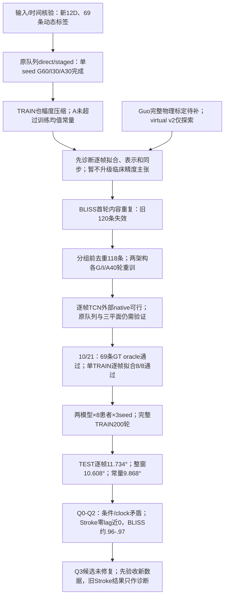
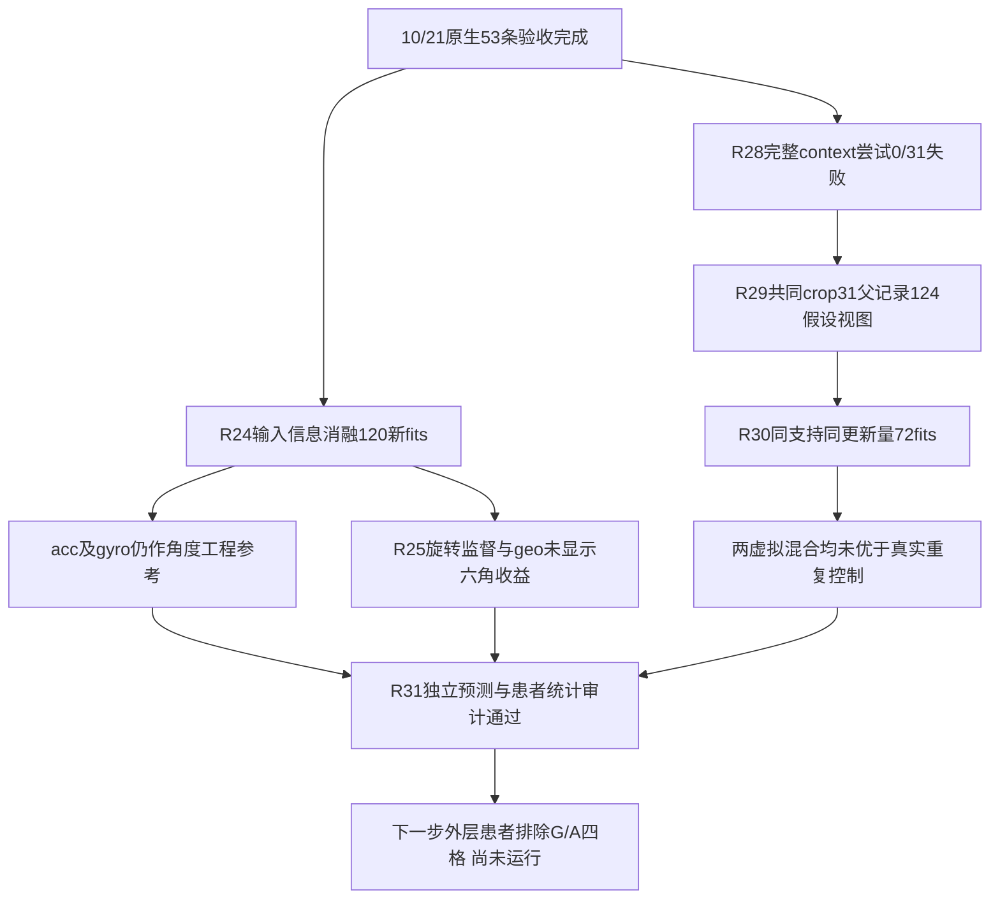
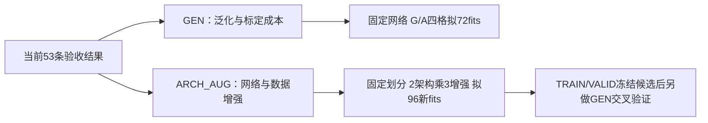

# 2026年11月20日硕士中期答辩大纲：泛化、适配与任务保真

**10/22泛化线结果验收：** [180次拟合与三批独立审计已完成](SII2027_GENERALIZATION_RESULTS_20261022_ZH.md)；真实源适配患膝2.949°，同标准化从零参考3.174°；低数据量曲线与虚拟源负结果均保留。[代码／合同索引](SII2027_GENERALIZATION_CODE_INDEX_20261022.json)。

**10/22双分支执行更新：** [GEN与ARCH_AUG已完成训练入口预检并启动](SII2027_RESEARCH_BRANCH_RUNS_20261022_ZH.md)；72与96次新增拟合按各自冻结合同推进。尚无新TEST结论，当前计数和验收边界见执行记录；[训练／分析代码索引](SII2027_RESEARCH_RUN_CODE_INDEX_20261022.json)。

**10/22研究分支更新：** 以已验收53条数据和结果为共同起点，分为[GEN：泛化与标定成本](SII2027_RESEARCH_FORK_20261022_ZH.md#gen)和[ARCH_AUG：网络架构与数据增强](SII2027_RESEARCH_FORK_20261022_ZH.md#arch_aug)。两个分支的角色／预算已预检，共享模型与静态旋转完成合成预检；规划冻结时新训练均为0，拟执行预算与旧成绩明确分开。

**10/22输入、监督表示与虚拟对照更新：** [192新增神经拟合、简单线性参考及独立验收](SII2027_NATIVE_ABLATIONS_20261022_ZH.md)完成。固定53真实数据/6患者TEST；3输入mask＋RotMSE/RotGeo，虚拟31TRAIN/124假设视图与同支持同21000步控制，失败context尝试也保留。所有种子及患者级配对结果见表；论文有标定方法但本地逐人安装值仍未知。当前为I_full，原E2的G/A外层患者排除尚未完成；不称临床JCS或真实安装等价。

更新：2026-10-21（Asia/Tokyo）；10/19大纲基础上回写代码与已完成实验。建议13页正文，讲述14分15秒，留45秒缓冲。结合BSN四页稿、SII七页稿、新论文包16篇及既有NMS/Embodied AI文献地图修订。完整证据、16篇定位与补验清单见[MIDTERM_LITERATURE_SYNTHESIS_20261019_ZH.md](MIDTERM_LITERATURE_SYNTHESIS_20261019_ZH.md)。本文件是文字大纲；实际答辩PPT仍未审阅。现已核验本地代码、日志与连续预测，历次尝试/目的/结果及源指纹见[实验决策台账](SII2027_EXPERIMENT_DECISIONS_20261020_ZH.md)。

## 1. 题目与一句话主线

**面向卒中患者运动重建的稀疏IMU模型泛化与个体适配研究**

**Generalization and Subject-Specific Adaptation of Sparse IMU Models for Motion Reconstruction in Stroke Patients**

如学校已备案其他正式题目，封面按备案题目填写，上述题目可作为研究副标题。

中心问题：**群体规律能在未见患者中保留多少运动信息；有限个体标定带来多少收益；这些收益能否保留到事件与关节运动学任务？**

工作一是双足输入→缺失小腿信号→事件一致性；工作二是双小腿输入→关节位置/旋转→指定投影角。二者共享问题与数据来源，各自的输入、监督、输出和参考不同；没有已验证的BSN→SII级联。

“个体特异性”在本硕士研究中指个体标定/适配的预测收益；不把所有患者差异归因于神经损伤。未来NMS、UWB和交互仅用于说明研究递进，不挤占本次结果。

## 2. 13页正文与讲述时间

| 页 | 标题/要回答的问题 | 主图或内容 | 时长 | 累计 |
|---|---|---|---:|---:|
| 1 | 稀疏IMU模型的泛化与个体适配 | 正式题目、姓名导师；一句话问题 | 0:20 | 0:20 |
| 2 | 减少佩戴观测后，哪些运动信息仍值得信任？ | 配置负担、卒中个体差异、事件/运动学两个任务 | 0:55 | 1:15 |
| 3 | 通用动捕已成熟，当前缺少哪些患者级证据？ | Guo临床近邻；TransPose/DynaIP/GRIP表示；Mundt/PNP合成与标定；本研究问题 | 1:10 | 2:25 |
| 4 | 怎样公平区分泛化、适配与测试？ | 两稿分支；共享队列；原始trial/real/virtual谱系；目标标定与测试 | 1:15 | 3:40 |
| 5 | 工作一：从双足恢复未测小腿信号 | 输入/输出、biRNN及架构比较、同人留出session；保留必要单位 | 0:50 | 4:30 |
| 6 | 工作一：信号误差与事件一致性是否同步改善？ | 每患者信号误差；IC/FC的P/R/F1和匹配误差；容差及失败例 | 1:10 | 5:40 |
| 7 | 工作二：从双小腿观测到关节运动状态 | 分阶段表示与投影角；输入朝向/骨盆框架与mocap角色 | 1:05 | 6:45 |
| 8 | 工作二：哪些运动信息实际恢复了？ | 原主8人投影膝结果与TRAIN/TEST幅度失败；外部pilot另标人群/参考 | 1:20 | 8:05 |
| 9 | 同一预算下，群体预训练和个体适配各贡献多少？ | G/I/A/C配对结果与患者点；负迁移；未完成项标状态 | 1:35 | 9:40 |
| 10 | 为这些收益需要付出多少标定成本？ | 低/中/完整预算；分钟数/唯一监督trial；I/A/C曲线与G参照 | 1:15 | 10:55 |
| 11 | 表示、合成数据与可获得输入的额外价值是什么？ | direct/staged、Guo骨干、context虚拟探索；BLISS去重与逐帧native角度pilot | 1:10 | 12:05 |
| 12 | 目前可以支持什么贡献，边界在哪里？ | 已完成证据、待补证据；离线/同次采集/参考/个体样本限制 | 1:05 | 13:10 |
| 13 | 本人贡献、投稿节点与后续问题 | 按实际分工填写；11/20中期与首投、1月底最终报告、2月交接；实时状态到辅助计算 | 1:05 | 14:15 |

45秒作为讲述缓冲。超过15分钟时，先缩第3页方法名和第7页网络细节，保留第4/9/10页的公平协议与核心比较。文献页不逐一朗读16篇；一张表讲清“已有能力—本研究待验证条件”。

## 3. 文献页具体写什么

建议一页只保留三组主要最近邻和一行未来方向：

| 组 | 代表工作 | 已经解决的能力 | 当前真正要检验 |
|---|---|---|---|
| 同任务/同人群 | Guo2025，两小腿IMU、慢性卒中 | 稀疏卒中运动学已有直接先例 | 在同输入、参考与预算下是否有新增收益 |
| 运动表示 | TransPose、DynaIP、GRIP | 分阶段位置/旋转/速度、物理重建已有 | 当前少量个体数据下中间表示是否值得使用 |
| 数据/标定 | Mundt、PNP、Li | 合成/真实、标定误差和迁移已有 | 母轨迹隔离、总监督成本和患者差异是否改变结论 |
| 后续边界 | ProbIP、UIP/UMotion/UDP及NMS控制地图 | 概率估计、几何融合、物理/患者控制各有进展 | 后续以任务、患者绑定和交互价值进一步限定问题 |

可讲：“我将这些方法视为已有技术基础，本次重点检验它们在卒中患者差异和有限标定条件下的实际价值。”不要说“通用方法都不能处理卒中”；没有实测该模型在本队列上的结果时，这仍是待检验问题。

## 4. 泛化与个体适配页的最小设计

| 组 | 定义 | 目标患者监督 |
|---|---|---|
| G | 其他患者预训练，排除目标real/virtual/派生样本后直接测试 | 0 |
| I(k) | 随机初始化，只用目标k预算 | k，包含训练/验证/早停标签 |
| A(k) | 从同一G初始化，用相同目标k适配 | 与I相同 |
| C(k) | 冻结G，仅做预定偏置或仿射校准 | 与I/A相同 |

每种任务固定架构/输出/参考、目标trial与有效时间范围。G的模型选择使用来源患者，不能用目标标签。目标virtual必须来自选入的同一k个母轨迹。G−A是适配收益，I−A是预训练收益，C−A是超出简单校准的收益。

SII优先完成完整主矩阵；BSN已有合规结果可复用，尚无的跨人结果如实标为待补。不要把BSN个体结果与SII群体结果比较，也不把不同物理量的RMSE混成一个总分。

第9页推荐画每患者配对点和差值；第10页用误差—标定分钟数曲线。全队列平均柱形图只能作概览。每患者先汇总试次，再患者等权；事件、窗口和种子不增加独立n。小样本区间和负迁移必须呈现。

## 5. 两稿的表述与结果边界

**BSN：** 原稿为100 Hz、225采样点窗口、受控7 m直行，个体训练后留出同人session。未核日期前不能称跨日；实际有效患者数按清单填写。加速度/角速度RMSE用各自单位，PCC仅描述对应通道。

当前事件参考为实测小腿算法，不是直接接触真值；P/R/F1与匹配后MAE并列，容差50/100/150/200 ms作为工程敏感性。若增加独立marker参考，实测与重建通道都对照它评价。虚拟信号不是新增独立测量，其价值是表示/先验或任务兼容性，后续用双足直接任务方法检验。

**SII原稿与新实验分开：** 已确认原24D含18D动态mocap姿态，且ACC被该姿态旋转；属于reference-assisted。新M路径固定12D实测ACC/GYRO，不含动态mocap特征，仍是已有固定重力预对齐的processed/offline路径。69条位置监督时间错误已在新入口修复。YZ/XZ/XY索引没有互换，但长轴投影不认证临床三维JCS，膝绝对值与踝零点限制保留。

当前稿件主评估8人、数据量5人，来源队列17人；各自角色和排除原因明确。总体PCC0.9974与RMSE2.968°核验前不作为整页结论；逐角度PCC0.872—0.986与逐患者结果更容易解释，不能直接用表格算术均值替换原总体值。踝角−40至−60°须解释零点、轴和投影定义。

当前已完成单seed同预算GIAC/direct-staged开发矩阵，但原主8人A动态幅度仍失败，不能以RMSE下降证明动态重建。Guo仅骨干对照完成，完整物理版仍受独立标定阻塞；虚拟v1因边界错误失效，context v2探索无稳定改善。BLISS首轮120条因重复内容污染验证而失效，去重118条已重跑。原Table VI跨研究数字放备份，不能据此宣称胜出。

**时间：** 中心窗口、双向结构和Hann融合按当前实现报告为离线估计；推理耗时快不等于满足实时。新增论文已有多种在线方法，第三篇须另以时序、预算和下游机械后果立题。

## 6. 可直接用于讲述的衔接句

开场：“我的研究关注卒中患者在有限可穿戴观测下的运动重建，重点考察群体模型如何泛化，以及少量个体数据能换来多少任务收益。”

两稿之间：“第一项工作检验未测小腿信号是否保留事件信息；第二项工作进一步估计关节运动状态。两项工作采用不同输入和参考，共同服务于有限观测下的个体运动评估。”

转入核心比较：“仅有重建精度还不能说明个体化是否值得。本研究把群体模型、纯个体学习、预训练适配和简单校准放在相同预算下比较。”

后续：“在运动状态可信之后，下一步研究它在实际可用时刻能否保留辅助指令所需的信息，再逐步引入独立力学或神经肌肉参考。”

## 7. 最低主图与备份

正文至少准备：两稿输入—监督—任务图；原始trial/real/virtual分组；BSN患者级信号/事件；SII患者×关节误差与ROM；G/I/A/C配对；标定成本曲线；必要direct/Guo/合成消融；本人贡献与实际节点。

备份：16篇文献对照表；完整纳排和每人试次数；骨盆/传感/世界坐标；6D到投影角；原始指标聚合口径；全部事件分母；Guo重实现细节；学习率搜索；未完成实验；真实跨日/佩戴及参考依赖限制；新论文不同模态和评价定义。

不要用空柱、假设数字或网络示意图代替未完成结果。某一实验尚未完成时，显示“已有证据—当前缺项—执行计划”，并在结论中限定表述。

## 8. 最可能的答辩问题

| 问题 | 回答依据 |
|---|---|
| 与已有稀疏动捕相比增加什么？ | 同人群近邻Guo为主；强调同预算结果和患者差异，不以网络部件或两传感器数量作唯一贡献 |
| 为什么不直接用GRIP或ProbIP？ | 任务、位置、模态和输出不同；给出可比条件，而非机械比较论文表格数字 |
| 适配有用是否因为多用了标签？ | 用同预算I(k)与A(k)区分，目标validation与virtual监督均计入成本 |
| 个体适配是否只是坐标偏置？ | C(k)为解释对照；相当时承认简化方法足够，不将复杂模型的必要性预设为结论 |
| 能否证明疾病特异机制？ | 当前是卒中人群内的预测泛化/个体适配；疾病特异机制需要新的对照与参考 |
| 虚拟IMU有何价值？ | 不增加独立测量；看它是否保留任务指标或方便迁移现成分析模块，需要直接任务对照 |
| 是否无需mocap就能用于新患者？ | 目标个体适配当前依赖相应监督；分钟数、trial及硬件需求如实报告 |
| 可以实时控制外骨骼吗？ | 当前离线；后续因果/时延验证和真实交互是不同实验层次 |
| 为什么不现在加UWB？ | 现有两稿先形成完整证据；新模态按下游状态可观测性和实际资源选择 |
| 你本人完成什么？ | 按实际代码、实验、分析和写作记录说明；SII合作作者分工核对后填写，作者顺序不代替事实 |

## 9. 从今天开始的交付节点

10/19—25完成关键审计和开发主对照；10/26—11/1完成患者级矩阵和预算；11/2—8补任务、统计与失败例，争取11/6完整期刊稿；11/12冻结中期图；11/13—19作者核验、投稿和排练；争取11/18—19首投，11/20为中期与首投目标。没有把此前排期自动记为已完成。

1月底最终报告与第三篇工作、2—3月返修和南科衔接沿用[半年路线](SIX_MONTH_EXECUTION_PLAN.md)。官方学位提交要求按老师通知执行。本次中期不展开博士三个Aim，也不因新读论文而新增一套大模型/硬件工程。

## 10. 已执行实验回写与答辩决策（2026-10-20）

完整代码入口、函数、预算、证据路径、各轮尝试与限制见[实验决策台账](SII2027_EXPERIMENT_DECISIONS_20261020_ZH.md)；[代码索引](SII2027_CODE_EVIDENCE_INDEX_20261020.json)含30个实际源文件指纹，[聚合CSV](SII2027_AGGREGATE_RESULTS_20261020.csv)保留队列与终点区分。

| 答辩页 | 可以展示的实际证据 | 必须保留的解释 |
|---|---|---|
| 4、7 | 原24D参考输入→新12D；位置时间修复；三平面已知姿态检查 | 索引未互换不等于临床JCS或新佩戴部署认证 |
| 8 | 原主8人A：direct10.192°、staged10.269°；TRAIN/TEST波形压缩 | 同k常量9.868°，现有结果不支持动态临床重建成立 |
| 9、10 | G/I/A/C及1/2/all嵌套预算；所有失败者和负迁移保留 | I/A均30轮；I−A是预训练收益，G−A不等于纯预训练收益 |
| 11 | Guo骨干、虚拟v1失败与v2修正；BLISS118条外部pilot | 不把骨干叫完整物理复现，不把模拟假设叫真实安装验证 |
| 11、12 | BLISS两名卒中A：窗口5.917°、逐帧2.023°；健康对照另列 | 六个native Angles X；非旧投影标签、非完整staged、非三平面临床认证 |
| 12 | 逐帧模型两卒中I2.210°→A2.023°，额外收益0.188° | n=2、单seed、目标个体trial间测试；不作疾病机制/跨session推断 |

现有BSN四容差结果来自存量单人三传感LSTM导出重算，不能放成新的双足跨患者实验。原文数值按用户说明不作为新稿复现目标。10/21两模型I(full)三seed已完成；G/A/staged的正式多seed、临床JCS、完整Guo物理、BSN独立接触参考及跨患者实验仍未完成，不通过删除门槛赶日期。

## 11. 10/21动态诊断与叙事更新

[R00–R03尝试、目的、代码及结论](SII2027_DYNAMIC_DIAGNOSIS_20261021_ZH.md)补齐原队列验证：TRAIN可拟合，TEST仍失败。答辩第8/11页应并列展示TRAIN1.667°与TEST11.734°，及整窗10.608°/常量9.868°；不能用ROM接近GT代表时序准确。三seed仅适用于本次I(full)两模型，不覆盖旧G/A或staged矩阵。7条固定TRAIN marker核验支持坐标正向，临床JCS仍待独立依据。改变核心思路前与用户沟通，新稿不追原文数字。

## 12. 数据可靠性复核对答辩的影响

[Q0–Q4](SII2027_DATA_RELIABILITY_20261021_ZH.md)补充条件来源、同步契约、TRAIN物理信号、候选失败和共同I双膝比较。原Stroke主矩阵与88次诊断训练只说明当前配对数组上的行为，不能作为模型或患者生理泛化结论。中期优先展示数据来源与失败定位；新配对验收前不扩大G/A/合成。BLISS可作native正对照，若改主队列先沟通。

## 10/21新增：原数据组合配对修复（R04–R08）

[详细尝试/目的/结果与新决策树](SII2027_PAIRING_REPAIR_20261021_ZH.md)、[源码函数/行号/SHA](SII2027_REPAIR_CODE_INDEX_20261021.json)、[全部聚合与固定种子结果](SII2027_REPAIR_AGGREGATES_20261021.csv)。原PDF唯一源窗→39 TRAIN前置动作开发→冻结69条应用，18条候选；2患者、6 TRAIN/3 TEST的固定配对模型恢复，表明先修复输入配对有必要。不能分离纯时间、试次身份和条件来源的单独贡献。

正式释放仍待上游重力/滤波支持、现场条件/安装及物理split验收；不把QC筛选子集或mocap离线校时描述成未见患者/实时IMU-only验证。主线保持双小腿实测IMU估计下肢运动学；正式G/I/A、逐帧与整窗比较须在验收新数据版本后继续。历史数字保留，不按原文不保真数字反推实验。

## 10/21采集者补充后的执行（R09–R12）

[原始源、抬健侧腿标记、S6与17条native候选](SII2027_RAW_ACQUISITION_20261021_ZH.md)、[函数/行号/SHA](SII2027_RAW_SOURCE_CODE_INDEX_20261021.json)、[聚合数据](SII2027_RAW_SOURCE_AGGREGATES_20261021.csv)。安装左右语义已由采集者确认；实验室轴、固定安装旋转与clinical JCS仍需分别验收。216原始文件/16加工源桥接已建立；17条native重建不沿用旧全记录滤波/旋转，但继承原离线clock/QC，旧2.205°不能转记为新版本成绩。

原患侧表与标记侧有2例待核，11条缺原光学；未用拐时S6也可能被携带，运动不能等同承重。下一步先确认标记事件和native预处理支持，再冻结正式实验；不据网络误差改条件、侧别或lag。旧阶段“安装未闭合”指其当时证据，最新采集者确认与剩余坐标问题以本次更新为准。

## 10/21新增：mocap少于IMU时的顺序/跳段配对（R13–R16）

[完整方法、尝试和结果](SII2027_ORDERED_MATCHING_20261021_ZH.md)、[源码函数/行号/SHA](SII2027_ORDERED_CODE_INDEX_20261021.json)、[聚合数据](SII2027_ORDERED_AGGREGATES_20261021.csv)。156原始光学中只有58属于当前有固定监督步态边界的69目标；另98未自动入组。164是IMU单侧重复动作候选，不是真实行走计数。未匹配IMU可能属于未选光学，不能等同漏采。

旧PDF同尾号绑定已降为历史假设，组内有序、组间另核来自用户确认。前置块决定候选与全局路径，步行仅后验验收且失败不重选。49原始候选仍依赖有限detector候选集和离线光学校时，正式释放false；下一步补候选召回与S6/预处理验收，再冻结新版本重训。旧数据和模型保留，未追逐原文不保真数值。

## 10/21新增：标记漏检的统一修复与回归（R17–R18）

[完整尝试、目的、代码职责和结论](SII2027_MARKER_RECALL_20261021_ZH.md)、[函数/行号/SHA](SII2027_RECALL_CODE_INDEX_20261021.json)、[聚合数据](SII2027_RECALL_AGGREGATES_20261021.csv)。

两条漏检源自标记后的活动并入峰组，导致整组对侧RMS超限。保留0.35rad/s及比值3等原门槛，全部18session统一枚举极大有效子窗；没有按旧时钟补单例。新增14动作提案，最终多4条验收；旧49同步时钟完全不变。真实同号绑定仍被弃用，两个条件各自保序、共享源且允许跳段。

物理身份反事实排除整类别名，10ms实际源区间隔与原始行非复用仍有效；当前311有效边无实际别名重复，因此结果改善来自新子窗。路径先冻结、步行后验收，失败不重选。剩余16/69未验收继续保留原因（11无模板、2侧别/模式、1无路径、2验收失败）。

本轮数据召回工作完成，正式训练就绪仍为false。下一步补53条S6证据及预处理/坐标合同，再冻结并重训；测试mocap用于离线修复，不称完全未接触测试集，不继承原2.205°模型分数。历史49版结果保留供对照。

## 10/21新增：原生53条工程训练版本与固定基线（R19–R22）

[完整目的、尝试、结论与决策树](SII2027_NATIVE_BASELINE_20261021_ZH.md)、[源码函数/行号/SHA](SII2027_NATIVE_CODE_INDEX_20261021.json)、[全部聚合指标](SII2027_NATIVE_AGGREGATES_20261021.csv)。

本轮完成此前计划的S6、输入和坐标合同：26目录有拐/27目录无拐的S6运动模式相容，未改条件或删人；53条原生SI和几何通过，三平面索引没有混淆，原生sensor XYZ与骨盆解剖轴严格区分。训练只用各患者TRAIN唯一帧拟合统计量，不再默认旧gravity加工输入或移植旧模型成绩。

固定24fits（8患者×3seed）全部200epoch，每10epoch在各人VALID择checkpoint，全部验签后统一TEST。原角色31/12/10、TEST6人；两人只有TRAIN/VALID；有一位患者VALID/TEST条件不同。连续源CSV跨角色共享但原生采样支持无重用，不能称文件级独立。

患者内真实IMU基线及TRAIN均值结果见表；旧2.205°是不同输入和分母的历史探索，不作直接增益比较。全部种子和10条TEST保留，212预测/1272角度指标完整审计。数据工程训练就绪不等于临床最终认证；下一步围绕冻结版本补输入/表示/虚拟数据消融，跨患者需另立协议，改临床输出或主队列须先讨论。

## 10/22新增：I_full信息、监督表示与假设虚拟对照（R23–R31）

[实验目的、每次尝试及结论](SII2027_NATIVE_ABLATIONS_20261022_ZH.md)、[函数/行号/SHA](SII2027_ABLATION_CODE_INDEX_20261022.json)、[聚合结果](SII2027_ABLATION_AGGREGATES_20261022.csv)、[患者配对差](SII2027_ABLATION_PAIRED_20261022.csv)。

本批实际是3输入信息组、2个Rot6D监督/损失组，共120新fits；另3个同共同crop/同4视图/同21000步的真实重复与假设虚拟组，共72新fits。简单当前帧Ridge参考8模型/48VALID候选另列，不能称完整Guo框架复现。旧raw12参考24fits只读复用。全数据角色和测试段不变，1537预测记录/9222角度指标与额外1908SO3指标可追溯，N仍为6测试患者。

虚拟完整context首次0/31失败；共同裁剪后31TRAIN/124视图，12665训练目标帧及18865参考context成本分别记账。原论文有sensor-to-segment标定方法，当前没有逐人实际安装数值，不把假设模拟提升为已标定真实IMU。输入轴与原六投影角含义保持不变。

每患者统计先汇总trial/seed再等患者，64种符号翻转与Holm保持原定义；不能为显著性把窗口/种子当患者或更换检验。本轮未完成原E2的外层患者G/A2×2：下一批需source彻底排除目标、两A共用同target真实适配并记VALID参考成本。草案已在本地形成，不冒充已运行结果。

节点对应代码、函数/行号/SHA及数值结论见本节链接；旧阶段流程保留为历史尝试，不能将其数值转记为本次原生结果。

## 10/22分支决策（R32–R35）

用户决定以当前结果为分支点，分别研究泛化和网络架构／数据增强。[完整分支图、目的、控制与计划](SII2027_RESEARCH_FORK_20261022_ZH.md)、[代码函数／行号／SHA](SII2027_RESEARCH_FORK_INDEX_20261022.json)。

GEN固定当前网络，先做排除目标患者的G/A×source真实／混合四格（拟72fits），再研究标定成本和独立跨条件／外部协议。ARCH_AUG固定当前患者内划分，用2架构×3增强解耦效果和交互（144逻辑fits，48旧复用、96拟新增）；首阶段24新fits仅TRAIN/VALID，全矩阵完成后统一新TEST。

规划冻结时两个分支尚无新训练结果。当前6名TEST患者与历史接触边界保留；不以窗口／seed扩大N，不把目录条件或投影角升级为临床真值。架构候选以后迁入GEN需另立交叉协议，避免从同一TEST反复选择后宣称独立确认。

## 10/22执行补记

**10/22双分支执行更新：** [GEN与ARCH_AUG已完成训练入口预检并启动](SII2027_RESEARCH_BRANCH_RUNS_20261022_ZH.md)；72与96次新增拟合按各自冻结合同推进。尚无新TEST结论，当前计数和验收边界见执行记录；[训练／分析代码索引](SII2027_RESEARCH_RUN_CODE_INDEX_20261022.json)。

规划和模块合成预检记录保留为分支冻结时事实；后续训练、正式评估及独立结果验收分别记录，不将拟执行次数或启动状态写成最终精度结论。

## 泛化结果验收补记

**10/22泛化线结果验收：** [180次拟合与三批独立审计已完成](SII2027_GENERALIZATION_RESULTS_20261022_ZH.md)；真实源适配患膝2.949°，同标准化从零参考3.174°；低数据量曲线与虚拟源负结果均保留。[代码／合同索引](SII2027_GENERALIZATION_CODE_INDEX_20261022.json)。

此前启动计数保留为当时快照；GEN已完成固定分析及独立结果验收，具体边界、标定量账目和后续决策见新结果页。
