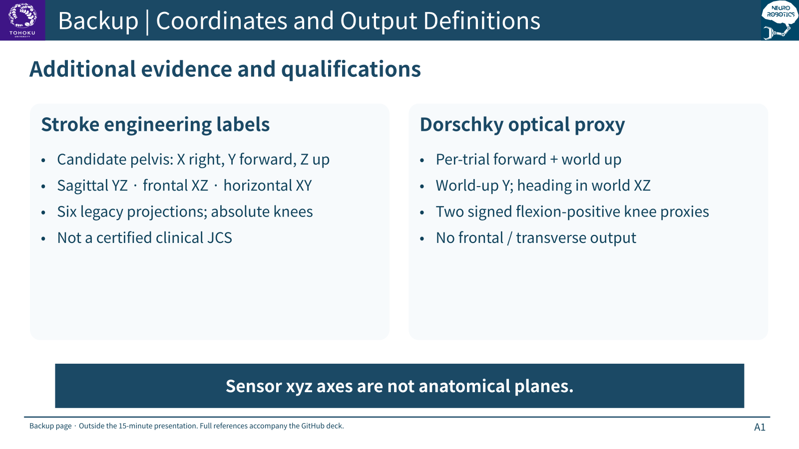
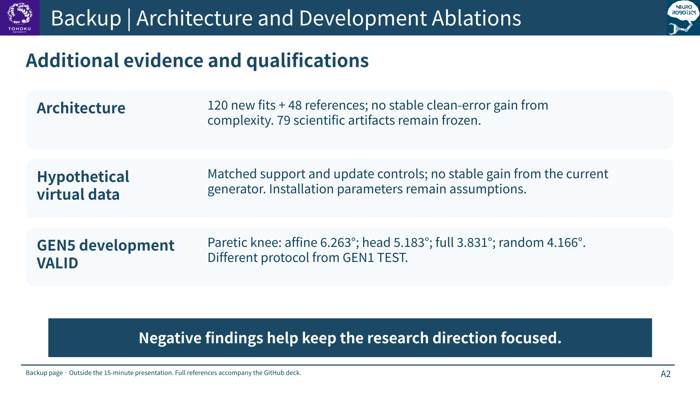
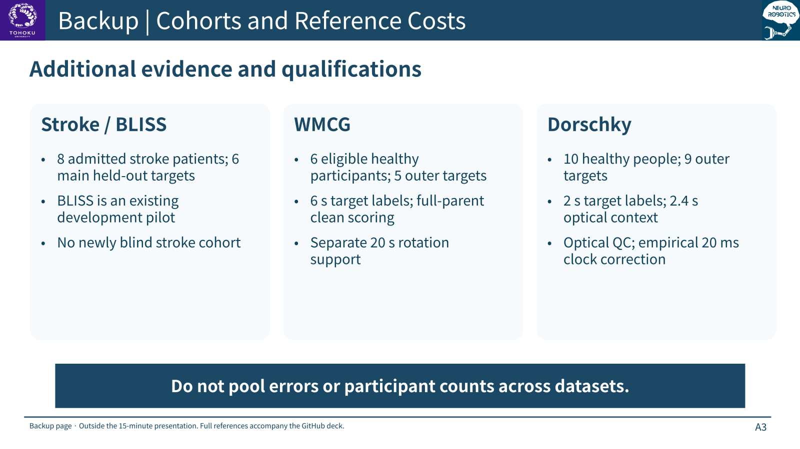
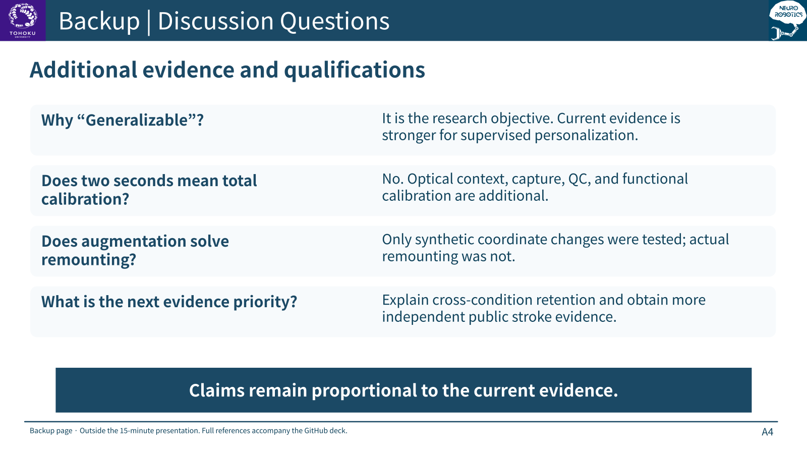

# Backup slides and references

These pages are outside the 15-minute talk. [Return to the presentation](MIDTERM_DEFENSE_20261027_EN.md).

## A1 · Coordinates and label definitions

## A2 · Architecture, virtual-data and GEN5 results

## A3 · Cohorts and reference costs

## A4 · Likely questions

## Primary research references

- **R1.** Sánchez N, et al. Multi-Site Identification and Generalization of Clusters of Walking Behaviors in Individuals With Chronic Stroke and Neurotypical Controls. Neurorehabilitation and Neural Repair. 2023;37(11–12):810–822. DOI: 10.1177/15459683231212864. [Primary source](https://pubmed.ncbi.nlm.nih.gov/37975184/).
- **R2.** Kettlety SA, et al. Speed-dependent biomechanical changes vary across individual gait metrics post-stroke relative to neurotypical adults. Journal of NeuroEngineering and Rehabilitation. 2023;20:14. DOI: 10.1186/s12984-023-01139-2. [Primary source](https://link.springer.com/article/10.1186/s12984-023-01139-2).
- **R3.** Guo Y, et al. Physics-Informed Learning Framework for Lower Limb Kinematic Prediction With Sparse Sensors and Its Application in Chronic Stroke. IEEE TNSRE. 2025;33:2475–2486. DOI: 10.1109/TNSRE.2025.3581352. [Primary source](https://ieeexplore.ieee.org/document/11044411/).
- **R4.** Hur B, Baek S, Kang I, Kim D. Learning based lower limb joint kinematic estimation using open source IMU data. Scientific Reports. 2025;15:5287. DOI: 10.1038/s41598-025-89716-4. [Primary source](https://www.nature.com/articles/s41598-025-89716-4).

- **R5.** Huang Y, Kaufmann M, Aksan E, Black MJ, Hilliges O, Pons-Moll G. Deep Inertial Poser: Learning to Reconstruct Human Pose from Sparse Inertial Measurements in Real Time. ACM Transactions on Graphics / SIGGRAPH Asia. 2018;37(6):185. [Author project and paper](https://dip.is.tue.mpg.de/).
- **R6.** Yi X, Zhou Y, Xu F. TransPose: Real-time 3D Human Translation and Pose Estimation with Six Inertial Sensors. ACM Transactions on Graphics / SIGGRAPH. 2021;40(4):86. DOI: 10.1145/3450626.3459786. [Author project and paper](https://xinyu-yi.github.io/TransPose/).
- **R7.** Yi X, Zhou Y, Habermann M, Shimada S, Golyanik V, Theobalt C, Xu F. Physical Inertial Poser (PIP): Physics-aware Real-time Human Motion Tracking from Sparse Inertial Sensors. CVPR. 2022. [Author project](https://xinyu-yi.github.io/PIP/) · [Primary paper](https://arxiv.org/abs/2203.08528).
- **R8.** Polese JC, et al. The effects of walking sticks on gait kinematics and kinetics with chronic stroke survivors. Clinical Biomechanics. 2012;27(2):131–137. DOI: 10.1016/j.clinbiomech.2011.08.003. [Primary source](https://pubmed.ncbi.nlm.nih.gov/21889240/).

These studies motivate the questions; their participants and best errors are not added to our evaluation. No paper figures or full texts are reproduced. Ordinary fine-tuning and two-IMU prediction are prior work, not new algorithm claims.

The six-sensor full-body setups of DIP, TransPose, and PIP use calibrated acceleration and orientation; they are distinct from the present two-shank ACC/GYRO engineering task. Their training uses motion-capture-derived synthetic signals and real-IMU refinement for relevant modules. Those benchmarks do not establish stroke-specific transfer. See the [TransPose training section](https://arxiv.org/html/2105.04605) and [PIP main paper and supplement](https://arxiv.org/pdf/2203.08528).

Stroke-gait descriptions summarize possible, patient-dependent patterns. The inference that transfer should be tested is a research motivation, not an experimental finding that a named method fails. The walking-stick study reports changes in speed and power, without significant changes in maximum joint angles. No gait curves or patient measurements were invented for the conceptual schematics.

## Project evidence

- **E1.** [Accepted stroke release and patient-specific baseline](SII2027_NATIVE_BASELINE_20261021_ZH.md).
- **E2.** [Ordered trial matching and marker recall](SII2027_MARKER_RECALL_20261021_ZH.md).
- **E3.** [Stroke GEN1 / GEN2 transfer and budget results](SII2027_GENERALIZATION_RESULTS_20261022_ZH.md).
- **E4.** [Frozen architecture and augmentation results](SII2027_ARCH_AUG_RESULTS_20261022_ZH.md).
- **E5.** [Accepted WMCG public-data experiment](SII2027_OPEN_EXTERNAL_VALIDATION_20261023_ZH.md).
- **E6.** [Accepted Dorschky optical two-knee experiment](SII2027_DORSCHKY_EXTERNAL_20261024_ZH.md).
- **E7.** [Three-level publication and research roadmap](MIDTERM_THEME_AND_PUBLICATION_ROADMAP_20261027_ZH.md).

The source experiment reports retain their original Chinese filenames and historical status. The presentation and spoken script are entirely English. Current stroke outputs are legacy pelvis-plane engineering angles; Dorschky outputs are signed heading-sagittal optical proxies. Raw IMU/marker samples, per-frame predictions, weights, and full papers are not included in this presentation package.
