# Generalizable and Personalized Motion Reconstruction in Stroke Patients Using Sparse IMUs

**Yincheng Wang** · Supervisor: **Mitsuhiro Hayashibe**  
**Tohoku University · Robotics** · Graduate research / midterm defense · **27 October 2026**

English visual presentation and English speaking script. **14 main slides: 14 min 30 s + 30 s buffer.** Four backup slides are outside the timed talk. Timing is a rehearsal target, not a measured delivery recording.

**Format update — 25 October 2026:** Rebuilt in the supplied Kemmochi thesis-slide style: blue headers, institutional logos, gray panels, a blue takeaway bar, and a 16:9 canvas. The 14 main slides, four backup slides, English speaking script, research values, and conclusions are retained. [Formatting review](MIDTERM_DEFENSE_20261027_FORMAT_REVIEW.json).

Each 16:9 slide is a GitHub-native SVG. Click an image to inspect it at full size. Expand **Speaker notes** to rehearse. All numerical results come from existing independently checked experiments; no new training or model selection was performed for this presentation.

[Continuous speaking script](MIDTERM_DEFENSE_20261027_SPEAKER_NOTES_EN.md) · [Backup slides and references](MIDTERM_DEFENSE_20261027_APPENDIX_EN.md) · [Evidence manifest](MIDTERM_DEFENSE_20261027_EVIDENCE.json)

| Slide | Topic | Time | Cumulative |
|---|---|---:|---:|
| [01](#slide-01) | Generalizable and Personalized Motion Reconstruction in Stroke Patients Using Sparse IMUs | 00:20 | 00:20 |
| [02](#slide-02) | Stroke gait requires both shared models and individual attention | 01:05 | 01:25 |
| [03](#slide-03) | Sparse wearable sensing trades measurement coverage for convenience | 00:55 | 02:20 |
| [04](#slide-04) | Sparse reconstruction and personalization already have strong precedents | 01:05 | 03:25 |
| [05](#slide-05) | Separate population transfer from the value of individual labels | 01:00 | 04:25 |
| [06](#slide-06) | Reliable pairing is a prerequisite for a meaningful learning result | 01:15 | 05:40 |
| [07](#slide-07) | Keep the network fixed and make the evaluation roles explicit | 01:15 | 06:55 |
| [08](#slide-08) | Verified inputs recover patient-specific motion beyond a constant baseline | 00:45 | 07:40 |
| [09](#slide-09) | Individual supervision matters; pretraining adds a modest further benefit | 01:20 | 09:00 |
| [10](#slide-10) | Personalization benefits depend on how much target reference is available | 01:15 | 10:15 |
| [11](#slide-11) | Public healthy cohorts provide technical replication across walking speeds | 01:15 | 11:30 |
| [12](#slide-12) | Direction augmentation reduces sensitivity, with a clean-error trade-off | 01:00 | 12:30 |
| [13](#slide-13) | The current contribution is an auditable study of personalization and its limits | 01:15 | 13:45 |
| [14](#slide-14) | From a complete exploratory study to stronger publication evidence | 00:45 | 14:30 |

---

## 01 · Generalizable and Personalized Motion Reconstruction in Stroke Patients Using Sparse IMUs

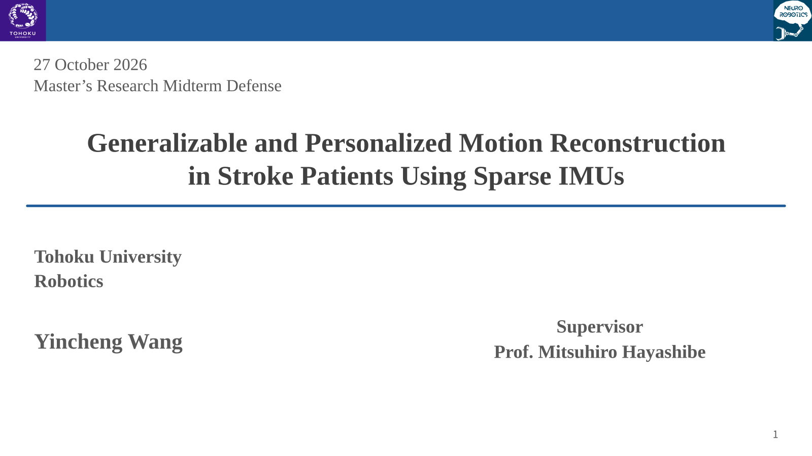

**Message:** Population knowledge, individual adaptation, and condition robustness.

Speaker notes · 00:20 · 00:00–00:20

Good morning. I am Yincheng Wang from Tohoku University, supervised by Professor Mitsuhiro Hayashibe. Today I will present my progress on motion reconstruction from sparse IMUs, focusing on how population knowledge can support personalized reconstruction in stroke patients.

[Contents](#generalizable-and-personalized-motion-reconstruction-in-stroke-patients-using-sparse-imus) · [Next slide](#slide-02)

---

## 02 · Stroke gait requires both shared models and individual attention

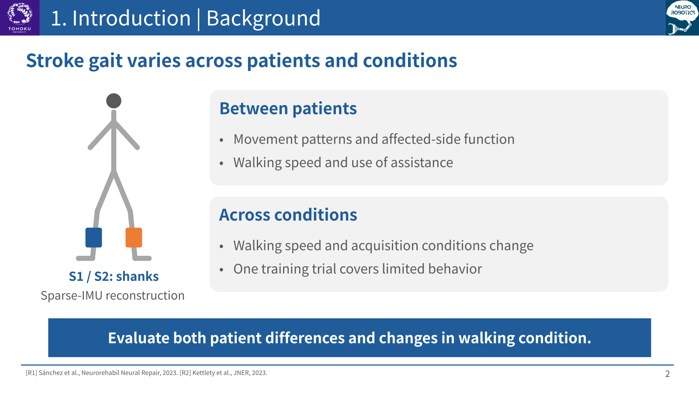

**Message:** A useful reconstruction model must accommodate both patient and condition differences.

Speaker notes · 01:05 · 00:20–01:25

The clinical motivation is that post-stroke gait is heterogeneous. Patients can differ in movement patterns, walking speed, and the use of assistance. These differences are relevant when we try to interpret a reconstructed joint trajectory. Published multi-site work has identified different walking-behavior clusters, while speed-dependent studies show that different gait measures do not change in the same way. These studies motivate our evaluation; they do not validate our model. The practical question is therefore more specific than whether a network can predict an average walking pattern. We want to know which relationships can be learned across people, which information must come from the individual, and whether the resulting reconstruction remains useful when the walking condition changes. Our present outcome is motion reconstruction, rather than diagnosis or treatment efficacy.

Sources: [R1: Sánchez et al., 2023 · Between-patient and site heterogeneity](https://pubmed.ncbi.nlm.nih.gov/37975184/) · [R2: Kettlety et al., 2023 · Speed-dependent changes after stroke](https://link.springer.com/article/10.1186/s12984-023-01139-2)

[Contents](#generalizable-and-personalized-motion-reconstruction-in-stroke-patients-using-sparse-imus) · [Next slide](#slide-03)

---

## 03 · Sparse wearable sensing trades measurement coverage for convenience

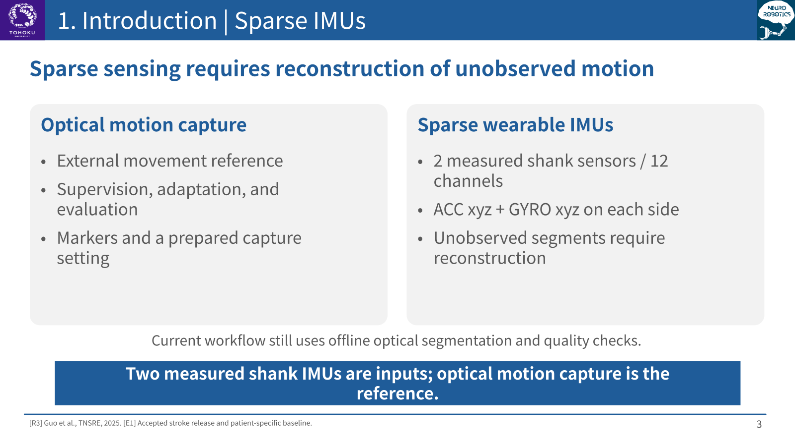

**Message:** Two shank IMUs provide measured inputs; optical motion capture provides the reference.

Speaker notes · 00:55 · 01:25–02:20

Optical motion capture provides an external reference for movement analysis, but requires markers and a prepared measurement setting. Wearable IMUs offer a more compact observation system. However, reducing the number of sensors also removes direct observations of some body segments. Two shank sensors do not directly measure every thigh and foot movement needed for lower-limb kinematics. Reconstruction therefore relies on learned relationships as well as measured signals. In this project, the model inputs are measured acceleration and angular velocity from the two shanks. Optical data remain necessary for supervised training, individual adaptation, and evaluation. Current segmentation and quality checks also use offline reference information, so we have not yet demonstrated a complete continuous, IMU-only deployment pipeline.

Sources: [R3: Guo et al., 2025 · Two-IMU physics-informed prediction](https://ieeexplore.ieee.org/document/11044411/) · [E1: Accepted stroke release and patient-specific baseline](SII2027_NATIVE_BASELINE_20261021_ZH.md)

[Contents](#generalizable-and-personalized-motion-reconstruction-in-stroke-patients-using-sparse-imus) · [Next slide](#slide-04)

---

## 04 · Sparse reconstruction and personalization already have strong precedents

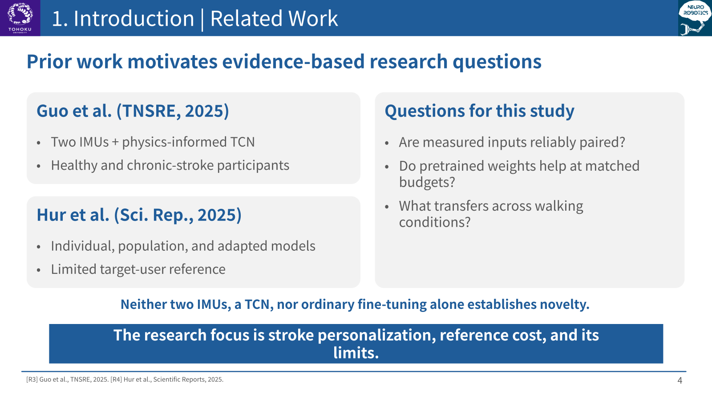

**Message:** Our focus is the evidence for stroke personalization, its reference cost, and its limits.

Speaker notes · 01:05 · 02:20–03:25

Two studies are particularly close to this work. Guo and colleagues investigated lower-limb kinematic prediction using two IMUs and a physics-informed temporal convolutional network, including chronic-stroke participants. Our current FrameTCN is not a reproduction of that complete physics-informed method. Hur and colleagues compared individual-user models, population models, and fine-tuning with a small amount of target-user data. Therefore, neither two sensors, a TCN, nor ordinary fine-tuning is sufficient as our novelty claim. The question we pursue is the strength of the evidence in a stroke setting: are the measured signals and references reliably paired, does pretraining help beyond the target labels alone, how much reference is actually needed, and which benefits persist outside the adapted trial or condition? The studies use different inputs and labels, so their reported errors are not direct numerical baselines for our experiments.

Sources: [R3: Guo et al., 2025 · Two-IMU physics-informed prediction](https://ieeexplore.ieee.org/document/11044411/) · [R4: Hur et al., 2025 · Individual, population, and adapted models](https://www.nature.com/articles/s41598-025-89716-4)

[Contents](#generalizable-and-personalized-motion-reconstruction-in-stroke-patients-using-sparse-imus) · [Next slide](#slide-05)

---

## 05 · Separate population transfer from the value of individual labels

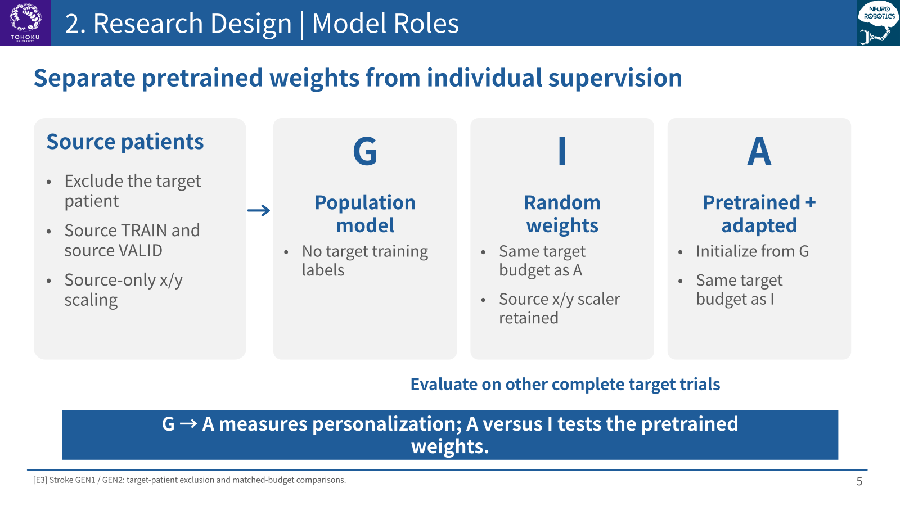

**Message:** G to A measures the effect of personalization; A versus I tests pretrained weights.

Speaker notes · 01:00 · 03:25–04:25

I use three model roles to separate these questions. G is a population model whose source training, scaling, and source validation exclude the target patient. It receives no target training labels. A starts from G and adapts using a limited amount of paired data from that patient. I starts from random weights and receives the same target training budget as A. Evaluation then uses other complete trials from the target patient. The large difference between G and A reflects the availability of individual supervision as well as adaptation. The comparison between A and I is the more appropriate test of the pretrained weights. In these experiments, I still uses the source input and output scaling statistics, so it is not completely free of source information.

Sources: [E3: Stroke GEN1 / GEN2 transfer and budget results](SII2027_GENERALIZATION_RESULTS_20261022_ZH.md)

[Contents](#generalizable-and-personalized-motion-reconstruction-in-stroke-patients-using-sparse-imus) · [Next slide](#slide-06)

---

## 06 · Reliable pairing is a prerequisite for a meaningful learning result

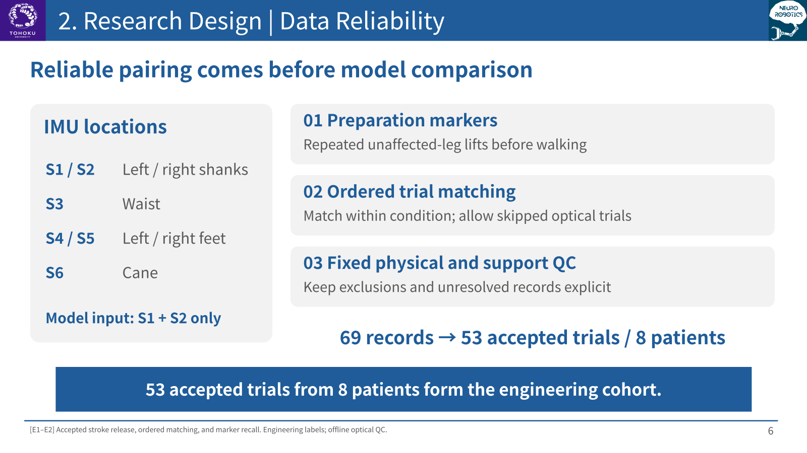

**Message:** The accepted engineering cohort contains 53 trials from 8 patients, with explicit exclusions.

Speaker notes · 01:15 · 04:25–05:40

Before comparing learning strategies, I revisited the data pipeline. The original acquisition used six IMUs. S1 and S2 are the left and right shanks and are the only sensors used by the reconstruction model. The other sensors help describe the acquisition, but do not become extra model inputs. Patients repeatedly lifted the unaffected leg before walking. These preparation movements provide candidate alignment markers. Optical trials are fewer than IMU walking segments, so matching must preserve order within each condition while allowing skipped segments. Combining this evidence with fixed physical and support checks produced fifty-three accepted trials from eight patients, out of sixty-nine original target records. Six patients contribute the main held-out test trials. The other sixteen records retain explicit unresolved reasons. Cane-sensor motion is consistent with the directory conditions in the accepted release, but motion alone does not certify cane contact or load bearing.

Sources: [E1: Accepted stroke release and patient-specific baseline](SII2027_NATIVE_BASELINE_20261021_ZH.md) · [E2: Ordered trial matching and marker recall](SII2027_MARKER_RECALL_20261021_ZH.md)

[Contents](#generalizable-and-personalized-motion-reconstruction-in-stroke-patients-using-sparse-imus) · [Next slide](#slide-07)

---

## 07 · Keep the network fixed and make the evaluation roles explicit

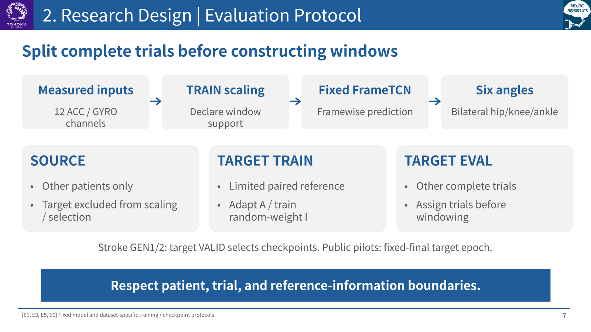

**Message:** Split complete trials before windowing, and charge all reference information to its role.

Speaker notes · 01:15 · 05:40–06:55

The main reconstruction model is a fixed FrameTCN. Twelve measured acceleration and angular-velocity channels are standardized and mapped to framewise engineering angles. For the stroke task, these are six bilateral hip, knee, and ankle projections. Overlapping windows are fused into one prediction per evaluated frame. We split complete trials before constructing windows, and estimate scaling statistics only from the declared source or training support. For the original stroke transfer experiments, target validation trials select checkpoints and therefore consume additional reference. The later public-data pilots instead use a fixed final adaptation epoch. These are different protocols and must remain separate. The goal is not to claim a new architecture. It is to compare the roles of population training and individual data under explicit budgets, while recording reference costs, selection procedures, and the limits of the output definition. All results shown here have passed independent numerical checks.

Sources: [E1: Accepted stroke release and patient-specific baseline](SII2027_NATIVE_BASELINE_20261021_ZH.md) · [E3: Stroke GEN1 / GEN2 transfer and budget results](SII2027_GENERALIZATION_RESULTS_20261022_ZH.md) · [E5: Accepted WMCG public-data experiment](SII2027_OPEN_EXTERNAL_VALIDATION_20261023_ZH.md) · [E6: Accepted Dorschky optical two-knee experiment](SII2027_DORSCHKY_EXTERNAL_20261024_ZH.md)

[Contents](#generalizable-and-personalized-motion-reconstruction-in-stroke-patients-using-sparse-imus) · [Next slide](#slide-08)

---

## 08 · Verified inputs recover patient-specific motion beyond a constant baseline

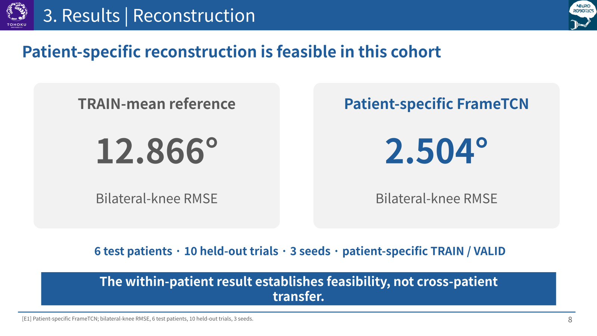

**Message:** Patient-specific reconstruction is feasible on the accepted data; this is not cross-patient transfer.

Speaker notes · 00:45 · 06:55–07:40

As a feasibility check, we first train a separate model for each patient. On ten held-out trials from six patients, the bilateral-knee error is about two point five degrees, compared with about twelve point nine degrees for the training-mean constant reference. This shows that the verified inputs contain useful dynamic information. It does not establish generalization to a new patient, because each model already uses that patient's training and validation trials. This bilateral-knee endpoint differs from the paretic-knee endpoint used next.

Sources: [E1: Accepted stroke release and patient-specific baseline](SII2027_NATIVE_BASELINE_20261021_ZH.md)

[Contents](#generalizable-and-personalized-motion-reconstruction-in-stroke-patients-using-sparse-imus) · [Next slide](#slide-09)

---

## 09 · Individual supervision matters; pretraining adds a modest further benefit

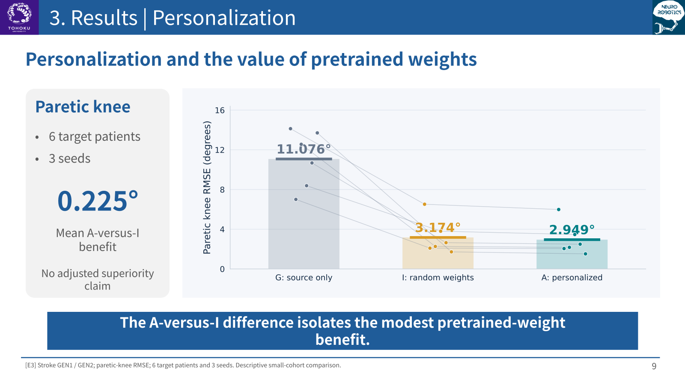

**Message:** The strongest current stroke evidence supports personalization, not reliable zero-label transfer.

Speaker notes · 01:20 · 07:40–09:00

This is the central stroke comparison. The source model G has a mean paretic-knee error of about eleven point one degrees. With the full target training budget, the random-weight reference I reaches about three point one seven degrees, while adaptation A reaches about two point nine five degrees. Each line represents one of six target patients, after aggregating trials and seeds. The substantial improvement from G to either target-trained model shows how important individual reference data are. The smaller difference between I and A, about zero point two two five degrees on average, is the benefit attributable to pretrained weights under this comparison. All six patients improve in that paired comparison, but the small cohort does not establish a multiple-testing-adjusted superiority claim. I also retains source scaling information, and source pretraining adds computation. The evidence therefore supports useful personalization with a modest additional pretraining benefit.

Sources: [E3: Stroke GEN1 / GEN2 transfer and budget results](SII2027_GENERALIZATION_RESULTS_20261022_ZH.md)

[Contents](#generalizable-and-personalized-motion-reconstruction-in-stroke-patients-using-sparse-imus) · [Next slide](#slide-10)

---

## 10 · Personalization benefits depend on how much target reference is available

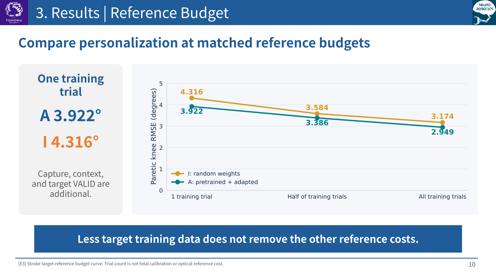

**Message:** Compare A and I within each budget; do not interpret one trial as a complete calibration cost.

Speaker notes · 01:15 · 09:00–10:15

We next reduce the target training budget using a predefined nested trial selection. With one training trial, adaptation reaches about three point nine two degrees, compared with four point three two for random initialization. At half and full budgets, both methods improve, with adaptation retaining a lower average error. However, half-budget adaptation still does not reach the accuracy of full-budget random-weight training. This prevents a stronger claim that we can simply halve the reference requirement without losing accuracy. The horizontal axis counts selected training trials, not total clinical collection time. Full reference capture, preprocessing context, and target validation are additional costs. More data also change motion coverage and optimization exposure, so comparisons across budgets are descriptive. The cleanest evidence is the comparison between A and I within each matched budget.

Sources: [E3: Stroke GEN1 / GEN2 transfer and budget results](SII2027_GENERALIZATION_RESULTS_20261022_ZH.md)

[Contents](#generalizable-and-personalized-motion-reconstruction-in-stroke-patients-using-sparse-imus) · [Next slide](#slide-11)

---

## 11 · Public healthy cohorts provide technical replication across walking speeds

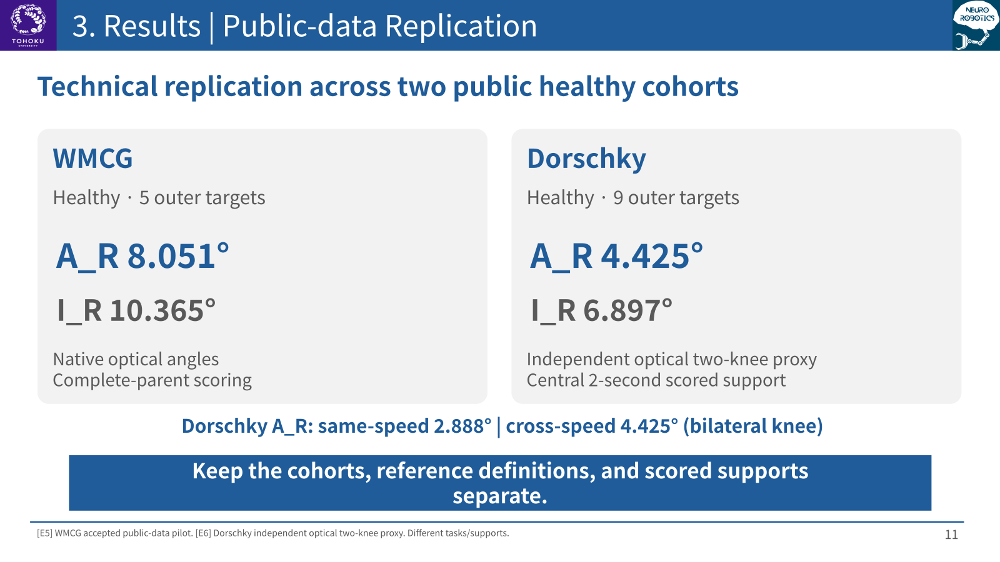

**Message:** Adaptation also helps in public-data pilots, while cross-speed reconstruction remains harder.

Speaker notes · 01:15 · 10:15–11:30

We then apply the same G/I/A comparison framework on two public healthy cohorts. These are new models trained within each dataset, not direct transfer of the stroke checkpoint. For WMCG, physical checks excluded four participants with abnormal released shank acceleration. Five remaining outer targets provide the accepted evaluation. For Dorschky, nine outer targets are evaluated, with an independently constructed optical knee proxy. The results support the technical value of adaptation in both pilots, but their errors must not be pooled or ranked because labels and scored supports differ. Dorschky also separates other normal-speed trials from slow and fast trials. Adapted bilateral-knee error is about two point eight nine degrees at the same speed and four point four three across speeds. This motivates studying how individual adaptation can preserve condition coverage. These healthy cohorts do not provide independent clinical validation in stroke.

Sources: [E5: Accepted WMCG public-data experiment](SII2027_OPEN_EXTERNAL_VALIDATION_20261023_ZH.md) · [E6: Accepted Dorschky optical two-knee experiment](SII2027_DORSCHKY_EXTERNAL_20261024_ZH.md)

[Contents](#generalizable-and-personalized-motion-reconstruction-in-stroke-patients-using-sparse-imus) · [Next slide](#slide-12)

---

## 12 · Direction augmentation reduces sensitivity, with a clean-error trade-off

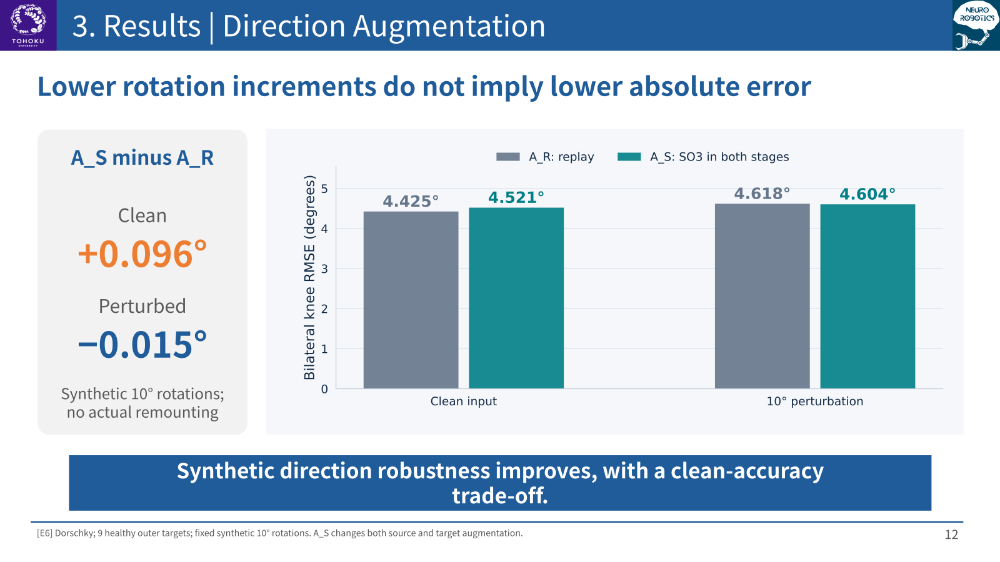

**Message:** A smaller perturbation increment does not imply a similarly large reduction in total error.

Speaker notes · 01:00 · 11:30–12:30

Finally, we apply fixed synthetic coordinate rotations to the same evaluated support. For Dorschky, augmentation reduces the additional error caused by the ten-degree perturbations from about zero point one nine three to zero point zero eight three degrees. However, clean error becomes slightly higher. The resulting absolute perturbed errors are about four point six one eight and four point six zero four degrees, so the total-error benefit is very small. This is why the graph shows the absolute errors on an axis starting at zero, rather than only reporting a large percentage reduction in the increment. The two compared arms change both source and target augmentation, so their individual effects remain unresolved. The result concerns synthetic coordinate sensitivity, not a demonstrated benefit after actual sensor remounting.

Sources: [E6: Accepted Dorschky optical two-knee experiment](SII2027_DORSCHKY_EXTERNAL_20261024_ZH.md)

[Contents](#generalizable-and-personalized-motion-reconstruction-in-stroke-patients-using-sparse-imus) · [Next slide](#slide-13)

---

## 13 · The current contribution is an auditable study of personalization and its limits

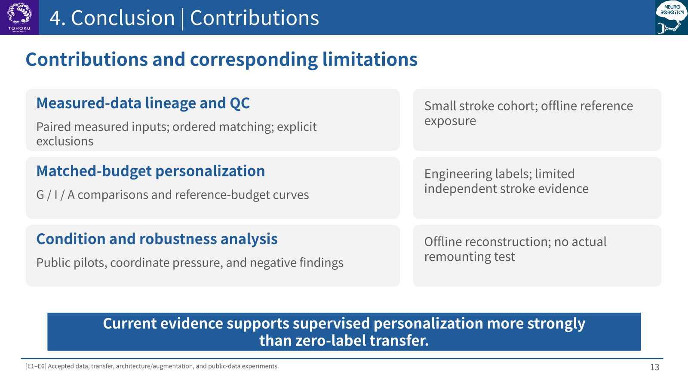

**Message:** Personalization is supported; clinical coordinates, independent stroke validation, and deployment remain open.

Speaker notes · 01:15 · 12:30–13:45

I summarize the current research contribution in three parts. First, the work reconstructs data lineage and trial pairing so that learning results can be interpreted against measured inputs. Second, it separates population transfer, individual labels, and pretrained weights through patient-level, matched-budget comparisons. Third, it quantifies reference-budget and condition-robustness trade-offs, including negative results. These are evidence and evaluation contributions rather than a claim that ordinary fine-tuning is a new algorithm. The limitations remain substantial. The stroke cohort is small and has been exposed during offline repair and development. Current outputs are engineering angles rather than certified clinical joint coordinates. The public pilots are healthy cohorts, and there is no true remounting test. More complex architectures and the current hypothetical virtual-data generator have not shown stable clean-error gains. These limitations identify the next research questions without changing the accepted results.

Sources: [E1: Accepted stroke release and patient-specific baseline](SII2027_NATIVE_BASELINE_20261021_ZH.md) · [E3: Stroke GEN1 / GEN2 transfer and budget results](SII2027_GENERALIZATION_RESULTS_20261022_ZH.md) · [E4: Frozen architecture and augmentation results](SII2027_ARCH_AUG_RESULTS_20261022_ZH.md) · [E5: Accepted WMCG public-data experiment](SII2027_OPEN_EXTERNAL_VALIDATION_20261023_ZH.md) · [E6: Accepted Dorschky optical two-knee experiment](SII2027_DORSCHKY_EXTERNAL_20261024_ZH.md)

[Contents](#generalizable-and-personalized-motion-reconstruction-in-stroke-patients-using-sparse-imus) · [Next slide](#slide-14)

---

## 14 · From a complete exploratory study to stronger publication evidence

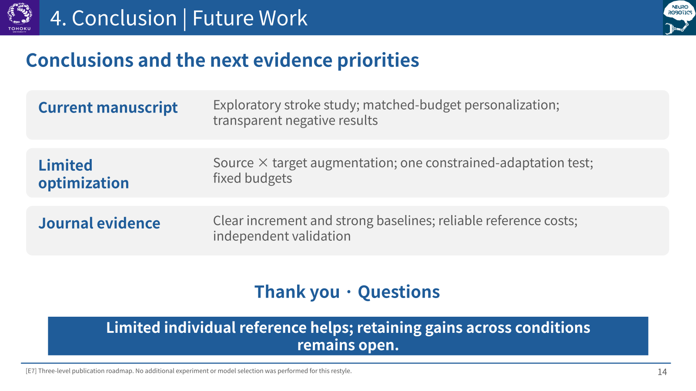

**Message:** Limited individual reference improves reconstruction; cross-condition reliability is the next target.

Speaker notes · 00:45 · 13:45–14:30

The next steps have three levels. The current results can support an exploratory engineering manuscript with clear limits. Limited optimization will first separate source and target augmentation, then test one constrained-adaptation strategy while keeping the architecture fixed. A stronger journal submission needs a clear contribution, comparable strong baselines, reliable references, transparent costs, and validation appropriate to the clinical claims. Independent public stroke evidence remains a priority; healthy data cannot replace it. My main conclusion is that limited individual reference improves reconstruction, while preserving performance across conditions remains the next target. Thank you for your attention.

Sources: [E7: Three-level publication and research roadmap](MIDTERM_THEME_AND_PUBLICATION_ROADMAP_20261027_ZH.md)

[Contents](#generalizable-and-personalized-motion-reconstruction-in-stroke-patients-using-sparse-imus)

---

**Scope:** Current outputs are dataset-specific engineering kinematics. The stroke cohort is exploratory; public healthy cohorts support technical replication. No certified clinical 3D coordinates, true-remounting robustness, or rehabilitation efficacy is claimed.
