# Generalizable and Personalized Motion Reconstruction in Stroke Patients Using Sparse IMUs

**Yincheng Wang** · Supervisor: **Mitsuhiro Hayashibe**  
**Tohoku University · Robotics** · Master’s research midterm defense · **27 October 2026**

**Updated 26 October 2026:** Four background pages now explain application value, sparse-IMU training, stroke-gait challenges, and the related-work gap. Layout and the navy/teal/orange palette follow the supplied *Small Dataset Imitation Learning* PDF. The cover and ten subsequent research pages retain their content and results.

English visual presentation and speaking script. **15 main slides: 14 min 30 s + 30 s buffer.** Four backup slides are outside the timed talk. Timing is a rehearsal target, not a measured delivery recording.

Each 16:9 slide is a GitHub-native SVG. Click an image to inspect it at full size. The revised English speaking script accompanies the local PowerPoint; this public page contains slide visuals and citations. Background diagrams are original conceptual schematics, not patient measurements. All research results remain those of the previously checked experiments; no new training or model selection was performed for this revision.

[Backup slides and references](MIDTERM_DEFENSE_20261027_APPENDIX_EN.md)

| Slide | Topic | Time | Cumulative |
|---|---|---:|---:|
| [01](#slide-01) | Generalizable and Personalized Motion Reconstruction in Stroke Patients Using Sparse IMUs | 00:20 | 00:20 |
| [02](#slide-02) | Why sparse IMUs matter for motion reconstruction | 00:45 | 01:05 |
| [03](#slide-03) | How sparse-IMU reconstruction is learned | 00:55 | 02:00 |
| [04](#slide-04) | Why stroke gait challenges a generic motion prior | 00:45 | 02:45 |
| [05](#slide-05) | Related work and the remaining evidence gap | 00:40 | 03:25 |
| [06](#slide-06) | Separate population transfer from the value of individual labels | 01:00 | 04:25 |
| [07](#slide-07) | Reliable pairing is a prerequisite for a meaningful learning result | 01:15 | 05:40 |
| [08](#slide-08) | Keep the network fixed and make the evaluation roles explicit | 01:15 | 06:55 |
| [09](#slide-09) | Verified inputs recover patient-specific motion beyond a constant baseline | 00:45 | 07:40 |
| [10](#slide-10) | Individual supervision matters; pretraining adds a modest further benefit | 01:20 | 09:00 |
| [11](#slide-11) | Personalization benefits depend on how much target reference is available | 01:15 | 10:15 |
| [12](#slide-12) | Public healthy cohorts provide technical replication across walking speeds | 01:15 | 11:30 |
| [13](#slide-13) | Direction augmentation reduces sensitivity, with a clean-error trade-off | 01:00 | 12:30 |
| [14](#slide-14) | The current contribution is an auditable study of personalization and its limits | 01:15 | 13:45 |
| [15](#slide-15) | From a complete exploratory study to stronger publication evidence | 00:45 | 14:30 |

---

## 01 · Generalizable and Personalized Motion Reconstruction in Stroke Patients Using Sparse IMUs

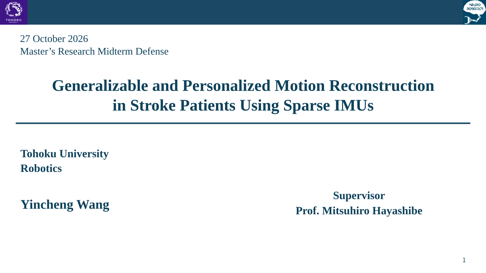

**Message:** Population knowledge, individual adaptation, and condition robustness.

[Contents](#generalizable-and-personalized-motion-reconstruction-in-stroke-patients-using-sparse-imus) · [Next slide](#slide-02)

---

## 02 · Why sparse IMUs matter for motion reconstruction

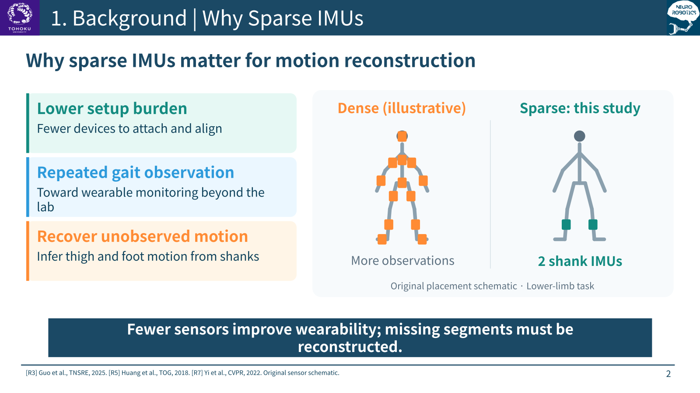

**Message:** Fewer sensors improve wearability; missing segments must be reconstructed.

Sources: [R3: Guo et al., 2025 — sparse physics-informed stroke reconstruction](https://ieeexplore.ieee.org/document/11044411/) · [R5: DIP — Huang et al., TOG / SIGGRAPH Asia 2018](https://dip.is.tue.mpg.de/) · [R7: Physical Inertial Poser (PIP) — Yi et al., CVPR 2022](https://xinyu-yi.github.io/PIP/)

[Contents](#generalizable-and-personalized-motion-reconstruction-in-stroke-patients-using-sparse-imus) · [Next slide](#slide-03)

---

## 03 · How sparse-IMU reconstruction is learned

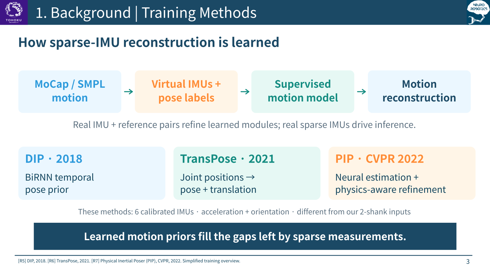

**Message:** Learned motion priors fill the gaps left by sparse measurements.

Sources: [R5: DIP — Huang et al., TOG / SIGGRAPH Asia 2018](https://dip.is.tue.mpg.de/) · [R6: TransPose — Yi et al., TOG / SIGGRAPH 2021](https://xinyu-yi.github.io/TransPose/) · [R7: Physical Inertial Poser (PIP) — Yi et al., CVPR 2022](https://xinyu-yi.github.io/PIP/)

[Contents](#generalizable-and-personalized-motion-reconstruction-in-stroke-patients-using-sparse-imus) · [Next slide](#slide-04)

---

## 04 · Why stroke gait challenges a generic motion prior

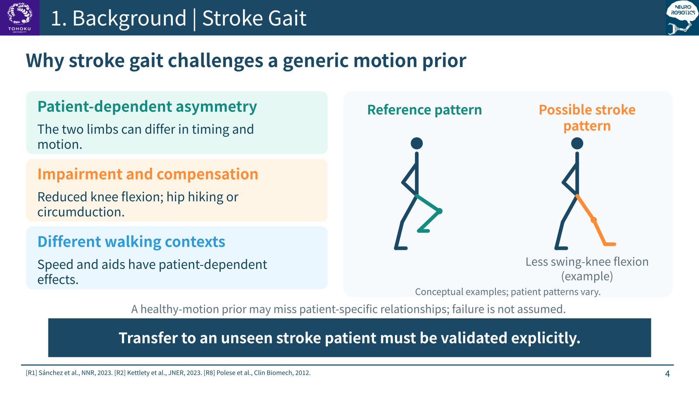

**Message:** Transfer to an unseen stroke patient must be validated explicitly.

Sources: [R1: Sánchez et al., 2023 — heterogeneous stroke walking clusters](https://pubmed.ncbi.nlm.nih.gov/37975184/) · [R2: Kettlety et al., 2023 — metric-specific effects of walking speed](https://link.springer.com/article/10.1186/s12984-023-01139-2) · [R8: Polese et al., 2012 — walking sticks and chronic-stroke gait](https://pubmed.ncbi.nlm.nih.gov/21889240/)

[Contents](#generalizable-and-personalized-motion-reconstruction-in-stroke-patients-using-sparse-imus) · [Next slide](#slide-05)

---

## 05 · Related work and the remaining evidence gap

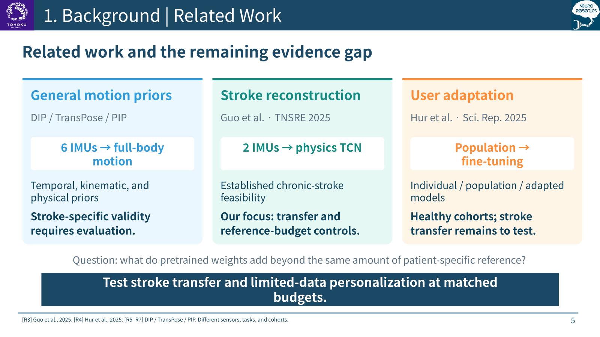

**Message:** Test stroke transfer and limited-data personalization at matched budgets.

Sources: [R3: Guo et al., 2025 — sparse physics-informed stroke reconstruction](https://ieeexplore.ieee.org/document/11044411/) · [R4: Hur et al., 2025 — individual, population, and adapted models](https://www.nature.com/articles/s41598-025-89716-4) · [R5: DIP — Huang et al., TOG / SIGGRAPH Asia 2018](https://dip.is.tue.mpg.de/) · [R6: TransPose — Yi et al., TOG / SIGGRAPH 2021](https://xinyu-yi.github.io/TransPose/) · [R7: Physical Inertial Poser (PIP) — Yi et al., CVPR 2022](https://xinyu-yi.github.io/PIP/)

[Contents](#generalizable-and-personalized-motion-reconstruction-in-stroke-patients-using-sparse-imus) · [Next slide](#slide-06)

---

## 06 · Separate population transfer from the value of individual labels

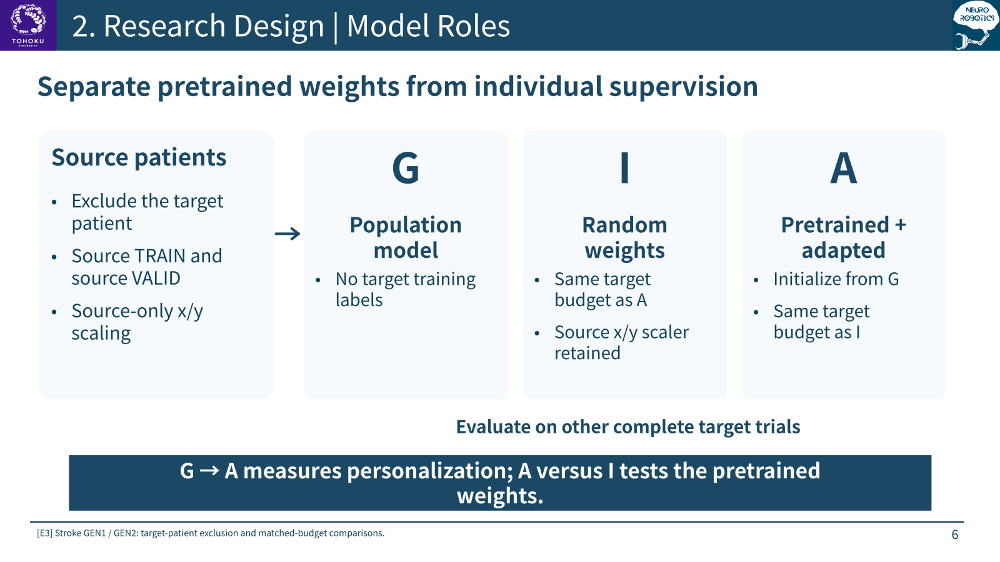

**Message:** G to A measures the effect of personalization; A versus I tests pretrained weights.

Sources: [E3: Stroke GEN1 / GEN2 transfer and budget results](SII2027_GENERALIZATION_RESULTS_20261022_ZH.md)

[Contents](#generalizable-and-personalized-motion-reconstruction-in-stroke-patients-using-sparse-imus) · [Next slide](#slide-07)

---

## 07 · Reliable pairing is a prerequisite for a meaningful learning result

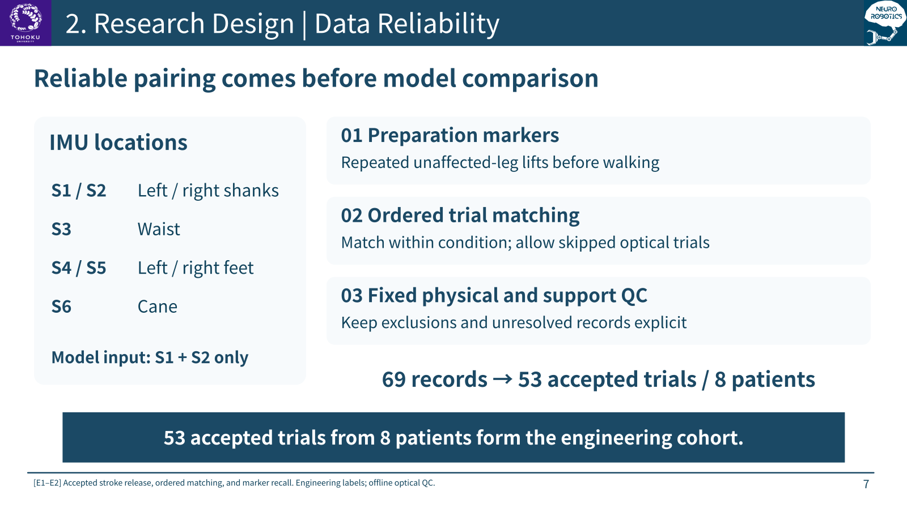

**Message:** The accepted engineering cohort contains 53 trials from 8 patients, with explicit exclusions.

Sources: [E1: Accepted stroke release and patient-specific baseline](SII2027_NATIVE_BASELINE_20261021_ZH.md) · [E2: Ordered trial matching and marker recall](SII2027_MARKER_RECALL_20261021_ZH.md)

[Contents](#generalizable-and-personalized-motion-reconstruction-in-stroke-patients-using-sparse-imus) · [Next slide](#slide-08)

---

## 08 · Keep the network fixed and make the evaluation roles explicit

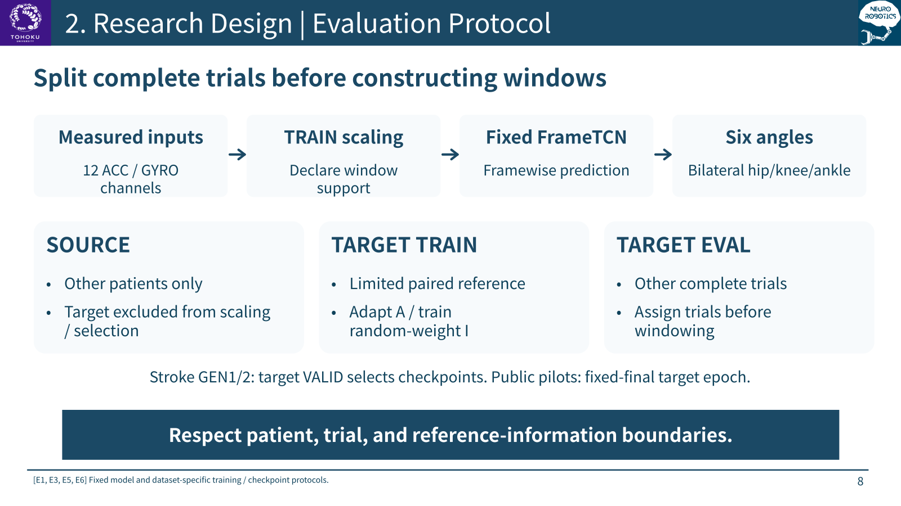

**Message:** Split complete trials before windowing, and charge all reference information to its role.

Sources: [E1: Accepted stroke release and patient-specific baseline](SII2027_NATIVE_BASELINE_20261021_ZH.md) · [E3: Stroke GEN1 / GEN2 transfer and budget results](SII2027_GENERALIZATION_RESULTS_20261022_ZH.md) · [E5: Accepted WMCG public-data experiment](SII2027_OPEN_EXTERNAL_VALIDATION_20261023_ZH.md) · [E6: Accepted Dorschky optical two-knee experiment](SII2027_DORSCHKY_EXTERNAL_20261024_ZH.md)

[Contents](#generalizable-and-personalized-motion-reconstruction-in-stroke-patients-using-sparse-imus) · [Next slide](#slide-09)

---

## 09 · Verified inputs recover patient-specific motion beyond a constant baseline

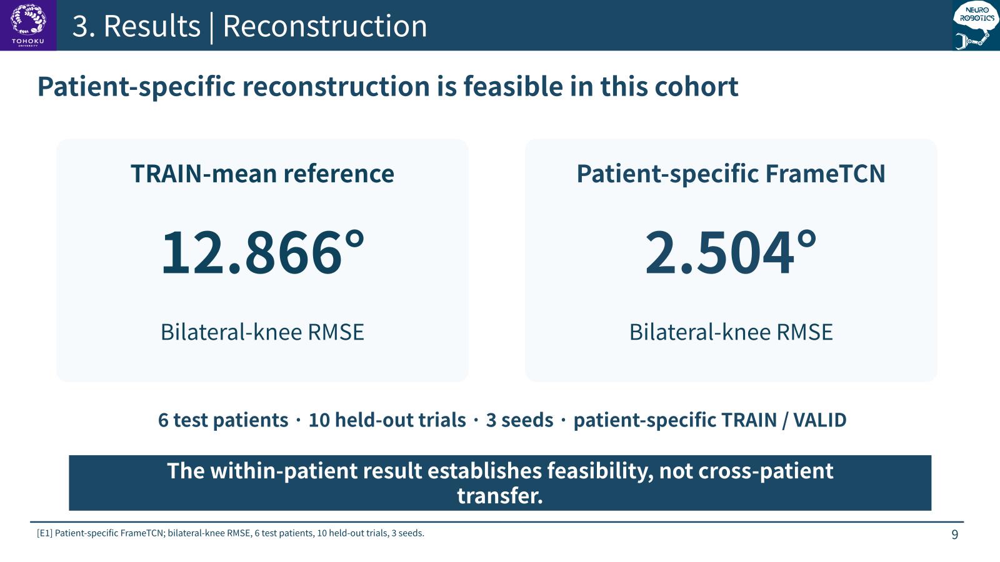

**Message:** Patient-specific reconstruction is feasible on the accepted data; this is not cross-patient transfer.

Sources: [E1: Accepted stroke release and patient-specific baseline](SII2027_NATIVE_BASELINE_20261021_ZH.md)

[Contents](#generalizable-and-personalized-motion-reconstruction-in-stroke-patients-using-sparse-imus) · [Next slide](#slide-10)

---

## 10 · Individual supervision matters; pretraining adds a modest further benefit

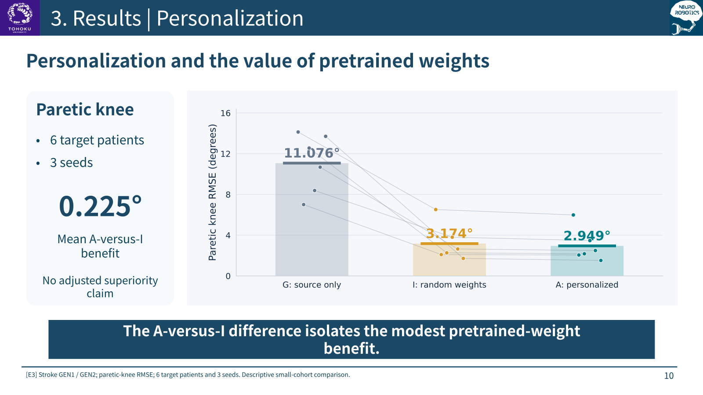

**Message:** The strongest current stroke evidence supports personalization, not reliable zero-label transfer.

Sources: [E3: Stroke GEN1 / GEN2 transfer and budget results](SII2027_GENERALIZATION_RESULTS_20261022_ZH.md)

[Contents](#generalizable-and-personalized-motion-reconstruction-in-stroke-patients-using-sparse-imus) · [Next slide](#slide-11)

---

## 11 · Personalization benefits depend on how much target reference is available

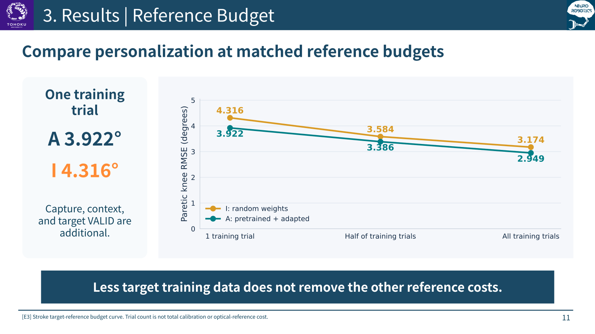

**Message:** Compare A and I within each budget; do not interpret one trial as a complete calibration cost.

Sources: [E3: Stroke GEN1 / GEN2 transfer and budget results](SII2027_GENERALIZATION_RESULTS_20261022_ZH.md)

[Contents](#generalizable-and-personalized-motion-reconstruction-in-stroke-patients-using-sparse-imus) · [Next slide](#slide-12)

---

## 12 · Public healthy cohorts provide technical replication across walking speeds

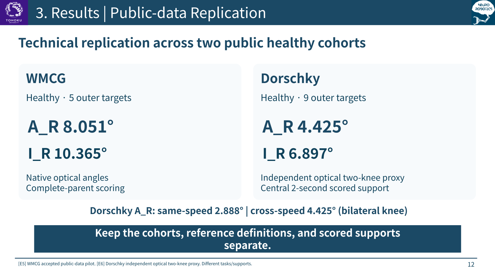

**Message:** Adaptation also helps in public-data pilots, while cross-speed reconstruction remains harder.

Sources: [E5: Accepted WMCG public-data experiment](SII2027_OPEN_EXTERNAL_VALIDATION_20261023_ZH.md) · [E6: Accepted Dorschky optical two-knee experiment](SII2027_DORSCHKY_EXTERNAL_20261024_ZH.md)

[Contents](#generalizable-and-personalized-motion-reconstruction-in-stroke-patients-using-sparse-imus) · [Next slide](#slide-13)

---

## 13 · Direction augmentation reduces sensitivity, with a clean-error trade-off

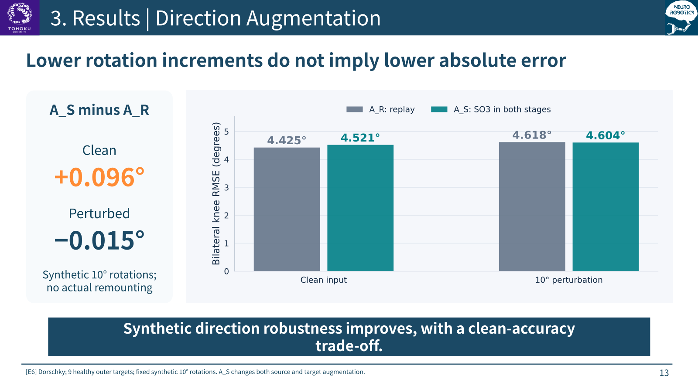

**Message:** A smaller perturbation increment does not imply a similarly large reduction in total error.

Sources: [E6: Accepted Dorschky optical two-knee experiment](SII2027_DORSCHKY_EXTERNAL_20261024_ZH.md)

[Contents](#generalizable-and-personalized-motion-reconstruction-in-stroke-patients-using-sparse-imus) · [Next slide](#slide-14)

---

## 14 · The current contribution is an auditable study of personalization and its limits

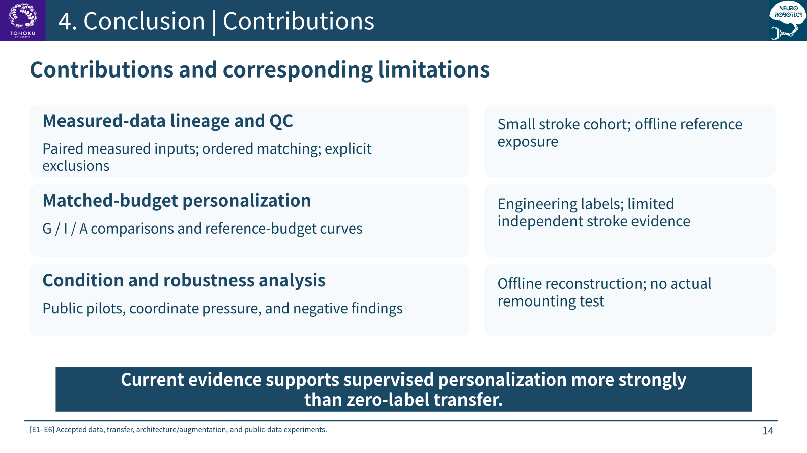

**Message:** Personalization is supported; clinical coordinates, independent stroke validation, and deployment remain open.

Sources: [E1: Accepted stroke release and patient-specific baseline](SII2027_NATIVE_BASELINE_20261021_ZH.md) · [E3: Stroke GEN1 / GEN2 transfer and budget results](SII2027_GENERALIZATION_RESULTS_20261022_ZH.md) · [E4: Frozen architecture and augmentation results](SII2027_ARCH_AUG_RESULTS_20261022_ZH.md) · [E5: Accepted WMCG public-data experiment](SII2027_OPEN_EXTERNAL_VALIDATION_20261023_ZH.md) · [E6: Accepted Dorschky optical two-knee experiment](SII2027_DORSCHKY_EXTERNAL_20261024_ZH.md)

[Contents](#generalizable-and-personalized-motion-reconstruction-in-stroke-patients-using-sparse-imus) · [Next slide](#slide-15)

---

## 15 · From a complete exploratory study to stronger publication evidence

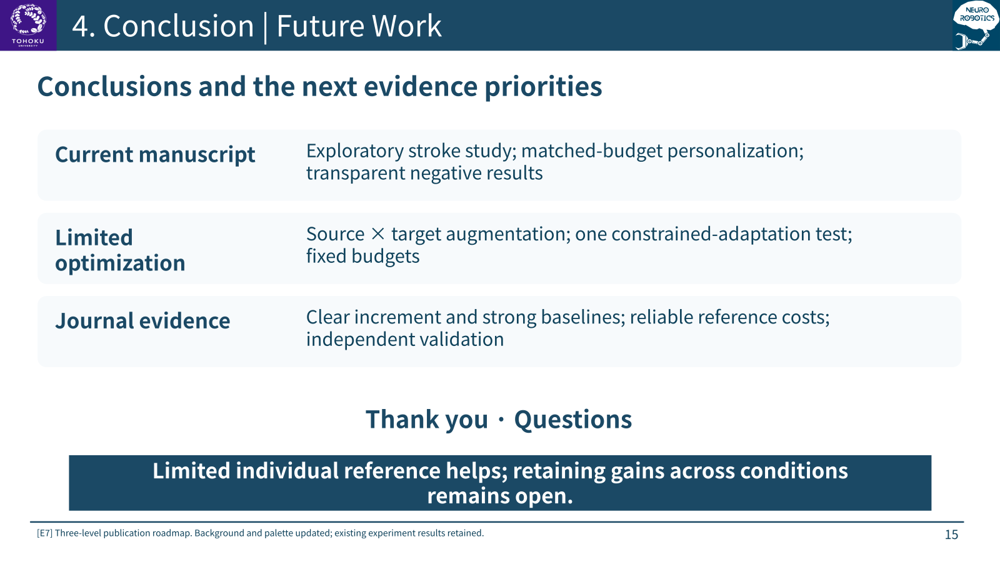

**Message:** Limited individual reference improves reconstruction; cross-condition reliability is the next target.

Sources: [E7: Three-level publication and research roadmap](MIDTERM_THEME_AND_PUBLICATION_ROADMAP_20261027_ZH.md)

[Contents](#generalizable-and-personalized-motion-reconstruction-in-stroke-patients-using-sparse-imus) · [Backup slides](MIDTERM_DEFENSE_20261027_APPENDIX_EN.md)
