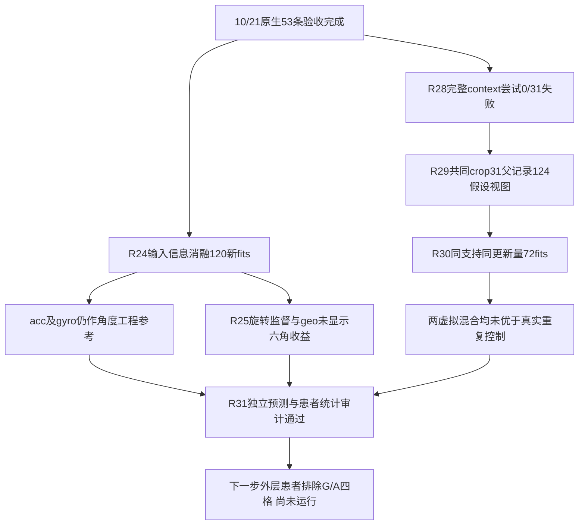
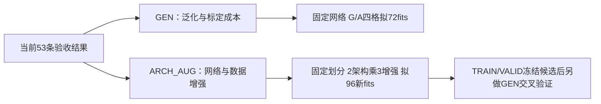

# 中期文献综合：稀疏IMU运动重建的泛化与个体化

**当前主题更新（2026-10-25）：** 用户确认2026-10-27中期答辩题目为 **Generalizable and Personalized Motion Reconstruction in Stroke Patients Using Sparse IMUs**。近期以真实双小腿IMU、跨患者建模与有限标签个体化为中心；三层目标为现有可组织投稿内容、适当优化、期刊证据包，见[当前主题与路线](MIDTERM_THEME_AND_PUBLICATION_ROADMAP_20261027_ZH.md)及[当前答辩大纲](MASTER_MIDTERM_OUTLINE_ZH.md)。现有证据更支持个体适配，零标定卒中泛化仍待验证；健康外部数据仅作技术复核。架构继续冻结，本次不启动新训练。以下旧日期、标题和未完成状态按各自记录日期保留，当前答辩日期以10月27日为准。

当前最近邻提醒：双IMU/TCN卒中运动学与个体/群体/少量微调均已有研究。新主题不把普通微调或更复杂网络当作当然创新；按实际结果论证参考成本、跨条件保持和卒中证据，文献入口见当前路线。

**2026-10-23研究决策更新：** 架构方向已冻结，泛化线继续推进，新开第三线“少量适配＋方向增强”。[三线方案、当前阶段及代码索引](SII2027_THREE_LINES_PLAN_20261023_ZH.md)。90个新神经fit及两线固定clean VALID诊断已独立验收；本批无新TEST。

**10/23网络架构与数据增强支线已验收（20261022批次）：** [六格、坐标敏感性与非线性融合追加实验](SII2027_ARCH_AUG_RESULTS_20261022_ZH.md)。完整报告保留阴性结果、全部seed、独立审计与计算成本；当前结果是患者内跨试次探索性证据。

**10/22泛化等患者损失对照已完成：** [66fit、独立VALID/TEST审计与完整配对结果](SII2027_GEN4_EQUAL_PATIENT_RESULTS_20261022_ZH.md)。保留全部6患者、3seed、one/half/full预算及正负方向；本批TEST为描述性比较。

**10/22泛化机制补查：** [TRAIN/VALID独立诊断完成；偏置不足以解释全部误差](SII2027_GEN3_GENERALIZATION_DIAGNOSIS_20261022_ZH.md)。源窗口权重差异已量化，并固定66fit等患者损失对照；新TEST结果尚未在此页报告。

**10/22泛化线结果验收：** [180次拟合与三批独立审计已完成](SII2027_GENERALIZATION_RESULTS_20261022_ZH.md)；真实源适配患膝2.949°，同标准化从零参考3.174°；低数据量曲线与虚拟源负结果均保留。[代码／合同索引](SII2027_GENERALIZATION_CODE_INDEX_20261022.json)。

**10/22双分支执行更新：** [GEN与ARCH_AUG已完成训练入口预检并启动](SII2027_RESEARCH_BRANCH_RUNS_20261022_ZH.md)；72与96次新增拟合按各自冻结合同推进。尚无新TEST结论，当前计数和验收边界见执行记录；[训练／分析代码索引](SII2027_RESEARCH_RUN_CODE_INDEX_20261022.json)。

**10/22研究分支更新：** 以已验收53条数据和结果为共同起点，分为[GEN：泛化与标定成本](SII2027_RESEARCH_FORK_20261022_ZH.md#gen)和[ARCH_AUG：网络架构与数据增强](SII2027_RESEARCH_FORK_20261022_ZH.md#arch_aug)。两个分支的角色／预算已预检，共享模型与静态旋转完成合成预检；规划冻结时新训练均为0，拟执行预算与旧成绩明确分开。

**10/22输入、监督表示与虚拟对照更新：** [192新增神经拟合、简单线性参考及独立验收](SII2027_NATIVE_ABLATIONS_20261022_ZH.md)完成。固定53真实数据/6患者TEST；3输入mask＋RotMSE/RotGeo，虚拟31TRAIN/124假设视图与同支持同21000步控制，失败context尝试也保留。所有种子及患者级配对结果见表；论文有标定方法但本地逐人安装值仍未知。当前为I_full，原E2的G/A外层患者排除尚未完成；不称临床JCS或真实安装等价。

初版：2026-10-19；代码与实验执行回写：2026-10-21（Asia/Tokyo）。目标：2026-11-20硕士中期答辩与第二篇IEEE Sensors Journal首投。用户明确要求将新上传论文与旧文献地图综合，本报告据此评估两稿与中期叙事，不将会议论文包当作整个领域。

## 1. 结论与推荐定位

**建议保留题目《面向卒中患者运动重建的稀疏IMU模型泛化与个体适配研究》，将答辩中心改成：群体模型能在未见患者中保留多少运动信息；有限个体标定带来多少额外收益；这些收益能否保留到事件与关节运动学任务。**

当前最有价值的工作不是再拼出一个更复杂的全身动捕网络，而是把已有两条重建任务转化为清楚、可复核的患者级证据。通用动捕方法很成熟，既不能因此否定卒中研究，也不能仅用“卒中数据”替代方法或科学贡献。独立价值要落到同预算对照、患者差异、任务结果和适用边界上。

这里的“个体特异性”操作性定义为个体标定/适配收益。没有健康对照、疾病区分或病理机制证据时，不把它扩写成“识别了卒中特异神经机制”。

## 2. 本次实际阅读的材料与范围

- 重新上传的[论文包](https://drive.google.com/file/d/1TRlzZLKJ0UnWTlsEKclz6uv533yajJuG/view?usp=drivesdk)：110,284,420字节；实际有16篇可解析PDF，共191页。README仍写“没有PDF”，与当前包内容不一致；本报告以实际PDF为准，没有执行包内下载脚本。
- 全部16篇核对题名、输入模态、摘要及问题定位；重点阅读PIP、TIP、DynaIP、PNP、UIP、UMotion、ProbIP、UDP、GRIP的方法/评价相关部分；视觉核对DynaIP、PNP和GRIP的重要页面/表格。不是对191页逐字精读或系统综述。
- 两份现有稿件：BSN.pdf（4页）、sii2027_abstract_summary.pdf（7页），本轮重新读取。10/19文献分析时尚未拿到原始数据、代码、训练日志；10/20的代码与实际重跑状态见第14节。
- 既有中期大纲和CURRENT_WORK_CRITIQUE_AND_CORE_EXPERIMENTS_ZH；本轮更新的是文字大纲，未取得并审阅实际答辩PPT。
- NMS-GAP文献地图及Digital Twin / Embodied AI gap矩阵，main核对为a463f882ed198d97dcd498c8ad680b49772326ec，与此前版本相同。采用其分析框架，但具体先行工作能力优先依据论文原文，不把旧verdict当作永久定论。

## 3. 三个证据层次分别回答什么

| 证据来源 | 对当前研究的作用 | 答辩中如何呈现 |
|---|---|---|
| 新论文包：图形学/视觉/HCI稀疏动捕 | 告诉我们分阶段、合成数据、概率估计、多模态几何和物理仿真已经做到什么程度 | 相关工作页展示能力边界，防止把已有部件当创新 |
| 既有地图：NMS建模、神经控制、患者个体化、康复交互 | 告诉我们从运动估计到患者模型和动作价值还缺哪些验证 | 一张研究定位表，明确硕士完成运动状态层，博士再推进机制和交互 |
| 当前两稿与可补实验 | 决定你现在真正能证明什么 | 两稿结果、G/I/A/C、成本曲线、任务指标、患者级失败边界 |

旧地图G07把最小观测问题判为partially-addressed，G05/EAI-G04把不确定性与变化条件下的动作验证判为partially-addressed；EAI-G07已明确“稀疏/重建IMU本身”不是独立具身智能空白。故中期可借用“任务相关信息是否被保留”的思路，不宣称已经解决NMS可辨识性或患者控制问题。GRIP自称digital twin，使用的是仿真人形；该命名不能直接认定其完成神经、肌肉、组织及纵向患者绑定，也不据此宣称所有患者数字孪生都不存在。

## 4. 新论文对原答辩判断的实际改变

### 4.1 分阶段表示和速度中间量不能再独立承担创新

DynaIP在PDF p.4–5明确用pseudo-velocity与part-based结构估计姿态；p.6–7比较合成AMASS、AMASS+DIP微调、真实Xsens及真实数据组合。它不等同于目标患者少量监督适配，但足以说明“合成预训练后真实微调”和“加入速度中间量”已有先例。

GRIP在PDF p.3–4采用leaf位置→完整位置→角度/关键速度的逐帧LSTM，再通过State Difference接入DynamicsNet。TransPose也是既有直接结构来源。因此SII的position→position→rotation不能只靠结构图宣称独特方法；需要同输入/监督预算的direct对照，说明当前两小腿、卒中及少量适配条件下中间监督是否有价值。

### 4.2 合成数据的重点应从“用了virtual IMU”转向“生成是否可信、额外监督成本如何计算”

旧地图中的Mundt已经覆盖合成/实测IMU与运动力学；PNP进一步研究非惯性参考、原始信号合成、噪声及标定误差，PDF p.6有明确sensor/world/bone坐标变换。SII应补一张输入来源图，区分mocap用于训练标签/生成，和测试特征是否仍依赖动态mocap参考。

PNP没有证明SII必然存在坐标错误。世界坐标加速度做旋转，与直接在随动骨盆坐标中求二阶导数不是同一操作；只有具体计算路线清楚后才能判断是否遗漏非惯性项。先查实现，不直接照搬PNP全套算法。

数据量实验还要回答：降低target real比例时，target virtual是否仍来自全部mocap母轨迹？若是，比例下降没有同比减少总标定监督。横轴至少改为唯一参考trial数与真实记录分钟数。

### 4.3 “两只IMU”不能单独定义先进性

ProbIP在PDF p.6及Fig.4比较6、5、4、3、2传感配置，其中两传感器是双腕；你的双小腿与其位置和任务不同。不能说“两只传感器没人做过”，也不能把其全身SMPL角误差与本项目投影角RMSE直接排序。

同理，GRIP四个IMU还使用足底压力，UIP/UMotion/UDP六个节点还使用节点间测距。比较传感负担应记录物理量、佩戴位置、姿态融合、外部参考、标定标签和额外模态，不只报数量。

### 4.4 任务指标要独立于姿态指标

一个具体反例来自GRIP PDF p.6 Table 1：PRISM上GRIP的MPJPE为182.44 mm，优于PIP的248.59 mm；但vGRF误差258.40 N高于PIP的246.85 N。此处只说明同一表中不同指标的排序可以不同，不据此否定GRIP总体贡献。

这支持你把BSN事件、SII ROM/峰值等放在波形/角度误差之外独立评价。它不能替你证明BSN事件已准确或SII已支持动力学。现有BSN事件参照为实测小腿算法，应称一致性；有独立mocap事件可再加评估，不能借用原算法论文的独立验证当成本稿证据。

## 5. 16篇新论文的筛选与使用位置

P编号仅用于本报告，不覆盖旧账本R编号。页码均为实际PDF页码。

| ID | 论文、输入与已建立能力 | 对当前工作的具体影响 | 答辩使用 |
|---|---|---|---|
| P01 | PIP 2022；6 IMU；神经估计+物理优化；合成训练后真实微调；在线与物理指标 | 物理优化、实时、synthetic→real本身均有先例；原文p.6有数据协议 | 相关工作一组，细节备份 |
| P02 | TIP 2022；6 IMU；Transformer、stationary body points、地形/漂移约束 | 时序一致性和接触先验不是新空白；其轨迹指标与本稿投影角不同 | 与PIP合并一行 |
| P03 | DynaIP 2024；6 IMU；pseudo-velocity、分体结构、跨骨架真实数据训练 | SII结构/域收益须分开；下一篇增加速度也须最近邻比较 | 核心最近邻，正文可点名 |
| P04 | PNP 2024；6 IMU；非惯性根参考、原始信号仿真及标定误差 | 优先查加速度定义、sensor-to-segment及骨盆参考来源 | 核心方法审计来源 |
| P05 | UIP 2024；6 IMU+UWB节点间测距，无固定anchor需求 | UWB提供新的几何观测；不是“用更强网络就恢复全部未知状态” | 南科衔接/备份 |
| P06 | GIP 2025；多人IMU+UWB；人内/跨人距离和相对轨迹 | 多人交互几何已有研究，但与当前单人卒中结果不是同协议 | 备份，不占中期主线 |
| P07 | ProbIP 2025；稀疏IMU；matrix Fisher旋转分布及减少传感配置 | 不能说稀疏动捕没有不确定性；两传感器应比较位置/任务 | 文献表或备份 |
| P08 | ToF-IP 2025；IMU+光学ToF测距，节点融合与空间编码 | 测距不是UWB专属；不能混淆光学ToF与UWB射频测距 | 未来模态选择备份 |
| P09 | UMotion 2025；6 IMU+UWB；UKF与体形/传感/姿态不确定性 | 身形约束已有，但不等于已识别卒中神经肌肉参数；方法p.6明确排除重叠训练来源 | 南科桥接/数据隔离参考 |
| P10 | UDP 2026；6 IMU+UWB；MDS布局+几何约束扩散 | “UWB+几何+扩散”已有直接近邻；节点间距离保留刚体/镜像歧义，需额外消歧 | 博士定位更新，备份 |
| P11 | HSC4D 2022；IMU+LiDAR；环境/人全局定位 | 大场景定位问题不同于个体临床角度重建 | 文献矩阵保留，正文省略 |
| P12 | IMUPoser 2023；手机/手表/耳机；可变可用观测 | 佩戴负担有使用场景维度；不能用“更少IMU”代替任务保真 | 背景一句或备份 |
| P13 | RobustCap 2023；相机+IMU；融合视觉/惯性退化条件 | 模态互补已有；输入预算不同不能做裸数字胜负 | 备份 |
| P14 | Garment-aware diffusion 2025；松动IMU、服装模拟及真实验证 | 真实松动已是明确研究；静态随机旋转不能自动等同软组织/衣服动态伪影 | 局限/鲁棒性备份 |
| P15 | MagShield 2025；IMU；磁干扰detect/correct | 姿态输入质量需要审计；只有使用磁航向时才把磁干扰列为本项目具体风险 | 输入质量与未来实验 |
| P16 | GRIP 2026；4 IMU+足底压力；分阶段状态、PPO物理人形、PRISM | 已有sensing→modeling→simulation/control桥梁；不能以“接仿真”为第三篇唯一创新 | 核心结构反证、未来一行 |

正文不罗列16篇。中期一页文献定位优先保留Guo、TransPose/DynaIP/GRIP、Mundt/PNP三组，UIP/UMotion/UDP与ProbIP概括为下一层研究，细表放备份。

## 6. 既有地图中仍必须保留的最近邻

新包主要是通用全身动捕，不覆盖完整临床/肌骨领域。以下旧地图来源仍决定当前任务：

| 来源 | 不能被新包替代的原因 | 建议 |
|---|---|---|
| Guo 2025，TNSRE；DOI 10.1109/TNSRE.2025.3581352 | 与你最接近的两小腿IMU、慢性卒中运动学；也是数据来源 | 第二篇最优先同协议基线；数据继承与新增贡献写清 |
| Mundt 2020；10.3389/fbioe.2020.00041 | 合成/实测惯性及运动力学的直接先例 | 不把virtual IMU当作新颖性来源 |
| Li 2024，TNSRE；10.1109/TNSRE.2024.3349639 | 减少传感器、跨活动迁移学习 | 个体适配与迁移概念的边界；不能直接推断本队列患者效果 |
| Romijnders 2021，JNER | 事件算法原始参考；其验证不替代本稿独立事件参考 | 保持实测IMU一致性与真实接触准确性区分 |
| Lin/OEEL 2025；10.1109/TNSRE.2025.3626316 | 目标组开放环境肌电预测/失败检测 | 未来不能泛称“运动预测未考虑不确定性” |
| Donahue 2026；10.1109/TBME.2026.3691128 | 临床运动学概率与校准方向 | 未来可靠度必须面向任务及独立参考 |
| Zhang 2023 NMS-BNN；10.3389/fnins.2023.1254088；Durandau 2019；10.1186/s12984-019-0559-z | 不确定性辅助与患者NMS实时控制已经存在 | 保留NMS机制/患者绑定/真实交互的证据层次 |

这些旧来源的访问深度沿用[SOURCE_AND_GAP_AUDIT](SOURCE_AND_GAP_AUDIT.md)及[实时动力学最近邻账本](REALTIME_DYNAMICS_NEAREST_WORK_20261009.md)。本轮重点补读新包，不冒称重读了全部旧论文最终版。

## 7. 建议改写的创新与结论

| 原来容易使用的表述 | 最近邻造成的问题 | 更稳妥的改写 |
|---|---|---|
| 用两只IMU实现运动重建，具有创新性 | Guo及其他稀疏配置已有；ProbIP还研究不同部位的两节点 | 在明确两小腿输入与标定监督下，检验新患者泛化及个体适配的收益和边界 |
| 提出位置—旋转分阶段网络 | TransPose、DynaIP、GRIP各有逐级中间表示 | 检验分阶段监督相对于匹配的直接回归，在当前卒中任务中是否增加价值 |
| 使用mocap生成virtual IMU改善泛化 | Mundt、PIP、PNP及大量先例 | 在原始母轨迹隔离及相同监督成本下，量化合成训练对真实测试的贡献 |
| 个体化有效，因为卒中步态具有特异性 | 可能混入身材、速度、佩戴、坐标等因素 | 当前将个体化定义为同患者标定后的预测收益，进一步比较是否超过简单校准 |
| 生成虚拟传感器增加了观测信息 | 若输出由相同输入确定，它不是新增独立测量 | 虚拟信号提供一种任务兼容表示/训练先验，其是否有用由下游对照判断 |
| 高PCC说明足以用于临床或实时辅助 | 波形/角度、任务、机械动作是不同终点 | 分别报告信号、事件、ROM和后续指令结果；当前模型的离线条件明确披露 |
| 接入物理人形就是NMS数字孪生 | GRIP等已有物理仿真，肌肉/神经与患者验证仍是另一层 | 当前完成运动状态估计组件，为外部锚定NMS与真实交互提供前置条件 |

## 8. 中期前最应补的实验：按必要性分层

### 必须先做：输入与协议成立

- 两稿有效患者/原始trial、共享队列和排除原因；SII原17人、主8人、预算实验5人的角色分开。
- 真实/合成/增强共享原始parent，先分组再切窗；目标患者real和virtual均从群体预训练中排除；标准化、早停与LR选择历史可查。
- 加速度含重力/去重力、传感/世界/骨盆坐标、sensor fusion来源、静态标定与动态mocap依赖明确。先审计，再决定是否需要参考辅助/可部署分支。
- 指标从患者×trial×输出明细生成；查清SII总体PCC0.9974与RMSE2.968°的聚合口径，不能直接用表格算术均值替换。

### 答辩科学问题的核心：G/I/A/C与标定预算

固定架构和输入，G=其他患者预训练零目标监督；I(k)=目标k预算从头训练；A(k)=G后用相同k适配；C(k)=冻结G后做预定偏置/尺度校准。测试trial、有效时间段及目标监督预算相同。

先一个预算的G/I/A，C作为便宜的解释基线；再做低/中/完整嵌套预算，列分钟数与唯一参考trial。G−A评价目标适配，I−A评价预训练收益，C−A检查深度适配是否超出简单校准。每人都展示，包括负迁移。

SII为期刊主实验，优先完成整个核心矩阵；BSN先核查已有模型/日志可否复用，补足同患者留出与跨患者结果的区别，避免同时铺开两套大规模架构搜索。若BSN尚无跨患者结果，明确它目前提供个体可行性证据。

### 第二篇投稿必须保留的对照

- 同输入/输出/监督parent的direct vs staged；披露辅助中间标签和参数/计算差异。
- Guo 2025同协议可信实现；原代码不可得时标明重实现，不用跨文献RMSE表代替实验。
- 固定预算real/virtual×adapt消融，或者按实际完成范围报告因素效应；目标虚拟监督不漏计。

无需在11月前复现全部PIP、PNP、ProbIP、UDP和GRIP。输入与任务不匹配的六节点全身方法不是直接两小腿基线；不能用零填充缺失传感器把它做成弱对照。

### 最低成本的任务证据

BSN保留IC/FC的P/R/F1、TP/FP/FN、匹配后MAE与signed bias，在50/100/150/200 ms工程容差下作一对一匹配；无TP时MAE不可估。能取得独立marker事件则共同评价实测与重建通道，否则保持“事件一致性”。

SII预先指定患侧膝RMSE为主终点，另加signed bias、ROM误差、必要的峰值时刻与低ROM病例。角度零点和投影定义须核验；同一投影代码的标签一致性不等于独立临床JCS验证。每患者等权，trial在患者内汇总；患者cluster区间、小样本局限和多重比较如实报告。

建议后续加BSN直接双足事件方法，与“重建小腿→事件”在同参考下比较。它能检验虚拟信号是否值得保留，但若没有成熟足部方法，不要为了凑基线直接把小腿算法套在足部信号。

## 9. 15分钟答辩应怎样重排

已更新[13页大纲](MASTER_MIDTERM_OUTLINE_ZH.md)。最重要的变化是把现有大纲第11页的“网络/合成消融”前移融入方法验证，再给G/I/A及成本曲线独立位置；学习率搜索和跨论文裸数字表移到备份。

正文建议时间14分15秒，留45秒缓冲：1题目0:20；2问题0:55；3文献定位1:10；4数据/公平协议1:15；5BSN方法0:50；6BSN信号与事件1:10；7SII方法与参考1:05；8SII患者级结果1:20；9G/I/A/C1:35；10标定预算1:15；11组件与输入边界1:10；12贡献/局限1:05；13本人贡献和节点1:05。

不要求把16篇各放一页，也不把中期主线改成UWB或机器人。最后半分钟用一条后续问题连接实时与动力学即可。

## 10. 从今天到11月20日的任务

不假定此前10/15、10/18任务已经完成。先复用现有有效结果，缺项按下表处理。

| 时间 | 第一优先 | 并行写作/答辩交付 |
|---|---|---|
| 10/19—10/25 | 输入/parent/指标审计；固定预算G/I/A及direct开发pilot；冻结主比较和参考 | 替换题目与文献页；完成Introduction/Methods；10/25列明P0是否通过 |
| 10/26—11/1 | 全可用患者主对照、简单C、嵌套预算；Guo基线与固定预算2×2按既定队列并行 | 主表、患者图、监督成本图；结果段同步写 |
| 11/2—11/8 | 事件容差、ROM/偏置、失败例、统计与必要重跑；11/5争取冻结主实验 | 11/6争取完整期刊稿v1；13页讲稿初版 |
| 11/9—11/12 | 共同作者核验和必要缺项；11/12冻结中期主图 | 去掉未完成结果的确定性措辞，形成可完整讲述版本 |
| 11/13—11/19 | 期刊附件、最后修订、计时排练 | 争取11/18—19投稿；至少两次完整15分钟排练 |
| 11/20 | 中期答辩与第二篇首投目标节点 | 归档稿件、图表和结果入口 |

10/25仍有输入/参考根本问题时，先解决并收缩主张；不在未验证的输入上继续堆模型。11/6若不能形成可信完整稿，明列缺项、所需时间和修复路径，第三篇继续暂停启动，不通过删除必要对照追日期。

## 11. 对第三篇与南科衔接的影响

原先“时延约束个体状态→辅助指令偏差”的窄问题可以保留，但最近邻必须新增DynaIP、PNP、ProbIP、GRIP。单纯加入速度、概率模块、因果网络或物理仿真均不足以独立成立。强对照后若只得到更快推理，应如实定位为工程改进。

更值得检验的是：相同患者标定预算和可获得输入下，角度最优的方法是否也是应用时刻辅助指令最优的方法；变化条件下何时失效。患者力矩需要同步外力/模型参考，仿真动作不能冒充患者真实力学。

南科准备继续围绕sensing→modeling→control/interaction，IMU为当前可用观测；UWB按目标组设备和参考资源接入。UIP、UMotion、UDP已分别覆盖融合、体形/不确定性和几何扩散，未来问题应指向任务相关可观测性、患者适配和交互价值，而不是笼统“UWB融合提升精度”。

## 12. 预期答辩追问与回答要点

| 追问 | 回答要点 |
|---|---|
| 这么多方法已能全身动捕，你的研究还需要做什么？ | 通用姿态能力不直接回答卒中人群内的未见患者、个体标定成本和任务误差；用实际患者级同预算结果支持差异 |
| 只有卒中数据就算创新吗？ | 不能。贡献要来自可检验的问题、合理对照、失败边界或方法价值；群体标签只是应用范围 |
| 虚拟IMU创造新信息了吗？ | 它不是新的独立测量；价值在表示/先验及下游兼容性，需要与直接任务方法比较 |
| 个体适配是否只是调了偏置？ | C(k)与A(k)同预算比较；若相当，保留简单校准并据实收缩复杂方法主张 |
| 为什么不直接比较GRIP/UDP？ | 模态、位置、监督和输出不同；同输入临床近邻Guo和direct对照更直接，通用系统作能力/设计最近邻 |
| GRIP已做数字孪生，你博士方向是否重复？ | 物理人形重建是重要先例；患者NMS机制参数、独立内部参考及真实交互价值是需另行验证的问题 |
| 能否实时辅助？ | 当前SII为中心窗口/双向离线估计；第三篇才检验因果输入、实际可用时间与机械后果 |

## 13. 原始论文入口与证据定位

- P01：[PIP](https://openaccess.thecvf.com/content/CVPR2022/html/Yi_Physical_Inertial_Poser_PIP_Physics-Aware_Real-Time_Human_Motion_Tracking_From_CVPR_2022_paper.html)，PDF p.1、p.6。
- P02：[TIP](https://arxiv.org/abs/2203.15720)，PDF p.1、p.6–7。
- P03：[DynaIP作者代码](https://github.com/dx118/dynaip)，PDF p.4–7。
- P04：[PNP作者项目](https://xinyu-yi.github.io/PNP/)，PDF p.1、p.3、p.6、局限部分。
- P05：[UIP作者项目](https://siplab.org/projects/UltraInertialPoser)，PDF p.1及评价相关部分。
- P06：[GIP作者项目](https://siplab.org/projects/GroupInertialPoser)，摘要/定位核对。
- P07：[ProbIP作者代码](https://github.com/MinKim14/ProbIP-ICCV2025)，PDF p.5–8及Fig.4。
- P08：[ToF-IP原始论文](https://proceedings.neurips.cc/paper_files/paper/2025/hash/7343a5c976f8399880b695267f1f9e9f-Abstract-Conference.html)，摘要/模态核对。
- P09：[UMotion原始论文](https://openaccess.thecvf.com/content/CVPR2025/html/Liu_UMotion_Uncertainty-driven_Human_Motion_Estimation_from_Inertial_and_Ultra-wideband_Units_CVPR_2025_paper.html)，PDF p.3、p.6、p.8。
- P10：[UDP作者项目](https://siplab.org/projects/UltraDiffusionPoser)，PDF p.1、p.4–5；项目核实CVPR2026。
- P11：[HSC4D](https://openaccess.thecvf.com/content/CVPR2022/html/Dai_HSC4D_Human-Centered_4D_Scene_Capture_in_Large-Scale_Indoor-Outdoor_Space_Using_CVPR_2022_paper.html)，摘要/模态核对。
- P12：[IMUPoser](https://spice-lab.org/projects/IMUPoser/)，摘要/应用与配置核对。
- P13：[RobustCap](https://shaohua-pan.github.io/robustcap-page/)，摘要/模态核对。
- P14：[Garment-aware diffusion](https://www.ijcai.org/proceedings/2025/135)，摘要/松动场景核对。
- P15：[MagShield](https://openaccess.thecvf.com/content/ICCV2025/html/Shao_MagShield_Towards_Better_Robustness_in_Sparse_Inertial_Motion_Capture_Under_ICCV_2025_paper.html)，摘要/输入质量核对。
- P16：[GRIP作者项目](https://ryosukehori.github.io/grip-project/)，PDF p.3–6；作者项目交叉核对表1及方法。PRISM随机sequence划分与另两数据集按subject划分不同，不能统称跨患者外部验证。

旧地图原始定位：[研究簇](https://github.com/InchengWang/NMS-GAP/blob/a463f882ed198d97dcd498c8ad680b49772326ec/01_literature_mapping/CLUSTERS_AND_GAPS.md)、[Digital Twin矩阵](https://github.com/InchengWang/NMS-GAP/blob/a463f882ed198d97dcd498c8ad680b49772326ec/Digital%20Twin/03_gap_validation/data/gap_validation_matrix.csv)、[Embodied AI矩阵](https://github.com/InchengWang/NMS-GAP/blob/a463f882ed198d97dcd498c8ad680b49772326ec/Embody%20AI/02_gap_validation/data/embodied_ai_gap_validation_matrix.csv)。

部分CVF网页本轮返回403，使用包内实际PDF读取，不把网页访问失败当作论文不存在。全文、摘要与作者项目的访问深度已区分；10/19文献分析没有重新验证所有长期gap，也没有产生新实验性能；10/20实际执行证据另见第14节。

## 14. 代码与实验执行回写：中期决策更新（2026-10-20）

本节按代码和实际输出更新第8节的待办。详细的每次尝试、目的、模块/函数、预算、结论和下一步见[实验决策台账](SII2027_EXPERIMENT_DECISIONS_20261020_ZH.md)；[30文件代码指纹索引](SII2027_CODE_EVIDENCE_INDEX_20261020.json)与[38行聚合结果](SII2027_AGGREGATE_RESULTS_20261020.csv)一并保存。其余文献判断保留原访问日期和访问深度。

| 原规划问题 | 已执行证据 | 当前决策 |
|---|---|---|
| 输入是否混入动态参考 | 确认旧24D包含18D动态mocap姿态；新12D只取实测ACC/GYRO | 新分支作为processed/offline sensor-only；旧结果为参考辅助条件，禁止换名复用 |
| 时间与三个平面 | 69条常量位置标签由local/absolute时间混用导致，新入口已恢复；YZ/XZ/XY索引未交换 | 六个YZ历史投影保留限制；轴向旋转、足滚转、临床零点/JCS仍未认证 |
| G/I/A/C与标定预算 | 3epoch流程验证后完成G最多60、I/A各30的单seed矩阵，118bundle；1/2/all和成本账本齐 | A比G低不能等同预训练优于I；同k简单C和常量M必须保留 |
| 分阶段是否值得 | 主8 direct A10.192°、staged A10.269°，额外位置监督/计算差异记录 | 没有稳定分阶段优势；不以网络复杂度写贡献 |
| 误差是否代表动态保真 | M常量9.868°；TRAIN预测ROM仅5.49–8.44°，GT36.61° | 先做原队列动态拟合诊断；不继续用角度RMSE下降证明临床动态有效 |
| Guo最近邻 | 原始xlsx角色的G60/A30骨干完成，A12.027° | 完整physics仍缺独立标定；骨干比较不能更名为完整论文复现 |
| 合成2×2 | v1因19.937m/s²解析边界错误失效；context v2重跑58parent/22运行，3epoch | v2没有稳定mixed改善；计算更新与mocap context更多，不能作纯合成因果收益 |
| BSN任务指标 | 现存单人三传感LSTM四容差一对一复核 | 不是新双足/跨患者实验；实测算法一致性与marker参考分开 |
| 独立数据与内容隔离 | BLISS首轮发现两对不同ID同内容；旧120条失效，去重118条重训 | 将完整源/数组内容唯一性升级为训练前硬门槛，旧数据作负例 |
| 外部动态可行性 | BLISS2卒中+1健康，18个40epoch模型、25tests、1328预测复算；A窗口6.889°、逐帧2.578° | native角度pilot有效；不能把它解释成原队列同协议提升、完整staged/三平面认证 |

BLISS两名卒中者逐帧I为2.210°、A为2.023°，差0.188°；不能把群体G到A的下降全部归为预训练价值。原Stroke69条补查未见完整内容重复，但不证明session独立或排除部分重叠。

**更新后的执行顺序：** 原队列固定输入/参考/覆盖的逐帧训练拟合检查 → 必要的坐标/同步与临床参考闭环 → 计算与参考分钟匹配的合成/近邻对照 → 冻结配置后的多seed确认。中期按实际证据展示失败与修正；当前训练完成不等于投稿就绪。

## 15. 10/21执行结果：训练能力与泛化分开验收

[动态诊断全文](SII2027_DYNAMIC_DIAGNOSIS_20261021_ZH.md)、[代码索引](SII2027_DIAGNOSIS_CODE_INDEX_20261021.json)、[聚合CSV](SII2027_DIAGNOSIS_AGGREGATES_20261021.csv)记录新增R00–R03。69条GT oracle通过；40次单trial诊断恢复TRAIN动态，预定8/8门槛通过；继而完成原主8完整TRAIN、两模型、三seed共48 fits。逐帧TCN的TRAIN患侧膝1.667°，TEST11.734°，差于整窗10.608°和常量9.868°，因此原队列泛化问题未解决。临床坐标候选在7条固定TRAIN源得到几何支持，但不是独立JCS。

下一阶段先审跨trial配对、物理侧别/安装与预对齐一致性，再做TRAIN内部整parent验证；不通过继续调已复用TEST提高结论。原文数据按用户说明不作为还原目标；新稿从新实验明细生成全部数值。若要改主方法、任务范围或主队列，须先沟通。原文献规划的临床、预算、阶段/合成贡献门槛继续有效。

## 16. 同日后续：数据配对优先于模型归因

[数据可靠性Q0–Q4](SII2027_DATA_RELIABILITY_20261021_ZH.md)发现原69条中4条条件矛盾、9条起点契约差15–45秒。固定TRAIN独立信号检查，BLISS两卒中同侧PCC .970/.959，Stroke四侧别假设近0；5条固定元数据候选仍未恢复。原M/D结果降为未验收配对上的处理诊断，不再据D2失败否定方法。先重建来源/clock/condition版本及TRAIN物理gate；不按TEST最佳lag修正。文献提出的泛化、适配/合成贡献必须在有效配对上重新检验。

## 10/21新增：原数据组合配对修复（R04–R08）

[详细尝试/目的/结果与新决策树](SII2027_PAIRING_REPAIR_20261021_ZH.md)、[源码函数/行号/SHA](SII2027_REPAIR_CODE_INDEX_20261021.json)、[全部聚合与固定种子结果](SII2027_REPAIR_AGGREGATES_20261021.csv)。原PDF唯一源窗→39 TRAIN前置动作开发→冻结69条应用，18条候选；2患者、6 TRAIN/3 TEST的固定配对模型恢复，表明先修复输入配对有必要。不能分离纯时间、试次身份和条件来源的单独贡献。

正式释放仍待上游重力/滤波支持、现场条件/安装及物理split验收；不把QC筛选子集或mocap离线校时描述成未见患者/实时IMU-only验证。主线保持双小腿实测IMU估计下肢运动学；正式G/I/A、逐帧与整窗比较须在验收新数据版本后继续。历史数字保留，不按原文不保真数字反推实验。

## 10/21采集者补充后的执行（R09–R12）

[原始源、抬健侧腿标记、S6与17条native候选](SII2027_RAW_ACQUISITION_20261021_ZH.md)、[函数/行号/SHA](SII2027_RAW_SOURCE_CODE_INDEX_20261021.json)、[聚合数据](SII2027_RAW_SOURCE_AGGREGATES_20261021.csv)。安装左右语义已由采集者确认；实验室轴、固定安装旋转与clinical JCS仍需分别验收。216原始文件/16加工源桥接已建立；17条native重建不沿用旧全记录滤波/旋转，但继承原离线clock/QC，旧2.205°不能转记为新版本成绩。

原患侧表与标记侧有2例待核，11条缺原光学；未用拐时S6也可能被携带，运动不能等同承重。下一步先确认标记事件和native预处理支持，再冻结正式实验；不据网络误差改条件、侧别或lag。旧阶段“安装未闭合”指其当时证据，最新采集者确认与剩余坐标问题以本次更新为准。

## 10/21新增：mocap少于IMU时的顺序/跳段配对（R13–R16）

[完整方法、尝试和结果](SII2027_ORDERED_MATCHING_20261021_ZH.md)、[源码函数/行号/SHA](SII2027_ORDERED_CODE_INDEX_20261021.json)、[聚合数据](SII2027_ORDERED_AGGREGATES_20261021.csv)。156原始光学中只有58属于当前有固定监督步态边界的69目标；另98未自动入组。164是IMU单侧重复动作候选，不是真实行走计数。未匹配IMU可能属于未选光学，不能等同漏采。

旧PDF同尾号绑定已降为历史假设，组内有序、组间另核来自用户确认。前置块决定候选与全局路径，步行仅后验验收且失败不重选。49原始候选仍依赖有限detector候选集和离线光学校时，正式释放false；下一步补候选召回与S6/预处理验收，再冻结新版本重训。旧数据和模型保留，未追逐原文不保真数值。

## 10/21新增：标记漏检的统一修复与回归（R17–R18）

[完整尝试、目的、代码职责和结论](SII2027_MARKER_RECALL_20261021_ZH.md)、[函数/行号/SHA](SII2027_RECALL_CODE_INDEX_20261021.json)、[聚合数据](SII2027_RECALL_AGGREGATES_20261021.csv)。

两条漏检源自标记后的活动并入峰组，导致整组对侧RMS超限。保留0.35rad/s及比值3等原门槛，全部18session统一枚举极大有效子窗；没有按旧时钟补单例。新增14动作提案，最终多4条验收；旧49同步时钟完全不变。真实同号绑定仍被弃用，两个条件各自保序、共享源且允许跳段。

物理身份反事实排除整类别名，10ms实际源区间隔与原始行非复用仍有效；当前311有效边无实际别名重复，因此结果改善来自新子窗。路径先冻结、步行后验收，失败不重选。剩余16/69未验收继续保留原因（11无模板、2侧别/模式、1无路径、2验收失败）。

本轮数据召回工作完成，正式训练就绪仍为false。下一步补53条S6证据及预处理/坐标合同，再冻结并重训；测试mocap用于离线修复，不称完全未接触测试集，不继承原2.205°模型分数。历史49版结果保留供对照。

## 10/21新增：原生53条工程训练版本与固定基线（R19–R22）

[完整目的、尝试、结论与决策树](SII2027_NATIVE_BASELINE_20261021_ZH.md)、[源码函数/行号/SHA](SII2027_NATIVE_CODE_INDEX_20261021.json)、[全部聚合指标](SII2027_NATIVE_AGGREGATES_20261021.csv)。

本轮完成此前计划的S6、输入和坐标合同：26目录有拐/27目录无拐的S6运动模式相容，未改条件或删人；53条原生SI和几何通过，三平面索引没有混淆，原生sensor XYZ与骨盆解剖轴严格区分。训练只用各患者TRAIN唯一帧拟合统计量，不再默认旧gravity加工输入或移植旧模型成绩。

固定24fits（8患者×3seed）全部200epoch，每10epoch在各人VALID择checkpoint，全部验签后统一TEST。原角色31/12/10、TEST6人；两人只有TRAIN/VALID；有一位患者VALID/TEST条件不同。连续源CSV跨角色共享但原生采样支持无重用，不能称文件级独立。

患者内真实IMU基线及TRAIN均值结果见表；旧2.205°是不同输入和分母的历史探索，不作直接增益比较。全部种子和10条TEST保留，212预测/1272角度指标完整审计。数据工程训练就绪不等于临床最终认证；下一步围绕冻结版本补输入/表示/虚拟数据消融，跨患者需另立协议，改临床输出或主队列须先讨论。

## 10/22新增：I_full信息、监督表示与假设虚拟对照（R23–R31）

[实验目的、每次尝试及结论](SII2027_NATIVE_ABLATIONS_20261022_ZH.md)、[函数/行号/SHA](SII2027_ABLATION_CODE_INDEX_20261022.json)、[聚合结果](SII2027_ABLATION_AGGREGATES_20261022.csv)、[患者配对差](SII2027_ABLATION_PAIRED_20261022.csv)。

本批实际是3输入信息组、2个Rot6D监督/损失组，共120新fits；另3个同共同crop/同4视图/同21000步的真实重复与假设虚拟组，共72新fits。简单当前帧Ridge参考8模型/48VALID候选另列，不能称完整Guo框架复现。旧raw12参考24fits只读复用。全数据角色和测试段不变，1537预测记录/9222角度指标与额外1908SO3指标可追溯，N仍为6测试患者。

虚拟完整context首次0/31失败；共同裁剪后31TRAIN/124视图，12665训练目标帧及18865参考context成本分别记账。原论文有sensor-to-segment标定方法，当前没有逐人实际安装数值，不把假设模拟提升为已标定真实IMU。输入轴与原六投影角含义保持不变。

每患者统计先汇总trial/seed再等患者，64种符号翻转与Holm保持原定义；不能为显著性把窗口/种子当患者或更换检验。本轮未完成原E2的外层患者G/A2×2：下一批需source彻底排除目标、两A共用同target真实适配并记VALID参考成本。草案已在本地形成，不冒充已运行结果。

节点对应代码、函数/行号/SHA及数值结论见本节链接；旧阶段流程保留为历史尝试，不能将其数值转记为本次原生结果。

## 10/22分支决策（R32–R35）

用户决定以当前结果为分支点，分别研究泛化和网络架构／数据增强。[完整分支图、目的、控制与计划](SII2027_RESEARCH_FORK_20261022_ZH.md)、[代码函数／行号／SHA](SII2027_RESEARCH_FORK_INDEX_20261022.json)。

GEN固定当前网络，先做排除目标患者的G/A×source真实／混合四格（拟72fits），再研究标定成本和独立跨条件／外部协议。ARCH_AUG固定当前患者内划分，用2架构×3增强解耦效果和交互（144逻辑fits，48旧复用、96拟新增）；首阶段24新fits仅TRAIN/VALID，全矩阵完成后统一新TEST。

规划冻结时两个分支尚无新训练结果。当前6名TEST患者与历史接触边界保留；不以窗口／seed扩大N，不把目录条件或投影角升级为临床真值。架构候选以后迁入GEN需另立交叉协议，避免从同一TEST反复选择后宣称独立确认。

## 10/22执行补记

**10/22双分支执行更新：** [GEN与ARCH_AUG已完成训练入口预检并启动](SII2027_RESEARCH_BRANCH_RUNS_20261022_ZH.md)；72与96次新增拟合按各自冻结合同推进。尚无新TEST结论，当前计数和验收边界见执行记录；[训练／分析代码索引](SII2027_RESEARCH_RUN_CODE_INDEX_20261022.json)。

规划和模块合成预检记录保留为分支冻结时事实；后续训练、正式评估及独立结果验收分别记录，不将拟执行次数或启动状态写成最终精度结论。

## 泛化结果验收补记

**10/22泛化线结果验收：** [180次拟合与三批独立审计已完成](SII2027_GENERALIZATION_RESULTS_20261022_ZH.md)；真实源适配患膝2.949°，同标准化从零参考3.174°；低数据量曲线与虚拟源负结果均保留。[代码／合同索引](SII2027_GENERALIZATION_CODE_INDEX_20261022.json)。

此前启动计数保留为当时快照；GEN已完成固定分析及独立结果验收，具体边界、标定量账目和后续决策见新结果页。

## TRAIN/VALID机制诊断补记

**10/22泛化机制补查：** [TRAIN/VALID独立诊断完成；偏置不足以解释全部误差](SII2027_GEN3_GENERALIZATION_DIAGNOSIS_20261022_ZH.md)。源窗口权重差异已量化，并固定66fit等患者损失对照；新TEST结果尚未在此页报告。

## GEN4等患者source损失结果补记

**10/22泛化等患者损失对照已完成：** [66fit、独立VALID/TEST审计与完整配对结果](SII2027_GEN4_EQUAL_PATIENT_RESULTS_20261022_ZH.md)。保留全部6患者、3seed、one/half/full预算及正负方向；本批TEST为描述性比较。

## ARCH_AUG网络架构与数据增强支线结果补记

**10/23网络架构与数据增强支线已验收（20261022批次）：** [六格、坐标敏感性与非线性融合追加实验](SII2027_ARCH_AUG_RESULTS_20261022_ZH.md)。完整报告保留阴性结果、全部seed、独立审计与计算成本；当前结果是患者内跨试次探索性证据。

## 2026-10-23：架构冻结与第三线立项/验收记录

**2026-10-23研究决策更新：** 架构方向已冻结，泛化线继续推进，新开第三线“少量适配＋方向增强”。[三线方案、当前阶段及代码索引](SII2027_THREE_LINES_PLAN_20261023_ZH.md)。90个新神经fit及两线固定clean VALID诊断已独立验收；本批无新TEST。

用户明确授权该安排；架构旧支线120新fit及48旧参考fit不再扩展。泛化GEN5固定one段六方法，新增18个head神经fit和36个闭式校准；第三线固定源/目标方向增强2×2，固定72新fit。目标网络采用预定200 epoch final，不按目标VALID选点；旧final参考曾看VALID另存best，历史保留。本批完训后仅执行一次目标VALID诊断，没有TEST推理实现。后续独立验证只使用开源数据，不安排重新采集；BLISS已经参与开发，不能称新盲测。

GEN5与COMB1的固定clean目标VALID诊断均已完成并通过独立数值审计；本批没有新TEST或方向压力预测。结果属于历史开发VALID，不能作为新增独立泛化证据。

历史VALID患膝：GEN5源G 11.936504°、仿射6.262902°、head 5.183036°、完整final 3.830770°、同预算scratch final 4.166245°；COMB两阶段replay 3.830770°、两阶段SO3 3.783814°。所有格/终点、患者方向计数、阴性结果、监督成本和函数SHA索引均见新报告；不与旧TEST或不同预算混比。

---

### 2026-10-23 外部输入质量纠错与25fit已验收增量

ARCH保持79项冻结。WMCG完整公开源接入后，物理QC发现P05/P06/P07/P10右小腿ACCY5长期近−16g，源CSV有限前缀确认其已存在于发布值。旧45fit批次停止：12源fit启动、0完成、0target/外层预测、≥7200更新，日志与partial全保留且不复用；旧形式通过回执不能覆盖物理失败。

新训练前固定输入质量规则，保留6名健康人，P01仅开发/源角色，另外5人整人排除外层目标。字节不变release_v4独审通过后，全新完成25fit/26000更新：每人normal6秒适配，在其slow/fast/vfast不同完整parents评价。完整clean双膝RMSE：G_R 8.394743°、G_S 7.967532°、A_R 8.050971°、A_S 8.021340°、I_R 10.365379°；独立20秒10°坐标压力增量A_R 0.322786°、A_S 0.158372°。75完整＋1425压力case、9000逐角及11表/3统计已独立复算。五目标最小双侧exact p=.0625，不作统计优越性、真实重戴或卒中临床泛化结论。

详见[目的—尝试—结论与代码入口](SII2027_OPEN_EXTERNAL_VALIDATION_20261023_ZH.md)、[验收/历史失败机器摘要](SII2027_OPEN_EXTERNAL_READINESS_20261023.json)、[函数行号与SHA](SII2027_OPEN_EXTERNAL_CODE_INDEX_20261023.json)及[完整聚合](SII2027_OPEN_EXTERNAL_AGGREGATES_20261023.json)。本条取代此前外部数据仍仅候选的状态，保留旧历史原文。

---

### 2026-10-25 Dorschky独立双膝任务：数据、代码与结果验收增量（实验ID20261024）

旧ARCH79项继续冻结，WMCG与Stroke旧数值不变。新公开Dorschky实测双tibia12D（SI、作者功能标定segment轴）＋独立光学heading双膝proxy，任务头6→2，不能与旧六角或其他数据源合并RMSE/N。297walking候选经固定QC保留271、26因共同XYZ支持不足2.4秒拒收，10健康男性/P02仅开发、9名外层人全部保留。20ms采用作者经验相关校正，非硬件精确同步；每人trial共用连续原IMU文件、上下文不重叠，不是真实重戴/独立session。

45新fit/34200更新及独立训练/结果验收完成。每目标2秒梯度/2.4秒marker预处理，完整trial/公开QC/作者功能标定另计。cross-speed双膝RMSE G_R 5.384334°、G_S 5.031603°、A_R 4.425045°、A_S 4.520874°、I_R 6.897207°；相同2秒固定10°压力差A_R +0.193454°、A_S +0.082787°。same-speed另报，预定三项统计只用cross-speed；1160模型-parent包/22040case（clean计一次）/44080角行、12表及三统计已独立复算。保留适配未必优于无适配G_S等负结果，不据外层成绩调参数。

目的—尝试—结论与函数入口见[新实验报告](SII2027_DORSCHKY_EXTERNAL_20261024_ZH.md)、[来源/成本/验收摘要](SII2027_DORSCHKY_READINESS_20261024.json)、[函数行号/SHA](SII2027_DORSCHKY_CODE_INDEX_20261024.json)与[完整聚合](SII2027_DORSCHKY_AGGREGATES_20261024.json)；新增Kiel/Grouvel/GAITEX/Twente候选核验见[简报](SII2027_PUBLIC_DATASET_CANDIDATES_20261024_ZH.md)。Kiel公开21健康、不是公开卒中，许可来源差异和标定配对待核；未将任何候选包装为已完成训练或真实重戴证据。
