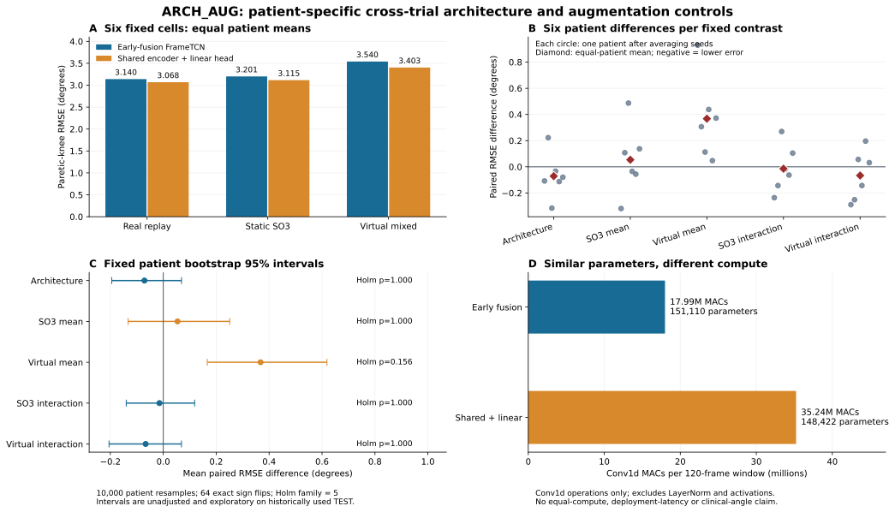
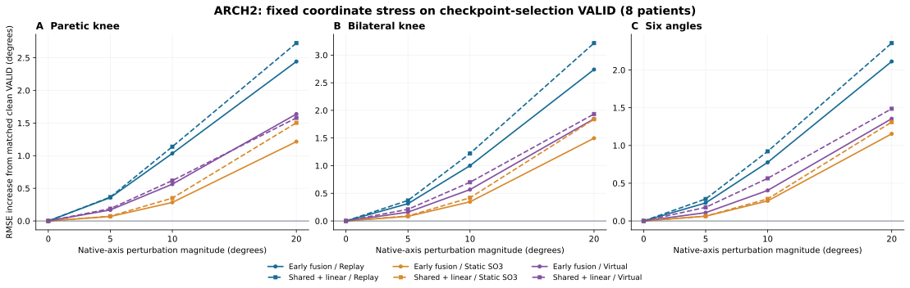
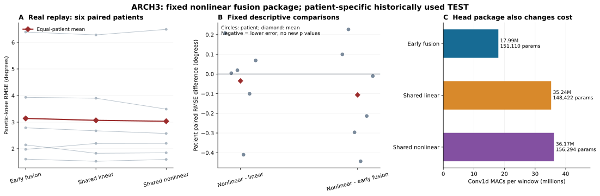

# 网络架构与数据增强支线：完整结果与决策（2026-10-23验收）

实验目录与文件名保留20261022批次标识，本页记录2026-10-23（Asia/Tokyo）完成的追加验收与汇总。

**原六格对照已完成96个新fit，48个旧fit只读复用，并通过独立训练、VALID及结果数值复核。** 本支线研究同一患者内跨试次的网络结构和增强策略，不把泛化线的跨患者结果混入此表。原共享结构在真实replay上的患膝平均误差减少0.071122°，5/6患者改善，但区间跨零且五项Holm校正后不显著；静态SO3在干净TEST上未显示稳定误差降低，mocap虚拟增强的平均误差升高0.367668°。全部六格、三seed、六名TEST患者与阴性结果保留。

追加ARCH2的全部19个固定VALID坐标case与ARCH3非线性融合头亦已独立验收。非线性头相对原共享线性头的患膝配对均值差为-0.035051°，2/6患者误差降低、4/6升高，作为固定描述性对照，不新增p值。整条支线共120新fit、105000更新；48旧fit只读复用另计。

## 1. 研究问题、输入来源和对照边界

以两种结构×三种增强固定六格：早融合FrameTCN；同一个6D小腿编码器分别处理左右侧，按左、右顺序拼接后接线性六角head。增强包括真实四槽replay、真实＋三个固定静态SO3坐标视图、真实＋三个已有random mocap虚拟视图。原早融合replay及virtual两格共48旧fit精确验签复用，不重新训练或改写旧预测；其余四格96新fit。stage1为24个共享replay fit，stage2另72 fit；全部新fit与旧参考验签后才开放本批正式TEST。

所有格保持53个原始parent及31TRAIN/12VALID/10TEST划分，8名拟合患者，其中6名有TEST，三seed固定为20261021/20261022/20261023。TRAIN每个parent裁切[100:-100]，共有12665唯一实测帧；对应完整TRAIN参考18865帧。四视图、相同标签/时钟、window120/stride20/尾窗、batch64、200epoch、AdamW 3e-4/weight_decay1e-4、clip1、每10epoch完整真实VALID、Hann floor0.08均固定。每格24fit合计21000步，96新fit合计84000步。每位患者的x/y scaler只从去重真实TRAIN裁切帧拟合，各格数值逐位一致。

输入始终为S1左小腿、S2右小腿实测加速度＋角速度12D，SI单位、sensor native轴，保留原重力和偏置；S3/S4/S5/S6、患侧和用拐候选标签均不是模型输入。输出保持LH/LK/LA/RH/RK/RA六个legacy骨盆YZ工程投影角：膝为投影角绝对值，踝未做90°中立位校正。没有改写标签、同步、mocap配对、坐标或三解剖平面的临床定义；native XYZ不可直接命名为矢状、冠状或水平轴。

真实SO3增强在SI信号上、标准化之前执行，同一parent内每个传感器的Q全程恒定，acc与gyro使用同Q；三个视图方向各向同性、角度在±10°内。列向量新值Qᵀv，行数组为vQ；时钟、GT和测量点不变。Q也旋转重力及偏置，原始向量模长保留；标准化后的模长和统计量不保证不变。它是同测量点的坐标轴扰动，不是有独立安装记录的真实重戴实验。

mocap虚拟视图源自既有marker运动学及假设的姿态、杆臂和传感器生成过程，不是原生IMU的另一次真实采集。virtual与真实SO3同时改变来源、姿态分布、滤波和物理假设，故仅能比较两种策略，不能把差值归结为单一的“虚拟数据来源效应”。

## 2. 六格完整TEST结果

|网络结构|增强策略|患侧膝RMSE°（主终点）|双膝RMSE°|六角RMSE°|
|---|---|---:|---:|---:|
|早融合FrameTCN|真实四槽replay|3.139519|2.747616|2.462231|
|早融合FrameTCN|真实＋3个静态SO3视图|3.200510|2.800984|2.470843|
|早融合FrameTCN|真实＋3个mocap虚拟视图|3.540441|3.207464|2.699182|
|共享编码＋线性融合|真实四槽replay|3.068398|2.758640|2.459411|
|共享编码＋线性融合|真实＋3个静态SO3视图|3.114999|2.780514|2.473274|
|共享编码＋线性融合|真实＋3个mocap虚拟视图|3.402812|3.240792|2.689186|

各角先按完整连续trial计算RMSE，再等角→患者内等trial→等seed→等患者。患膝每trial只有一个患侧角；双膝为两膝各自RMSE的平均，不是先合并两列残差再开方。PCC各层采用Fisher-z聚合，辅助MAE、PCC与ROM见[无身份汇总JSON](SII2027_ARCH_AUG_AGGREGATES_20261022.json)。trial、seed、窗口和增强视图均不增加独立患者数。

图A为六名患者等权均值；图B每点为患者内先平均seed后的差值，不展示患者身份；图C为10000次患者bootstrap的未调整95%百分位区间，图中p为五项Holm校正结果；图D仅比较Conv1d MAC。图中所有格与预定对照完整保留。

## 3. 五项预先固定的患者对照

F为早融合，H为共享编码＋线性头；replay、SO3、virtual为三策略。主对照为H_replay−F_replay；SO3均效应为0.5×[(F_SO3−F_replay)+(H_SO3−H_replay)]，virtual同理；交互为H内增强变化−F内增强变化。负值表示该固定差的误差更低，不代表交互中的所有格都获益。

|固定对照|患膝RMSE配对均值差°|患者bootstrap95%区间°|64模式双侧sign-flip p|Holm五项p|负差患者|
|---|---:|---|---:|---:|---:|
|架构主对照|-0.071122|[-0.194600, +0.068974]|0.40625|1.00000|5/6|
|SO3平均效应|+0.053796|[-0.132904, +0.251222]|0.62500|1.00000|3/6|
|虚拟平均效应|+0.367668|[+0.166463, +0.618514]|0.03125|0.15625|0/6|
|SO3×架构交互|-0.014390|[-0.139955, +0.118614]|0.84375|1.00000|4/6|
|虚拟×架构交互|-0.066507|[-0.205070, +0.068750]|0.43750|1.00000|3/6|

bootstrap单位为六名患者，10000次、seed20261022；sign-flip穷举64种符号，依赖零假设下差值符号对称性。五对照属于同一固定Holm家族，六患者下最小可达校正p为0.15625，当前设计本身难以给出p<0.05。区间为未调整的描述性区间，不能借其不跨零规避多重比较。新增机制实验的对照不事后混入或替换这个家族。

当前共享线性结构的优势很小且患者间方向并不完全一致；静态SO3平均效应未稳定降低误差；virtual均效应六名患者均变差，但校正p仍不能当显著证据。保留负结果，并不据已反复使用的TEST筛选seed、患者、增强角度或部署赢家。

## 4. 架构性质与计算成本

原共享模型在eval时为f(L,R)=W_LE(L)+W_RE(R)+b。编码器内部可以学习各侧的非线性时序特征；对独立的左右输入，该函数具有加性，不能显式表达融合后的非线性交互。自然步态的左右信号本身相关，加性模型仍可利用两侧信息预测，不能泛称它学不到双侧步态关系。独立合成四组合输入的跨侧二阶差分验证了上述结构性质。本对照同时改变早/晚融合、权重共享和跨侧表达能力，是架构组合对照，并非孤立的权重共享因果效应。

|结构|参数|Conv1d MAC/120帧窗|单窗合成CPU探针中位数ms|
|---|---:|---:|---:|
|早融合FrameTCN|151110|17986560|2.965874|
|共享编码＋线性融合|148422|35235840|2.670894|
|追加共享＋GELU融合头（ARCH3）|156294|36172800|2.856670|

共享模型参数少1.78%，但双侧编码的Conv1d MAC为原模型约1.96倍；两者RF均85帧。MAC不含LayerNorm、激活和dropout，参数相近不代表等计算。耗时来自三结构同进程、合成单窗、CPU1线程、batch1、每模型10次warmup后50次固定seed交错测量的中位数，p10/p90完整保留于汇总JSON，受运行环境及并行实现影响，不能据单个中位数宣称部署更快或实时性能。跨结构初始化、dropout及shuffle共用全局torch RNG的消耗量不同，不声称跨结构逐batch顺序完全一致；同结构增强格沿用同实现、seed、形状、窗口及更新预算。

## 5. 追加机制实验与结构扩展

以下追加项各自采用独立合同与验收，不改写原六格合同、模型、五项统计家族或原始分组。它们用于检验结构和坐标敏感性，不补造独立队列或临床JCS结论。

### 5.1 ARCH2：固定VALID坐标敏感性诊断

不增加训练，使用全部144个冻结best模型、12个完整VALID trial、8名患者。固定19个case：clean，以及native X/Y/Z各轴、正负符号、5/10/20°的18扰动；对每个传感器acc与gyro用相同Q，在原始SI单位、scaler之前执行。S1为+theta，S2围绕其自身同索引轴为−theta；这两个native轴没有共同解剖方向含义，反向耦合模式不能分离左右传感器贡献，也不能覆盖所有真实重戴。

216个model-trial产生4104个case预测、24624逐角指标。先按同trial、seed、患者聚合，每个非零幅度再对六个轴/符号case等权；患者内减相同支持的clean分数。全部模型、幅度、方向及三个终点保留，无新增p值。下表为患膝VALID RMSE，括号为相对clean的配对变化；它不是TEST表。

|结构·增强|clean RMSE°|5°压力：RMSE° (Δ°)|10°压力：RMSE° (Δ°)|20°压力：RMSE° (Δ°)|
|---|---:|---:|---:|---:|
|早融合·replay|3.213074|3.571691 (+0.358617)|4.247815 (+1.034742)|5.655619 (+2.442545)|
|早融合·SO3|3.210285|3.278468 (+0.068184)|3.494426 (+0.284142)|4.425771 (+1.215487)|
|早融合·virtual|3.355951|3.524852 (+0.168901)|3.919577 (+0.563625)|4.993941 (+1.637990)|
|共享线性·replay|3.295132|3.660617 (+0.365484)|4.432988 (+1.137855)|6.019910 (+2.724778)|
|共享线性·SO3|3.267629|3.340331 (+0.072702)|3.617846 (+0.350217)|4.771394 (+1.503764)|
|共享线性·virtual|3.474990|3.663036 (+0.188046)|4.093201 (+0.618211)|5.054453 (+1.579463)|

早融合：10°患膝误差增量replay +1.034742°，SO3 +0.284142°，virtual +0.563625°；共享线性：10°患膝误差增量replay +1.137855°，SO3 +0.350217°，virtual +0.618211°。这些差值只描述本固定耦合坐标压力下、相对各自clean的敏感性；较低增量不等于更低的clean误差，也不自动推广为真实安装变化的有效增强。

坐标变换只改输入，不改GT、时钟、测量点或工程角定义。20°超出原增强的±10°训练范围，是预设外推压力。VALID已经参与每个模型的checkpoint选择，因此这里只能分析已选模型的坐标敏感性，不能宣称新独立泛化、临床解剖面鲁棒性或已验证真实传感器重戴。独立审计对所有4104预测重新前向、逐角及所有汇总重算，clean与原选点分数一致；TRAIN、TEST及旧预测/评分文件均未读取或散列。

### 5.2 ARCH3：固定非线性融合头组合对照

根据原共享模型的源码加性性质另立模型：保持同一shared shank encoder、左右顺序、RF85、六角监督与真实replay，融合头固定为Conv1d(128,64,1)→GELU→Conv1d(64,6,1)，不新增head dropout。没有据TEST搜索head宽度、seed、患者或增强。先构造原共享模型再替换head，使同seed encoder初始权重逐位相同；head额外初始化消耗RNG，后续dropout/shuffle轨迹不同，不能声称逐batch同序。

新增24fit、21000更新，TRAIN/VALID角色、四槽、scaler和原训练配置均保持。全部fit验签且独立重算24模型best及final的完整VALID，共36＋36 model-trial之后，才开放新TEST。固定保存30新TEST预测，另60原Frame/共享线性replay预测只读复用，共90记录、540角；这不是90个独立新样本，也未增加患者数。

|固定真实replay模型|患侧膝RMSE°|双膝RMSE°|六角RMSE°|
|---|---:|---:|---:|
|早融合FrameTCN|3.139519|2.747616|2.462231|
|原共享线性头|3.068398|2.758640|2.459411|
|共享＋GELU非线性融合头|3.033347|2.662806|2.402930|

|终点|固定描述性差|患者配对均值差°|误差降低|误差升高|持平|
|---|---|---:|---:|---:|---:|
|患侧膝|非线性−原共享线性|-0.035051|2/6|4/6|0/6|
|患侧膝|非线性−早融合|-0.106173|4/6|2/6|0/6|
|双膝|非线性−原共享线性|-0.095834|6/6|0/6|0/6|
|双膝|非线性−早融合|-0.084811|4/6|2/6|0/6|
|六角|非线性−原共享线性|-0.056481|5/6|1/6|0/6|
|六角|非线性−早融合|-0.059301|4/6|2/6|0/6|

患膝主终点相对原共享线性头只有2/6患者误差降低、4/6升高，均值差-0.035051°不能单独作为稳定收益证据。双膝和六角保留为辅助观察，不替换患膝主终点。

参数156294、Conv1d MAC/120帧窗36172800：相对原共享线性头参数+5.30%、MAC+2.66%；相对FrameTCN参数+3.43%。融合后的非线性、容量、计算成本和RNG路径共同改变，因此本实验不能纯因果隔离其中任何单一因素。统一三结构合成CPU推理探针见汇总JSON，不能替代部署时延测试。

新增比较为“非线性−原共享线性”和“非线性−Frame”两项描述性差，三个终点和所有患者/seed保留，不增加p值或事后加入原五项Holm家族。配对均值与患者方向用于描述，不据单个均值挑选部署结构。独立结果审计重算30新预测，验签60原预测，重建540角指标、全部汇总和36个患者配对差；旧参考不重写。

## 6. 审计与决策记录

本支线新增训练库存为原六格96fit/84000更新＋ARCH3 24fit/21000更新＝120fit/105000更新，旧48fit/42000更新只读复用不再计新增，逻辑模型168。新模型比较预测为636个原六格全角色预测＋30个ARCH3 TEST＝666个、3996新逐角指标；ARCH2的216个多case档、4104case预测和24624角属于机制诊断另计。原六格954总记录及ARCH3 90总记录均含复用，不相加当作独立新预测或患者。

原训练审计只读31TRAIN、12VALID及93random训练视图，重新构建所有视图、窗口、标签和scaler；144fit的28800条历史与2880个VALID选点记录核对，best及final共288状态在完整VALID上重新前向，432个model-trial评分复算。96新fit的初始状态指纹逐位复现；旧48fit没有另存原始初始张量，只能依冻结源与seed复现初始化，不能称保存了其完整初始轨迹。优化器状态未保留，不把历史更新数核对称为重演整个优化轨迹。

独立结果审计使用另写的functional Conv1d/LayerNorm/因果padding和共享左右顺序实现，对新636＋旧318共954份预测全部重新网络前向，保存pred逐元素一致；5724逐角指标、四级汇总、五项固定对照及bootstrap/sign-flip/Holm全部数值复核通过。图与报告入口重新验审计状态、源码、合同和结果摘要，过期或缺失时拒绝读取正式汇总。索引列出对应相对实验路径、函数行号与SHA，见[函数级代码索引](SII2027_ARCH_AUG_CODE_INDEX_20261022.json)，不公开绝对路径、患者角色表、原始数组或模型权重。

当前决定：原六格和追加结果作为本支线的完整探索性证据保留；任何小均值变化都不单独证明通用架构或增强有效。若继续比较噪声、偏置、缺失模态或新的结构，需先固定具体问题与支持范围，并单列训练、监督和计算成本，不围绕同一TEST连续搜索。泛化线与本支线保留同一数据分支点，但当前表是同患者跨试次，不能据此宣称跨患者泛化改善。

TEST在早期身份/时钟QC及历轮研究已出现；本批训练完成后才开放TEST不等于全历史盲测。原始连续CSV可含不同角色的不重叠采样段，不能称文件独立。拐杖目录/S6运动仍只是候选条件，不能证明接触或承重；TEST有拐/无拐患者覆盖不完全配对。实测IMU安装旋转未独立识别，输出仍是工程投影角。因此本报告不声称临床角准确性、真实重戴泛化、临床用拐效果或独立患者确认性验证。
