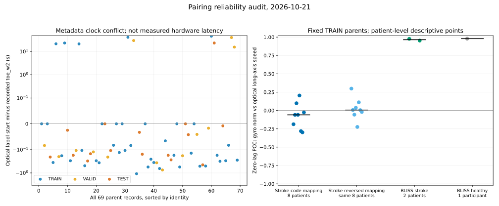
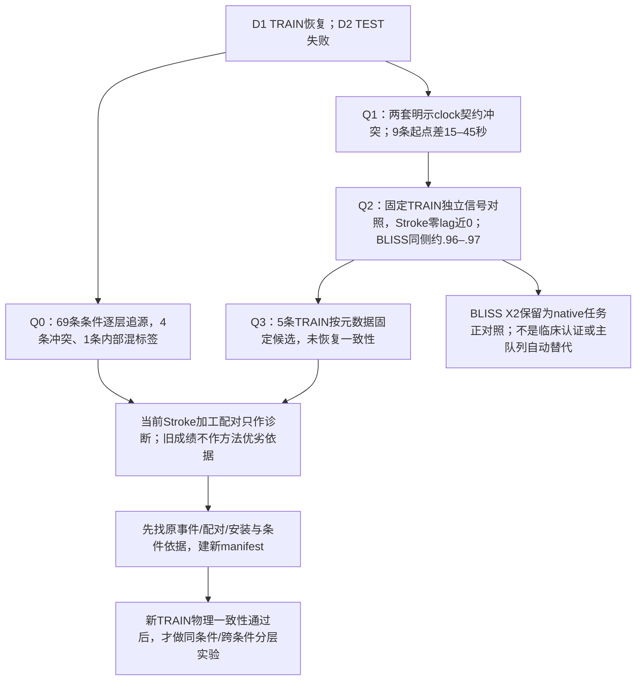

# 原Stroke与BLISS：先验收数据配对，再讨论模型

**10/22输入、监督表示与虚拟对照更新：** [192新增神经拟合、简单线性参考及独立验收](SII2027_NATIVE_ABLATIONS_20261022_ZH.md)完成。固定53真实数据/6患者TEST；3输入mask＋RotMSE/RotGeo，虚拟31TRAIN/124假设视图与同支持同21000步控制，失败context尝试也保留。所有种子及患者级配对结果见表；论文有标定方法但本地逐人安装值仍未知。当前为I_full，原E2的G/A外层患者排除尚未完成；不称临床JCS或真实安装等价。

更新：2026-10-21（Asia/Tokyo）。用户提出用拐条件、同步和BLISS结果的可靠性疑问后，本轮完成了独立的只读审计。**当前原Stroke加工后的IMU—mocap配对版本不再接受为已同步的监督训练集；原始单模态测量并未被宣判无效。BLISS去重X2具有更充分的native任务配对证据，可继续作为正对照。**

之前D1/D2及原M数值保留，可复算性没有被否定；其科学解释降为未验收配对上的诊断，不能据此裁定逐帧/分阶段方法或真实患者泛化失败。本次没有新训练，没有改旧数据、条件、标签、split、模型或测试分数。仍保持双小腿IMU估计下肢运动学主线；改变主方法、输出任务或主队列之前先与用户沟通，原文不保真的数字不作为复现目标。

左图为全部69条的元数据起点差，**不是硬件延迟测量**。右图每点是一个患者的双侧trial中位PCC再取中位，Stroke两个映射是同一8人的两套保留假设，不是16人。长轴速率忽略轴向spin，不等同完整gyro范数。BLISS健康1人单独列示。

配套：[8个脚本的函数/行号/SHA索引](SII2027_RELIABILITY_CODE_INDEX_20261021.json)、[聚合证据CSV](SII2027_RELIABILITY_AGGREGATES_20261021.csv)。Q指本地`Project2_submission/experiments/data_reliability_20261021`；原数据、逐trial表、权重和代码实体仍在本地。公开本页、源码定位/指纹、聚合数据和无身份汇总图，不上传原始参与者记录。

## 1. 新决策树

## 2. Q0：用拐条件来源不一致，混合条件不能解释一切

**目的：** 区分真实条件变化、元数据误写和IMU—mocap跨条件错误配对。

**尝试/代码：** `Q/cane_condition_audit.py`逐层读取69条NPZ字段/路径、aligned逐行Cane_Label、前级完整IMU slice、原mocap目录及现存TRC头部；从364份保存NPZ重算旧D2患侧膝，不新训练。

**结果：** 4/69条IMU侧与mocap侧条件矛盾，主8涉及2条TRAIN和1条TEST。1条TEST的637帧中，首152帧标有拐、后485帧标无拐，NPZ仅存首帧标签。这里只证明字段混合，不证明实际途中换拐。原IMU连续流没有逐trial条件真值；矛盾已存在前级slice，不能只改NPZ字段修复。

原划分未按拐杖分层，但每个TEST条件在该患者TRAIN中均出现，不是严格的“只训有拐→只测无拐”。存在所有来源一致且全无拐的患者仍显著失败，说明混拐不能解释全部问题。

事后条件来源一致子集：有拐TEST3患者/4trial，逐帧9.122°、整窗7.344°、常量8.079°；无拐TEST7患者/8trial，逐帧12.182°、整窗11.365°、常量10.289°。组成人群不同，模型仍用原39 TRAIN，这不是同条件重训或拐杖因果效应。全部旧分数独立复算最大差7.11e−15。

**决策：** 条件真值与配对身份先核，不按目录重命名或按误差挑标签。缺独立记录的条件应在新版本中记unknown/隔离，并保留原文件。

## 3. Q1：已确认时间契约冲突

**目的：** 检查数组内部时间一致是否掩盖IMU与光学的物理时刻错接。

**尝试/代码：** `Q/sync_provenance_check.py`对69条NPZ、aligned CSV、完整前级IMU slice、point绝对frame/time、Rot6D局部编号和旧Toe锚逐sample追源。69条前级slice→aligned的12D最大差0，NPZ仅float32舍入；当前query均为`120×walk_time`。

当前链条按旧walking锚裁IMU后归零，再接光学rotation的局部0行；另一现存明文Toe映射为`mocap_time=toe_w1+IMU_elapsed_since_w1`。原point标签绝对起点没有被传播进前一套连接，两个契约可直接比较：

| 元数据检查 | 记录数 |
|---|---:|
| 旧toe_w2与现有point起点差>0.01s | 58/69 |
| 起点差>0.25s | 30/69 |
| 起点差>2s | 9/69，实际15.392–45.534s |
| 上述大差异且属于固定TRAIN | 5/39 |
| toe_w3与point末端误差≤0.008s | 69/69 |

一个固定TRAIN例的旧锚范围20.133–69.608s，而现有标签仅65.667–69.608s；当前仍取旧IMU起点附近短段配到光学65.667s。这高度支持“标签裁短/重选后起点未同步传播”的机制。

**证据边界：** 确定的是两套时间契约不一致及程序如何取样；原point/Toe writer执行谱系、事件定义和独立物理时延仍缺，不能把45秒差值叫硬件延迟，也不能断言历史修改顺序。此前M修复point↔rotation行对应，仍继承上游aligned query，未关闭这一跨模态问题。

**决策：** 当前加工配对不通过同步来源gate。信号真实、插值正确、GT oracle通过与生物学时刻正确是不同检查。

## 4. Q2：与BLISS的独立TRAIN信号比较

**目的：** 用不依赖网络误差的物理量检查当前配对的同相证据。

**尝试/代码：** `Q/signal_pairing_audit.py`固定Stroke主8全部39 TRAIN、BLISS X2全部72 target TRAIN（两卒中55、健康17）；只在TRAIN作固定零lag及±1s诊断。Stroke34条有verified world，另5条保留缺源拒绝，不换例。gyro范数与光学小腿长轴转速统一固定6Hz/100Hz处理，保留四种侧别及足/小腿、world/pelvis假设。

下表先每患者取trial中位，再患者间中位；健康不混入卒中：

| 固定假设 | n患者/world TRAIN | 零lag PCC |
|---|---:|---:|
| BLISS卒中左—左 | 2/55 | .970 |
| BLISS卒中右—右 | 2/55 | .959 |
| BLISS健康同侧左/右 | 1/17 | .982 / .975 |
| Stroke S1—左 | 8/34 | −.081 |
| Stroke S1—右 | 8/34 | .010 |
| Stroke S2—左 | 8/34 | .012 |
| Stroke S2—右 | 8/34 | −.110 |

BLISS同侧在原导出时钟已高度同相；Stroke各固定侧别均近0，足线和pelvis-relative参考也未统一恢复，不能简单交换S1/S2解释。诊断最优lag未用于修正数据/分数；周期运动可以在多个lag相关，不能据其认证真实同步。健康片段过短，不报其固定共同支持±1s扫描结果。

**边界/决策：** gyro包含绕长轴spin，长轴速率没有；marker代理、安装和病情不同，所以低相关单独不是硬件故障证明。它与明确时间契约冲突合起来，支持优先检查配对，而不是继续扩大模型。

## 5. Q3：元数据固定候选未验证修复

**目的：** 检查已发现的时间矛盾能否仅靠已有锚点恢复一致性。

**尝试/代码：** `Q/signal_candidate_mapping.py`只取39 TRAIN内起点差>2s的预定5条，不按模型误差/相关择例。由完整IMU按`mocap_time=elapsed_since_w1+toe_w1`固定scale=1重读，在相同原光学绝对时刻比较，保留所有侧别/段假设。5/5源覆盖充分，历史x可重建。

**结果/决策：** 候选没有统一改善零lag对应，足线也没有统一恢复。不能把元数据差值当作已知物理lag，不能直接按该候选重训、选最佳时移/换侧、删除失败例或覆盖旧成绩。需继续找原Toe事件定义、人工配对/trigger、sensor安装及条件依据。

## 6. Q4：共同模型指标与数值质量

`Q/distribution_quality_audit.py`逐源SHA核验147条既有TRAIN/TEST输入、11套TRAIN-only scaler，VALID数组未读。输入均有限、约100Hz递增，无整trial常量通道；acc/gyro范数同量级，未见全局单位倍率或gyro全零。正常数组仍可对应错误时刻。

统一为**个体从头训练I、双膝、患者等权**，不将旧Stroke患侧膝与BLISS适配A混比：

| 数据/逐帧模型 | TRAIN双膝RMSE° | TEST双膝RMSE° | TEST PCC |
|---|---:|---:|---:|
| 原Stroke | 1.815 | 14.250 | .210 |
| BLISS两卒中 | 2.242 | 2.210 | .995 |

Stroke8患者/3seed/width64/200轮，BLISS2卒中/单seed/width32/40轮，参考量及标签不同：legacy YZ投影 vs native Visual3D Angles X。这个差距是支持性现象，不能算数据质量倍数，也不是匹配预算因果实验。BLISS的I为2.210°；此前A为2.023°，此处分别记账。

官方[BLISS Version 3档案](https://researchdata.bath.ac.uk/1425/)提供光学参考及采集、布置、参与者和导出资料；X2按同trial的native exported Time共同覆盖配对、先去重复源到118条。其独立硬件latency与完整JCS仍未认证，不因较低RMSE自动认证数据。

## 7. 当前用途与下一步

| 对象 | 当前判定 |
|---|---|
| 原Stroke原始单模态文件 | 保留来源、marker几何与配对重建用途，未判设备或原始采集整体无效 |
| 当前原Stroke加工配对 | 仅作诊断，不用于已同步监督下的方法优劣、适配/合成收益或临床泛化主张 |
| BLISS X2 | 维持已声明native导出时钟任务的正对照，非大样本临床/多session认证 |

先追原事件、试次配对和安装/条件记录；在新目录建立版本化manifest和source/clock/condition gate。新TRAIN物理一致性通过后才做同条件留trial与跨条件分层实验。当前不以测试最佳lag或误差选配对；已有TEST也须继续标开发性复用。若要改用BLISS作为新稿主队列，先沟通，不自动替换研究方向。

本轮8个实际脚本、全部来源与聚合表已封存，源码快照`source_snapshots/f688e49d8ae01302`；新审计53个artifact和15个源码/文档快照共68项hash核验通过，旧D归档1210项未改动。3项数学工具检查、364份旧预测独立复算和各源SHA核验通过；这些工具验收不等于生物同步通过。精确入口/函数见[代码索引](SII2027_RELIABILITY_CODE_INDEX_20261021.json)。

## 10/21新增：原数据组合配对修复（R04–R08）

[详细尝试/目的/结果与新决策树](SII2027_PAIRING_REPAIR_20261021_ZH.md)、[源码函数/行号/SHA](SII2027_REPAIR_CODE_INDEX_20261021.json)、[全部聚合与固定种子结果](SII2027_REPAIR_AGGREGATES_20261021.csv)。原PDF唯一源窗→39 TRAIN前置动作开发→冻结69条应用，18条候选；2患者、6 TRAIN/3 TEST的固定配对模型恢复，表明先修复输入配对有必要。不能分离纯时间、试次身份和条件来源的单独贡献。

正式释放仍待上游重力/滤波支持、现场条件/安装及物理split验收；不把QC筛选子集或mocap离线校时描述成未见患者/实时IMU-only验证。主线保持双小腿实测IMU估计下肢运动学；正式G/I/A、逐帧与整窗比较须在验收新数据版本后继续。历史数字保留，不按原文不保真数字反推实验。

## 10/21采集者补充后的执行（R09–R12）

[原始源、抬健侧腿标记、S6与17条native候选](SII2027_RAW_ACQUISITION_20261021_ZH.md)、[函数/行号/SHA](SII2027_RAW_SOURCE_CODE_INDEX_20261021.json)、[聚合数据](SII2027_RAW_SOURCE_AGGREGATES_20261021.csv)。安装左右语义已由采集者确认；实验室轴、固定安装旋转与clinical JCS仍需分别验收。216原始文件/16加工源桥接已建立；17条native重建不沿用旧全记录滤波/旋转，但继承原离线clock/QC，旧2.205°不能转记为新版本成绩。

原患侧表与标记侧有2例待核，11条缺原光学；未用拐时S6也可能被携带，运动不能等同承重。下一步先确认标记事件和native预处理支持，再冻结正式实验；不据网络误差改条件、侧别或lag。旧阶段“安装未闭合”指其当时证据，最新采集者确认与剩余坐标问题以本次更新为准。

## 10/21新增：mocap少于IMU时的顺序/跳段配对（R13–R16）

[完整方法、尝试和结果](SII2027_ORDERED_MATCHING_20261021_ZH.md)、[源码函数/行号/SHA](SII2027_ORDERED_CODE_INDEX_20261021.json)、[聚合数据](SII2027_ORDERED_AGGREGATES_20261021.csv)。156原始光学中只有58属于当前有固定监督步态边界的69目标；另98未自动入组。164是IMU单侧重复动作候选，不是真实行走计数。未匹配IMU可能属于未选光学，不能等同漏采。

旧PDF同尾号绑定已降为历史假设，组内有序、组间另核来自用户确认。前置块决定候选与全局路径，步行仅后验验收且失败不重选。49原始候选仍依赖有限detector候选集和离线光学校时，正式释放false；下一步补候选召回与S6/预处理验收，再冻结新版本重训。旧数据和模型保留，未追逐原文不保真数值。

## 10/21新增：标记漏检的统一修复与回归（R17–R18）

[完整尝试、目的、代码职责和结论](SII2027_MARKER_RECALL_20261021_ZH.md)、[函数/行号/SHA](SII2027_RECALL_CODE_INDEX_20261021.json)、[聚合数据](SII2027_RECALL_AGGREGATES_20261021.csv)。

两条漏检源自标记后的活动并入峰组，导致整组对侧RMS超限。保留0.35rad/s及比值3等原门槛，全部18session统一枚举极大有效子窗；没有按旧时钟补单例。新增14动作提案，最终多4条验收；旧49同步时钟完全不变。真实同号绑定仍被弃用，两个条件各自保序、共享源且允许跳段。

物理身份反事实排除整类别名，10ms实际源区间隔与原始行非复用仍有效；当前311有效边无实际别名重复，因此结果改善来自新子窗。路径先冻结、步行后验收，失败不重选。剩余16/69未验收继续保留原因（11无模板、2侧别/模式、1无路径、2验收失败）。

本轮数据召回工作完成，正式训练就绪仍为false。下一步补53条S6证据及预处理/坐标合同，再冻结并重训；测试mocap用于离线修复，不称完全未接触测试集，不继承原2.205°模型分数。历史49版结果保留供对照。

## 10/21新增：原生53条工程训练版本与固定基线（R19–R22）

[完整目的、尝试、结论与决策树](SII2027_NATIVE_BASELINE_20261021_ZH.md)、[源码函数/行号/SHA](SII2027_NATIVE_CODE_INDEX_20261021.json)、[全部聚合指标](SII2027_NATIVE_AGGREGATES_20261021.csv)。

本轮完成此前计划的S6、输入和坐标合同：26目录有拐/27目录无拐的S6运动模式相容，未改条件或删人；53条原生SI和几何通过，三平面索引没有混淆，原生sensor XYZ与骨盆解剖轴严格区分。训练只用各患者TRAIN唯一帧拟合统计量，不再默认旧gravity加工输入或移植旧模型成绩。

固定24fits（8患者×3seed）全部200epoch，每10epoch在各人VALID择checkpoint，全部验签后统一TEST。原角色31/12/10、TEST6人；两人只有TRAIN/VALID；有一位患者VALID/TEST条件不同。连续源CSV跨角色共享但原生采样支持无重用，不能称文件级独立。

患者内真实IMU基线及TRAIN均值结果见表；旧2.205°是不同输入和分母的历史探索，不作直接增益比较。全部种子和10条TEST保留，212预测/1272角度指标完整审计。数据工程训练就绪不等于临床最终认证；下一步围绕冻结版本补输入/表示/虚拟数据消融，跨患者需另立协议，改临床输出或主队列须先讨论。

## 10/22新增：I_full信息、监督表示与假设虚拟对照（R23–R31）

[实验目的、每次尝试及结论](SII2027_NATIVE_ABLATIONS_20261022_ZH.md)、[函数/行号/SHA](SII2027_ABLATION_CODE_INDEX_20261022.json)、[聚合结果](SII2027_ABLATION_AGGREGATES_20261022.csv)、[患者配对差](SII2027_ABLATION_PAIRED_20261022.csv)。

本批实际是3输入信息组、2个Rot6D监督/损失组，共120新fits；另3个同共同crop/同4视图/同21000步的真实重复与假设虚拟组，共72新fits。简单当前帧Ridge参考8模型/48VALID候选另列，不能称完整Guo框架复现。旧raw12参考24fits只读复用。全数据角色和测试段不变，1537预测记录/9222角度指标与额外1908SO3指标可追溯，N仍为6测试患者。

虚拟完整context首次0/31失败；共同裁剪后31TRAIN/124视图，12665训练目标帧及18865参考context成本分别记账。原论文有sensor-to-segment标定方法，当前没有逐人实际安装数值，不把假设模拟提升为已标定真实IMU。输入轴与原六投影角含义保持不变。

每患者统计先汇总trial/seed再等患者，64种符号翻转与Holm保持原定义；不能为显著性把窗口/种子当患者或更换检验。本轮未完成原E2的外层患者G/A2×2：下一批需source彻底排除目标、两A共用同target真实适配并记VALID参考成本。草案已在本地形成，不冒充已运行结果。
