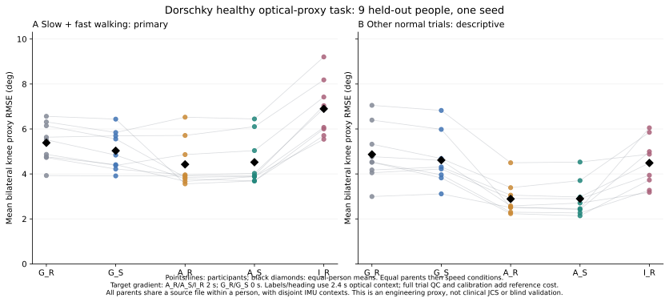
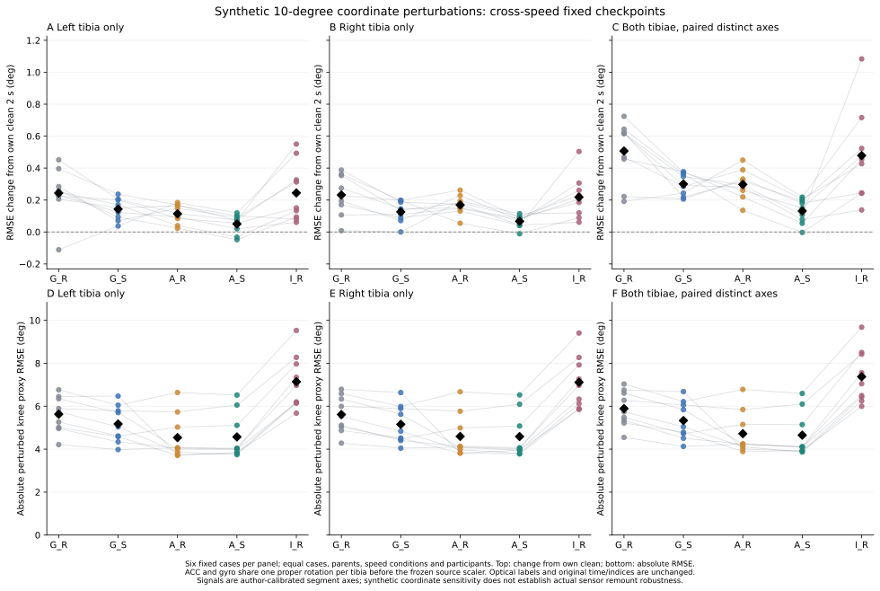
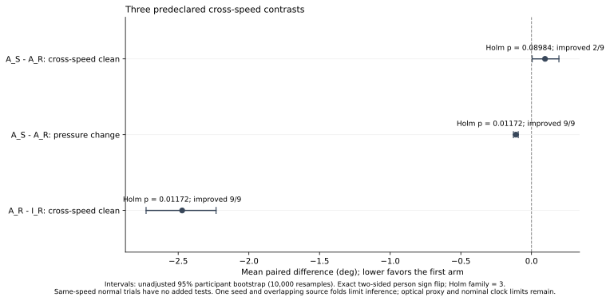

# Dorschky公开数据：独立双膝任务、少量适配与方向增强

实验设计：2026-10-24；验收/报告更新：2026-10-25。实验ID与附件文件名保留20261024。

**本批45次拟合、34200次优化更新及固定评价已通过独立训练和完整数值审计。** 本轮继续泛化和“少量适配＋方向增强”，保持旧架构分支79项冻结。Dorschky提供真实双小腿IMU和独立光学marker；没有可直接逐帧配对的双侧原生六角，本轮公开定义独立双膝heading-sagittal工程proxy。任务头由6输出设为2输出，主体定义和训练超参沿用；新权重从头初始化，不从WMCG/Stroke迁入，不把三个任务的RMSE或目标N混合。

## 本轮问题与尝试

| 尝试 | 目的与代码实现 | 发现、处理和结论边界 |
|---|---|---|
| 全体公开源接入 | 全10人的实测双tibia十二列＋TRIGGER，完整OMC，源Range/列文件SHA和OMC官方MD5 | 10份完整OMC验MD5；原IMU只选列，不声称整文件MD5通过；zero-filled decoder image不是完整源 |
| 原始试次身份 | 显式MOVEMENT/TRIAL、实际trigger code与数量，按实际N/连续1..N核对 | 全592条OMC结构候选，walking297条；P01慢走与P05慢走/常速是9次，不能强塞统一10次或压缩缺号列表 |
| 格点与字段差异 | 明确marker实际200Hz，容器1000Hz；列名按显式连字符/下划线对应 | P02/P03用连字符、其他8人下划线；五行中四行NaN是未采样占位，另有真正tracking缺失 |
| 标签与平面 | `dorschky_signal.py::signed_knee/construct`，光学GTRO/KNE/ANK投影至forward/up | 左右均thigh−shank，正屈膝、保留负值；heading来自同2.4秒滤波GTRO首末差；不是clinical JCS或三平面验证 |
| 抗混叠与固定支持 | marker N2/10Hz双向SOS＋81tap40Hz FIR/down2，IMU401tap40Hz FIR/down10 | 480marker/2400IMU→240@100Hz→[20:220]恰200帧；保留时间和原indices，不补tracking缺口、不扫描lag |
| candidate_v1退役 | 独立read审发现完整文件有限性超出已声明支持门槛，以及artifact损坏可误当parent拒收 | 在0NPZ/0fit时归档源和合同；v2将整文件finite作诊断，artifact/version不一致必须fatal，不能换后续TRIAL |
| 调度启动维护 | 原冻结verify逐history行反复解析约1.4MB manifest，空dispatcher耗时；保留0fit/0更新日志，停止旧EVAL等待器（0预测） | 新`metadata_cached_driver.py`只缓存父进程不可变metadata，运行原target/EVAL入口；worker仍原CLI，核心源码/合同/manifest前后SHA一致，不改模型、数据或G18结果，不计额外fit |
| 全人机械QC与release | `prepare_release.py`对input与固定clock跨模态一致性检查，独立source→NPZ重建 | 297候选保留271，26条只因共同有限XYZ支持不足2.4秒拒收；10人均保留，不按模型误差删人 |
| 五臂同/跨速度 | `dorschky_training.py`，9名外层目标，每人normal2秒适配，其他normal与slow/fast分开 | 五臂固定比较，source best用另人VALID，target final200；同速度和跨速度可分辨，不能把同人其他试次叫新患者 |
| 固定方向压力 | `dorschky_evaluation.py`，19种10°case与clean共用同200帧 | 1160模型-parent包、22040case（clean计一次）、44080逐角行；只支持合成坐标敏感性，非真实重戴 |

接入早期metadata计数JSON序列化失败，随后用已校验源字节重试；早期脚本启动SHA未完整捕捉，相关限制和失败日志保留。正式release/模型/评价均另行冻结SHA，不把接入初期包装成全程预注册。[官方固定记录](https://zenodo.org/records/11522050)、[README](https://zenodo.org/records/11522050/files/README.txt?download=1)

## 实测输入、独立参考与三个平面

输入固定 `TIBIA_L_ACC_X/Y/Z, TIBIA_L_GYRO_X/Y/Z, TIBIA_R_ACC_X/Y/Z, TIBIA_R_GYRO_X/Y/Z`，单位m/s²、rad/s。来自实际硬件，作者已做功能标定并旋转到segment轴；不是未处理native轴，不是由mocap生成的虚拟IMU。保留重力，不按目标拟合bias/scaler。proper SO3 helper回执的S1/S2只是左/右输入槽别名，绝非其他数据集的硬件编号；同传感器ACC/GYRO同旋转。

OMC的mean文件是按速度平均的右侧100-node曲线，不能复制成连续逐trial标签。新参考只用六个独立光学marker的共同有限XYZ、单位mm；大腿向量a=KNE−GTRO，小腿b=ANK−KNE。在heading forward/up投影上：

```text
q = atan2(a_up*b_forward - a_forward*b_up,
          a_forward*b_forward + a_up*b_up) * 180/pi
```

左右均正屈膝，直腿0°，不abs、不选符号/零位。heading为同480帧内滤波GTRO中点首末差的世界XZ投影，up=世界Y；位移不足250mm拒收。若名义X前/Y上/Z右，矢状/水平/冠状分别XY/XZ/YZ；**这里实际采用各trial forward与world up张成的heading-sagittal平面**，不是把IMU的XYZ直接命名为解剖平面。仅两膝屈伸proxy，不含冠状/水平自由度，表面marker/软组织和离面运动使其不能称临床关节中心/JCS。[leg2d符号定义](https://github.com/csu-hmc/GaitAnalysisToolKit/blob/master/gaitanalysis/octave/2d_inverse_dynamics/leg2d.m)

marker200Hz的N2/10Hz前后向滤波高频滚降等效4阶，不能写成单次N4 Butterworth；10Hz双向约−6dB。FIR半支撑0.2秒，裁中段不依赖FIR context外padding；零相位IIR仍是离线处理，不能声称裁边后影响数学严格为0。[2019作者论文](https://www.mad.tf.fau.de/files/2019/08/201908_JBiomech_Dorschky.pdf)

## 时钟、身份和参考成本

每trial固定 `i_IMU=i_trigger+1000*(t_OMC−t_trigger_OMC−0.020)`；trigger不一定在OMC time0，原t0和索引保留。原IMU无timestamp，1000Hz为名义频率。作者2025文献说明约20ms来自光学角导数与邻接gyro互相关估计；本轮固定该值，不重新寻找lag、符号、轴或scale，但它不是独立精确硬件时延、jitter或drift证明。[作者同数据研究](https://www.frontiersin.org/journals/bioengineering-and-biotechnology/articles/10.3389/fbioe.2025.1507162/full)

为说明参考曲线对时间变化的敏感性，另做**无模型、未修改主评价**的固定诊断：各271条参考分别比较相隔1/2个100Hz样本的角度，仅使用199/198个共同帧，不padding、不插值；先逐膝RMS差，再等parent/速度/人。这里n=10包含开发P02，与模型外层n=9分开。该诊断已独立重算：

| 假设的绝对错位 | 参考自身双膝RMS差均值 | 参与者范围 |
|---|---:|---|
| 10 ms | 1.640840° | [1.489117, 1.765587]° |
| 20 ms | 3.274424° | [2.974087, 3.519922]° |

**这些值不是实际同步误差估计，不是模型RMSE，也不说明共同误差必然推翻配对模型差异。** 它只描述已公开参考曲线在指定假设错位下的变化；没有寻找实际lag、平移label或选择模型，主性能仍在原200帧固定数据上计算，没有新增p。机器摘要/聚合只附population与subject摘要及源码/独审SHA，不把它当额外模型样本。

同code、实际N及连续TRIAL匹配只是源有序一致性的结构候选，再由固定规则检查物理一致性；不能独立绝对认证事件身份。每人多个trial仍来自同一个连续IMU文件，已核parent滤波/模型原IMU上下文不重叠；这是不同有序trial，不是独立session或重新安装。

**2秒是200唯一帧的梯度支持，首末采样间隔1.99秒；label滤波和heading另用2.4秒marker context。** 还需要完整trial采集、全trial mask/QC查阅与作者功能标定，不能把总光学/标定成本称作2秒。每fold source TRAIN为8人×3速度×2秒=48秒真实标签，其markercontext57.6秒；source VALID另人全部合格walking parent，实际评分支持范围38.0–60.0秒。五臂/19case重复使用参考，不乘成新增采集量。

九名目标各2秒，共18秒实际唯一梯度标签；其markercontexts共21.6秒，完整CALIB trial样本时长范围2.580–3.870秒。232个不同目标评价parent共464 sample-seconds评分参考，所用markercontexts共556.8秒。全297 walking parent的OMC容器参考mask/QC曾查阅1066.055 sample-seconds，所有592个OMC parent共1442.430；这些角色重叠，不能相加声称互相独立采集。逐fold成本见机器摘要。

**source、CALIB和EVAL都使用光学共同可见性规则划出的中心2秒；EVAL不是完整walk trial或连续全天IMU。** 本轮使用了光学mask来质控和确定支持，尚未验证没有mocap时的自动步态分段流程。适配后评价的是其他TRIAL各自选定的2秒，而不是“2秒适配后完整行走”。

## 整人分配与固定实验

10名健康男性全部通过整人可用性规则，P02永久开发/源角色。外层P01/P03/P04/P05/P06/P07/P08/P09/P10逐人排除；每fold另一个目标循环作source VALID，其他8人为source TRAIN（含P02）。目标不进入源梯度、源scaler或源选点。**源模型是跨人训练；目标适配与评价则是同一目标人的不同trial。**

| 参与者 | 合格slow | 合格normal | 合格fast |
|---|---:|---:|---:|
| P01 | 9 | 10 | 10 |
| P02 | 10 | 10 | 10 |
| P03 | 10 | 10 | 10 |
| P04 | 10 | 7 | 2 |
| P05 | 9 | 9 | 10 |
| P06 | 10 | 10 | 10 |
| P07 | 10 | 10 | 9 |
| P08 | 6 | 8 | 10 |
| P09 | 10 | 10 | 9 |
| P10 | 10 | 9 | 4 |

source每人每speed取最小合格TRIAL；source VALID用独立人所有合格walking trial并先等trial再等三速度选best。目标CALIB为最小合格normal：P01:TRIAL01; P03:TRIAL01; P04:TRIAL01; P05:TRIAL01; P06:TRIAL01; P07:TRIAL01; P08:TRIAL03; P09:TRIAL01; P10:TRIAL01。该CALIB parent整体退出EVAL；其余normal仅same-speed诊断，slow/fast为cross-speed主终点。先分parent再窗口，不将一个原trial切两半冒充跨试次。

G_R是源replay，G_S是源静态SO3；A_R从G_R做replay全参数适配，A_S从G_S做SO3适配；I_R随机权重、相同目标预算，但仍沿G_R的源x/y scaler（包括source标签统计），不是完全无源部署。A_S−A_R同时改变源/目标增强，不能单独归因某一阶段或声称外部交互识别。

冻结FrameTCN原主体定义，仅任务头6→2，150850参数；width64/dropout.15、RF85、120帧窗口/stride20+tail、Hannfloor.08、AdamW3e−4/wd1e−4/clip1、batch64、200epoch、seed20261021。source每10epoch依另人VALID strict less取最早best，全部训练到200；target固定final200、无target VALID。18源fit/28800更新＋27目标fit/5400更新＝45fit/34200更新。公开QC已见全人参考、source fold重叠且单seed，不能称未接触盲临床确认。

冻结的是架构定义和这些超参；source训练及全参数适配的网络权重仍按各臂更新，并非固定encoder权重。

## 固定结果与统计

单位均为度，数值来自独立数值验收后的固定CSV。

| 方法 | cross-speed clean双膝RMSE | cross压力绝对RMSE（18case均值） | 相对自身clean的压力增量 |
|---|---:|---:|---:|
| G_R | 5.384334 | 5.711587 | +0.327253 |
| G_S | 5.031603 | 5.221409 | +0.189806 |
| A_R | 4.425045 | 4.618499 | +0.193454 |
| A_S | 4.520874 | 4.603661 | +0.082787 |
| I_R | 6.897207 | 7.210990 | +0.313782 |

| 方法 | same-speed clean双膝RMSE | same压力绝对RMSE（18case均值） | 相对自身clean的压力增量 |
|---|---:|---:|---:|
| G_R | 4.867179 | 5.203673 | +0.336494 |
| G_S | 4.613230 | 4.773836 | +0.160606 |
| A_R | 2.887501 | 3.160613 | +0.273112 |
| A_S | 2.897033 | 3.029422 | +0.132389 |
| I_R | 4.487047 | 4.884720 | +0.397673 |

A_R相对I_R的cross-speed平均差为-2.472163°，9/9人改善；它比较的是预训练权重，I_R仍用了源x/y scaler。A_R相对G_R的cross-speed差-0.959289°、7/9人改善；A_S相对G_S差-0.510729°、5/9人改善。**无适配G_S也完整保留，不能仅挑适配模型报告。**

同速度诊断中，A_R−G_R差-1.979678°，A_S−G_S差-1.716198°。这些是预定描述性比较，不能另追加normal显著性检验。两阶段增强A_S−A_R的cross clean差+0.095829°，2/9人改善、7/9人变差；cross压力增量从+0.193454°到+0.082787°。不能将两个阶段的同时变化拆成独立源/目标主效应。

同一2秒支持上的cross压力**绝对**RMSE均值为A_R 4.618499°、A_S 4.603661°，A_S−A_R差-0.014838°；同时clean差为+0.095829°。压力增量的相对下降不能直接写作总误差按同一比例下降。这里可将同段clean与压力增量相加，代码也从18个非clean case直接取均值交叉核对；**不能把这一关系套到WMCG完整parent clean与另取20秒压力的不同支持**。

| 预定cross-speed对照，负值较好 | 差值 | 未校正bootstrap95%CI | 改善人数 | exact双侧p | Holm3 p |
|---|---:|---|---:|---:|---:|
| `A_S_minus_A_R_cross_speed_clean` | +0.095829 | [+0.004891, +0.194117] | 2/9 | 0.089844 | 0.089844 |
| `A_S_minus_A_R_cross_speed_pressure_degradation` | -0.110667 | [-0.127902, -0.093662] | 9/9 | 0.003906 | 0.011719 |
| `A_R_minus_I_R_cross_speed_clean` | -2.472163 | [-2.727284, -2.232142] | 9/9 | 0.003906 | 0.011719 |

每名参与者的方向、左右膝、各速度、单侧/双侧压力、PCC/MAE/ROM和负结果均保留。统计重采样和符号翻转单位仍是9名外层人，不能把232个parent、1160模型比较或22040case当成样本量。CI是未校正参与者重采样范围，不能代替预定exact/Holm检验，即使某CI不含0也不据此追加显著性结论；它不抵消fold训练人重叠、单seed、工程参考和公开QC暴露的限制。

clean=19case中的case0，不另加一次预测计数；每case仍用同200帧。单左XYZ±6、单右6、双侧六对固定10°，所有角度时间不变，输入SI之后、冻结source scaler之前旋转。压力差值减**自身同2秒clean**；normal和cross-speed分别汇总，主统计只用cross-speed。

RMSE/MAE/PCC/ROM先用float64唯一融合帧计算；PCC任一std<1e−8度未定义，Fisher-z clip±(1−1e−7)按parent→condition→person等权，并保留有效计数。主终点先等左右膝，再等parent、等slow/fast、等人，不能按有效trial个数/帧/扰动case当独立N。三项预定主对照为cross-speed A_S−A_R clean、A_S−A_R压力差、A_R−I_R clean，exact双侧按9人512种符号、Holm3、10000次固定参与者bootstrap（seed20261023，各contrast重置同索引）；same-speed不加事后p。

## 代码、独立验收与下一步

| 代码入口（行号/SHA见索引） | 作用 |
|---|---|
| `acquire_selected_sources.py/finalize_source_acquisition.py` | 显式实测列、Range与源身份/OMC MD5，禁止把未选通道填零图当完整源 |
| `dorschky_signal.py::construct/signed_knee` | 独立光学heading双膝定义、固定滤波/20ms映射、2.4→2秒及原indices |
| `prepare_release.py::inspect_person/release` | 全297 mechanical QC、26拒收原因、cohort与逐人/parent角色、物理context不重叠 |
| `independent_release_audit_v1.py` | 不调用生产构造器，direct convolution/段角差独立重建源→NPZ、身份格点/左右/角色 |
| `dorschky_model_engine.py/dorschky_training.py` | 仅执行原冻结三类AST定义；2头generic窗/融合；角色Guard、source best/target final |
| `metadata_cached_driver.py::run` | 父进程manifest只读缓存，运行原冻结target/EVAL入口；独立运行合同及前后canonical/disk SHA证明，不改worker或科学设计 |
| `audit_dorschky_training.py` | 独立scaler/SO3/窗/初始化/迁移/source best+final VALID；源码/产物闭环 |
| `dorschky_evaluation.py/audit_dorschky_results.py` | 独审后一次固定评价；另实现literal forward/全部预测与12表/三统计重算 |

没有保存全部中间候选weights，只能核20个候选epoch历史和最早最小值，并独立重推保存的source best/final；不能声称完整优化轨迹或所有中间候选数值重演。训练器没有EVAL loader；全部fit和独立训练通过后才解锁目标数组/哈希。评价19case同段支持、12表、三统计均需root独立验收，图由已验聚合生成。旧架构79项SHA保持。

新公开候选见[详细接入简报](SII2027_PUBLIC_DATASET_CANDIDATES_20261024_ZH.md)与[机器证据](SII2027_PUBLIC_DATASET_CANDIDATES_20261024.json)。Kiel有21健康公开和TTL、实测双shank小样本，但许可API/论文/旧GitHub冲突、正确静态标定配对和全队列缺口仍待核；公开部分不能当23名卒中队列。Grouvel有双shank实测和独立marker，估计同步约0.1秒且无现成六角；GAITEX的发布IK为IMU驱动且ACC/GYRO列未实证；Twente卒中集缺另一侧实测小腿。没有把这些候选当作已可训练/真实重戴证据，也不走联系作者或新采集路线。

下一步优先补独立公开cohort的正确标定与光学标签，而非在本轮9人外层结果上继续挑方向幅度/窗口/epoch；仍保留预训练、适配和方向增强可能相互抵消的负结果。只公开报告、函数SHA、聚合和图，不上传论文全文、原始IMU/marker、样本预测或模型权重。函数索引不是独立可运行复现包。[验收摘要](SII2027_DORSCHKY_READINESS_20261024.json)、[代码索引](SII2027_DORSCHKY_CODE_INDEX_20261024.json)、[已验聚合](SII2027_DORSCHKY_AGGREGATES_20261024.json)。

独立结果literal前向最大差0，全部1160预测包×19case、44080逐角、12表和三项统计验收通过。




