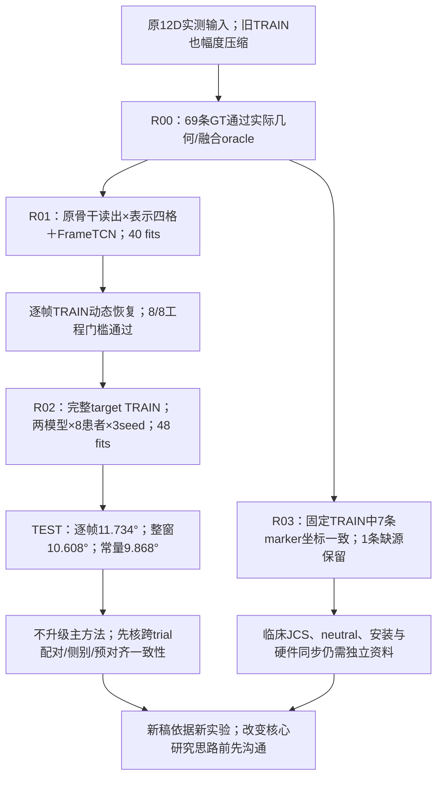

# 原Stroke动态诊断：训练已能拟合，跨trial泛化仍失败

**10/21后续可靠性复核：** [新审计](SII2027_DATA_RELIABILITY_20261021_ZH.md)确认原Stroke当前配对有条件来源与时间契约矛盾，固定TRAIN物理信号缺乏零lag一致性，元数据候选也未修复。下述原Stroke数值保留为处理诊断，不能据此判定方法优劣或真实泛化；BLISS X2维持其原有限scope。先验收新数据版本，再讨论模型。

更新：2026-10-21（Asia/Tokyo）。本轮执行了10/20台账中“先恢复原队列TRAIN动态、再进行同协议比较”的计划。**40次单trial拟合、48次完整预算多seed训练与独立验收均完成。逐帧TCN改善TRAIN，但原队列TEST误差11.734°，差于整窗10.608°及TRAIN均值常量9.868°。**

用户本轮明确原文各项数值不保真，无须严格还原，只在研究思路上连贯。后续以可追溯数据和新实验为准，原文2.968°/0.9974等数字不再作为新稿验收目标。继续保持“双小腿IMU→下肢运动学”的主线；若要把分阶段重建改为直接角度主方法、收缩三平面任务或更换主队列，须先沟通，不由本诊断自动决定。

配套：[代码函数/行号/SHA索引](SII2027_DIAGNOSIS_CODE_INDEX_20261021.json)、[16行聚合结果](SII2027_DIAGNOSIS_AGGREGATES_20261021.csv)、[既有19项实验台账](SII2027_EXPERIMENT_DECISIONS_20261020_ZH.md)。本页追加R00–R03四项决策。D指本地`Project2_submission/experiments/stroke_dynamic_diagnosis_20261021`，代码实体、原数据、权重和逐患者预测仍在本地；索引明确标注访问范围。本次公开文件只含聚合结果与代码定位。

## 1. 决策树

## 2. R00：检查表示、窗口、逆变换和旋转融合

**目的：** 判断动态压缩是否来自确定性的frame/reshape、6D布局、scaler或SO(3)融合错误。

**代码与尝试：** `D/geometry_review_checks.py`通过原M的`runner.predict_trial()`，把69条正确GT作为受控逐窗输出，执行原逆变换→GS→实际同帧SVD融合→原投影角；另检查均值退化、acos梯度和反相预测窗。

**结果：** 最大角误差1.526e−5°；ROM比[0.999999287,1.000000674]；69条全帧覆盖。36D中仅2个恒定分量触及scale下限，均值GS未退化。acos夹紧只在约.081°以内产生小死区。反相预测可经平均抵消，但一致预测保留幅度。

**结论/决策：** 未发现能解释宏观压缩的上述确定性错误；进入实际逐窗口模型输出诊断。几何oracle只证明处理自洽，不证明硬件同步、临床坐标或输入可辨识性。

## 3. R01：固定单TRAIN trial的2×2诊断与拟合门槛

**目的：** 区分原时序读出、表示/损失、优化步数和融合影响，先回答实现是否能拟合TRAIN。

**代码与尝试：** `diag_data.py`沿用M数组和原parent划分，仅依身份取主8人各自target TRAIN字典序首条；`diag_models.py`复用原TCN/BiGRU，组合pooled/sequence读出×angle/Rot6D，加X2来源FrameTCN。`diag_runner.py::fit()`固定seed20261021、200轮，保存30/200轮及逐窗输出；`window_dynamics_diagnostic.py`只读保存的TRAIN预测。

两种表示的loss不同：angle标准化MSE；Rot6D标准化MSE+.05物理geodesic。统一window120/stride20、width64、batch64、dropout.15、AdamW lr3e−4/weight decay1e−4、clip1。8 parent共5,068个100Hz帧。未用VALID/TEST选择。

下表为第200轮、患者等权**双膝单TRAIN trial**指标，GT ROM47.111°：

| 模型 | epoch | RMSE° | PCC | 预测ROM° | SD比 |
|---|---:|---:|---:|---:|---:|
| frame_tcn_angle | 200 | 0.918 | 0.998 | 48.384 | 1.030 |
| pooled_angle | 200 | 5.576 | 0.900 | 36.720 | 0.809 |
| pooled_rot6d | 200 | 5.472 | 0.904 | 35.971 | 0.824 |
| sequence_angle | 200 | 0.965 | 0.997 | 47.335 | 1.009 |
| sequence_rot6d | 200 | 1.940 | 0.989 | 44.062 | 0.953 |

原整窗angle/Rot6D在30轮的RMSE为12.443°/12.992°；逐帧BiGRU angle/FrameTCN为6.586°/3.823°，延长训练也有作用，不能将全部差异归为一个结构开关。

**门槛：** FrameTCN末轮全部8例双膝RMSE≤3°，每膝PCC≥.90、SD比.8–1.2，8/8通过。它是工程拟合门槛，不是临床阈值。单trial可被记忆，不能据此证明跨trial可恢复目标。

**逐窗定位：** 30轮整窗angle的窗内/融合后SD比分别.216/.104，Rot6D为.152/.077，说明融合前已经压缩。200轮两者窗内约.872、融合后.809/.824。Rot6D的SO(3)与角度算术融合差仅.087°（30轮）/.103°（200轮），不支持只改SVD就能消除失败。

**结论/决策：** TRAIN读出和优化是值得继续检查的因素；参数数/表示仍不同，未定位唯一根因。预设门槛通过，进入完整TRAIN多seed比较。

## 4. R02：相同输入、标签、parent和更新预算的完整k比较

**目的：** 检查TRAIN改善能否保留到原队列跨trial TEST。

**代码与尝试：** `run_diagnosis.py full`执行两模型×8患者×3seed，全部从头个体训练I(full)。`diag_runner.py::evaluate_full()`在48份拟合完成且源码、权重和合同核验后，统一评分TRAIN/既有TEST；`analyze_diagnosis.py::constant_baseline()`只用唯一TRAIN帧拟合常量。未扩展G/A或staged。

完整TRAIN39 parent、23,680有效帧（3.94667分钟），原VALID13 parent不使用，TEST13 parent保持不变。固定200轮、seeds20261021/22/23；两模型每患者parent、窗口、batch和optimizer steps相同。整窗229,841参数、逐帧151,110参数，骨干/上下文/实际计算量不同，不是纯读出或等计算量因果比较。

主终点为**患侧膝历史YZ投影**，trial→患者、seed在患者内汇总，再8患者等权；PCC用Fisher-z。与R01双膝单trial口径分别列示：

| 模型 | 集合 | RMSE° | PCC | GT ROM° | 预测ROM° | SD比 |
|---|---|---:|---:|---:|---:|---:|
| constant | TEST | 9.868 | 不可估 | 35.961 | 0.000 | 0.000 |
| constant | TRAIN | 9.810 | 不可估 | 36.608 | 0.000 | 0.000 |
| frame_tcn_angle | TEST | 11.734 | 0.127 | 35.961 | 32.204 | 0.774 |
| frame_tcn_angle | TRAIN | 1.667 | 0.987 | 36.608 | 37.053 | 1.022 |
| pooled_angle | TEST | 10.608 | 0.264 | 35.961 | 24.374 | 0.634 |
| pooled_angle | TRAIN | 4.724 | 0.887 | 36.608 | 28.590 | 0.846 |

**失败分析：** 逐帧TRAIN比整窗低3.057°，8/8患者改善；TEST反而高1.126°，仅2/8优于整窗、1/8优于常量。TEST ROM更接近GT但PCC更差，幅度恢复不等于正确时序。所有患者/seed均保留，未按最佳seed汇报。全部主8首个固定TEST parent波形在本地保存，首seed固定20261021。

描述性患者bootstrap5,000次：TEST“整窗−逐帧”−1.126°，区间[−2.192,−.188]；“常量−逐帧”−1.866°，区间[−3.615,−.376]。既有TEST曾用于旧研究，本轮是**开发性复用**；不能称新的确认性泛化证据。3seed不增加独立患者n。

**结论/决策：** 恢复TRAIN拟合没有解决跨trial泛化。保留负结果；不把逐帧直接角度回归升级为最终主方法。优先检查TRAIN内部跨trial的配对时间、S1/S2物理侧别/安装、预对齐和条件差异，再设计独立的整parent内部验证。波形错相不能直接证明换侧或时间错配，也不允许按TEST最佳lag/换侧修正分数。

## 5. R03：原pelvis方向与临床参考可行性

**目的：** 从原始world marker检验坐标方向，区分有数据可做的几何工作与尚缺的临床依据。

**代码与尝试：** `train_marker_pelvis_check.py`保持同样8个固定TRAIN parent，不依据误差选例。按ASIS左右建x右、ASIS/PSIS前后建y前、右手叉积建z上；严格匹配原frame/time，不拟合旋转、不翻轴、不时移。7个有verified world、1个缺源拒绝且不替换。

**结果：** 7 parent、5,129个native point行，左右thigh/shank四条长轴与原point标签最大角差1.479e−6°，支持这些TRAIN parent的原骨盆正向解释。58条world源均有45个marker、120Hz/mm头部；存在膝踝内外侧及pelvis marker，可另建明确声明的marker参考候选。

**结论/决策：** YZ矢状、XZ冠状、XY水平索引未互换；现有六角仍是长轴投影，膝绝对值/踝零点限制保留。D2只评估YZ，不认证临床三平面。原writer谱系、marker协议/hip center、neutral、foot twist、安装和硬件时延仍未闭环。几何源内一致不能冒充独立临床JCS。

## 6. 验收、代码证据与后续门槛

33项测试通过。D1独立复算40 fit/80预测；D2先通过48份TRAIN合同，再独立核验312份TRAIN/TEST连续输出（234/78）；TRAIN均值常量8次拟合/52预测及4张患者/seed/组/配对表复算通过，最大差2.813e−14。训练核心/标签未因结果而修改。

本地源码快照：`source_snapshots/b9e3da81755966d9`；1157个输出与源码/metadata共1210项hash已核验。代码、结果来源和各功能行号见[新代码索引](SII2027_DIAGNOSIS_CODE_INDEX_20261021.json)；CPU并发墙钟时间不作为推理延迟证据。

下一步优先级：① TRAIN内部跨trial来源/配对/物理映射审查；② 冻结marker候选的中心、段轴、neutral与缺测规则，取得独立采集依据后再建新标签版本；③ 新配置使用整parent内部验证，并如实标注已复用TEST；④ 核心方法、任务范围或主队列变更先与用户沟通。原文数字的还原已移出验收目标；新稿所有数字应来自新实验明细。

