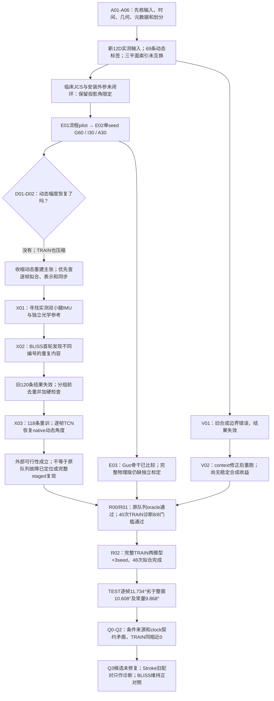
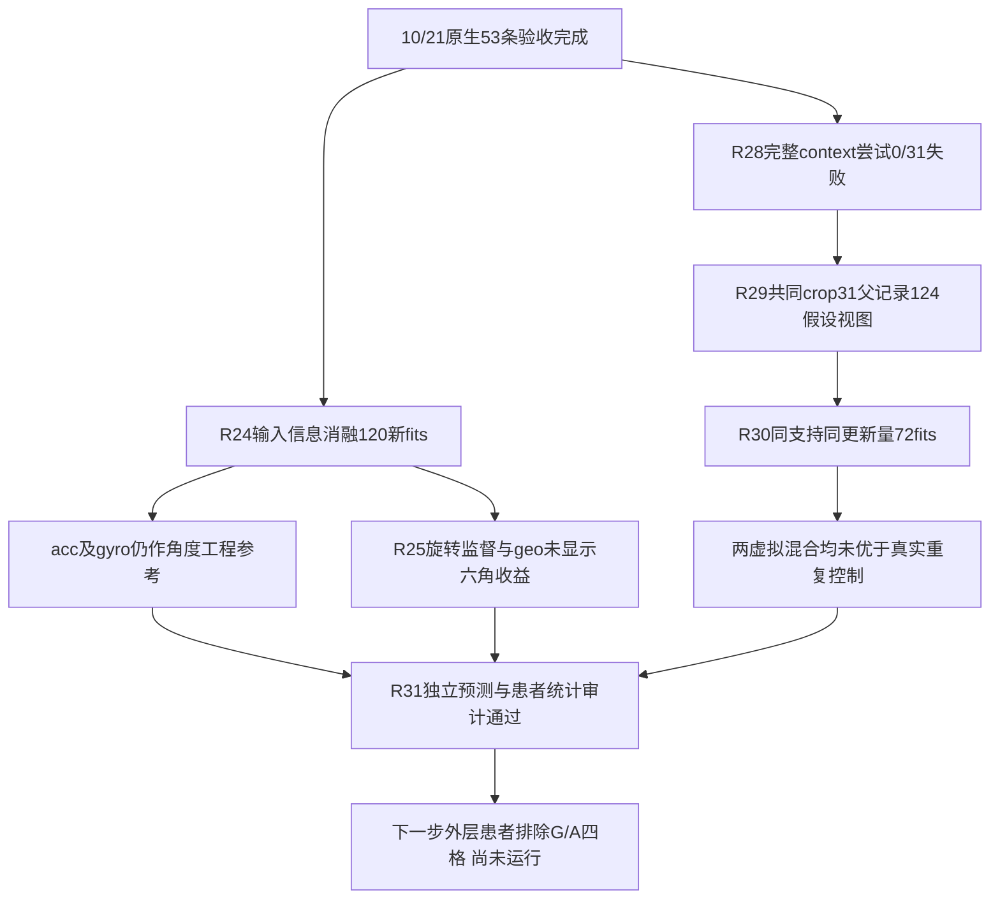
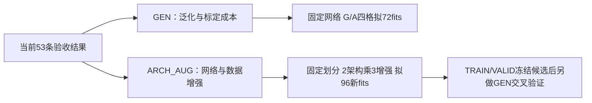

# SII2027中期报告：代码、历次实验与决策记录

**2026-10-23研究决策更新：** 架构方向已冻结，泛化线继续推进，新开第三线“少量适配＋方向增强”。[三线方案、当前阶段及代码索引](SII2027_THREE_LINES_PLAN_20261023_ZH.md)。90个新神经fit及两线固定clean VALID诊断已独立验收；本批无新TEST。

**10/23网络架构与数据增强支线已验收（20261022批次）：** [六格、坐标敏感性与非线性融合追加实验](SII2027_ARCH_AUG_RESULTS_20261022_ZH.md)。完整报告保留阴性结果、全部seed、独立审计与计算成本；当前结果是患者内跨试次探索性证据。


**10/22泛化等患者损失对照已完成：** [66fit、独立VALID/TEST审计与完整配对结果](SII2027_GEN4_EQUAL_PATIENT_RESULTS_20261022_ZH.md)。保留全部6患者、3seed、one/half/full预算及正负方向；本批TEST为描述性比较。


**10/22泛化机制补查：** [TRAIN/VALID独立诊断完成；偏置不足以解释全部误差](SII2027_GEN3_GENERALIZATION_DIAGNOSIS_20261022_ZH.md)。源窗口权重差异已量化，并固定66fit等患者损失对照；新TEST结果尚未在此页报告。


**10/22泛化线结果验收：** [180次拟合与三批独立审计已完成](SII2027_GENERALIZATION_RESULTS_20261022_ZH.md)；真实源适配患膝2.949°，同标准化从零参考3.174°；低数据量曲线与虚拟源负结果均保留。[代码／合同索引](SII2027_GENERALIZATION_CODE_INDEX_20261022.json)。


**10/22双分支执行更新：** [GEN与ARCH_AUG已完成训练入口预检并启动](SII2027_RESEARCH_BRANCH_RUNS_20261022_ZH.md)；72与96次新增拟合按各自冻结合同推进。尚无新TEST结论，当前计数和验收边界见执行记录；[训练／分析代码索引](SII2027_RESEARCH_RUN_CODE_INDEX_20261022.json)。


**10/22研究分支更新：** 以已验收53条数据和结果为共同起点，分为[GEN：泛化与标定成本](SII2027_RESEARCH_FORK_20261022_ZH.md#gen)和[ARCH_AUG：网络架构与数据增强](SII2027_RESEARCH_FORK_20261022_ZH.md#arch_aug)。两个分支的角色／预算已预检，共享模型与静态旋转完成合成预检；规划冻结时新训练均为0，拟执行预算与旧成绩明确分开。


**10/22输入、监督表示与虚拟对照更新：** [192新增神经拟合、简单线性参考及独立验收](SII2027_NATIVE_ABLATIONS_20261022_ZH.md)完成。固定53真实数据/6患者TEST；3输入mask＋RotMSE/RotGeo，虚拟31TRAIN/124假设视图与同支持同21000步控制，失败context尝试也保留。所有种子及患者级配对结果见表；论文有标定方法但本地逐人安装值仍未知。当前为I_full，原E2的G/A外层患者排除尚未完成；不称临床JCS或真实安装等价。

更新：2026-10-21（Asia/Tokyo）；10/20实验保持归档，10/21增量见R00–R03。本记录把10/19文献规划回写为实际执行事实；依据本地源代码、checkpoint训练历史、连续预测和独立复算，不按配置文件存在推定实验完成。

10/21最新结论与用户方向：[R00–R03动态诊断](SII2027_DYNAMIC_DIAGNOSIS_20261021_ZH.md)、[新增函数/SHA索引](SII2027_DIAGNOSIS_CODE_INDEX_20261021.json)、[聚合结果](SII2027_DIAGNOSIS_AGGREGATES_20261021.csv)。TRAIN恢复、TEST仍失败；原文数字不作还原目标，核心思路变更先沟通。以下19项是既有实验的历史事实，追加4项详见新页。

10/20历史结论：**原Stroke主线的输入和时间错误已经在独立实验路径中处理，但现存网络在训练集也明显压缩动态幅度；BLISS去重后的外部试验支持逐帧角度估计的可行性，尚不能替代原队列、临床三平面参考或完整分阶段复现。**

配套：[30个代码文件/函数/行号/SHA索引](SII2027_CODE_EVIDENCE_INDEX_20261020.json)、[38行公开聚合结果CSV](SII2027_AGGREGATE_RESULTS_20261020.csv)、[中期大纲](MASTER_MIDTERM_OUTLINE_ZH.md)、[文献规划](MIDTERM_LITERATURE_SYNTHESIS_20261019_ZH.md)。

## 1. 代码位置与证据等级

用户选定主工程为本地 `Dataset_Stroke/Yan_Stroke Experiment Data/1_2027SII/Project2_submission`。以下用三个根目录别名，所有命令都在对应目录执行：

| 别名 | `Project2_submission/experiments/`下目录 | 实际用途 |
|---|---|---|
| M | `midterm_20261019` | 原Stroke队列的新输入、协议、direct/staged、Guo骨干、虚拟与诊断 |
| X1 | `external_validation_20261019` | 未内容去重的BLISS首轮；训练和指标可复算，但结果已撤出结论 |
| X2 | `external_validation_20261020_deduplicated` | BLISS在分组前内容去重后的有效外部pilot |

本仓库本次保存的是决策记录、精确代码入口与源指纹、聚合结果。代码实体、原始参与者数据、逐帧预测和权重位于本地工程；下列`M/...`与`X2/...`是**本地路径**，不是仓库中已发布的源码链接。JSON索引明确记录这一访问状态。

状态含义：`已核验`只针对相应检查；`开发完成`为单seed开发实验；`探索完成`含明确模拟/计算条件；`失效`不参与科学结论；`阻塞/待做`仍需新增证据。训练结束、来源检查通过、临床有效性和投稿就绪是不同门槛。

## 2. 当前决策树



树中箭头表示证据如何改变下一步，不表示所有分支都已通过。尤其不能越过TRAIN幅度失败，直接用更多epoch、种子或合成样本包装精度结论。

## 3. 逐项尝试、目的、代码与结论

### A01：确认真实输入，拆开mocap与实测IMU

- **目的：** 确认“两小腿IMU”的输入预算真实成立。
- **尝试与代码：** `M/data.py::sensor_features`、`load_real_trials`固定读取S1/S2各ACC XYZ和GYRO XYZ，形成12D。旧24D含18D动态mocap姿态，实测ACC也被该姿态旋转；旧24D没有使用gyro。旧权重与NPZ保留，未改名为新实验。
- **证据：** `M/data_acceptance.json`、`M/INPUT_AND_PLANES_CURRENT_ZH.md`；69条real、11人。67条还能对应现存GravityFilter，另两条只追到已提取上游。
- **结论/决策：** 新路径没有动态mocap特征输入。ACC保留重力，单位m/s²；GYRO为rad/s。前级已有固定IMU-only重力方向对齐，因此称processed/offline sensor-only，不把它写成未经处理设备轴或新佩戴在线认证。mocap仍用于同步、监督与评分。

### A02：修复位置标签时间对应

- **目的：** 防止错误位置监督使分阶段实验失去意义。
- **尝试与代码：** `M/data.py::checked_interp`、`_verify_label_pair`、`load_real_trials`按rotation局部row→同源point绝对frame/time→query对应；不做越界端点夹紧。
- **证据：** 原loader混用局部行号与绝对frame，69/69 real位置变常数；新入口69/69恢复动态。原始缺帧沿对应表保留，不能用“首帧+行号”替代完整映射。
- **结论/决策：** 新结果绑定修复后的标签与源码指纹。旧结果不能当作新分阶段监督的复现；位置动态恢复也不自动证明网络已学到动态。

### A03：三个平面与临床角度核验

- **目的：** 区分索引交换、几何定义和临床解剖解释三种问题。
- **尝试与代码：** 原稿投影函数的已知姿态反例；新`M/data.py::angles_from_rot6d`与`M/runner.py::rotation_angles`保留历史YZ评分，预测先在SO(3)融合再求投影角。
- **结果：** 在代码声明的pelvis x横向、y前后、z上下约定下，YZ `[1,2]`为矢状、XZ `[0,2]`为冠状、XY `[0,1]`为水平，原稿分支未互换。大腿长轴方位不能测绕自身长轴twist，足长轴投影不能认证内翻/外翻；膝取绝对值不能区分过伸，踝未做临床中立零点。
- **结论/决策：** 新主实验仅报告六个历史YZ投影角，不声称完整临床JCS或三维旋转验证。另一个`2_2027SII`分支的Euler命名问题与本分支分开记录；不能靠交换两列“修复”全部临床定义。

### A04：患侧与队列来源

- **目的：** 避免主终点选错侧，或Guo按错误角色重排输入。
- **尝试与代码：** `M/metadata_sensitivity.py`、`M/guo_dispatch.py`显式选择元数据来源；双侧core保留同一预测做评分敏感性。
- **证据：** 17名原marker参与者中15人来源一致，另两人的原始xlsx与原稿CSV冲突；历史主8人不含这两人，评分角色一致。11名有real数据，主8与预算5分别汇总；仅1条real的两人只做G，不能伪造独立适配。
- **结论/决策：** Guo较长开发跑使用`original_xlsx`来源；全11人患侧附录为来源条件结果，临床最终裁决仍待补。

### A05：原论文2.968° / 0.9974指标对账

- **目的：** 让摘要数字能追到同一组连续预测和聚合规则。
- **尝试与代码：** `M/legacy_and_events.py::legacy_angles`对旧打包输出重算pooled及患者等权指标。
- **结果：** 旧打包65条、10人的连续表可复算pooled RMSE **3.341417°**、PCC **0.996858**；患者/试次等权六角均值约3.401398°。稿件2.968°/0.9974来源仍未闭环。
- **结论/决策：** 保留未解决状态，不挑最接近稿件的聚合口径。旧reference-assisted输入及其他旧缺陷仍在，旧数字也不充当新12D证据。

### A06：母轨迹隔离、预算与成本

- **目的：** 让G/I/A/C区分适配、预训练与简单校准，并排除目标派生轨迹混入。
- **尝试与代码：** `M/protocols.py::build_protocol`、`assert_no_leakage`、`validate_training_sources`、`supervision_budget`；`M/runner.py::run_subject`；`M/cost_ledger.py`。
- **执行：** 先按原parent分组，后切窗；G排除目标real/virtual；I/A/C用相同k。1/2/all为嵌套预算，每架构24个唯一目标集合；不可达预算名称标alias，不新增拟合或n。G只用population validation选权重，I/A固定末次轮；目标validation不参与选择。
- **结论/决策：** 保存所有方法相同测试frame/time/GT并逐文件复核。有效监督分钟、完整原始参考时长、佩戴/标定成本分别记录；未知成本保持未知。完整内容去重是额外门槛，不能由ID隔离代替，见X02/Q01。

### E01：3epoch流程pilot

- **目的：** 检查direct/staged、G/I/A/C、预算alias、存储、融合与评分是否跑通。
- **代码/配置：** `M/run_matrix.py`→`runner.py::train_bundle`、`predict_trial`；3epoch、width16、seed20261019。
- **完成：** 22个架构×患者运行、118个G/I/A bundle；staged每bundle含三个网络。C为训练集偏置拟合，不另算神经模型。
- **结论/决策：** 流程验证完成，3epoch精度不能进入投稿主张。随后建立独立`outputs/development_60ep`，没有覆盖pilot。

### E02：较长direct/staged × G/I/A/C与嵌套预算

- **目的：** 检验适配是否超过G、是否优于同预算从头训练，以及分阶段是否值得。
- **代码/配置：** `M/models.py::build_stage`、`M/runner.py::train_bundle`、`run_subject`、`M/analyze_results.py`；width64、seed20261019，G最多60epoch并按预定population验证选点/早停，I与A各固定30epoch末次权重。
- **完成：** 22/22运行、118个bundle、236次网络拟合。全部I/A bundle及stage历史已核实均为30轮；没有“I60对A30”的预算错配。
- **主8人完整k结果：** direct G/I/A/C = **12.400/10.527/10.192/10.468°**；staged = **13.609/10.397/10.269/11.197°**。终点为患者等权患侧膝历史YZ投影，不是BLISS的双膝native角度。
- **结论/决策：** A相对G下降，但I−A的描述区间跨零；direct A相对C也未显示稳定额外收益。staged A未优于direct A，且使用额外位置中间监督、更多参数/训练量。预算不是通用“最佳比例”证明，多seed正式schedule仍待做。必须结合D01/D02收缩精度表述。

### D01：同预算训练均值M(k)事后诊断

- **目的：** 排查低RMSE是否主要来自预测接近常量，而非恢复动态。
- **代码：** `M/mean_baseline_diagnostic.py`仅从同k训练parent的唯一帧计算均值并冻结，再在相同测试帧评分。
- **结果：** 主8人M(k) RMSE **9.868°**，direct/staged A为10.192/10.269°，平均均未超过该常量；两种A预测ROM约6.82/8.31°，GT约35.96°。常量PCC不可估。
- **结论/决策：** 明确为观察ROM失败后新增的事后诊断，不能改称预注册主比较。保留全部患者，停止用RMSE下降证明动态临床重建。

### D02：训练集与冻结测试波形只读复核

- **目的：** 区分“训练已拟合但跨trial失效”和“训练动态本身未充分拟合”。
- **代码/证据：** `M/audit_train_vs_holdout_waveform.py`加载32个既存main8 full-k I/A模型及原scaler，不重训、不改参；权重/源码SHA不变，TEST覆盖及预测复现。
- **结果：** TRAIN四组预测ROM仅 **5.49–8.44°**，GT **36.61°**；PCC **0.205–0.406**；每组8/8人的SD比<0.5。TEST PCC进一步降到0.073–0.169。
- **结论/决策：** 不能仅归因为跨人/跨trial泛化困难。下一步先在原队列固定参考和输入检查逐帧输出、训练拟合、几何损失及同步证据，再扩大训练；现有诊断不能定位唯一因果故障。

### E03：Guo近邻骨干pilot与来源明确的较长开发跑

- **目的：** 用同队列、同输入和参考做近邻比较，替代跨论文裸数字排序。
- **代码：** `M/guo_baseline.py`、`guo_dispatch.py`、`compare_backbone.py`。先有3epoch/width16的旧CSV角色pilot，再按原始xlsx角色运行主8人G60/A30、channels64。
- **结果：** 来源明确较长运行8/8完成；Guo-style backbone A **12.027°**，direct/staged A为10.192/10.269°。与direct的配对差区间跨零；staged差为开发设置下的描述结果。
- **结论/决策：** 这是TCN骨干重实现，不是完整Guo物理复现。角度head、辅助监督、受野、优化器/更新次数、患侧角色输入均有差异；完整物理版缺独立轴与安装标定，预检保留阻塞，不能用gyro proxy冒充闭环验证。

### V00：虚拟物理内核和来源门槛

- **目的：** 把“生成公式数学自洽”与“匹配真实传感器安装”分开。
- **代码：** `M/virtual.py::generate_sensor12`、`require_training_eligibility`、`load_verified_virtual_trials`；静止、平移、倾斜、旋转/lever-arm、单位、采样和来源拒绝检查。
- **定义：** `f_S = R_WS.T @ (p_ddot_W - g_W)`，`omega_S = vee(skew(R_WS.T @ Rdot_WS))`。旧144个pelvis-relative虚拟NPZ未纳入新训练。
- **结论/决策：** 物理内核测试通过不代表真实安装已验证。缺独立来源/安装记录时，硬件匹配分支仍拒绝训练；声明假设的world-marker模拟另列V01/V02。

### V01：先裁段再滤波/求导的虚拟v1，已失效

- **目的/尝试：** `M/assumption_virtual.py`为同parent世界marker建立声明安装假设的模拟，并运行`outputs/virtual_factorial_pilot`。
- **发现：** 先裁walking片段后filtfilt/二阶导，仅删两端2帧；匀加速1m/s²解析输入的保留帧最大误差达 **19.937m/s²**。
- **结论/决策：** 确定的生成边界错误。v1代码与权重保留复算，结果作废科学解读；没有把v1输出更名为修正版。

### V02：同parent上下文修正与2×2重跑

- **目的：** 修正边界后检验增加模拟视图和目标real适配的影响。
- **代码：** `M/assumption_virtual_context.py::one_trial`、`_context_grid`，同parent两端各≥1s上下文，先滤波/求导后裁输出；`check_assumption_context.py`、`factorial.py`、`analyze_factorial.py`。
- **完成：** 69个real parent中58个有可核验world源，返回126–791帧；解析匀加速最大误差降为 **1.782e-5m/s²**。`outputs/virtual_factorial_context_pilot`完成22个运行，3epoch、width16、单seed；120个cell/trial覆盖检查通过。
- **结果：** 主8人mixed−real A为direct **+0.050°**、staged **+0.007°**（负值才表示mixed更好）；无稳定改善。一个交互的描述区间不跨零，也不能抵消计算/参考覆盖差异。
- **结论/决策：** 明确假设的探索性敏感性，不证明真实硬件等价或合成数据普遍有效。mixed有更多window/更新，并使用同parent额外mocap context，parent数量相同不等于frame/分钟/计算量相同；目标virtual未额外加入适配。

### T01：BSN事件四容差复核

- **目的：** 同时呈现事件分母和匹配时差，避免仅报匹配成功事件的MAE。
- **代码：** `M/legacy_and_events.py::events`，在50/100/150/200ms下最大TP后最小时差的一对一匹配；保存TP/FP/FN、P/R/F1、MAE/bias，无TP的timing为null。
- **实际输入：** 既有单人S3/S4/S5三传感LSTM导出，分别对照实测小腿detector与独立足marker detector；不是新训练的双足BSN跨患者模型，marker detector也不是测力台接触真值。
- **结论/决策：** 存量事件一致性/参考敏感性复核完成。新的双足直接事件基线、独立接触参考和跨患者BSN仍待补，不能从这次重算推定已完成。

### X01：外部数据检索和真实字段核验

- **目的：** 找真实双侧小腿ACC/GYRO及独立光学参考，检验新队列上能否恢复动态。
- **代码/证据：** `X2/probe_remote_zip_headers.py`及完整ZIP准备；检索记录保存在M的`external_dataset_stroke_search.md`与`external_dataset_healthy_search.md`。
- **选择：** [BLISS官方档案](https://researchdata.bath.ac.uk/1425/)提供实测Trigno与Qualisys/Visual3D reference，CC BY 4.0。[参与者表](https://researchdata.bath.ac.uk/1425/46/Subject%20Information.xlsx)中明确stroke仅两人，本轮另选一名有完整输入的健康管线对照，未当匹配疾病对照。
- **排除/限制：** 抽检两个较小BLISS包只有EMG，不能补零冒充IMU；50 Stroke PiG缺真实IMU；Warmerdam患者数据需申请，公开健康数据不能称公开卒中数据；Dorschky有实测IMU+光学，但提供的平均角度不能冒充连续trial真值。本轮未把这些候选记成已完成重跑。

### X02：BLISS首轮120条训练后发现重复，已失效

- **目的/配置：** X1按不同trial ID划分，训练窗口角度网络和逐帧TCN，G/I/A各40轮。
- **关键发现：** 健康包Trial_019/020、Trial_022/023两对的完整Raw Analog与native optical CSV内容完全一致，prepared x/y也一致；其中019/020跨入两名卒中目标的population train/validation。
- **结论/决策：** 旧17项测试与指标复算只覆盖编号隔离/评分一致性，漏掉内容独立性。X1全部结果统一撤出科学结论并保留失效说明；不能因未直接跨健康TEST就忽略验证污染与重复权重。健康首轮k=17个ID实际只有15个独特内容。

### X03：分组前去重后的BLISS有效外部pilot

- **目的：** 在独立数据中比较原窗口结构加native角度head与保留时间维的TCN，并区分G/I/A/C/M。
- **准备代码：** `X2/prepare_bliss.py::verified_archive`、`align_arrays`及`main`先核官方MD5/SHA，按完整真实IMU+光学内容确定性去重。133候选中13条缺光学，另移除2条重复，保留 **118条：卒中49/42，健康27**；无按ROM/误差筛选。
- **输入/监督：** 双侧TibialisAnterior传感器ACC/GYRO，12D；ACC CSV为g，乘9.81恢复m/s²；GYRO原导出已为rad/s，不二次转换。六个目标为独立光学的LH/LK/LA/RH/RK/RA Angles X，degree，保留原零点/符号，无虚构位置或Rot6D。
- **模型与协议：** `external_models.py::WindowAngleDirect`复用原Stage3 TCN/BiGRU/attention结构但换成逐窗口六角度head；`FrameTCN`为三块残差逐帧TCN，RF85。`external_runner.py::build_protocol`按完整parent划分；window120/stride20、100Hz、width32、batch64、seed20261019，G/I/A各实际40轮。I/A同k并用末次40轮，G仅population validation选点；目标validation保留不使用。
- **内容与评分硬门槛：** `content_identity_gate.py::check_content_identity`在driver拟合前拒绝内容重复；独立`audit_content_isolation.py`能拦截旧120条负例。`external_runner.py::verify_completed_run`与`audit_external_results.py`逐数组核对来源、scaler、C/M、同测试frame/time/GT及RMSE/ROM/PCC等。
- **完成：** 6/6架构×受试者运行、18份40epoch训练历史、**25项测试、1328份连续预测**通过；23个唯一TEST parent，独立受试者仍仅3名。

| X03个体适配A双膝RMSE | 窗口结构+native角度head | 逐帧TCN |
|---|---:|---:|
| 两名卒中者等权 | 5.917° | 2.023° |
| 一名健康对照 | 8.834° | 3.689° |
| 三人等权 | 6.889° | 2.578° |

逐帧A的三人双膝PCC **0.994**，GT/预测ROM **62.893°/63.516°**，SD比约0.993；窗口A的PCC约0.944、预测ROM约55.717°。动态指标共同支持本协议下逐帧native角度估计的可行性。

但两名卒中者逐帧I已为 **2.210°**，A为2.023°，额外收益仅 **0.188°**；三人G/A为12.051/2.578°的大差值不能全部解释为预训练收益。

**成本：** full-k按AB2948/AB2949/AB2950依次为29/17/26个唯一目标parent；保留监督分钟约2.939/0.628/2.697，对应整trial光学采集分钟约3.137/0.742/2.870。G还需要69/91/76个其他受试者参考parent，A/C总参考parent为98/108/102；这些不等于完整session、安装或临床标定成本。

**决策与限制：** 只支持2名卒中+1健康、单seed、个体不同trial间native角度pilot。未建立跨session/日期/条件留出；未独立核验硬件延迟、安装外参与临床JCS；没有患侧字段，终点是双膝，不能猜患侧。仅Angles X，不验证冠状/水平分量。输出head、队列和参考与M不同，两套RMSE不能解释为同协议改进，也不是完整staged或完整Guo复现。TCN局部因果结构不抵消输入零相位滤波的离线性质。

### Q01：把“文件不同”升级为“完整内容不同”

- **目的：** 把X02发现的真实遗漏补进后续验收。
- **尝试：** 对原始成员内容及解码后的x/y/联合数组计算指纹，忽略parent标签与NPZ容器；时间相同本身不判重复。新X2原始文件与数组无完整重复、六fold无跨角色内容复用，旧X1作为必须失败的负例。
- **原Stroke补查：** 69个real parent的完整x、各位置/Rot6D/角度y及联合time没有精确重复，86份既有协议未见这种内容跨角色。
- **结论/决策：** 这是完整exact重复检查，不证明跨session独立，亦不排除裁切重叠、错位或近重复。代码与数组指纹各回答不同问题；不能再用唯一文件名/parent ID当作内容独立性证明。

## 4. 关键代码调用链与复核命令

```text
M: data.load_real_trials
   → protocols.build_protocol / validate_training_sources
   → runner.run_subject → train_bundle → models.build_stage
   → runner.predict_trial（逐级预测、SO(3)融合）
   → analyze_results（trial→患者、GIAC配对、预算与失败项）

X2: prepare_bliss（官方完整性→单位/时钟→内容去重→独立NPZ）
    → run_external_matrix（source预检→content_identity_gate）
    → external_runner.run_subject / train_model
    → verify_completed_run / summarize
    → audit_external_results（独立复算）→ analyze_external（报告/波形）
```

已完成配置的复核示例，运行需本地数据与相应Python依赖；新训练使用新output目录，保留已有证据：

```bash
# 在M中：与已完成60/30开发矩阵相同的配置
python -B run_matrix.py --preset full --epochs 60 --adapt-epochs 30 --width 64 --workers 3 --threads-per-worker 2 --output outputs/development_replication
python -B analyze_results.py --input outputs/development_60ep --output outputs/development_60ep/analysis_main8 --subjects P1 P4 P6 P7 P8 P10 P15 P17

# 在M中：context修正后的声明模拟；查看来源与解析检查
python -B check_assumption_context.py

# 在X2中：只读验收已完成运行，不拟合
python -B content_identity_gate.py
python -B audit_external_results.py --input outputs/bliss_native_pilot

# 在X2中：新目录重新训练，含训练前内容硬门槛
python -B run_external_matrix.py --output outputs/bliss_native_replication --subjects AB2948 AB2949 AB2950 --workers 3 --threads 2
python -B analyze_external.py --input outputs/bliss_native_replication
```

源指纹：M runner `dbd36016694093a0d7ed3bab654da053a5e1b183818e9e368bfd1c3d6a47fe3f`；X2 runner `3c800f34e0782ebf4b9cf3eee61a31fa8a072d073017a2a26c891415e3e123e3`，models `ee252b3574a7acec4a6d5c1f488e311f6f406d02a83321f8a20517f7e2ae978b`；X2准备manifest `93bca39bf0dadf55769ef32daa8991acba9d3034c5e24dc5e9166ec23544fb8c`。完整文件指纹见JSON索引；X2本地源码快照为`source_snapshots/d948a9032d036b0e`。

## 5. 下一步做什么，什么情况下改变决策

| 优先级 | 下一项 | 触发依据 | 验收后才允许的结论 |
|---|---|---|---|
| 1 | 原Stroke同输入/标签/覆盖下逐帧输出与小样本训练拟合诊断 | D02 TRAIN幅度已失败；X03只提供新队列native可行性 | 区分表示、输出读出、损失或同步因素；先恢复TRAIN动态，再讨论泛化 |
| 2 | 独立坐标/JCS、安装与时间参考记录 | A03及X03仍缺硬件/临床标定 | 支持相应平面、零点和外推部署解释；没有记录时保持投影/native限定 |
| 3 | 更新数/参考分钟匹配的合成消融 | V02 mixed计算及context覆盖更多，当前也无稳定优势 | 支持限定条件的合成贡献；不是所有virtual都有效 |
| 4 | 完整Guo物理版或明确限定的骨干对照 | E03独立轴向/physics参考未闭环 | 只有完成物理门槛后才能称完整最近邻复现 |
| 5 | 在冻结可解释配置后增加seed、正式患者统计与失败分析 | E02/X03均单seed，且原队列动态失败尚在 | 患者配对效应与训练随机性；不会增加独立患者n |
| 6 | 新BSN双足/事件直接基线、独立接触参考与跨患者实验 | T01只是既有三传感单人导出重算 | 新任务/泛化证据；不能借原算法论文代替本稿验证 |

中期可以展示：输入/时间修复、严谨预算、动态失败诊断、合成边界反例与修正、外部内容去重及逐帧可行性。当前仍不支持“原SII临床三维重建已完成”“分阶段/预训练/合成普遍更优”“已可实时辅助”。本次回写没有把计划日期、作者贡献或投稿就绪自动记为已完成。


## 6. 10/21下一步执行回写

上一节第1项已完成，新增I(full)三seed比较也已完成：[R00–R03](SII2027_DYNAMIC_DIAGNOSIS_20261021_ZH.md)记录尝试、目的、实际代码与负结果。下一优先级改为TRAIN内部跨trial来源/同步/物理映射审查和整parent内部验证；G/A/staged、合成与临床参考门槛分别保留。原文各项数字按用户说明不再要求严格还原，新稿数值只取新实验；研究思路改变前先沟通。


## 7. 数据可靠性Q0–Q4及解释降级

[五项新审计的尝试、目的、实际代码及结论](SII2027_DATA_RELIABILITY_20261021_ZH.md)、[函数/SHA索引](SII2027_RELIABILITY_CODE_INDEX_20261021.json)、[聚合证据](SII2027_RELIABILITY_AGGREGATES_20261021.csv)。条件冲突不是简单NPZ误标；两套时间契约冲突不是已知硬件lag；元数据候选没有恢复一致性。原M/D全部加工配对实验数值归档保留，当前不支持监督方法优劣/真实泛化归因；虚拟/适配收益也须在新可靠数据上检验。未新训练，未改分数。

## 10/21新增：原数据组合配对修复（R04–R08）

[详细尝试/目的/结果与新决策树](SII2027_PAIRING_REPAIR_20261021_ZH.md)、[源码函数/行号/SHA](SII2027_REPAIR_CODE_INDEX_20261021.json)、[全部聚合与固定种子结果](SII2027_REPAIR_AGGREGATES_20261021.csv)。原PDF唯一源窗→39 TRAIN前置动作开发→冻结69条应用，18条候选；2患者、6 TRAIN/3 TEST的固定配对模型恢复，表明先修复输入配对有必要。不能分离纯时间、试次身份和条件来源的单独贡献。

正式释放仍待上游重力/滤波支持、现场条件/安装及物理split验收；不把QC筛选子集或mocap离线校时描述成未见患者/实时IMU-only验证。主线保持双小腿实测IMU估计下肢运动学；正式G/I/A、逐帧与整窗比较须在验收新数据版本后继续。历史数字保留，不按原文不保真数字反推实验。

## 10/21采集者补充后的执行（R09–R12）

[原始源、抬健侧腿标记、S6与17条native候选](SII2027_RAW_ACQUISITION_20261021_ZH.md)、[函数/行号/SHA](SII2027_RAW_SOURCE_CODE_INDEX_20261021.json)、[聚合数据](SII2027_RAW_SOURCE_AGGREGATES_20261021.csv)。安装左右语义已由采集者确认；实验室轴、固定安装旋转与clinical JCS仍需分别验收。216原始文件/16加工源桥接已建立；17条native重建不沿用旧全记录滤波/旋转，但继承原离线clock/QC，旧2.205°不能转记为新版本成绩。

原患侧表与标记侧有2例待核，11条缺原光学；未用拐时S6也可能被携带，运动不能等同承重。下一步先确认标记事件和native预处理支持，再冻结正式实验；不据网络误差改条件、侧别或lag。旧阶段“安装未闭合”指其当时证据，最新采集者确认与剩余坐标问题以本次更新为准。

## 10/21新增：mocap少于IMU时的顺序/跳段配对（R13–R16）

[完整方法、尝试和结果](SII2027_ORDERED_MATCHING_20261021_ZH.md)、[源码函数/行号/SHA](SII2027_ORDERED_CODE_INDEX_20261021.json)、[聚合数据](SII2027_ORDERED_AGGREGATES_20261021.csv)。156原始光学中只有58属于当前有固定监督步态边界的69目标；另98未自动入组。164是IMU单侧重复动作候选，不是真实行走计数。未匹配IMU可能属于未选光学，不能等同漏采。

旧PDF同尾号绑定已降为历史假设，组内有序、组间另核来自用户确认。前置块决定候选与全局路径，步行仅后验验收且失败不重选。49原始候选仍依赖有限detector候选集和离线光学校时，正式释放false；下一步补候选召回与S6/预处理验收，再冻结新版本重训。旧数据和模型保留，未追逐原文不保真数值。

## 10/21新增：标记漏检的统一修复与回归（R17–R18）

[完整尝试、目的、代码职责和结论](SII2027_MARKER_RECALL_20261021_ZH.md)、[函数/行号/SHA](SII2027_RECALL_CODE_INDEX_20261021.json)、[聚合数据](SII2027_RECALL_AGGREGATES_20261021.csv)。

两条漏检源自标记后的活动并入峰组，导致整组对侧RMS超限。保留0.35rad/s及比值3等原门槛，全部18session统一枚举极大有效子窗；没有按旧时钟补单例。新增14动作提案，最终多4条验收；旧49同步时钟完全不变。真实同号绑定仍被弃用，两个条件各自保序、共享源且允许跳段。

物理身份反事实排除整类别名，10ms实际源区间隔与原始行非复用仍有效；当前311有效边无实际别名重复，因此结果改善来自新子窗。路径先冻结、步行后验收，失败不重选。剩余16/69未验收继续保留原因（11无模板、2侧别/模式、1无路径、2验收失败）。

本轮数据召回工作完成，正式训练就绪仍为false。下一步补53条S6证据及预处理/坐标合同，再冻结并重训；测试mocap用于离线修复，不称完全未接触测试集，不继承原2.205°模型分数。历史49版结果保留供对照。

## 10/21新增：原生53条工程训练版本与固定基线（R19–R22）

[完整目的、尝试、结论与决策树](SII2027_NATIVE_BASELINE_20261021_ZH.md)、[源码函数/行号/SHA](SII2027_NATIVE_CODE_INDEX_20261021.json)、[全部聚合指标](SII2027_NATIVE_AGGREGATES_20261021.csv)。

本轮完成此前计划的S6、输入和坐标合同：26目录有拐/27目录无拐的S6运动模式相容，未改条件或删人；53条原生SI和几何通过，三平面索引没有混淆，原生sensor XYZ与骨盆解剖轴严格区分。训练只用各患者TRAIN唯一帧拟合统计量，不再默认旧gravity加工输入或移植旧模型成绩。

固定24fits（8患者×3seed）全部200epoch，每10epoch在各人VALID择checkpoint，全部验签后统一TEST。原角色31/12/10、TEST6人；两人只有TRAIN/VALID；有一位患者VALID/TEST条件不同。连续源CSV跨角色共享但原生采样支持无重用，不能称文件级独立。

患者内真实IMU基线及TRAIN均值结果见表；旧2.205°是不同输入和分母的历史探索，不作直接增益比较。全部种子和10条TEST保留，212预测/1272角度指标完整审计。数据工程训练就绪不等于临床最终认证；下一步围绕冻结版本补输入/表示/虚拟数据消融，跨患者需另立协议，改临床输出或主队列须先讨论。

## 10/22新增：I_full信息、监督表示与假设虚拟对照（R23–R31）

[实验目的、每次尝试及结论](SII2027_NATIVE_ABLATIONS_20261022_ZH.md)、[函数/行号/SHA](SII2027_ABLATION_CODE_INDEX_20261022.json)、[聚合结果](SII2027_ABLATION_AGGREGATES_20261022.csv)、[患者配对差](SII2027_ABLATION_PAIRED_20261022.csv)。

本批实际是3输入信息组、2个Rot6D监督/损失组，共120新fits；另3个同共同crop/同4视图/同21000步的真实重复与假设虚拟组，共72新fits。简单当前帧Ridge参考8模型/48VALID候选另列，不能称完整Guo框架复现。旧raw12参考24fits只读复用。全数据角色和测试段不变，1537预测记录/9222角度指标与额外1908SO3指标可追溯，N仍为6测试患者。

虚拟完整context首次0/31失败；共同裁剪后31TRAIN/124视图，12665训练目标帧及18865参考context成本分别记账。原论文有sensor-to-segment标定方法，当前没有逐人实际安装数值，不把假设模拟提升为已标定真实IMU。输入轴与原六投影角含义保持不变。

每患者统计先汇总trial/seed再等患者，64种符号翻转与Holm保持原定义；不能为显著性把窗口/种子当患者或更换检验。本轮未完成原E2的外层患者G/A2×2：下一批需source彻底排除目标、两A共用同target真实适配并记VALID参考成本。草案已在本地形成，不冒充已运行结果。



节点对应代码、函数/行号/SHA及数值结论见本节链接；旧阶段流程保留为历史尝试，不能将其数值转记为本次原生结果。

## 10/22分支决策（R32–R35）

用户决定以当前结果为分支点，分别研究泛化和网络架构／数据增强。[完整分支图、目的、控制与计划](SII2027_RESEARCH_FORK_20261022_ZH.md)、[代码函数／行号／SHA](SII2027_RESEARCH_FORK_INDEX_20261022.json)。

GEN固定当前网络，先做排除目标患者的G/A×source真实／混合四格（拟72fits），再研究标定成本和独立跨条件／外部协议。ARCH_AUG固定当前患者内划分，用2架构×3增强解耦效果和交互（144逻辑fits，48旧复用、96拟新增）；首阶段24新fits仅TRAIN/VALID，全矩阵完成后统一新TEST。

规划冻结时两个分支尚无新训练结果。当前6名TEST患者与历史接触边界保留；不以窗口／seed扩大N，不把目录条件或投影角升级为临床真值。架构候选以后迁入GEN需另立交叉协议，避免从同一TEST反复选择后宣称独立确认。



## 10/22执行补记

**10/22双分支执行更新：** [GEN与ARCH_AUG已完成训练入口预检并启动](SII2027_RESEARCH_BRANCH_RUNS_20261022_ZH.md)；72与96次新增拟合按各自冻结合同推进。尚无新TEST结论，当前计数和验收边界见执行记录；[训练／分析代码索引](SII2027_RESEARCH_RUN_CODE_INDEX_20261022.json)。

规划和模块合成预检记录保留为分支冻结时事实；后续训练、正式评估及独立结果验收分别记录，不将拟执行次数或启动状态写成最终精度结论。

## 泛化结果验收补记

**10/22泛化线结果验收：** [180次拟合与三批独立审计已完成](SII2027_GENERALIZATION_RESULTS_20261022_ZH.md)；真实源适配患膝2.949°，同标准化从零参考3.174°；低数据量曲线与虚拟源负结果均保留。[代码／合同索引](SII2027_GENERALIZATION_CODE_INDEX_20261022.json)。

此前启动计数保留为当时快照；GEN已完成固定分析及独立结果验收，具体边界、标定量账目和后续决策见新结果页。

## TRAIN/VALID机制诊断补记

**10/22泛化机制补查：** [TRAIN/VALID独立诊断完成；偏置不足以解释全部误差](SII2027_GEN3_GENERALIZATION_DIAGNOSIS_20261022_ZH.md)。源窗口权重差异已量化，并固定66fit等患者损失对照；新TEST结果尚未在此页报告。

## GEN4等患者source损失结果补记

**10/22泛化等患者损失对照已完成：** [66fit、独立VALID/TEST审计与完整配对结果](SII2027_GEN4_EQUAL_PATIENT_RESULTS_20261022_ZH.md)。保留全部6患者、3seed、one/half/full预算及正负方向；本批TEST为描述性比较。

## ARCH_AUG网络架构与数据增强支线结果补记

**10/23网络架构与数据增强支线已验收（20261022批次）：** [六格、坐标敏感性与非线性融合追加实验](SII2027_ARCH_AUG_RESULTS_20261022_ZH.md)。完整报告保留阴性结果、全部seed、独立审计与计算成本；当前结果是患者内跨试次探索性证据。

## 2026-10-23：架构冻结与第三线立项/验收记录

**2026-10-23研究决策更新：** 架构方向已冻结，泛化线继续推进，新开第三线“少量适配＋方向增强”。[三线方案、当前阶段及代码索引](SII2027_THREE_LINES_PLAN_20261023_ZH.md)。90个新神经fit及两线固定clean VALID诊断已独立验收；本批无新TEST。

用户明确授权该安排；架构旧支线120新fit及48旧参考fit不再扩展。泛化GEN5固定one段六方法，新增18个head神经fit和36个闭式校准；第三线固定源/目标方向增强2×2，固定72新fit。目标网络采用预定200 epoch final，不按目标VALID选点；旧final参考曾看VALID另存best，历史保留。本批完训后仅执行一次目标VALID诊断，没有TEST推理实现。后续独立验证只使用开源数据，不安排重新采集；BLISS已经参与开发，不能称新盲测。

GEN5与COMB1的固定clean目标VALID诊断均已完成并通过独立数值审计；本批没有新TEST或方向压力预测。结果属于历史开发VALID，不能作为新增独立泛化证据。

历史VALID患膝：GEN5源G 11.936504°、仿射6.262902°、head 5.183036°、完整final 3.830770°、同预算scratch final 4.166245°；COMB两阶段replay 3.830770°、两阶段SO3 3.783814°。所有格/终点、患者方向计数、阴性结果、监督成本和函数SHA索引均见新报告；不与旧TEST或不同预算混比。
