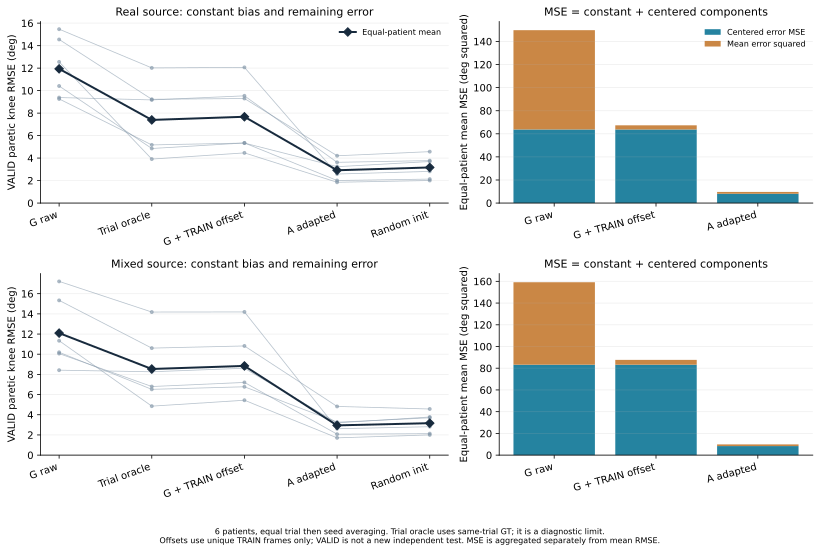
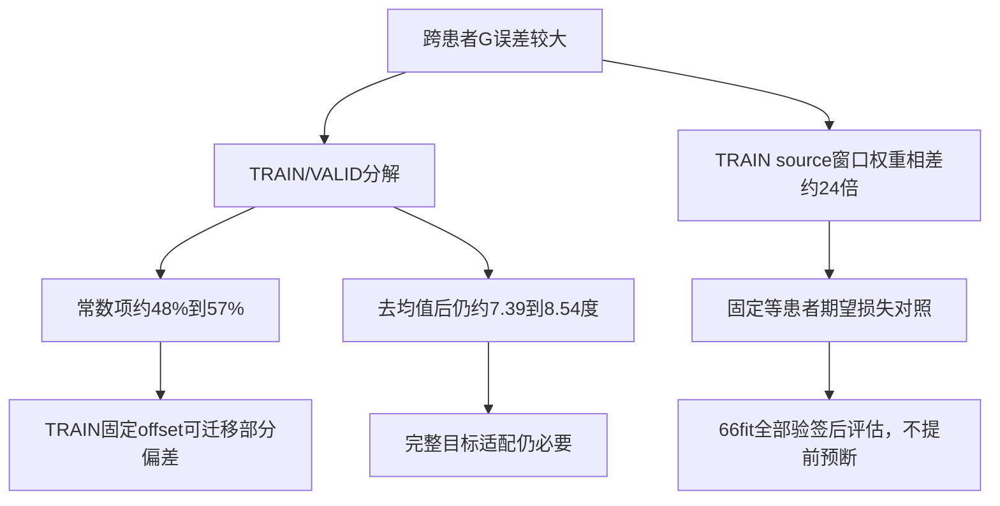

# 泛化误差机制诊断与等患者权重对照（2026-10-22）

本页承接[GEN1/GEN2已验收结果](SII2027_GENERALIZATION_RESULTS_20261022_ZH.md)，只增加TRAIN/VALID诊断。**跨患者失败同时包含常数偏差与动态误差；仅校正常数偏置不足以替代目标患者适配。源患者窗口权重集中，下一项固定对照是等患者source损失。** 本页不提供新的TEST精度，不使用架构线结果挑模型。

## 1. 已完成的机制诊断

在原6目标、3seed、5方法的540个TRAIN/VALID预测上，核对36个原reference支持，生成3240条逐角分解。TRAIN仍crop[100:-100]、VALID仍完整。MSE分解为每trial误差均值平方B与中心化误差D之和：e=prediction−GT，M=mean(e²)=mean(e)²+mean((e−mean(e))²，ddof=0。各分量按相同等角→等trial→等seed→等患者权重聚合；偏置份额为聚合B/聚合M。mean(RMSE)的平方不当作聚合MSE。

另仅对两个source-only G，用已冻结one/half/full目标TRAIN前缀估计固定六角offset：负的所选唯一crop帧平均残差。长trial按帧数加权，不重复计四槽/窗口；同一目标所有VALID加同一个offset。48个独特target/seed/k×2方法=96组offset，576个逐角参数，168个VALID预测支持/1008角行；重复k别名不增加样本数。没有新模型训练、优化、scaler重拟合、时滞、坐标或标签修改。

|source方案|G原始 VALID患膝RMSE°|每trial理想常数诊断界限°|full TRAIN固定offset后°|对应A适配°|G偏置MSE份额|
|---|---:|---:|---:|---:|---:|
|真实源|11.936504|7.393486|7.674105|2.916979|57.43%|
|混合虚拟源|12.093936|8.537025|8.840624|2.948083|47.71%|

理想界限用同段GT且允许每trial单独常数，不能当部署结果；TRAIN offset迁移诊断与它分开。常数平移不改变PCC和中心化误差，数值审计已确认。真实源G的VALID PCC约0.8185，A约0.9659；去均值后仍包含振幅、相位、形状和噪声，不能因PCC较高就声称动态已经学好。

真实源G→A的总MSE下降中约60.26%来自偏置项下降、39.74%来自中心化误差下降；混合源约49.82%/50.18%。这支持“适配改善了不止常数偏差”，但不证明误差由某个安装角、零点或物理坐标错误引起。

A/I的VALID已经参与历史checkpoint选择，G+offset用了目标TRAIN标签后也不再是zero-shot。该分析是既有数据的机制证据，不是独立新队列确认；不据VALID挑选预算/source域，本阶段没有新TEST分析。

## 2. 训练输入与source损失机会核查

独立输入诊断仅用31条真实TRAIN，crop后12665唯一帧、1968四槽窗口。每患者24–580窗口，相差24.17倍；每fold source7窗口占比1.24%–39.62%，等患者参考为14.29%。Kish权重集中度1/Σw²为3.968–4.806，只是采样/损失权重指标，不是实际独立临床样本量或测得的梯度范数。

target/source7的12D均值差RMS为0.189–0.357 source SD，72个fold×通道没有均值差超过1 SD；14/72的标准差比超出[0.5,2]，总范围0.242–2.595。步行加速度均值方向差：左小腿7.69–16.90°、右小腿8.74–13.47°；陀螺向量RMS比左0.731–2.019、右0.396–1.395。双膝TRAIN工程标签均值差分别可到约−10.28至7.85°、−9.57至6.81°。

这些差异可能混合步态、速度、姿势、时间组成、安装和偏置。动态步行加速度均值不能当静态重力标定；不能从上述角度推出sensor-to-body旋转或据此重新定义坐标。标签仍是legacy工程投影角，不是临床JCS。

原始梯度还取决于残差、方向、clip、AdamW及批次；窗口权重不等于实际梯度贡献。各原生通道、标签与公式的无患者ID汇总见[输入诊断JSON](SII2027_GEN3_TRAIN_INPUT_AGGREGATES_20261022.json)，带患者明细和波形不上传。

## 3. 下一实验已固定：等患者source损失

设计见[GEN4预先固定方案](SII2027_GEN4_EQUAL_PATIENT_DESIGN_20261022.json)，代码定位见[诊断与新训练代码索引](SII2027_GEN3_DIAGNOSIS_CODE_INDEX_20261022.json)。计划66个新fit＝18个真实源G＋48个目标A预算；原uniform的对应66个fit只读复用。source97800、target30400，共128200更新。当前这里只记录诊断依据与固定方案，训练/评估进度另记，**不预断等患者权重能改善TEST**。

source均匀shuffle相同窗口，不重采样；患者p每个窗口权重a=N/(7N_p)，loss=mean(a×per-window standardized six-angle MSE)，不按batch权重和再次归一。全体窗口平均权重为1，各source患者的期望损失系数为1/7；小尾batch、clip与AdamW行为沿用。source唯一真实帧pooled scaler维持原算法，不跟着损失重加权。

同一FrameTCN151110参数、12D实测输入、200epoch、每10epoch VALID、数据支持/窗口/初始化/seed/batch及每fit更新量配平。G仍整人排除target，source等患者VALID选点；18G全部验签后48A才从对应新G最佳权重开始。A仍普通MSE、相同one/half/full预算、真实四槽、frozen source scaler；full保持旧manifest parent序，low保持既有SHA前缀序，重复k合并。全部66完整验签才开放新TEST。主患膝、辅助双膝/六角、患者级方向与预算曲线均描述性，不增加p值，不删患者/seed/预算。

## 4. 验证与访问记录

输入侧独立重算783项断言通过，31个真实TRAIN动态文件，VALID/TEST/预测/checkpoint动态读取0。误差v2独立numpy审计125605项断言通过，最大数值差1.71×10⁻¹²；540预测、36reference、96offset、1008校正角行、PCC/中心化误差平移不变性、各层级权重及适配MSE归因均一致。

必须保留一次实现失败：最初v1预检只补丁builtins/io，当前Python的Path.open缓存_accessor.open使一次TEST原NPZ摘要计算绕过拦截；随即失败停止，未加载TEST数组、预测或数值用于诊断，正式诊断0。失败源码/协议/receipt已保留，v1误差诊断停用。v2另立合同，显式Path.open和sys.audit底层open结合np.load白名单；6种真实禁止路径读取/散列尝试均在打开前拒绝，v2正式与独立复算只访问576个TRAIN/VALID路径，TEST字节和预测读取0。不能把修复后0访问写成全历史0。

GEN4入口也保留一次启动前静态修订：v1的A阶段会在精确文件守卫内重复读取父G摘要而被拒绝，尚未运行任何fit即被独立审发现；v1合同/预检/源码已退休归档，v2在进入守卫前缓存已验签父G摘要，并补回归检查。它没有发生TEST读取，不能与上述GEN3失败预检混同。

文件位置：gen_train_distribution_diagnosis.py → GEN3_diagnosis_v1/input_distribution；gen_error_diagnosis.py / audit_GEN3_train_valid_numpy.py → GEN3_diagnosis_v2；新gen_balanced_training.py → GEN4_balanced_v2。旧180fit、原始数据、角色及坐标未修改。本页公开汇总、代码定位和图表；不上传原NPZ、患者角色表、权重或完整波形。
