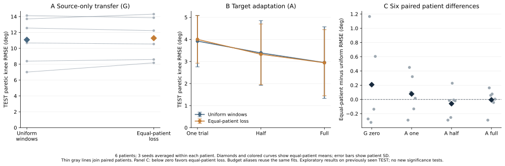

# GEN4：等患者source损失对照结果（2026-10-22）

**66个固定新fit已完成，并通过独立VALID选点与TEST结果复核。** 本实验检验TRAIN源患者窗口权重集中是否影响泛化，唯一预设训练改动是source每窗口损失权重。全部6目标患者、3个seed和one/half/full预算保留。以下差值统一为“等患者损失−原uniform窗口损失”，负值表示误差降低；结论是已有TEST上的描述性比较，不增加显著性检验。

## 1. 目的、实现与配平

[GEN3诊断](SII2027_GEN3_GENERALIZATION_DIAGNOSIS_20261022_ZH.md)发现源患者窗口数相差24.17倍，各fold source7患者的窗口占比可达1.24%–39.62%，但这不等于实测梯度贡献。GEN4据此固定一个独立损失对照，未改变网络、坐标、标签或数据划分，也未据本实验结果继续调权。

对source患者p，每窗口权重a=N/(7N_p)，其中N为该fold源窗口总数，N_p为该患者窗口数。loss=mean(a×每窗口的标准化六角MSE)，不按batch权重和再次归一，不重采样。全部窗口的平均权重为1，各source患者的期望损失系数为1/7；残差、batch尾部、clip和AdamW仍决定实际更新，不能声称实际梯度范数严格相等。

FrameTCN保持151110参数；12D实测左右小腿IMU输入、200epoch、每10epoch VALID、初始化/seed/窗口顺序/dropout/batch及每fit更新量与旧对照配平。source x/y scaler仍由源真实TRAIN唯一帧pooled拟合，没有随损失重加权。18个G仍整人排除目标患者，以source等患者VALID选点；48个A从对应新G最佳权重独立开始，target阶段仍普通MSE、冻结source scaler、相同真实四槽与既定预算。

one/half/full分别为1、ceil(n/2)、n个目标TRAIN trial，依既有SHA前缀选取；full训练仍沿用旧manifest parent顺序。小样本患者的重复k别名复用同一个fit和预测，不增加独立样本。跨预算目标更新数、覆盖及训练顺序并未全部配平，预算曲线只作描述。

新增18 G＋48 A＝66个fit；source97800＋target30400＝128200次更新。原uniform对应66个fit与114份预测只读复用，旧网络不重新推理；新模型产生114份TEST预测。两臂合计228预测、1368逐角指标。既有180fit与本次合计246fit、415000次新增训练更新，966份新增预测、5796条模型比较逐角指标；复用模型不再次计数，GEN3机制诊断另计。

## 2. 主终点：患侧膝角RMSE

|固定条件|原uniform窗口损失 RMSE°|等患者source损失 RMSE°|配对均值差°|患者误差降低|患者误差升高|
|---|---:|---:|---:|---:|---:|
|G：零目标标定|11.076073|11.283447|+0.207374|3/6|3/6|
|A：一个TRAIN trial|3.922012|3.999251|+0.077239|2/6|4/6|
|A：约半数TRAIN trial|3.385850|3.326125|-0.059725|5/6|1/6|
|A：全部TRAIN trial|2.949062|2.943575|-0.005487|2/6|4/6|

各角先算RMSE，再等角→等trial→等seed→等患者聚合；患膝终点每trial只有一个患侧膝角。6名患者是配对方向的单位，trial、seed、窗口和预算别名都不当独立患者；均值差等于6个患者配对差的均值。辅助MAE与PCC见[无患者ID汇总JSON](SII2027_GEN4_EQUAL_PATIENT_AGGREGATES_20261022.json)；PCC沿用各层Fisher-z聚合，不能按RMSE式直接算术平均。

- 零标定G：等患者损失的平均患膝RMSE升高，差值+0.207374°；6名患者中3人降低、3人升高、0人持平。
- 一个trial适配：等患者损失的平均患膝RMSE升高，差值+0.077239°；6名患者中2人降低、4人升高、0人持平。
- 约半数trial适配：等患者损失的平均患膝RMSE降低，差值-0.059725°；6名患者中5人降低、1人升高、0人持平。
- 全部trial适配：等患者损失的平均患膝RMSE降低，差值-0.005487°；6名患者中2人降低、4人升高、0人持平。

图A展示6个匿名患者的G配对值；图B误差棒为患者间SD，不是置信区间；图C每点为患者内先平均seed后的差值，负值有利于等患者损失。图不显示身份信息，也不连接不同患者制造额外样本。

## 3. 辅助终点与标定预算边界

|条件与终点|原uniform RMSE°|等患者损失 RMSE°|配对均值差°|患者误差降低|
|---|---:|---:|---:|---:|
|G零标定·双膝|9.138240|9.090219|-0.048021|3/6|
|G零标定·六角|10.417331|10.057287|-0.360044|6/6|
|A全部TRAIN·双膝|2.450731|2.453056|+0.002326|2/6|
|A全部TRAIN·六角|2.304418|2.319559|+0.015142|2/6|

等患者half适配为3.326125°，原uniform full适配为2.949062°；前者误差更高，不能宣称减半目标标定仍保留原full精度。 G零标定不使用目标标定标签；A使用目标TRAIN和VALID且source y scaler本身包含源标签信息，不能把A称为零标定。target VALID与source TRAIN/VALID的监督成本均保留，不能仅统计目标TRAIN时长就宣称全部成本下降。

|A预算|目标TRAIN裁切分钟|对应完整参考分钟|目标VALID分钟|目标优化更新数|
|---|---:|---:|---:|---:|
|one|0.062991|0.096324|0.163417|288.89|
|half|0.164176|0.247509|0.163417|566.67|
|full|0.283361|0.427806|0.163417|900.00|

成本表依seed再患者等权平均，仅用于描述本研究预算，因患者原有trial数不同，平均更新数可为非整数。“完整参考分钟”只覆盖所选TRAIN trial，不是额外独立样本；source监督与训练成本另计且没有省略。

## 4. 决策与下一步

本次在零标定G、一个trial适配观察到均值变差，说明本次固定的等患者损失处理未稳定改善。该对照不能排除患者贡献不均是误差的潜在成因；也不能把某条件极微小的平均降低解释为有效增益。 保持原uniform为冻结的主分析参考，等患者损失仅作敏感性对照；这是保留既有分析口径，不是按已见TEST选择最优部署模型。不用这批TEST继续搜索权重、患者、seed或预算，正负结果完整纳入决策。

研究瓶颈仍是零标定跨患者误差、小队列、工程标签以及安装/标定信息不确定。下一步优先编制独立验证方案并确认采集条件，明确可获得的新患者、真实IMU与mocap同步、分组覆盖和标定记录；缺少安装/标定信息的边界必须保留。当前不自行新增队列、坐标定义或临床可用性主张；拟改变任务定义或研究主线前应先与研究者讨论。

## 5. 审计、历史与局限

全部66fit的best/final、历史、scaler、窗口权重与父G链先验签；独立审计重新计算66个最佳checkpoint的VALID选点分数，source G共186个model-trial、target A共84个，TEST文件/摘要访问0。上述门槛通过后才开放本批TEST。独立结果审计重新推理114个新预测，核对228份预测、1368条逐角指标及配对层级；展示入口再次核对审计代码、合同、completion与CSV摘要，禁止在审计缺失或过期时读取正式TEST表。

原GEN3 v1预检发生一次TEST原NPZ摘要读取，随后停止并归档；GEN3 v2已修复、正式诊断和独立复算TEST读取0。GEN4 v1在任何fit前因父G摘要守卫问题退休；正式使用v2。原始TEST在此前身份/时钟QC及多轮研究中已经出现，因此“本批模型训练完成后才开放”不等于全历史盲测，结果不能当新队列确认性证据。

当前只有6名TEST患者；同一连续原始CSV的分段可跨角色但采样支持不重叠，不能称文件独立。拐杖条件仅候选标签，S6运动不足以证明接触或承重；条件覆盖不支持完整的患者内有拐/无拐配对推断。真实IMU坐标仍为sensor native轴，安装旋转未被独立识别；目标仍是legacy工程投影角，不是临床JCS，也不代表已确认三个解剖平面的临床有效性。

本页仅公开无身份汇总、图与[函数级代码索引](SII2027_GEN4_EQUAL_PATIENT_CODE_INDEX_20261022.json)。索引提供basename、相对实验路径、函数行号与SHA；不上传本地路径、原始NPZ、患者角色表、权重或完整波形。协议与代码对应：gen_balanced_training.py训练；audit_GEN4_validation.py复核VALID；gen_balanced_evaluation.py生成固定TEST比较；audit_GEN4_results.py独立复算；plot_GEN4_results.py作图。
