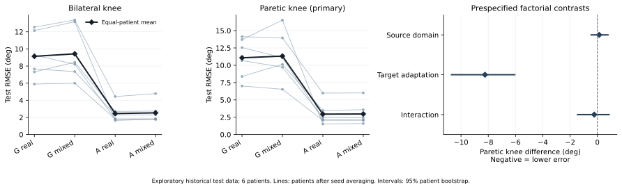
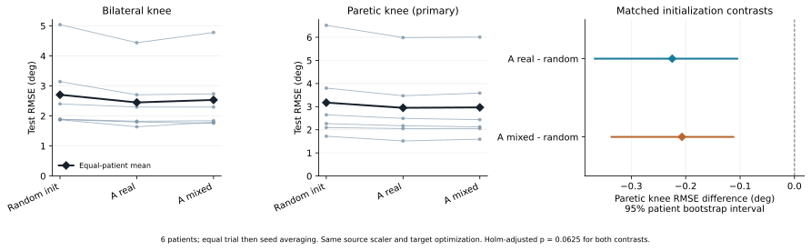
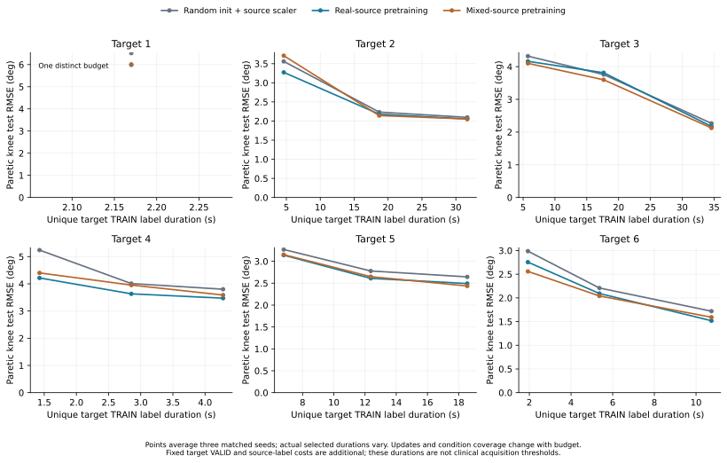
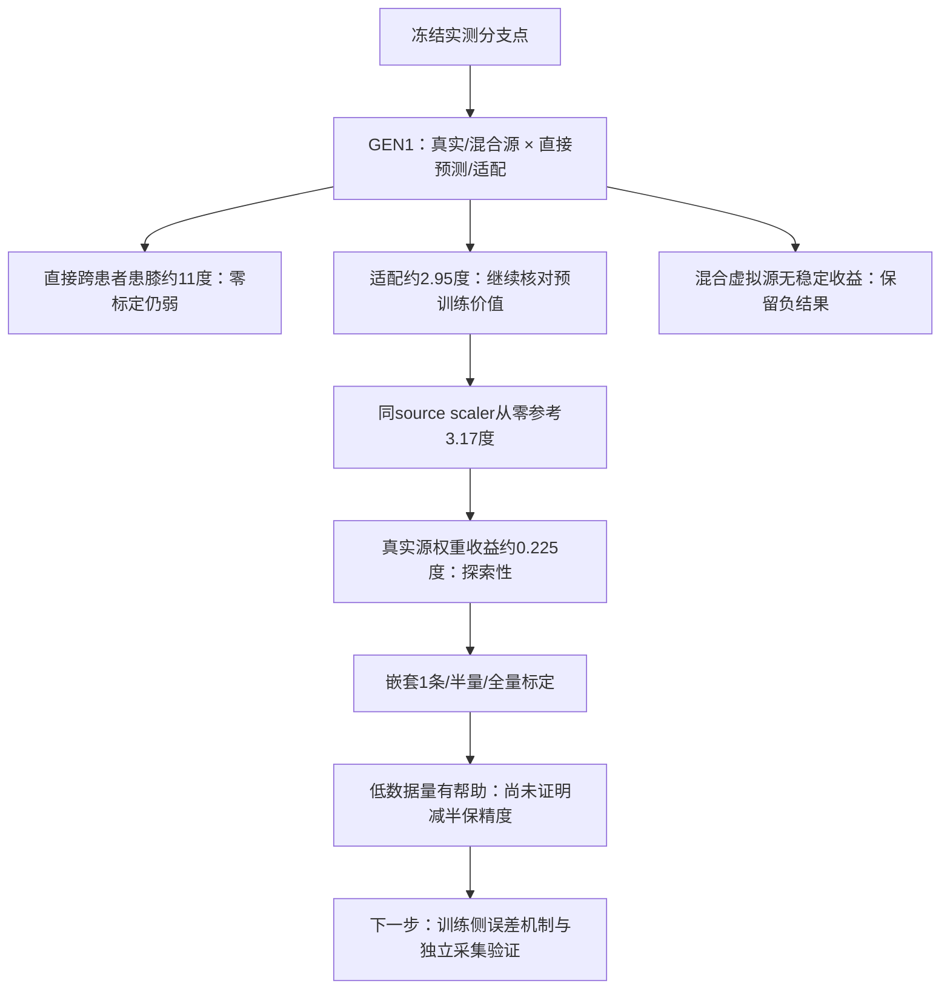

# 泛化线：已验收结果、代码落实与决策（2026-10-22）

本轮在[共同分支点](SII2027_RESEARCH_FORK_20261022_ZH.md)上完成GEN1四格、全量同标准化从零参考及嵌套标定量实验。**180个新增fit、286800更新均完成；三批结果已独立验收。当前证据支持目标患者适配的作用，未支持可靠零标定迁移或虚拟源的稳定收益。** 本文更新[原中期综合规划](MIDTERM_LITERATURE_SYNTHESIS_20261019_ZH.md)中的泛化分支，不据架构线TEST挑选模型。

## 数据、训练与可解释范围

仍为53实测试次，31TRAIN/12VALID/10TEST；8建模患者中6人有TEST，另2人仅作source。每个G完整排除该目标患者，用其余7人的TRAIN拟合梯度与scaler、VALID选择checkpoint，source TEST禁用。A从对应G最佳权重开始，只用目标TRAIN和VALID；两种A均使用真实目标数据。12D输入为左右小腿原生加速度/角速度，SI单位与传感器轴保留；标签为六个legacy pelvis-YZ投影工程角，非临床JCS认证。

架构FrameTCN151110参数、window120/stride20、width64、dropout.15、dilation1/2/4、batch64、200epoch、AdamW lr3e-4/wd1e-4/clip1。source真实TRAIN唯一crop[100:-100]拟合x/y scaler；四槽或窗口不重复计入scaler。真实源为replay4，混合源为真实+3个既有假设random虚拟视图。VALID/TEST保留原完整支持；Hann floor.08融合。G按source等患者、A和从零模型按目标等trial双膝VALID每10epoch选择，严格较小、平局保留早期点。

所有TEST均是历史研究已接触数据，身份与时钟重建曾用mocap作离线QC；试次来自共享连续原文件，支持不交叠不等于文件独立。本轮是探索性跨患者/跨试次重建验证，不能声称未接触TEST、新队列、IMU-only部署或临床标定阈值。安装Q和杠杆臂的实际患者记录仍不确定。

## 尝试、目的、结果与保留决策

|尝试|目的与代码定位|完成与结论|
|---|---|---|
|GEN1：G_real/G_mixed/A_real/A_mixed|gen_data.py: FitData；gen_training.py: worker/valid_metric；gen_evaluation.py: evaluate/statistics|72fit、228000更新；检验source域、目标适配及交互。适配有明显降误差，虚拟源无稳定收益。|
|full I_source_scaler|gen_scratch_reference.py: fresh_model/load_training/worker；gen_scratch_evaluation.py: training_gate/paired_statistics|18fit、16200更新；相同source x/y scaler、目标支持和目标阶段优化下隔离预训练权重收益。真实源适配患膝平均改善0.224781°，6/6同方向，Holm2=0.0625。|
|GEN2嵌套标定量|gen_budget_plan.py；gen_nested_training.py: DynamicAccess/initialize/worker/verify；gen_nested_evaluation.py: tables/evaluate|90新增低预算、42600更新，复用full A36+I18，共144个目标预算模型。低数据量预训练有帮助；半量适配未达到full从零参考的平均误差。|
|候选有拐/无拐覆盖核查|gen_condition_feasibility.py，仅冻结角色元数据|TEST有拐候选3条/2人、无拐7条/5人，仅1人两条件均有。条件分层仅描述，不能称充分配对的同患者条件迁移。|
|独立数值验收与图表|audit_GEN1_results.py、audit_GEN2_full_results.py、audit_GEN2_budget_results.py及plot_gen_*|source VALID、checkpoint推理、GT/time、scaler、逐角指标、分层权重及患者统计均通过；保留不利结果。|

代码索引为本地工作区`experiments/native_generalization_20261022`的文件、函数、行号与SHA追溯信息，见[具体代码索引](SII2027_GENERALIZATION_CODE_INDEX_20261022.json)；索引不表示这些本地脚本已作为可运行源码包上传。

## 已核验的全量结果

均为同6名患者等trial→等seed→等患者平均RMSE，单位°。双膝及六角均为各角RMSE的算术平均。

|方法|双膝|患侧膝（主终点）|六角|
|---|---:|---:|---:|
|G_real|9.138240|11.076073|10.417331|
|G_mixed|9.425187|11.322245|10.474993|
|I_source_scaler|2.705857|3.173843|2.441341|
|A_real|2.450731|2.949062|2.304418|
|A_mixed|2.534602|2.966957|2.331119|

G为未使用该目标患者标签的跨患者直接预测；A为目标患者适配。I_source_scaler是随机权重目标训练参考，含source x/y统计及source标签信息，不能称无群体信息。A−I才用于本轮预训练权重收益解释；A另有source预训练算力，source+target总计算未配平。旧patient-only I及原完整TRAIN基线的scaler/支持不同，不混入本轮配对效应。

GEN1预定患膝因素对比：source域+0.132033°，患者bootstrap95%区间[-0.457959,0.777779]、Holm3=1；适配−8.241149°，区间[-10.695212,-6.059855]、6/6降误差、Holm3=0.09375；交互−0.228276°，区间[-1.454824,0.858954]、Holm3=1。6患者只有64种符号组合，最小原始双侧p=0.03125，Holm3最低0.09375；不把seed或窗口当患者追求显著性。

full同标准化辅助对比：A_real−I=−0.224781°，区间[-0.367026,-0.105136]；A_mixed−I=−0.206885°，区间[-0.336252,-0.112246]；两项均6/6降误差、原始p=0.03125、Holm2=0.0625。bootstrap区间不能替代多重校正检验；当前不宣称p<0.05的确认性优势。

## 嵌套标定量：已核验的描述性曲线

每seed依`SHA256(GEN2_nested_budget_v1|seed|parent_id)`排序取1、ceil(n/2)、n嵌套前缀，不按信号或分数选段。重复k合并；只有1条TRAIN的目标只有1个真实预算，图中只画1点。各A_k均从对应source G最佳权重开始，绝不从见过全量target的A_full初始化。

|目标标定预算|I_source_scaler患膝RMSE|A_real患膝RMSE|A_mixed患膝RMSE|
|---|---:|---:|---:|
|1条TRAIN|4.315726|3.922012|3.987889|
|ceil(n/2)条|3.584422|3.385850|3.398776|
|全部n条|3.173843|2.949062|2.966957|

真实源预训练在1条、半量、全量的平均差分别为−0.393714°、−0.198571°、−0.224781°；患者改善方向分别6/6、5/6、6/6。曲线不新增显著性检验。半量A_real的3.385850°仍高于full I的3.173843°，目前不能宣称半量标定保持全量个体训练精度。

图中TRAIN监督crop的患者/seed平均长度约3.779、9.851、17.002秒；对应所选完整参考段约5.779、14.851、25.668秒，还另需固定目标VALID平均9.805秒、source TRAIN/VALID与离线QC。它们是已有裁剪数据的账目，不能解释为临床采集只需数秒。不同k的优化更新、运动/条件覆盖和parent顺序均会改变；full复用保留原manifest序，低k取SHA前缀序；只在同k三方法内匹配数据/更新/RNG，不称跨k计算匹配或纯标签量因果效应。

## 验收证据与决策树

GEN1在72fit验签后生成552新预测/3312逐角指标；独立审计另重跑36个G最佳模型的source VALID（372个trial-model组合），核对等7患者选择分数与history最低值。full参考新增138预测/828指标，另外只读导入276个A预测；138份scratch预测重新从checkpoint独立前向，最大预测差0，目标VALID分数也一致。

预算分析先验签144目标模型+36源G及900个checkpoint/receipt/access/history摘要，再新增162个低预算TEST预测，只读导入90个full TEST预测，共252唯一预测/1512指标。独立审计重跑162个低预算TEST及90模型的完整目标VALID，预测最大差0；唯一TRAIN scaler、嵌套支持、别名处理、成本端点和等trial/seed/患者汇总均通过。总新增预测为552+138+162=852、逐角指标5112；导入记录不重复计数。

下一步优先基于TRAIN/VALID分解跨患者直接预测的偏差来源、检查source患者训练贡献不均及输入统计变化，再规划独立患者/独立采集验证。任何新增坐标标定、队列或标签定义须另立方案；不据当前TEST重排试次、患者或更改坐标来美化结果。ARCH_AUG继续保留独立分支，本页不使用其成绩决定GEN模型。
