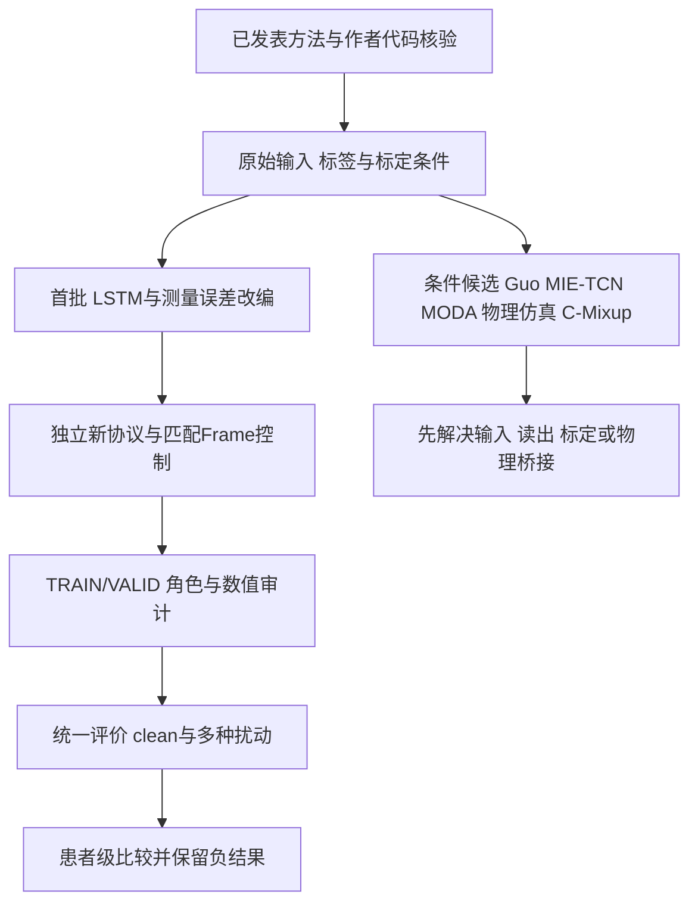

# 稀疏IMU运动重建：文献baseline筛选与公平比较方案

**2026-10-26追加验收（本条优先）：** 原六格baseline余下SO3/noise/gyro-bias的72新fit/63000更新及3360压力预测已独立复算通过，六格累计144个独立fit/126000更新。SO3患膝clean为3.273°（replay 3.174°），±10°旋转绝对误差3.388°（replay 3.711°；6/6改善），存在clean/压力权衡。固定noise/bias压力过弱，不能判增强家族无效。另完成0新fit、0VALID/TEST的TRAIN梯度几何诊断。见[增强全结果](SII2027_MEASUREMENT_BASELINES_20261026_ZH.md)、[梯度诊断及限制](SII2027_TRAIN_GRADIENT_DIAGNOSIS_20261026_ZH.md)、[本轮代码函数/SHA索引](SII2027_MEASUREMENT_GRADIENT_CODE_INDEX_20261026.json)。此前三批加本批共174 accepted fit/134400更新；含Dorschky失败版实际192次尝试/138000更新，仅指这四批，非全项目总成本。下面各日期旧状态保留历史含义；旧ARCH79及答辩文件保持。

**2026-10-26前批研究状态（历史）：** [三批后续实验与决策](SII2027_RESEARCH_PROGRESS_20261026_ZH.md)已通过独立训练和全结果复算：文献架构72fit、Dorschky四格新增18fit、监督机制12fit。TCN同人TEST患膝3.174°，两种LSTM未改善；方向增强存在clean/压力权衡；固定中间联合监督三seed阴性。accepted共102fit/71400更新，含失败的实际成本120次/75000更新。旧ARCH79继续冻结；余下增强baseline72fit尚未执行。以下早期“未训练/0fit”等文字按原记录日期保留，当前状态以本条及新报告为准。

日期：2026-10-25。服务于 **Generalizable and Personalized Motion Reconstruction in Stroke Patients Using Sparse IMUs**。本次用户要求补架构与数据增强的已发表方法对照；旧ARCH79项冻结和既有成绩保持，新比较另立版本。

**结论：现有Frame/共享TCN、Rot6D、静态SO3与假设虚拟混合主要是内部消融，不能替代已发表方法baseline。首批优先Hur-LSTM128、参数匹配LSTM85，以及固定FrameTCN上的测量噪声、陀螺仪常量偏置对照。** 较强的现代近邻MIE-TCN、MODA和完整物理生成有价值，但需先闭合输入、读出或标定条件。

本次已完成一手文献/作者代码核验、两个独立LSTM及测量扰动原型、合成接口检查；**正式新增fit和性能评价均为0**。下面是拟议比较，不是新的RMSE结果或已冻结训练合同。

## 1. 选择原则

优先真实IMU到连续下肢运动学回归，其次是可清楚改编的惯性回归；同时看原始输入、标签、划分、代码和标定成本，而不只看刊物名称。论文最佳RMSE不能直接填进本项目主表。人体动作分类、全身orientation输入、模拟IMU和不同传感器数量须明确区分。

比较分开回答：固定真实训练策略时架构是否有益；固定架构时增强是否有益。参数量、时间上下文、初始化、监督和优化曝光另外控制；不能一边换网络一边增加增强，再把总变化归因于某一个因素。

## 2. 架构与个体化baseline

| 文献 | 可借鉴对照 | 当前适用性与处理 |
|---|---|---|
| **Hur et al., Scientific Reports 2025**，[原文](https://www.nature.com/articles/s41598-025-89716-4) | CNN/LSTM；individual、generalized、adaptive三类训练 | **首选LSTM**。原输入含8枚IMU的ACC/GYRO/Euler共72维、10角输出、50帧窗；本项目明确改为实测12维、既有6/2角、共同context，不能称原文整套复现。 |
| **Guo et al., IEEE TNSRE 2025**，[原文](https://ieeexplore.ieee.org/document/11044411/) | 最接近的双IMU卒中physics-informed TCN | 保留为最近邻完整方法目标。其标定、杆臂/肢段长度、事件/ZUPT和物理损失未在本地全部闭合；普通双TCN不等于完整Guo方法。当前未定位到可确认的官方代码，不写成“代码不存在”。 |
| **Wang et al., Cognitive Computation 2026**，[MIE-TCN原文](https://link.springer.com/article/10.1007/s12559-026-10627-1) | Modified Informer encoder＋TCN，现代attention对照 | 作者公开代码可检查，但原单IMU特征化输入和last-step读出不同。需另设rolling endpoint协议及匹配控制，不能把一个预测复制到整窗冒充逐帧；列第二阶段。 |
| **Hernandez et al., Gait & Posture 2021**，[作者机构记录](https://research.monash.edu/en/publications/lower-body-kinematics-estimation-from-wearable-sensors-for-walkin/) | 多速度、真实ACC/GYRO连续运动学回归 | 任务接近，但原5枚IMU，当前只核到机构摘要，完整层配置/官方实现未核；不凭模型名称猜CNN-LSTM复现。 |
| **Mundt et al., Sensors 2021**，[原文](https://pmc.ncbi.nlm.nih.gov/articles/PMC8271391/) | MLP、LSTM、CNN及实测/模拟比较 | 101点周期和图像CNN改变分段、输入表示及未来上下文；作比较设计依据，暂不当即插的12维逐帧主baseline。 |

### 已核实的作者代码问题

Hur作者仓库commit **62af9e446bd52e3ab500c166847d690dc0a944c9**，论文Data availability直接链接。[LSTM](https://github.com/mintlabkorea/Learning-Based-Lower-Limb-Joint-Kinematic-Estimation-Using-Open-Source-IMU-Data/blob/62af9e446bd52e3ab500c166847d690dc0a944c9/Codes/model_angle.py)为3层hidden128、dropout0.2，对整个序列作逐帧Linear，而非仅最后一步。[CNN](https://github.com/mintlabkorea/Learning-Based-Lower-Limb-Joint-Kinematic-Estimation-Using-Open-Source-IMU-Data/blob/62af9e446bd52e3ab500c166847d690dc0a944c9/Codes/model_cnn.py)却有论文第三卷积10通道与代码3通道、代码中的时间Linear(50,50)而正文未明列的差异；部分工具依赖缺失，仓库未核到LICENSE。首批只独立实现明确的LSTM，不复制其无明确代码许可文件，也不静默修正CNN后冒充官方模型。

MIE-TCN作者仓库commit **8e5b05a77b95c0d8a4b09ca83368d01830f3b31d**。[模型](https://github.com/Shurun-Wang/MIE-TCN/blob/8e5b05a77b95c0d8a4b09ca83368d01830f3b31d/models/model.py)、[TCN](https://github.com/Shurun-Wang/MIE-TCN/blob/8e5b05a77b95c0d8a4b09ca83368d01830f3b31d/models/tcn.py)实际取最后时间步；其[特征函数](https://github.com/Shurun-Wang/MIE-TCN/blob/8e5b05a77b95c0d8a4b09ca83368d01830f3b31d/data/features.py)支持6维或按18维索引的分支，12维双小腿不能直接传入后一分支。README标MIT但未见实际LICENSE，许可声明/文件状态分开记录。若后续改编，须明确特征、context、输出头和非同原文数据的信息条件。

### 参数控制与当前可运行原型

| 输入→输出 | 当前FrameTCN | Hur-LSTM128改编 | LSTM85容量控制 |
|---|---:|---:|---:|
| 12→6，Stroke | 151110 | 337670 | 151136 |
| 12→2，Dorschky | 150850 | 337154 | 150792 |

128是文献骨干宽度；85是本项目根据参数量设计的控制，不是论文设定。近似同参数不等于同计算量、有效历史或时延，后续需同设备报告成本。共同120帧与论文50帧不同，正式命名 **Hur-LSTM128-adapted**；LSTM85命名 **capacity control**。更换架构时不增加Euler或mocap-derived输入。

## 3. 数据增强baseline

| 文献/方法 | 比较用途 | 物理与标签约束 |
|---|---|---|
| **Choi & Lee, Sensors 2023**，[原文](https://www.mdpi.com/1424-8220/23/17/7458) | **首批measurement noise、constant gyro bias** | 原任务为9轴姿态估计；改编为当前关节角回归的测量误差对照，不称同任务复现。当前关节角与时间保持，SI值上、scaler前变换。 |
| **MODA, CVPR 2025**，[原论文](https://openaccess.thecvf.com/content/CVPR2025/papers/Wu_MODA_Motion-Drift_Augmentation_for_Inertial_Human_Motion_Analysis_CVPR_2025_paper.pdf) | motion-drift、安装/软组织运动一致性的重要近邻 | HPE输入为多IMU orientation＋acceleration；raw gyro的时变坐标变换还涉及Q导数，不能只逐帧乘随机旋转。须先验证fusion/坐标/时间单位与标签桥接，不能用TEST mocap补orientation输入。 |
| **Dorschky et al., Frontiers 2020**，[原文](https://www.frontiersin.org/journals/bioengineering-and-biotechnology/articles/10.3389/fbioe.2020.00604/full) | 完整物理仿真与实测混合参考 | 原12维是4传感器×3矢状通道，并用半周期/左右对称扩展；不等于当前2×6，也不能把对称假设原样施加于偏瘫。论文有CNN补充实现，不等于完整生成链已复现。 |
| **Sharifi Renani et al., Sensors 2021**，[原文](https://www.mdpi.com/1424-8220/21/17/5876) | 运动学扰动后重新生成IMU | 先修改关节运动，再经模型重算IMU；直接对raw ACC/GYRO做time-warp不能复现它。位置、导数和标定成本另计。 |
| **C-Mixup, NeurIPS 2022**，[原文](https://papers.neurips.cc/paper_files/paper/2022/hash/1626be0ab7f3d7b3c639fbfd5951bc40-Abstract-Conference.html) | 第二阶段统计回归增强 | 按标签相似度配对，同时混合x和y；不是已证明的生物力学有效运动。仅TRAIN建邻接/核权重；序列标签距离、phase和带宽须另立改编协议。 |

C-Mixup[官方MIT代码](https://github.com/huaxiuyao/C-Mixup/tree/0b88fb314075dbb2bebf4c6041a8116fb7604762)已锁commit **0b88fb314075dbb2bebf4c6041a8116fb7604762**。其[`src/algorithm.py`](https://github.com/huaxiuyao/C-Mixup/blob/0b88fb314075dbb2bebf4c6041a8116fb7604762/src/algorithm.py)从TRAIN标签建KDE采样率，并同步mixup输入和标签。它是通用回归强参考，不冒充已在双小腿运动学任务证明的增强。

现有静态proper SO3是合理的坐标鲁棒性对照，但旋转增强有既有文献先例，不能单独作为新颖性。分类增强中的随机通道置换、任意time-warp或不改y的mixup，也不能直接搬来验证连续关节角回归。

### 首批测量扰动的显式改编

采用文献量级的固定非负SD：ACC noise **0.02 m/s²**，GYRO noise **0.15°/s＝0.002617994 rad/s**；GYRO bias每轴每parent/视图独立抽样 **N(0,(0.5°/s)²)**，即SD **0.008726646 rad/s**，整parent保持常量。原文涉及随机signed尺度的表述，不能把负数传为标准差；这里明确采用fixed-SD简化，而非假装完全复现。

这些不是本项目设备实测噪声统计。应称SI模型输入的测量误差控制；对于已经滤波的公开输入，不声称完整模拟原设备噪声传播。全parent一次采样再开窗，重叠帧共用同视图，不能逐窗独立重抽；标签/时间不变。原型另有noise+bias组合，但不自动加入首批矩阵。

## 4. 首批公平比较：Stroke优先，独立新控制

旧代码的模型初始化、dropout与DataLoader共享全局Torch RNG，不同架构同seed不保证同batch顺序。建议新批次拆分初始化/数据洗牌/视图随机流，重新训练匹配Frame控制；旧48个Frame replay/SO3模型仅作历史参照，不默认当新协议控制。较省算力的“96新fit＋48旧参考”只在明确兼容旧随机调度且通过全部复用合同后才成立，**不是当前首选预算**。

| 独立cell | 目的 | 计划fit | 计划更新 |
|---|---|---:|---:|
| FrameTCN＋replay4 | 两组共用的新控制 | 24 | 21000 |
| Hur-LSTM128＋replay4 | 文献循环骨干 | 24 | 21000 |
| LSTM85＋replay4 | 近似同参数控制 | 24 | 21000 |
| FrameTCN＋原静态SO3 | 当前方向增强 | 24 | 21000 |
| FrameTCN＋measurement noise | 文献动机测量噪声 | 24 | 21000 |
| FrameTCN＋constant gyro bias | 文献动机固定偏置 | 24 | 21000 |
| **合计，replay不重复计** | **6cell** | **144** | **126000** |

共同条件：53条原生数据、8患者/3seed；TRAIN31个parent固定共同crop[100:-100]、12665唯一帧；4视图槽、124视图；只用唯一真实TRAIN拟合scaler；120帧窗/stride20＋tail、同Hann融合；原200epoch、batch64、AdamW3e-4/wd1e-4/clip1与VALID-best规则。文献原生optimizer/epoch与此不同，因此本矩阵是**同信息/训练预算的架构改编比较**，不是最优原文重现；若做调参，应另给所有架构相同的VALID搜索预算，不能只调本方法或按TEST补调。

先TRAIN/VALID预检并独立验收，全部fit通过后统一评价。主TEST仍6患者10trial，属于**同人跨trial的架构/增强比较**；不能改称跨患者泛化。随后另立G/I/A外层人排除及Dorschky跨速度验证，不按这批已暴露TEST挑赢家后声称新独立泛化。

评价须同时报告clean、固定旋转、噪声/偏置敏感性，以及扰动后的绝对误差。只用旋转压力评价会偏向旋转增强，不能证明普遍鲁棒；新扰动强度/支持和统计需先固定。患膝、双膝和六角分别等trial→seed→患者，保留全部失败与负迁移；不以窗口或seed扩大N。

## 5. 当前交付与下一执行门槛

- [LSTM改编原型](baselines_20261025/architecture_baselines.py)：逐帧B×T×12→B×T×6/2，每次forward重置状态；未复制作者代码。
- [测量扰动原型](baselines_20261025/measurement_augmentations.py)：SI noise、constant gyro bias及可选组合；无数据读取或标定拟合。
- [模型合成probe](baselines_20261025/probe_receipt.json)：12个形状、4组梯度/重置/前缀检查；[测量probe](baselines_20261025/measurement_probe_receipt.json)：8项性质和5个非法输入阻断。
- [来源与实现状态索引](SII2027_LITERATURE_BASELINE_INDEX_20261025.json)：论文、代码commit/许可、实现/改编范围及原型SHA。

两类原型均无真实数据、旧权重或优化步。它们只证明接口/基本性质，不证明完整训练、角色隔离、性能或文献复现。下一步需编写独立runner/合同和数据访问预检，完成TRAIN/VALID及独立LSTM门方程/融合审计后才解锁评价。当前不在27号答辩中加入尚未运行的baseline成绩。

本轮优先补论文baseline缺口；原源×目标增强2×2机制计划继续保留。没有把候选、合成probe或计划fit写成新实验结论。

## 2026-10-26 执行状态更新

**2026-10-26最新研究状态：** [三批后续实验与决策](SII2027_RESEARCH_PROGRESS_20261026_ZH.md)已通过独立训练和全结果复算：文献架构72fit、Dorschky四格新增18fit、监督机制12fit。TCN同人TEST患膝3.174°，两种LSTM未改善；方向增强存在clean/压力权衡；固定中间联合监督三seed阴性。accepted共102fit/71400更新，含失败的实际成本120次/75000更新。旧ARCH79继续冻结；余下增强baseline72fit尚未执行。以下早期“未训练/0fit”等文字按原记录日期保留，当前状态以本条及新报告为准。

详细目的、全部负结果、成本、下一门槛与三张科学图见[本轮研究报告](SII2027_RESEARCH_PROGRESS_20261026_ZH.md)。这次新增研究没有修改旧冻结合同或既有答辩页。
