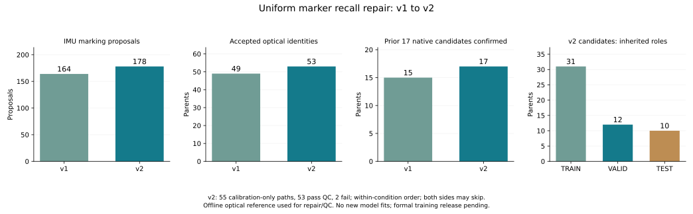
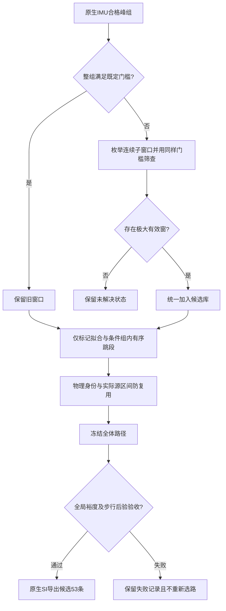

# 标记漏检修复与全量配对复核（2026-10-21）

配套：[代码函数/行号/SHA索引](SII2027_RECALL_CODE_INDEX_20261021.json)、[聚合证据](SII2027_RECALL_AGGREGATES_20261021.csv)。逐trial数据、原始信号与具体编号留在本地；本页仅公开方法、匿名案例指标及聚合证据。

已完成统一子窗口检测、全库配对、原生输入导出和独立验收：53条通过，覆盖8位患者，保留31 TRAIN、12 VALID、10 TEST的原始角色。旧49条全部保留且时钟不变，先前漏覆盖的两条已找回；旧17条现在全部得到新路径支持。没有新模型训练，旧2.205°不能作为本版结果。

## 为什么漏检

旧检测器将间隔不超过2秒的合格健侧峰连成整组，再判断整组质量。两例标记后的零散运动峰被并入，局部峰附近对侧很安静，但峰间对侧运动抬高整组RMS，导致真正标记也随整组被拒绝。

| 匿名事后诊断例 | 标记内合格峰→整组峰 | 标记内对侧RMS→整组RMS（rad/s） | 原因 |
|---|---:|---:|---|
| 新增例B | 6→9 | 0.123943→0.815127 | 超过0.35整组门槛 |
| 新增例C | 14→16 | 0.201494→0.364520 | 超过0.35整组门槛 |

不是峰数不足，也不是这两例跨度超过12秒。旧时钟仅用于事后复盘，未参与新候选生成；细节、完整峰表和上下文图见`missed_cause.json`及同名前缀产物。

## 统一修复与防止重复证据

保留所有原有峰高、突出度、峰距、局部对侧RMS及健/对侧比值阈值。在每组内枚举连续峰子窗口，要求至少4峰、跨度1.5–12秒，对带0.25秒边缘的窗口执行原有RMS≤0.35及比值≥3，保留不被另一个有效窗口包含的极大窗口。不是为两个旧时间段手工加切片，也没有放宽阈值。

全部18个完整双小腿session统一扫描，164→178个健侧候选；旧164个的峰集合及标记边界全部保留。仅4个session数量变化：12→13、13→15、18→20、10→19；对侧复核候选仍16个，一般活动356段，文档提案88条。178是动作提案数，不是真实行走次数。一例原始文件缺失缺源，两例原表与抬腿侧异常的原表与抬腿侧矛盾未通过改侧或补造解决。

重叠提案可能对应同一个物理时钟，故加入仅由全段标记PCC局部峰决定的物理身份，250ms峰距、最近峰50ms归并容差，反事实禁用整类别名。实际源pose→walk支持仍必须不重叠且相隔至少10ms。当前311条有效边恰好形成311个不同身份，没有真实数据别名重复；别名功能由穷举及合成测试验证，不能把本库不存在的别名问题声称为增益来源。

S1左小腿、S2右小腿和工作簿侧别保持不变；复用SHA验证后的原生100Hz、逐连续段6Hz缓存。检测不读取mocap、PDF编号、旧同步时间或预测误差。配对仍按每个条件组内顺序允许两侧跳段，跨条件顺序不预设，P1各独立session不混合。所有路径仅用标记选择，先冻结，再查步行；失败不重选。

## 全量结果与逐条变化

| 阶段 | v1 | v2 |
|---|---:|---:|
| 固定光学目标 | 69 | 69 |
| 有光学模板 | 58 | 58 |
| 健侧/标记规则允许的模板 | 56 | 56 |
| IMU健侧动作提案 | 164 | 178 |
| 配对边 / 通过标记门槛的边 | 659 / 284 | 706 / 311 |
| 冻结标记配对路径 | 52 | 55 |
| 通过全局裕度和步行门槛 / 原生导出 | 49 | 53 |
| TRAIN / VALID / TEST | 30 / 9 / 10 | 31 / 12 / 10 |
| 旧17条获得路径支持 | 15 | 17 |

旧49条全部保持相同session、连续段及同步时钟，无丢失。新增4条如下，完整69目标去向见`version_comparison.json`。

| 匿名新增记录 | 原角色 | 标记PCC | 步行PCC | 全局裕度 | 步行最佳局部偏差 |
|---|---|---:|---:|---:|---:|
| 新增例A | VALID | 0.992080 | 0.943967 | 0.960402 | 0ms |
| 新增例B | TRAIN | 0.995912 | 0.960328 | 0.979560 | 0ms |
| 新增例C | VALID | 0.993938 | 0.925487 | 0.969689 | 10ms |
| 新增例D | VALID | 0.993970 | 0.842923 | 0.656482 | 10ms |

前三条原先没有进入标记路径；最后一条原先进入路径但步行PCC仅0.272，未被验收。新增子窗口在标记评分阶段提供了新源候选，使其全局选中时钟比旧版提前38.960秒，之后才做步行复核；没有利用步行信号反选新时钟。旧49条均不受此变化影响。

仍有16/69条未验收：11无模板、2侧别/标记模式未解决、1没有标记路径、2选中但失败。两个失败为失败例E步行PCC0.743294低于0.8，以及歧义例F全局裕度0.074756低于0.1。均保留诊断，未绕过门槛。没有将其余原始光学文件自动纳入主队列。

## 验证与代码落点

20项测试通过：7项检测行为检查（污染尾部、完整标记、长组、双侧运动、噪声、峰数不足、峰间大间断）及13项物理身份求解检查（含60个随机小实例穷举及全部选中类的反事实）。独立枚举2650个有效连续子窗，178个极大窗与生产实现完全相同，直接RMS最大差2.95×10⁻¹²。旧659条边的时钟、分数和门槛逐字段不变；新求解器精确复现旧10个session路径及52个裕度，旧求解器在新矩阵也精确复现全部路径及55个裕度，确认增益来自新子窗口。只读实现复核另穷查有效边，未发现提案编号与实际源时间倒置造成的可行路径损失。

独立重算704项标记PCC，最大误差6.01×10⁻¹³；53份输入从原始CSV时间戳、单位换算和两邻点插值独立重建，最大误差1.39×10⁻¹⁷；从Rot6D独立计算既有投影角误差0。53份原始行支持无重用，条件组内保序和10ms源间隔通过。53份均有严格双小腿加速度/角速度支持，无导出拒绝。

| 新文件 | 目的与实际作用 |
|---|---|
| `recall_inventory.py` | `marking_blocks/main`统一极大有效子窗口、逐session旧候选保留证明 |
| `build_recall_matching.py` | 从只读v1生成新数值适配层，逐项变更收据 |
| `recall_matching.py` | `score_candidates/assign/validate`标记矩阵、物理身份、先冻结后验收 |
| `physical_assignment.py` | `solve/edge_margins`双链跳段、物理集合去重、整类别名反事实 |
| `compare_recall_versions.py` | 全69目标去向、旧49时钟保持、新增/丢失逐条记录 |
| `export_recall_candidates.py` | 原生SI传感器坐标12D导出，保留重力和偏置，无滤波或重力坐标变换 |
| `audit_recall_matching.py` | 直接PCC、别名类、原生输入、几何、行重用及旧17覆盖验收 |
| `plot_recall_matching.py` | 全55条路径含2个失败，不精选成功样例 |
| `archive_marker_recall.py` | 本版源快照、产物与前几版完整性逐SHA核验 |

本版的输入坐标与标签仍有明确边界：真实IMU采用原生传感器轴；同步用双侧3D模，不能据此推定完整解剖朝向。标签沿用原有骨盆YZ投影定义，不把投影角自动改称临床关节坐标系角度。S6仅辅助，用拐条件继承光学目录候选标签，拐杖被携带不等于实际承重使用。

本轮完成数据召回与离线配对修复；正式训练就绪仍为false。后续先为53条补齐S6状态的可审核证据和输入预处理/坐标合同，冻结可训练版本，再按原划分重训及评价。测试mocap已用于离线修复质检，不能称为完全未接触测试集；现有8患者集合不是新增跨患者泛化结果。

## 中期决策树新增：R17 / R18

| 决策 | 尝试与目的 | 代码与证据 | 结论 |
|---|---|---|---|
| R17 标记召回 | 查明旧17中2条未覆盖的具体门槛，采用统一有效子窗口而不抬高对侧阈值 | `missed_cause.py`、`recall_inventory.py:marking_blocks/main`、`compare_recall_versions.py:main`；2650有效子窗独立枚举 | 164→178；全部旧候选保留；49→53；旧17→17全支持；4条新增在步行前已选定 |
| R18 物理别名与回归 | 防止重叠提案重复表示同一时钟而制造假竞争，保留真实不同源竞争 | `physical_assignment.py:solve/edge_margins`、`physical_assignment_test.py`、`audit_recall_matching.py:main` | 13求解测试含60穷举实例通过；本库311有效边恰为311身份；增益来自新窗口，不能归功于未出现的别名合并 |

本轮保持“两枚真实小腿IMU→下肢运动学”的研究思路。没有更换主队列、解剖输出或模型，也未追逐原文不可靠数值。标记与步行的物理一致性证明离线配对质量，不能代替训练后预测效果或真实用拐承重证据。

源快照：`source_snapshots/355d38fed7f83c76`；manifest SHA256：`efe72410f9fc5c4c46dc681ee1d33ccd436470786d5e62511d2fa73f2d1ecfb9`。新代码在本地主项目`experiments/marker_recall_20261021`，具体函数、行号和SHA见配套索引。
