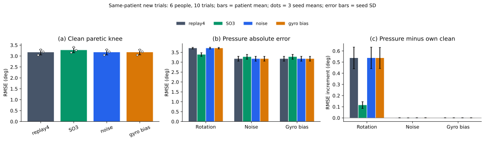

# 测量扰动增强：已独立审计结果

本批在同患者新试次上比较 replay4 与 SO3、白噪声、gyro 常偏三个增强臂。6名有TEST患者、10个完整试次、3个优化seed；不是跨患者验证或新盲测。全部72新fit及结果独审通过后才生成本报告。

输入全部来自native SI实测S1左小腿/S2右小腿12维ACC/GYRO。SO3、noise和bias仅扰动这些实测母本；mocap仅用于标签及已有离线配对/QC，不混入真实IMU输入，也不调用旧virtual生成数组。历史helper虽名为virtual_data.py，本批只借用其real_trials读取实测数据。输出保持工程pelvis-YZ六角，不称三解剖平面JCS。

训练四视图含一个原样clean和三个生成视图。SO3沿用每传感器固定随机轴、带符号均匀±10°，同一旋转同时用于ACC/GYRO；noise为逐样本独立高斯ACC SD 0.02 m/s²、GYRO SD 0.15°/s；bias仅GYRO，每母本/视图/传感器/轴固定高斯SD 0.5°/s。全部先在完整实测母本生成，再裁剪、标准化和开窗。测试为clean、12个单传感器轴±10°、12个单gyro轴±0.5°/s及3个固定noise重复。

新增72次独立拟合、63,000次AdamW更新；旧Frame24模型只读复用。原六格矩阵合计144个独立模型、126,000次历史及当前更新。本报告无新增拟合、scaler重估或p值。

所有数值为度。均值先压力族内等case、再等trial、等seed、等患者。±为三个seed群体均值的样本SD（ddof=1），不是患者SD或置信区间。

| 臂 | clean患膝 | clean双膝 | clean六角 |
|---|---:|---:|---:|
| replay4 | 3.1737 ± 0.1229 | 2.7810 ± 0.0728 | 2.4580 ± 0.0284 |
| SO3 | 3.2730 ± 0.1220 | 2.8496 ± 0.0707 | 2.4837 ± 0.0270 |
| noise | 3.1742 ± 0.1234 | 2.7812 ± 0.0730 | 2.4568 ± 0.0286 |
| gyro bias | 3.1742 ± 0.1199 | 2.7818 ± 0.0739 | 2.4569 ± 0.0296 |

各压力族单列；以下为患膝，双膝、六角及六个逐角总体值完整保存在无ID聚合JSON。

| 压力族 | 臂 | 绝对RMSE | 相对自身clean增量 |
|---|---|---:|---:|
| 单传感器各轴±10° | replay4 | 3.7111 | +0.5373 |
| 单传感器各轴±10° | SO3 | 3.3879 | +0.1149 |
| 单传感器各轴±10° | noise | 3.7119 | +0.5377 |
| 单传感器各轴±10° | gyro bias | 3.7114 | +0.5372 |
| 白噪声3次固定重复 | replay4 | 3.1743 | +0.0006 |
| 白噪声3次固定重复 | SO3 | 3.2728 | -0.0003 |
| 白噪声3次固定重复 | noise | 3.1747 | +0.0005 |
| 白噪声3次固定重复 | gyro bias | 3.1749 | +0.0006 |
| 单gyro轴±0.5°/s | replay4 | 3.1740 | +0.0003 |
| 单gyro轴±0.5°/s | SO3 | 3.2732 | +0.0002 |
| 单gyro轴±0.5°/s | noise | 3.1745 | +0.0003 |
| 单gyro轴±0.5°/s | gyro bias | 3.1745 | +0.0003 |

三个预定对比均为增强−replay；负差表示较低误差。方向计数按每患者三个seed先平均，再比较；分母始终6名患者。

| 臂 | 压力族 | 绝对误差差 | 增量差 | 绝对差改善/恶化/持平人数 |
|---|---|---:|---:|---|
| SO3 | clean | +0.0993 | +0.0000 | 2/4/0 |
| SO3 | 单传感器各轴±10° | -0.3232 | -0.4225 | 6/0/0 |
| SO3 | 白噪声3次固定重复 | +0.0985 | -0.0008 | 2/4/0 |
| SO3 | 单gyro轴±0.5°/s | +0.0992 | -0.0001 | 2/4/0 |
| noise | clean | +0.0005 | +0.0000 | 3/3/0 |
| noise | 单传感器各轴±10° | +0.0008 | +0.0003 | 3/3/0 |
| noise | 白噪声3次固定重复 | +0.0005 | -0.0001 | 4/2/0 |
| noise | 单gyro轴±0.5°/s | +0.0005 | -0.0000 | 3/3/0 |
| gyro bias | clean | +0.0005 | +0.0000 | 4/2/0 |
| gyro bias | 单传感器各轴±10° | +0.0004 | -0.0001 | 4/2/0 |
| gyro bias | 白噪声3次固定重复 | +0.0006 | +0.0001 | 4/2/0 |
| gyro bias | 单gyro轴±0.5°/s | +0.0005 | -0.0000 | 4/2/0 |

压力增量降低可能同时伴随clean误差上升；不能仅凭增量挑选最好模型。各压力族、全部三个seed与零/负收益均保留，不合成跨族压力总分。

本批固定噪声和偏置量级形成的压力很弱：replay患膝相对clean增量分别仅0.000558°和0.000290°；noise/bias自身增强与replay的总体误差差异也低于0.001°。这不足以判断噪声或偏置增强家族无效，也不能推出SO3普遍优于经过充分校准或调参的其他增强。SO3在本次±10°轴向旋转压力下改善，同时伴随clean误差上升，应保留这一权衡。

后续若研究噪声/偏置的强度响应，应另立协议，用TRAIN-only信号统计或独立设备测量依据校准候选强度并预先冻结评估；不能依据本批已知TEST结果直接调高扰动强度或挑选最有利幅度。

合成原生轴旋转、白噪声与固定gyro偏置不代表真实重戴、传感器位置变化或设备标定。输出仍为工程六角；光学离线配对/QC、同患者划分和历史TEST暴露的限制保持。没有临床三平面JCS、独立卒中队列或流式延迟认证。

公开内容仅本报告、总体/seed聚合、科学图及函数SHA；完整源码、患者表、权重和预测留本地。

[无ID总体聚合](SII2027_MEASUREMENT_BASELINES_20261026_AGGREGATES.json) · [科学图索引](SII2027_MEASUREMENT_BASELINES_20261026_FIGURES.json)

