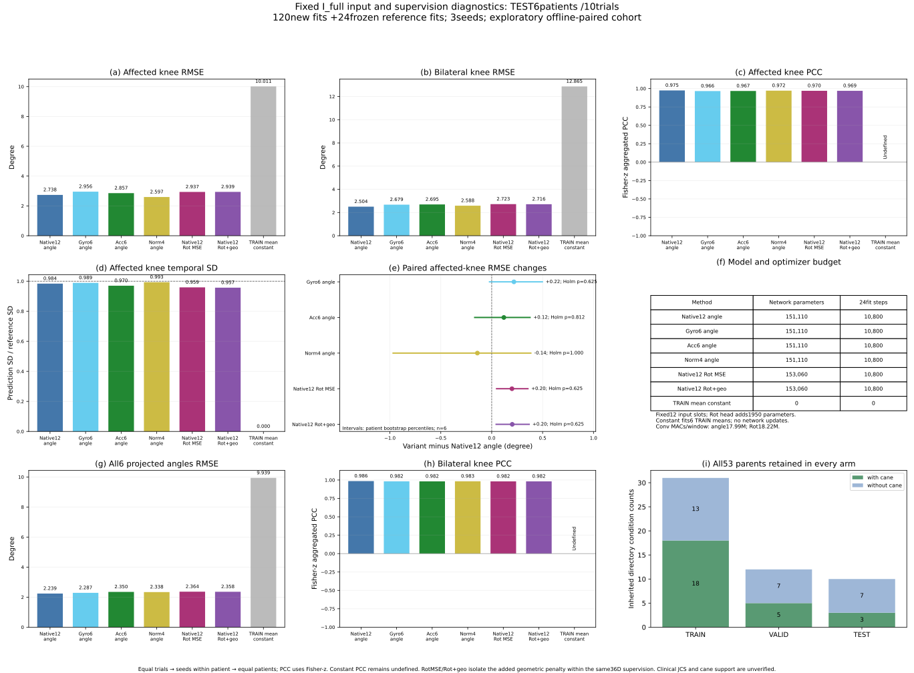
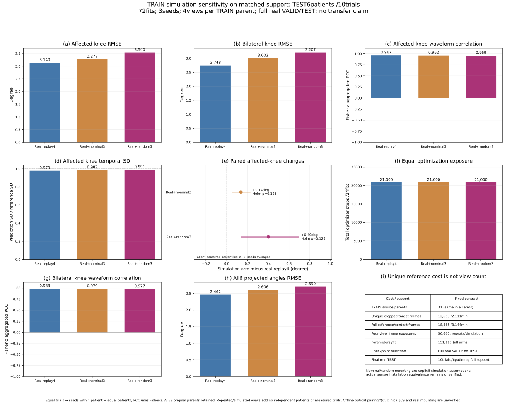
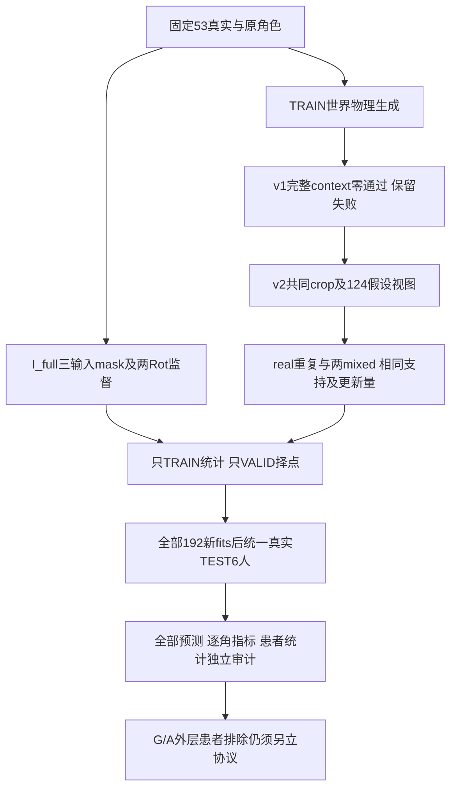

# 原生53条输入、监督表示与假设虚拟增强消融（2026-10-22）

**10/22研究分支更新：** 以已验收53条数据和结果为共同起点，分为[GEN：泛化与标定成本](SII2027_RESEARCH_FORK_20261022_ZH.md#gen)和[ARCH_AUG：网络架构与数据增强](SII2027_RESEARCH_FORK_20261022_ZH.md#arch_aug)。两个分支的角色／预算已预检，共享模型与静态旋转完成合成预检；当前新训练均为0，拟执行预算与旧成绩明确分开。

配套：[代码函数/行号/SHA](SII2027_ABLATION_CODE_INDEX_20261022.json)、[全部聚合指标](SII2027_ABLATION_AGGREGATES_20261022.csv)、[患者级配对差聚合](SII2027_ABLATION_PAIRED_20261022.csv)。具体患者编号、逐trial矩阵、原始/预测NPZ、完整波形及权重留在本地；本页仅公开方法与聚合证据。

已在固定53条真实数据、原31TRAIN/12VALID/10TEST上完成192次新增神经网络拟合（I_full120＋假设虚拟72），复用旧raw12参考24次；另完成8个确定性线性模型的48个VALID候选。所有种子、完整TEST段和不佳结果保留，独立审计通过。新增预测1325份，连同旧参考212份，三类结果共1537份预测记录、9222行角度指标；SO(3)另列1908行关节指标。患者数没有因窗口/seed/视图增加。

本轮属于患者内I_full消融和简单E1参考，不是原计划的排除目标患者G/A与real/mixed×adapt2×2，也没有完成staged/direct模型比较。8患者建模、TEST仅6患者10trial；目录条件仍只是候选，输出仍为六个骨盆YZ工程投影角。

## 1. 输入与监督表示

gyro-only、acc-only和norm4均保持12槽、151110参数与原FrameTCN骨干；未用槽在scaler前置零、标准化后仍为零。norm仅去方向而保留动态幅值；acc包含重力和平动，不能将两模态差异简化为静态/动态。所有统计量仅来自患者原TRAIN唯一帧，VALID每10epoch择checkpoint，全部120次200epoch完成验签后统一TEST，每组10800更新。

Rot6D有MSE-only与MSE+0.05geo两个分支，36输出使参数增加1950（1.29%）；监督维数、监督信息和损失均明示，两分支实际可用输入均为同一native12，不称纯编码因果优势。窗口输出先逆标准化、GS解码、加权矩阵平均/SVD投影，再生成同一六角。旧整窗架构还改变BiGRU/attention且参数增加约52%，本轮未作为纯readout对照运行。

| 方法 | 患侧膝RMSE(°) | 双膝RMSE(°) | 六角RMSE(°) | 双膝PCC |
|---|---:|---:|---:|---:|
| frame_tcn_angle | 2.7377 | 2.5036 | 2.2391 | 0.9856 |
| gyro6_angle | 2.9560 | 2.6789 | 2.2869 | 0.9824 |
| acc6_angle | 2.8570 | 2.6951 | 2.3498 | 0.9819 |
| norm4_angle | 2.5970 | 2.5880 | 2.3381 | 0.9831 |
| native12_rot6d_mse | 2.9366 | 2.7230 | 2.3636 | 0.9817 |
| native12_rot6d_geo | 2.9394 | 2.7156 | 2.3577 | 0.9818 |
| linear_native12_current_frame | 7.1804 | 8.7098 | 6.3831 | 0.7379 |
| TRAIN_mean_constant | 10.0112 | 12.8655 | 9.9394 | 未定义 |

表中先逐角/完整trial计算，再患者内等trial、等seed、最后6患者等权；PCC为有效逐角值Fisher-z汇总，常数不填0。所有方法无最佳lag或测试中立位修正。线性参考是当前帧78参数Ridge，alpha候选预定并只用VALID选；它没有TCN时域上下文，不冒称完整Guo物理或MLR/Kalman复现。

本轮结论：完整acc+gyro仍有最低双膝和六角误差，去掉任一模态均未改善这两个端点。norm4患侧膝均值稍低（2.5970°对2.7377°），但双膝/六角稍高，患者配对精确p=1.0；不据此改称方向信息无用或安装误差已解决。RotMSE/RotGeo双膝约2.72°，没有优于原角度参考；geo项只带来很小数值变化。当前保留原生双模态角度网络作为工程参考，Rot6D另保留完整旋转次指标，不宣称其必然更好。该结论限于患者内完整数据训练，不能外推新患者。

### 患侧膝患者配对差（新方法−raw12参考）

| 分支 | 均值差(°) | 患者bootstrap区间(°) | 改善/变差人数 | 精确双侧p | 五项Holm p |
|---|---:|---|---:|---:|---:|
| gyro6_angle | 0.2183 | [-0.0283, 0.5044] | 1/5 | 0.15625 | 0.62500 |
| acc6_angle | 0.1193 | [-0.1737, 0.3833] | 2/4 | 0.40625 | 0.81250 |
| norm4_angle | -0.1407 | [-0.9752, 0.3912] | 1/5 | 1.00000 | 1.00000 |
| native12_rot6d_mse | 0.1989 | [0.0412, 0.3625] | 2/4 | 0.12500 | 0.62500 |
| native12_rot6d_geo | 0.2017 | [0.0369, 0.3746] | 2/4 | 0.15625 | 0.62500 |

norm4−raw12患侧膝是预先指定主对比，其余探索性保留。6患者仅64个符号翻转模式，双侧原始p最小0.03125；五项Holm不可能低于0.15625，两项Holm不可能低于0.0625。不能以本样本校正p<0.05作为成功门槛，不能把seed/window当独立患者补足N。区间是患者级描述性bootstrap，检验依赖符号对称等假设；旧TEST已接触，均非临床确认。

### 仅Rot6D分支的完整相对SO(3)次指标

| 分支 | TEST患者 | 六关节等权平均测地距离(°) | 测地RMSE(°) |
|---|---:|---:|---:|
| native12_rot6d_geo | 6 | 2.5041 | 2.9898 |
| native12_rot6d_mse | 6 | 2.5088 | 2.9943 |

角度网络无法唯一反演完整3D姿态，其SO(3)为不适用，不伪造Rot6D。此表是原工程相对旋转，不自动认证解剖轴扭转或临床JCS，也不替换六角评分。

## 2. 文献安装依据与虚拟生成尝试

用户指定的Guo2025论文确实给出了名义轴向与静止/步行sensor-to-segment标定，而不是完全没有说明；已读作者发表版III-A/IV-A。论文不能直接替代本地每患者安装矩阵、传感器距离和标定段执行收据；当前rawSI输入未冒充该已校准坐标。[论文全文](https://www.researchgate.net/publication/392839405_Physics-Informed_Learning_Framework_for_Lower_Limb_Kinematic_Prediction_with_Sparse_Sensors_and_its_Application_in_Chronic_Stroke)。

虚拟v1要求完整TRAIN q外各1s真实world context，0/31通过，失败协议/清单保留。v2固定保留同parent q[100:-100]，用原TRAIN两端作为滤波和导数context，31/31通过。原参考18865帧→共同训练目标12665帧；额外参考context、监督维数和假设成本不隐藏。VALID/TEST仍原全段，不生成其虚拟数据。

由原world绝对位移、marker段frame、中小腿固定杆臂、显式世界重力生成specific force和角速度，保留旋转切向/向心项。nominal及3个固定随机SO(3)安装共124视图，8项解析测试及全部来源/标签/物理量独立重算通过。midshank/Q仍是模拟假设，TRAIN-only安装拟合诊断未用于改生成器，不宣称真实安装等价。

## 3. 匹配支持及优化曝光的假设虚拟对照

三组均有同一12665真实TRAIN唯一帧、4个视图槽和相同初始化/窗口/批数，每组24fits、200epoch、21000更新。x/y scaler只用裁剪后真实TRAIN唯一帧，绝不把synthetic、重复槽或VALID/TEST混入统计量。real_replay4重复实测四次；nominal混合为1real＋同nominal三次；random混合为1real＋三个预定Q视图。不能将重复槽视为新试次或只比较不同更新量。

| 分支 | 患侧膝RMSE(°) | 双膝RMSE(°) | 六角RMSE(°) | 双膝PCC |
|---|---:|---:|---:|---:|
| real_replay4 | 3.1395 | 2.7476 | 2.4622 | 0.9827 |
| mixed_nominal3 | 3.2768 | 3.0023 | 2.6064 | 0.9789 |
| mixed_random3 | 3.5404 | 3.2075 | 2.6992 | 0.9769 |

| 生成器−真实重复控制 | 患侧膝均值差(°) | 患者bootstrap区间(°) | 原始p | 两项Holm p |
|---|---:|---|---:|---:|
| mixed_nominal3 | 0.1373 | [0.0543, 0.2290] | 0.06250 | 0.12500 |
| mixed_random3 | 0.4009 | [0.1359, 0.6984] | 0.06250 | 0.12500 |

旧raw12参考使用完整TRAIN和10800步/组，此处控制裁剪TRAIN且21000步/组；两者不能直接归因为虚拟收益。生成器效果只由同支持同更新量三组比较判断；无益/有害结果也完整保留，不据本次TEST调安装Q、滤波或混合比例。

本轮结论：nominal与random混合的双膝误差均高于真实重复控制（3.0023°/3.2075°对2.7476°），患侧膝分别增加0.1373°/0.4009°；当前假设生成器没有显示患者内增强收益。缺失逐人安装标定是可检验的解释之一，尚不能把它确定为唯一原因，也不能据此否定所有物理虚拟数据。下一批仍按预先拟定的source真实/混合双臂检验跨患者预训练与真实适配，不用本轮TEST挑选Q或删掉不佳分支。

## 4. 可定位代码与决策

| 决策 | 尝试/目的 | 代码 | 结论位置 |
|---|---|---|---|
| R23 | 对齐I/G/A与原E2编号 | leakage_review.py/md | 当前是I_full，G/A外层患者排除仍待执行 |
| R24 | 相同网络去除方向/模态信息 | ablation_features.py、i_full_ablation.py | 输入表及患者配对差 |
| R25 | 分开Rot6D监督和geo项 | ablation_models.py、rotation_secondary_metrics.py | 六角与SO(3)均保留；非纯编码/临床姿态认证 |
| R26 | 简单当前帧参考 | linear_reference.py、audit_linear_reference.py | 8模型/48VALID候选、78参数、无时间上下文 |
| R27 | 原论文安装/标定依据 | paper_installation_review_ZH.md/json | 论文有方法，本地执行值仍需追溯 |
| R28 | 真实context不足的失败尝试 | virtual_source.py、virtual_source_preflight.json | v1 0/31，未静默外推 |
| R29 | 同TRAIN世界物理模拟 | virtual_generate_v2.py、virtual_independent_check.py | 31parent/124视图、共同crop及假设显式 |
| R30 | 控制额外训练量 | virtual_ablation.py、virtual_training_ledger.json | 每组21000步、仅realunique scaler，三组结果见表 |
| R31 | 患者统计与逐预测独立验收 | I_full_statistics.py、virtual_statistics.py、audit_I_full.py、audit_virtual.py | 192新fits及全部预测/指标/层级汇总验证，N仍6 |

## 5. 当前边界与下一批

三平面仍为骨盆YZ矢状、XZ冠状、XY水平，原sensor XYZ不能直接当解剖轴。S6目录运动相容不等于承重真值。连续CSV跨角色共享但原生样本支持不重用，TEST只6人、少量trial，有一患者VALID/TEST条件不同；69原目标中16仍未验收，不补造或外推。

本批没有按新TEST更换核心输出、患者、同步或统计规则，没有声称重现原文不可靠数字。接下来按NEXT_G_A_PROTOCOL_DRAFT_ZH.md审查后冻结外层患者排除的G/A 2×2：source训练/验证/统计量均排除目标，两种A均只用相同target真实数据，避免把source合成与target增强捆绑。目标VALID亦消耗监督参考须单列成本。此草案尚非已运行结果，staged/direct和低标定成本曲线仍需后续证据。

后续拟以有TEST的6患者逐一作为目标，其余7患者为source；3seed、real/mixed两域，各36个G与A，共72次拟合。G仅source TRAIN拟合、source VALID等患者择点；A从对应G初始化且冻结其scaler，仅相同target真实TRAIN适配、target VALID择点。四格为G_real/G_mixed/A_real/A_mixed。主报告患侧膝，合成主效应、适配主效应与交互均按6患者配对，三项Holm最低也为0.09375，重在效应量和区间。后续代码尚未运行，当前不能报告跨患者成绩。

源码快照`source_snapshots/c0bfadaf0e14450e`；manifest SHA256 `0d735c1e0ca960632f0db92196503636f30f17081bb4fd19bac6f952cd41e9d2`。本地主项目`experiments/native_ablation_20261022`，源码实体与行号见索引。

## 10/22分支决策（R32–R35）

用户决定以当前结果为分支点，分别研究泛化和网络架构／数据增强。[完整分支图、目的、控制与计划](SII2027_RESEARCH_FORK_20261022_ZH.md)、[代码函数／行号／SHA](SII2027_RESEARCH_FORK_INDEX_20261022.json)。

GEN固定当前网络，先做排除目标患者的G/A×source真实／混合四格（拟72fits），再研究标定成本和独立跨条件／外部协议。ARCH_AUG固定当前患者内划分，用2架构×3增强解耦效果和交互（144逻辑fits，48旧复用、96拟新增）；首阶段24新fits仅TRAIN/VALID，全矩阵完成后统一新TEST。

两个分支尚无新训练结果。当前6名TEST患者与历史接触边界保留；不以窗口／seed扩大N，不把目录条件或投影角升级为临床真值。架构候选以后迁入GEN需另立交叉协议，避免从同一TEST反复选择后宣称独立确认。
