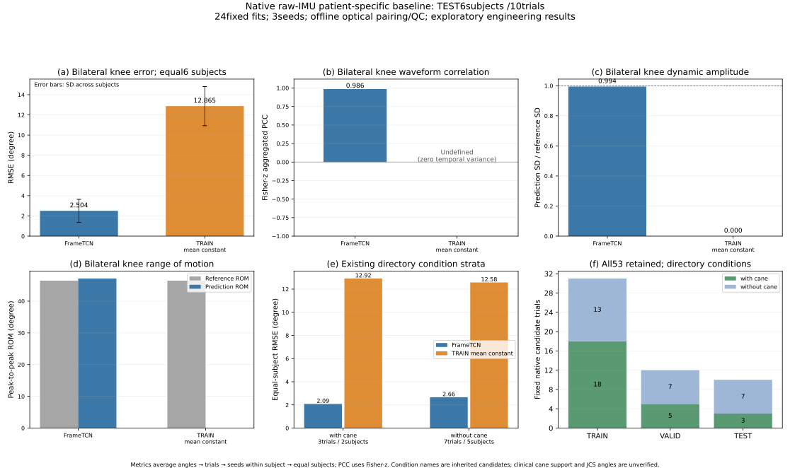
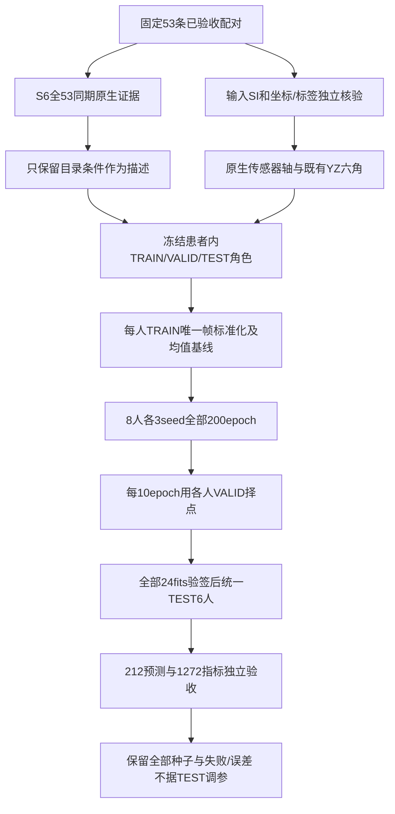

# 原生53条冻结、S6与坐标验收及患者内基线（2026-10-21）

配套：[代码函数/行号/SHA](SII2027_NATIVE_CODE_INDEX_20261021.json)、[聚合指标](SII2027_NATIVE_AGGREGATES_20261021.csv)。本页公开聚合证据；患者编号、逐trial结果、波形、原始数据、预测文件和权重留在本地。

本轮已完成计划中的S6同期证据、原生输入/几何合同、可追溯数据冻结，以及全部24次患者内基线拟合和独立预测审计。使用53条固定配对、8人分别建模；TEST为其中6人的10个独立trial。没有改动旧数据、模型、源配对或原角色。

训练就绪仅指明确范围的工程基线，不代表最终临床认证。没有将S6运动改写为真实承重用拐，也没有把骨盆投影角更名为临床JCS。测试mocap已参与离线配对与质检，不能称为未接触测试集。

## 1. S6、输入及三个平面

全部53条S6原始支持与时钟通过，原光学目录有拐26条均为明显运动、无拐27条均为低运动；没有unknown、删人、改标签或按S6筛选。独立CSV时钟/单位/特征复算误差≤1.43×10⁻¹⁴，S6仅支持目录条件的描述性对照，接地与承重仍未知。

实际训练输入为S1左小腿accXYZ/gyroXYZ、S2右小腿accXYZ/gyroXYZ：g→m/s²、deg/s→rad/s，原生传感器轴、重力及偏置保留，无新增滤波/重力或解剖旋转。只用每患者TRAIN唯一帧计算12输入和6输出的mean/std；VALID/TEST固定使用。原32份连续IMU文件跨角色共享，真正独立的是trial及输入插值支持行，不能称文件级独立。

独立核验53条32,148帧：原生SI输入最大误差1.39×10⁻¹⁷，标签Rot6D/位置原CSV重建通过；独立角度差≤3.82×10⁻⁶°。位置与Rot6D分别100Hz重采样后几何运算不完全交换，最大投影差0.014504°，保留既有输出。

| 骨盆约定 | 投影平面 | 本版标签 |
|---|---|---|
| X候选向右、Y候选向前、Z=X×Y | YZ矢状面 | 全部六角LH/LK/LA/RH/RK/RA |
| 同上 | XZ冠状面 | 不混入本版六角 |
| 同上 | XY水平面 | 不混入本版六角 |

53条原world与候选骨盆轴/腿段向量一致，未发现三平面索引交换。但传感器XYZ不等于骨盆XYZ；完整解剖安装旋转、轴向扭转、关节中心与临床中立位未认证。膝取绝对值、踝无90°中立补偿，当前仍为原有工程投影定义。

## 2. 数据冻结与训练协议

| 原角色 | trials | 帧数 | 患者数 |
|---|---:|---:|---:|
| TRAIN | 31 | 18865 | 8 |
| VALID | 12 | 7238 | 8 |
| TEST | 10 | 6045 | 6 |

8位患者均有自己的TRAIN和VALID，维持原角色、trial整段划分后再开窗口；原49条同步时钟不变。两人无TEST，仅报告TRAIN/VALID。一位患者的VALID全来自无拐目录、TEST全来自有拐目录，条件不同已披露，不称各条件均有独立VALID。

复用逐帧FrameTCN，120帧窗/20帧步长，width64/dropout0.15，AdamW lr3e-4/weight_decay1e-4、batch64、gradient_clip1。每人固定3种子，全部24fits均跑200epoch；每10epoch只用该患者VALID完整trial的等trial双膝RMSE择checkpoint，平局保留较早者。全部模型验签后统一TEST，没有用TEST选参数、epoch、seed或同步时钟。

预测采用Hann权重下限0.08的重叠窗融合，trial完整帧不删边、不做最佳滞后或offset纠正。窗口起点上下文重置，按离线恢复解释。constant为该患者TRAIN唯一帧六角均值，不用VALID/TEST。

## 3. 固定基线结果

下表按角度/完整trial计算，再患者内等trial、等seed、最后等患者汇总；双膝是LK/RK逐角RMSE均值。各split的患者数不同，不能直接把其均值差解释为学习曲线。PCC为Fisher-z汇总，constant预测的PCC无定义。

| Split | Endpoint | 患者数 | FrameTCN RMSE(°) | TRAIN均值 RMSE(°) | FrameTCN PCC |
|---|---|---:|---:|---:|
| TRAIN | bilateral_knee | 8 | 1.3218 | 12.3658 | 0.9949 |
| TRAIN | paretic_knee | 8 | 1.2024 | 9.6550 | 0.9931 |
| TRAIN | six_angles | 8 | 1.1471 | 9.5672 | 0.9929 |
| VALID | bilateral_knee | 8 | 2.5530 | 13.0620 | 0.9822 |
| VALID | paretic_knee | 8 | 2.7076 | 10.1947 | 0.9673 |
| VALID | six_angles | 8 | 2.2964 | 10.0123 | 0.9745 |
| TEST | bilateral_knee | 6 | 2.5036 | 12.8655 | 0.9856 |
| TEST | paretic_knee | 6 | 2.7377 | 10.0112 | 0.9746 |
| TEST | six_angles | 6 | 2.2391 | 9.9394 | 0.9780 |

所有种子均保留；不把seed重复当作新增受试者。不与旧2.205°直接作增益比较：旧值来自另一套加工坐标/配对、仅2患者探索性检查，本版改为原生输入、53条、6人TEST与VALID择点，分母和协议均不同。

### 原目录条件的描述性TEST分层

| 目录条件 | TEST患者数 | FrameTCN双膝RMSE(°) | TRAIN均值RMSE(°) | FrameTCN PCC | 动态SD比例 |
|---|---:|---:|---:|---:|---:|
| with_cane | 2 | 2.0865 | 12.9157 | 0.9894 | 1.0370 |
| without_cane | 5 | 2.6565 | 12.5750 | 0.9834 | 0.9836 |

条件组患者集合不同且不是随机分组，不能把差值解释为拐杖的因果效应或临床亚组结论。

## 4. 独立验收、局限与下一步

独立审计复查24份TRAIN-only scalers、完整200epoch与VALID最优epoch、212份完整预测、1272行角度指标及等trial/seed/患者汇总。测试集10条×3种子及constant均保留，无失败样例筛除。全部10条六角波形和聚合图见`plot_native_baseline.py`产物，完整source/角色/时钟由机器合同保存。

当前能回答：在已核验配对、固定采集安装和这套工程标签下，同一患者不同trial上的真实双小腿IMU恢复效果。不能回答：新患者泛化、传感器换装、完整三维临床关节角、拐杖接地/承重或独立临床诊断。69条原目标中仍16条未验收，本版不补造，也不把53条结果外推给全部数据。

下一步围绕已冻结数据补充输入/表示/虚拟数据消融和按条件覆盖解释误差；任何跨患者实验须另立训练患者与归一化范围协议。若改成临床JCS输出或更换主队列，先与用户讨论，再另建版本。此次不因新TEST表现继续调参。

入口：`dataset_release.json`、`BASELINE_PROTOCOL_ZH.md`、`coordinate_contract_ZH.md`、`cane53_report_ZH.md`、`baseline_v1/summary.json`、`baseline_independent_audit.json`。正式临床认证false，工程基线训练就绪true；旧实验及其分数保留原义。

## 中期决策追加：R19–R22

| 决策 | 尝试与目的 | 代码落点 | 结论与边界 |
|---|---|---|---|
| R19 S6证据 | 固定53条同一UTC窗读取S6与双小腿；旧门槛只作工程运动描述 | `cane53_evidence.py`、`cane53_independent_check.py` | 26目录有拐均明显运动、27无拐均低运动，全部保留；不生成临床用拐/接地/承重标签 |
| R20 坐标与预处理 | 直接原CSV重建SI12D、标签与原world候选骨盆；三平面合成检查 | `input_geometry_audit.py`、`coordinate_contract_ZH.md` | 53条/32148帧通过；YZ矢状/XZ冠状/XY水平未混淆；传感器轴不冒充解剖轴；六角仍非clinicalJCS |
| R21 冻结与划分 | 保留31/12/10角色，禁止跨trial窗口，明确工程训练就绪范围 | `release_data.py:main/load_trials`、`dataset_release.json` | 8人有TRAIN/VALID，TEST仅6人；源连续文件共享但采样支持不重叠；条件覆盖不平衡明示 |
| R22 新基线 | 24患者内FrameTCN fits、TRAIN-only scalers、VALID择点，对照TRAIN均值 | `native_baseline.py:worker/verify_all_fits/evaluate/summarize`、`audit_native_baseline.py` | 全部种子/完整trial评价；见上表；测试只最终推理，不继承旧2.205°，不宣称新患者或临床泛化 |

工程基线准入true，最终临床认证false。核心研究思路保持双小腿真实IMU→下肢运动学；本轮FrameTCN是数据与读出基线，不替代原稿核心模型的最终消融与评价。

快照：`source_snapshots/199ac8e3d870d0ad`；manifest SHA256：`5d71f9f48207d9732423575df1e0daa59bc09e7b8d59099a1fdc1feb4df19f24`。新源码位于本地主项目`experiments/native_training_release_20261021`；各函数行号及SHA见索引。
