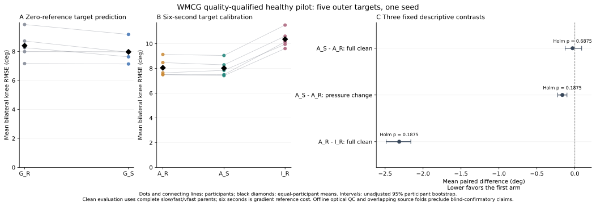
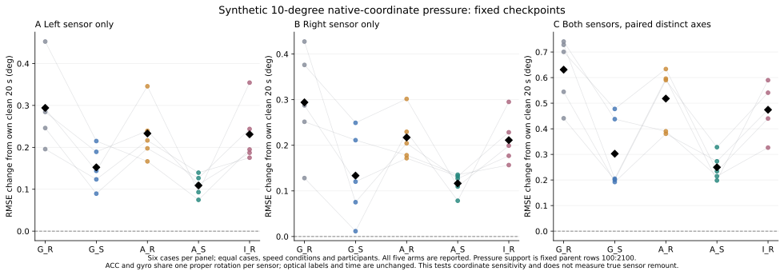

# 开源外部方法复验：输入质量纠错、固定少量适配与方向增强

**本批已完成25次全新拟合、26000次优化更新，并通过训练角色与完整数值独立审计。** 架构保持冻结。WMCG原始10人中4人的右小腿通道存在实质缺陷，旧45fit批次中断退役；当前结果仅适用于质量规则保留的6名健康受试者，其中5名作为外层目标。它是同一方法在新公开数据任务上的技术复验。

## 目的、尝试与决策链

| 尝试 | 目的与具体实现 | 发现/结论与处理 |
|---|---|---|
| 官方公开源接入 | 完整compact ZIP，核长度、官方MD5、member CRC和HDF5 SHA；核140个IMU group单位属性 | 来源门槛通过；不下载视频或完整153GB影像包 |
| 列与传感器映射 | 逐parent `channel_names`→左右shank named字段逐位校验；原CSV前缀对照 | `raw_layout`文字错误，不能按其reshape；实际左IMU6、右IMU5，不混用Stroke的S6拐杖 |
| release_v1 | 按原生joint名重排六角 | h5py拒绝非单调fancy indices，0数据release/0模型；修成合法block后用NumPy重排，保留失败快照 |
| release_v2 | 检查IMU/IK导出时钟与100Hz | 零起点假设错误，45份部分支持保留、0manifest/0模型；改为保留time并验相对网格，不扫描lag |
| release_v3与stage45 | 40parent/150角色数据通过形式独审，原定9目标45fit | 后续物理QC发现4人右ACCY5长期近−16g；停止12个未完成source fit，0完成/0target/0外层预测，至少7200更新不计入新25fit |
| 原CSV缺陷核查 | 对P05/P06/P07/P10官方原CSV做有限有界前缀比对 | CSV转float32与HDF5一致；异常存在于发布源，不能归因本地列转换；未验整CSV CRC，未确诊硬件根因 |
| 机械质量cohort | 新训练前固定全部输入6个acc轴、wholeparent和固定角色支持中近±16g比例规则，任何必需condition失败则整人拒收 | 24合格parents、6人；16拒收parents、4人。筛选依据输入质量，未用模型误差；不加常数/补轴/挑结果好的时间段 |
| release_v4/stage25 | 字节不变复用合格90份支持；独审从HDF5重建；所有模型重新开始 | 25fit/26000更新已完成；旧污染partial权重未复用；保留六角任务，不静默换成Dorschky不同proxy |
| 固定clean＋方向压力 | 同一冻结FrameTCN，75完整parent预测及1425固定20秒case预测；独立functional前向和11表/3统计复算 | 数值审计通过，最大预测差0；完整记录clean与20秒压力分开评价 |

质量规则是在首次source训练后发现异常、随后在全新训练前固定，**不是最初预注册QC**。规则是任一输入加速度轴在wholeparent或固定支持上满足 `abs(abs(a_g)-16)≤0.001` 的比例严格大于0.5即拒收；任一必需速度拒收则整人拒收。P05/P06/P07/P10的右ACCY5全记录约92%处于该邻域，导出支持起点后1–7秒均值约−16g、std约0.00049g。重采样微波动使其不一定恰好等于−16；“近固定异常”比直接确诊硬件饱和更准确。该门槛不保证其余全部传感器/光学/同步属性无误。

## 输入、参考、坐标与同步

输入为独立实测双小腿IMU十二路，左6/右5各ACC三轴＋GYRO三轴。冻结SO3 helper回执中的S1/S2只是左/右输入槽旧接口别名，实际映射始终为WMCG IMU6/5，绝非WMCG硬件1/2。发布单位ACC=g、GYRO=deg/s，确定转换为m/s²、rad/s；此前重力/偏置/滤波处理无完整记录，保留as-released表征，仅作SI转换。基础输入不含由mocap反推的虚拟IMU；增强分支另由这些实测向量作坐标旋转生成view。输出来自独立Vicon→OpenSim IK的六个有符号角，顺序左髋/膝/踝、右髋/膝/踝，单位度，膝屈曲保留负号，不作abs或目标评价误差驱动的零位/符号修正。本批六输出是左右髋屈伸、膝屈伸和踝背/跖屈，不含内外旋或内外翻的独立输出，不能称三平面角度验证。WMCG健康原生角与Stroke legacy投影工程角不是同一标签任务。[官方数据v2](https://doi.org/10.25452/figshare.plus.29328746.v2)、[官方实现](https://github.com/Md-Sanzid-Bin-Hossain/Multi-modal-IMU-and-Wearable-Camera-Dataset)

作者图示OpenSim X=Vicon Y、OpenSim Y=Vicon Z、OpenSim Z=Vicon X。在论文名义世界轴下，Vicon矢状/冠状/水平面是YZ/XZ/XY，OpenSim是XY/YZ/XZ；IMU native XYZ不能直接命名为解剖平面。上述世界平面依作者名义前进方向解释，并非随时随人的临床关节面，转弯时也不据此给IMU轴重新贴解剖标签。本轮使用原生IK角，不另外从marker重建投影角。方向压力的X/Y/Z是各传感器坐标轴。[原论文Fig.3](https://www.nature.com/articles/s41597-026-07657-7#Fig3)

作者说明共同硬件trigger启动、IMU约148Hz重采样到100Hz、人工停止并匹配终点。导出IMU/IK时间逐位相等，保留部分parent非零t0；这不证明精确延迟/漂移上界已经独立量化。没有按目标误差搜索lag、轴或符号。[原论文](https://www.nature.com/articles/s41597-026-07657-7)

## 分配、计算与参考成本

P01只用于schema开发和源角色。P02/P03/P04/P08/P09逐人作为外层目标；每折下一合格目标循环作source VALID，剩余四人source TRAIN。目标整人不进入源训练、标准化拟合或源选点。

| 用途 | 每折固定支持 | 读取与选点 |
|---|---|---|
| source TRAIN | 四人×四速度×3秒，共4800唯一帧；四view后640窗口 | x/y scaler仅这些真实帧，200epoch、2000更新/源fit |
| source VALID | 另一个人四速度各20秒，共8000帧 | 每10epoch双膝RMSE选best，strict less且同值取最早 |
| target CALIB | normal行100–699，600唯一帧/6秒；四view后100窗口 | 200epoch、400更新/目标fit，固定final，无target VALID/早停 |
| target clean EVAL | slow/fast/vfast不同完整parent | normal剩余部分隔离；是normal少量标定后跨速度评价 |
| target压力诊断 | 每个评价parent另取行100–2099，20秒 | 自己20秒clean＋18个10°case，退化只减同支持clean |

G_R/G_S分别采用四份真实replay、或一真实＋三静态SO3源训练；A_R从G_R做replay适配，A_S从G_S做SO3适配。I_R随机权重、相同目标预算，但沿用G_R的源x/y scaler（含source标签统计），因此是预训练权重对照，不能称完全无源数据的部署。固定151110参数FrameTCN、RF85、120帧窗口/20步长/Hann融合、AdamW3e-4、固定seed20261021；没有新增架构或超参搜索。

共10源fit/20000更新＋15目标fit/6000更新。6秒是目标梯度监督成本；完整normal记录采集、最终evaluation光学、source TRAIN/VALID光学以及全数组QC所接触参考须另计。独立QC曾读完整参考数组，旧部分source训练曾读source VALID；不能把整个外部数据集称为未接触盲数据。旧中断≥7200更新与新26000更新分账。按帧数/100计，五名目标完整normal记录时长为{'P02': 121.19, 'P03': 134.35, 'P04': 120.5, 'P08': 124.49, 'P09': 132.41}秒，均值126.588秒、范围[120.500, 134.350]秒；15个完整评价parent的参考共1900.890秒，原始40parent全段QC曾接触参考共5062.240秒。这些角色存在重叠，不能相加声称互不重叠的采集总量。

## 已验收结果

所有误差单位度；先每角唯一融合帧计算，再等左右膝、等三速度、等参与者。压力增量是18个非clean case均值减自己的20秒clean，不等于与完整parent clean相减。

| 方法 | 完整parent双膝RMSE | 完整parent六角均值RMSE | 20秒坐标压力双膝增量 |
|---|---:|---:|---:|
| G_R | 8.394743 | 7.549766 | 0.406443 |
| G_S | 7.967532 | 7.397190 | 0.196131 |
| A_R | 8.050971 | 7.298478 | 0.322786 |
| A_S | 8.021340 | 7.266842 | 0.158372 |
| I_R | 10.365379 | 8.821193 | 0.305588 |

预训练＋6秒适配A_R比同预算随机权重I_R低2.314407°，5/5人改善；但相对无适配G_R只低0.343771°，4/5人改善。SO3源模型G_S相对G_R低0.427211°、5/5人改善；再用6秒适配的A_S相对G_S差值为+0.053809°，只有3/5人更好。因此这批数据不支持“适配一定优于无适配”。

两阶段增强A_S相对A_R的完整clean改善只有0.029631°；固定方向压力的误差增量则从0.322786°降到0.158372°。当前第三线的主要证据是合成坐标敏感性降低，尚未形成明显clean收益或临床误差降低结论。

| 预定对照，负值较好 | 双膝差值 | 未校正参与者bootstrap95%CI | 改善人数 | exact双侧p | 三项Holm p |
|---|---:|---|---:|---:|---:|
| `A_S_minus_A_R_full_parent_clean` | -0.029631 | [-0.127540, +0.090138] | 4/5 | 0.6875 | 0.6875 |
| `A_S_minus_A_R_fixed20s_pressure_degradation` | -0.164414 | [-0.225703, -0.103125] | 5/5 | 0.0625 | 0.1875 |
| `A_R_minus_I_R_full_parent_clean` | -2.314407 | [-2.487082, -2.161248] | 5/5 | 0.0625 | 0.1875 |

五名目标的双侧32种符号翻转最小p=0.0625，三项Holm最小p=0.1875，**本批不能提供统计优越性确认**。CI仅描述参与者重采样范围，source训练fold重叠且单seed不能估计训练随机性。两阶段同时增强的A_S/A_R对照也不能独立归因源阶段和适配阶段的作用。全部参与者方向、分速度、左右/六角、PCC/MAE/ROM及左单侧/右单侧/双侧压力在机器汇总与本地完整表保留，不据结果追加候选或调参。

PCC遇任一std<1e-8度记未定义，按Fisher-z、clip±(1−1e-7)逐层等权；ROM在同一原生有符号角的唯一融合帧上计算。所有指标先将pred/gt转float64。

## 审计、代码与下一步

| 代码位置（精确行号/SHA见函数索引） | 本轮执行职责 |
|---|---|
| `physical_cohort_gate.py::run/metrics` | 对全40parent及固定支持实施同一输入质量规则，整人决定，不读取模型结局 |
| `wmcg_data_release_v4.py::run` | 绑定原源、物理缺陷、CSV证据与退役回执；保留正确role NPZ原字节；重建五折划分 |
| `wmcg_training_stage25.py::RoleGuard/load_trials/fit_scalers/arrays/worker` | 精确角色读取、仅源真实帧scaler、replay/SO3等预算窗口、源best与目标final200 |
| `external_stage25_training_independent_audit.py::rotation/windows/source_valid_metric/run` | 不导入训练器，独立重建增强、窗口、来源与源best/final前向 |
| `wmcg_evaluation_stage25.py::unlock_gate/cases/perturb/aggregate/statistics/evaluate` | 25fit及独审后解锁；固定19case、同20秒基准、等患者汇总与三项统计 |
| `audit_wmcg_stage25_results.py::metrics/reconstruct_tables/check_statistics/run` | 独立literal-functional前向、逐包身份/标签/时钟、11表与预定统计复算 |

训练审计独立重建24parent角色、scaler、640/100窗口、proper SO3、初始化、首epoch shuffle、迁移、target final和26000更新；10源best及final各四个source VALID记录重推。逐源模型20个、合计200个候选epoch历史及最早最小值已核，但没有保存全部中间权重，不能声称逐元素重演全部候选分数或完整优化轨迹。

评价先通过全部25fit及独立训练回执才解锁；训练不读外层EVAL/stress或其hash。根审计使用独立literal-functional前向重推75完整预测和1425压力case，核150预测包的gt/time/frame及checkpoint身份，复算9000逐角指标、全部11张表、32符号统计/Holm/固定bootstrap。架构冻结79项再次SHA核验无变动。

Dorschky备用数据仅对开发受试者P02读取真实双tibia十二路及OMC/trigger证据，并非全10人验收；目前ready_for_training=false，尚缺完整任务/全人数据协议，也未验完整源Parquet MD5。IMU属于已功能标定segment轴，缺真实IMU逐帧timestamp及严格drift核验；固定20ms trigger关系的物理一致性检查不是最佳lag拟合。其连续marker可探索不同双膝工程proxy，尚无本轮神经训练；没有静默替换WMCG原生六角任务。[官方Zenodo](https://zenodo.org/records/11522050)

后续应优先补充第二公开数据源的独立任务定义和验证，并在更多合格目标上检验方向增强的收益；WMCG本批按固定方案归档，不按这5人的结果重新挑幅度/窗口/epoch。真实重戴、卒中临床泛化、Stroke checkpoint直接跨数据集迁移仍未验证。

公开附件：[来源/验收机器摘要](SII2027_OPEN_EXTERNAL_READINESS_20261023.json)、[函数行号与SHA索引](SII2027_OPEN_EXTERNAL_CODE_INDEX_20261023.json)、[已验聚合及全部参与者差](SII2027_OPEN_EXTERNAL_AGGREGATES_20261023.json)。函数索引不是独立可运行复现包；原始数组、样本预测、视频、模型权重及作者全文不上传。

