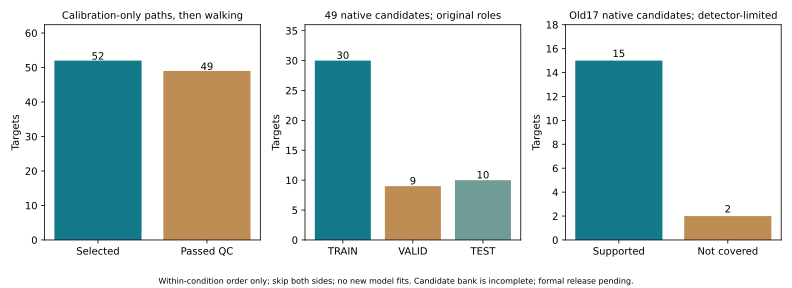
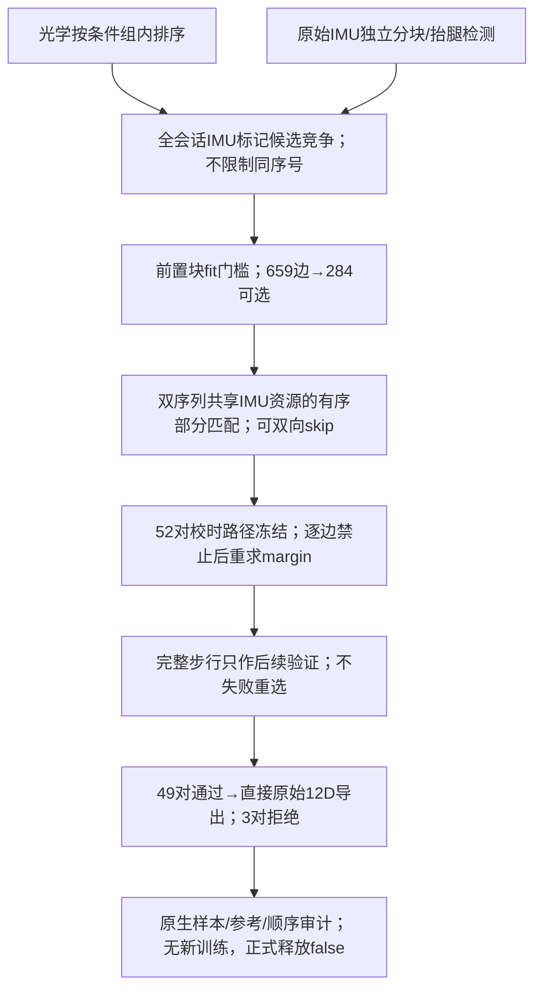

# 有序跳段匹配：解除同号假设，得到49条新候选

配套：[函数/行号/SHA索引](SII2027_ORDERED_CODE_INDEX_20261021.json)、[聚合证据](SII2027_ORDERED_AGGREGATES_20261021.csv)。本页代码位于本地`Dataset_Stroke/.../1_2027SII/Project2_submission/experiments/ordered_trial_matching_20261021`；逐trial矩阵、原始数据、NPZ、完整波形和具体异常编号留在本地，仅公开方法与聚合证据。

2026-10-21（Asia/Tokyo）。用户补充mocap少于IMU，开头、中间、末尾可能漏段，并确认**只保证各用拐条件组内序号有序，组间顺序另核**。本轮已据此实现并运行允许跳过的单调部分匹配，旧数据、17/18候选与模型均不覆盖。

核心结果：在原69目标中，58条有原光学模板，56条标记侧别/模式可用于本轮；独立IMU候选与光学前置动作生成659条候选边，其中284条通过校时门槛。只用前置动作评分的全局路径选52对，之后独立步行验收49对，**49份直接原始12D候选已导出：30 TRAIN、9 VALID、10 TEST，8患者**。无新模型训练；旧2.205°不能当作新版本成绩。

“49”是通过当前候选集合下顺序/物理门槛的探索性配对，不是已获现场事件认证的49个真值。IMU标记检测有漏检，已用旧候选的只读复核明确暴露，不能称全局搜索穷尽所有行走。

## 1. 之前同号假设如何处理

旧`source_identity_manifest.py`取光学trial尾两位，直接查PDF详细IMU窗的同序号。该表提供的是IMU文档窗，不自动给出跨系统同号身份。新用户信息要求解除这一硬候选限制。

旧18条并非只有文档证据：原前置fit PCC .9697–.9984、步行 .8692–.9866，局部峰差 .2309–.5005，步行最优offset差≤.02s。因此原2患者拟合与17份原始输入重建验收保留，但其身份仍应在更大候选范围竞争，不整体作废，也不自动升级为确认性结果。

新算法不将旧PDF同号窗作搜索范围，不用旧offset作中心，不要求光学第n条等于IMU第n段。PDF的88个详细窗另存为document-proposed sequence，不能与mocap强行同号绑定。

## 2. 数据范围及原始候选

患者kinematics目录实际159 CSV，其中156个原始world trial与3个P1派生CSV；原始world无重复hash/同患者同trial ID冲突。原69目标中58有raw world，11缺源；其余98个原始world没有本轮既有人工监督步态边界，未自动扩入主队列。

因此本轮“IMU未匹配”仅表示未被原69目标采用，可能对应其余98份光学，不能据此断言采集时没有mocap。156与164也不能直接比较为真实行走次数。

`imu_episode_inventory.py`独立扫描18个具备双小腿源的原始会话（P1三会话分开，另P14不完整）：100Hz、各连续原生块内6Hz，固定单侧重复运动峰/双侧能量门槛，生成164个按原表健侧的pose候选，另保留16个反侧复核假设、356个活动bout和88个独立文档窗。时钟回退/断档分块，重叠UTC区间剔除，不静默排序。

`mocap_catalog.py`保留69目标，58模板各含前置动作与原手选步态的绝对时钟、左右完整小腿3D框架角速度和双侧RSS；54复用旧有限块，4按同一规则补块。光学前置块的选择与原始IMU候选各自独立；两例原表/标记侧别异常侧别/动作矛盾保留，未将反侧假设偷偷当健侧。

## 3. 匹配与验收规则

光学同患者同条件内按序号递增，两条件链允许交错，使用相同IMU episode资源；P1跨会话依据原始UTC会话分开，不把01/02当全局采集顺序。算法允许跳过任意IMU和光学记录，允许全不匹配；一对一且前置至步行支持区间不能重叠。

前置fit使用原生双gyro3D能量与光学小腿完整框架RSS，固定scale1、100Hz/6Hz；至少2s、SD≥.05rad/s、PCC≥.8，源窗须包含至少2个独立检测标记峰，竞争时移隔≥.25s时峰差≥.10。只有前置块给边权`(PCC−.8)/.2`，skip权0；步行仅检查时间覆盖，不用其信号决定offset/episode/path。

`ordered_assignment.py`多链动态规划保留两个不同匹配集合的最优路径，去除仅gap操作顺序不同的等价路径。对每条选中边禁止该边重求最优完整路径，分数损失≥.10才记全局分离足够。此margin依赖候选集合，不是概率/置信区间；未提议的源段也没有参加竞争。

所有路径先写入`matching_v1/assignment_frozen.json`，再检查整步行PCC≥.8、RMS比.5–2、双方≥2峰，以及在原offset±1s内独立最优步行时移差≤.05s。此稳定性是局部检查，不称整会话独立身份搜索。步行失败不换下一episode，不按神经误差或测试表现重选。

## 4. 实际结果与失败

| 阶段 | 数量 |
|---|---:|
| 原目标 | 69 |
| 光学模板ready / 缺源 | 58 / 11 |
| 标记模式可用于本轮 / 侧别未解 | 56 / 2 |
| 校时候选边 / 前置门槛通过 | 659 / 284 |
| 全局路径选中 | 52 |
| 全局分离与步行检查通过 | 49 |
| 导出原始12D候选 | 49（30 TRAIN、9 VALID、10 TEST） |

3个选中边未通过：失败例A步行PCC .743；失败例B步行PCC .272且局部最优时移−.25s；歧义例C步行PCC .936但全局反事实margin .0748<.10。保留原路径和失败，不以步行分数重选替代配对。另4个可用光学模板未入最优路径；11缺源、2侧别异常仍未解决，总计20/69未进入本版。

所有52条前置/步行波形一起出图，包含3条失败，见`figures/all_selected_paths_page*.png`；候选矩阵、完整路径、未采用IMU/光学、反事实margin及旧同号窗比较均保存，不只展示成功例。

## 5. 旧17候选的两条未确认不等于旧配对错误

此前17份native中15份获本轮通过；旧候选D、旧候选E未获当前路径确认。冻结新路径之后才做旧offset的只读覆盖诊断，未反向改算法：

| 旧候选 | 原offset下直接原生前置PCC | 步行PCC | 独立IMU detector能覆盖旧pose的episode |
|---|---:|---:|---|
| 旧候选D | .9966 | .9571 | 无 |
| 旧候选E | .9946 | .8944 | 无 |

这说明当前独立标记候选生成器确有覆盖不足；不能把未被本轮选中当成旧trial必错，也不能声称本轮候选集合涵盖所有可能身份。此诊断未用于塞回两个旧时钟、改阈值或重跑最优路径。下一版应改进候选召回或加入预先定义的全会话dense fallback，并对全部目标统一应用。

旧候选D曾是旧2患者pilot的一条TRAIN，所以旧2.205°只能继续保留为旧处理/身份候选下的诊断；当前49版本无新模型成绩。

## 6. 导出与独立复算

`本地/ordered_native_candidates_v1/manifest.json`含49条原始S1左/S2右的acc+gyro，共12D，UTC查询、原native源SHA、光学source及新episode身份均保留。g×9.80665、deg/s×π/180，原传感器坐标、含重力、未滤波/去偏置/旋转；没有将mocap或S6放入网络x。

目标保持M的原point/rotation对应与六角投影定义；仍不是clinical JCS。原TRAIN/VALID/TEST角色保留，但新身份和来源支持须重新正式验收，不能把旧角色自动称全新保留集。临床用拐仅继承光学目录为candidate，S6未提供接地/承重真值。

`audit_ordered_matching.py`逐边直接重算657个有fit的PCC，与FFT profile最大差5.00e−13；检查条件组内顺序、一对一和源区间不复用。49份输入从原CSV用独立ISO+时区解析和两邻样本插值重建，最大差1.39e−17；独立Rot6D→六角误差0，实际原生插值支持行无跨parent重叠。

8项基本DP回归、1项穷举oracle（20组小规模双链最优/次优及边禁用检查）、3项IMU分块/重复动作测试通过。光学catalog另独立验证159源SHA、58模板/116绝对时钟块及RSS公式，误差8.88e−16。归档由`archive_ordered_matching.py`执行，旧R与原始重建A保持不变。

## 7. 下一步

优先提高独立标记候选召回，统一覆盖被漏掉的旧强物理候选，并核对3条失败/2例反侧与11缺光学。对新49条补S6同期旁证、明确静止/功能轴校准及滤波支持，再冻结正式物理划分并重训；不据旧论文数值反推方法。其余98原光学先追踪人工步态边界来源，再决定是否扩入实验，主队列/核心方法变更先与用户沟通。

这是离线数据构建，读了原VALID/TEST光学参考，不是未看TEST、跨患者临床验证或IMU-only标定部署。现有条件/侧别/坐标与事件认证边界继续保留，正式训练释放仍false。

## 8. 可定位的代码职责

| 代码 | 函数与实际作用 |
|---|---|
| `mocap_catalog.py` | 原目录/69目标清单、58前置与步行模板、无同号身份假设 |
| `imu_episode_inventory.py` | `monotonic_parts/common_runs/marking_blocks`原生分块、重叠时钟拒绝、健侧候选与独立备用记录 |
| `ordered_matching.py` | `score_candidates`全会话校时矩阵，`assign`仅前置评分，`validate`路径冻结后步行检查 |
| `ordered_assignment.py` | `solve/edge_margins`双链共享资源、双侧skip、两条不同匹配集合与禁止边反事实 |
| `ordered_assignment_oracle_test.py` | 穷举20组小实例，核对最优/次优及边禁用结果 |
| `export_ordered_candidates.py` | 原始双小腿SI读取与49份候选，保留原角色/参考定义 |
| `audit_ordered_matching.py` | 657直接PCC、组内顺序/不复用、原始输入/独立投影与旧17候选覆盖复核 |
| `plot_ordered_matching.py` | 全52选中路径含3失败一起画图，无精选案例 |
| `archive_ordered_matching.py` | 248artifact、19源/文档、旧R/A375项完整性验收 |

归档快照：`source_snapshots/f6c65b5029c9b207`；主manifest SHA256：`25682309fbe2daf724fef4ed0166c8e5b1122aadacdbd0d7c8c8602a09e3a862`。没有将上一轮2.205°搬到新版本，也没有因原17中两条未被当前detector覆盖就宣判其配对错误。
