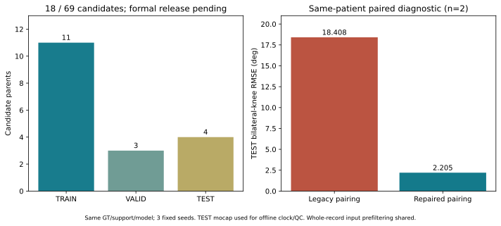
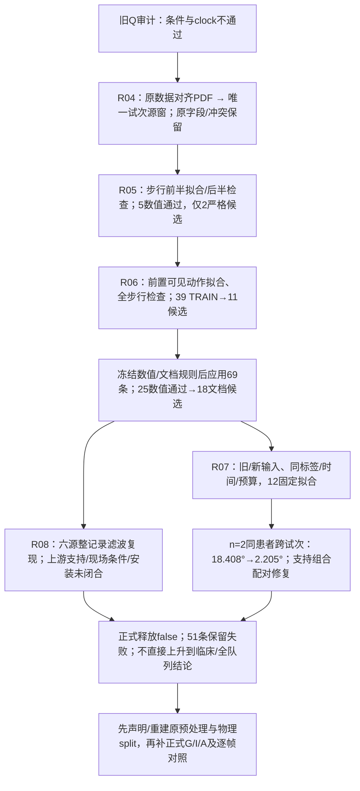

# 原Stroke配对矫正：18条候选与修复前后12次配对诊断

**10/21原始采集依据补全：** [原始源、健侧标记与native重建](SII2027_RAW_ACQUISITION_20261021_ZH.md)。用户确认S1左小腿/S2右小腿、S3腰、S4左足/S5右足、S6拐杖；原患侧xlsx及重复抬健侧腿标记已核查。旧18候选中17条直接从原始双小腿重建（11 TRAIN/3 VALID/3 TEST），1条因原生时钟回退拒绝；S6仅作运动旁证，无自动用拐标签。native版本无新训练，不能沿用旧2.205°成绩，正式释放仍false。

更新：2026-10-21（Asia/Tokyo）。本轮按用户“尝试对原数据集进行矫正”执行；原工程仍为`Dataset_Stroke/.../1_2027SII/Project2_submission`。**原69条中18条/6患者通过新文档身份与冻结物理质检，另51条未导出；能构成同条件TRAIN/TEST的2患者上，固定模型TEST双膝RMSE从18.408°降至2.205°。** 这支持组合配对修复的重要性，仍不是正式数据释放或确认性临床实验。

原始文件、旧划分/条件字段、权重和分数完整保留，双小腿实测IMU→下肢运动学主线不变。没有为了接近原文数字改方法。变化涉及IMU试次身份、来源窗及clock共同修复，不能将收益全归因于纯同步或拐杖效应。

配套：[源码函数/行号/SHA索引](SII2027_REPAIR_CODE_INDEX_20261021.json)、[全部聚合与3种子CSV](SII2027_REPAIR_AGGREGATES_20261021.csv)。R指本地`Project2_submission/experiments/stroke_pairing_repair_20261021`。代码实体、逐parent来源、原始数据、权重、54份连续预测与完整波形图留在本地；本页只公开代码定位、汇总证据与聚合图。

## 1. 更新后的决策树

## 2. R04：修正来源身份，保留历史条件冲突

**目的：** 旧Q3仅按Toe元数据固定候选未统一恢复同相，需要先确认连续IMU里究竟哪一试次对应光学parent。

**尝试/代码：** `condition_repair.py:condition_decision/build_manifest`保存69条原字段、原split及来源SHA；65条仅metadata agreement、4条冲突隔离。`source_identity_manifest.py:main`读取原`数据对齐.pdf`详细表，按光学患者/条件/序号查唯一文档窗，不按信号相关在其他试次中择优。PDF SHA256为`522f0d36659621eed2547d45b1ca9df7a2e48f422be6096ddfafe5fa9225cec6`，逐行保留页码、列、序号。

**结果：** 69条有60条详细文档窗；原主8的39 TRAIN有36条。发现若干旧slice试次错位/条件源窗不符，不能只在旧x上整体平移。旧起点只有13条在目标粗窗内也不能直接称其余56条都错，因为文档窗边界存在粗略性。

**决策：** 从连续实测源重取输入。P7/P15文档冲突继续拒绝；P10有拐计数/清单矛盾保留，而无拐6条详细清单/计数明确，复核仅作用于无拐列。新候选条件有PDF+光学身份+物理匹配支持，但尚非独立现场真值；4条旧条件冲突在历史账本保留。

## 3. R05–R06：先TRAIN开发，再冻结全库应用

**输入与坐标：** 仅S1/S2 filtered acc/gyro共12维实测IMU，SI单位m/s²、rad/s；连续CSV中未filtered的g、deg/s列不混入新输入。本轮没有虚拟生成、mocap动态量进入x或按最佳相关交换传感器左右。同步参考由verified-world膝/踝框架求完整3D小腿角速度，含长轴spin；双侧root-sum-square用于减少侧别假设，不能据其认证真实安装。输出仍为原M的pelvis-YZ投影六角、无符号膝，**不是临床JCS**；YZ矢状、XZ冠状、XY水平的既有几何结论不变。

| 尝试/目的 | 范围与方法 | 结果 | 决策 |
|---|---|---|---|
| R05检验独立半段稳定性 | 全部39 TRAIN，步行前半拟合、后半检查，PDF窗内固定搜索 | 5条数值通过，严格身份/条件下仅2条v1 | 不放宽短段/周期歧义门槛，不把重复parent扩样 |
| R06提高校时动作独立性 | 全部39 TRAIN，选择另一段步行前可见动作，仅其拟合offset | 14条数值通过，11条TRAIN候选 | 冻结此规则；该动作未被现场认证为专用标定 |
| R06全库应用 | 先写全库协议，69原parent/角色，数值函数/循环保持相同 | 25数值通过，7因文档歧义拒绝，最终18条 | 51条未导出，不按NN误差补例或调lag |

`calibration_alignment.py:blocks/shank_speeds/main`从8个膝/踝marker全部有限、无>0.0251s断档的块中选择步行至少0.4s之前最长块，同长选最早，最后最多10s；动作块选择不看相关/误差。clock为`imu_time=optic_time+offset_s`，scale固定1。

门槛全部同时满足：固定6Hz/100Hz处理，各块去0.2s边缘后≥2s、参考SD≥.05rad/s；拟合/步行PCC均≥.8；竞争峰间距≥.25s时峰差≥.10；步行独立最优offset与应用值差≤.05s；两块双方各≥2峰；RMS比.5–2。**实际offset只由前置块拟合，步行最佳值不替换它。** 不拟合关节角/网络输出的最优lag。

全库版`apply_frozen_calibration.py`仅改变scope/输出/角色元数据，AST回归验证数值核心相同，原39 TRAIN结果逐项完全复现。导出`export_full_candidates.py`保留旧parent/split，重采样不外推、不跨缺口。全部候选仍`training_ready=false`。

| 原角色 | 候选parent | 该角色患者 | 同参考旧/新物理PCC |
|---|---:|---:|---:|
| TRAIN | 11 | 5 | −.0234 / .9278 |
| VALID | 3 | 3 | .1671 / .9095 |
| TEST | 4 | 3 | .0568 / .9256 |
| 全部 | 18 | 6去重 | −.0685 / .9227 |

PCC先患者内trial中位，再患者中位；这已经通过PCC门槛筛选，**属于条件化质检，不能当全69条的改善估计**。`review_full_candidates.py`验证18份x来源与独立Rot6D投影标签最大差均0；步行PCC范围.8692–.9866。

## 4. R07：修复前后配对模型究竟测了什么

**目的：** 在相同输出与预算下，判断更正输入配对能否恢复可学的跨试次关系。

**划分：同一患者、同次采集、同文档支持用拐条件，不同完整试次。** 主8中所有候选里≥2原TRAIN、≥1原TEST且TRAIN/TEST条件一致者只有2患者：一人无拐TRAIN3/TEST2，另一人有拐TRAIN3/TEST1。各自从头训练，没有跨患者、跨session、跨条件或多步态泛化试验。选择不看网络误差，但依赖前述物理质检。

总TRAIN6个parent、2984唯一帧/名义29.84s；TEST3个parent、1707帧/17.07s。120帧窗、stride20只在parent内部生成，重叠窗不计新独立数据。VALID不用于训练、选epoch或调参。3种子是优化随机重复，独立患者仍是2人。

`repair_pilot.py:selection/load_trials/contract/worker/evaluate/summarize`冻结旧/新输入2版本×2患者×3种子=12拟合，FrameTCN angle width64、200ep最终checkpoint，seed20261021/22/23。两个版本原parent和GT/time/frame**完全一致**，旧x重采样到同一目标支持；仅12维输入配对变化。每个x/y scaler只由其对应TRAIN唯一帧拟合，完整试次后再分窗。

| 相同子集固定诊断 | TRAIN双膝RMSE° | TEST双膝RMSE° | TEST PCC | TEST时序SD比 |
|---|---:|---:|---:|---:|
| 旧配对重新训练 | 1.545 | 18.408 | −.157 | .734 |
| 新身份+前置动作校时 | 1.180 | 2.205 | .988 | 1.001 |

两患者均改善：匿名患者A TEST21.060→2.662°、B15.757→1.747°。双膝先逐trial对LK/RK RMSE取均值，再trial/seed在患者内平均，最终患者等权；PCC用Fisher-z。全部3种子、全部TEST保留；本地全3条TEST首个预设种子的左右膝波形一起出图，不挑最好试次。

不能将此18.408°与旧D全8人14.250°双膝或11.734°患侧膝直接相减，也不能因新2.205°接近BLISS I的2.210°而称任务等价。旧D失败说明先前数据加工不适合方法裁决；此次小样本恢复仍不能替代正式G/I/A对照或证明临床准确度。

## 5. R08：额外上游审计与正式释放边界

本次候选在同一source SHA下的步行、前置校时、两者交叉及**本次PDF同步滤波窗**未发现跨parent/角色交叠。这个检查不涵盖既有输入列的所有上游处理。

`audit_upstream_filter.py`对全部6份候选连续源的12列作只读数值重建：整记录四阶10Hz Butterworth `filtfilt`及acc×9.80665、gyro×π/180，全部匹配，最大差1.60e−13。确认存在共享连续记录离线滤波；不是将本轮6Hz同步比较滤波误当网络输入滤波。候选notebook还有整段静止搜索，但实际writer运行receipt及静止/重力校准支持仍未闭合。这不是mocap标签泄漏证明，应明确共享session预处理和离线成本，不能宣称原始trial预处理完全隔离或实时部署。

TEST前置mocap已用于离线校时，步行参考用于质检筛选；GT没有进入x，但不是未看TEST，也不是IMU-only时间标定。旧TEST此前已使用，只保留角色作历史诊断，不能升级为确认性保留集。51条失败不强行择最佳lag，不用网络结果删失败或改条件。硬件trigger/clock漂移、真实安装/侧别、现场用拐、临床JCS/中性位/足roll仍开放。

**当前决策：** 旧配对的负向gate保留；新18条只进入有条件的数据修复研究候选。先追溯或重建上游预处理、声明校时成本、冻结实际物理源split，再补正式同条件、跨条件及G/I/A实验。更改核心方法、输出任务或主队列前先与用户沟通。

## 6. 代码与验收凭据

| 本地源码 | 实际职责 |
|---|---|
| `condition_repair.py` | `condition_decision`和`build_manifest`保留69条字段/冲突/来源，禁止多数票改条件 |
| `source_identity_manifest.py` | `main`按PDF唯一详细列/序号建立连续源窗候选 |
| `alignment_candidates.py` | `frame_speed/optical_speeds`完整3D框架，`sliding_pcc/diagnose`固定规则，不把长轴速率误当gyro范数 |
| `calibration_alignment.py` | `blocks/shank_speeds/main`前置动作选择和39 TRAIN校时 |
| `apply_frozen_calibration.py` | 同一数值规则全69处理，完整失败账本 |
| `repair_data.py` | `covered_interp`拒绝缺口/外推；历史v1条件门槛与导出 |
| `export_full_candidates.py` | `documentary_decision/main`新候选版本、原角色、来源SHA和本阶段区间重叠检查 |
| `review_full_candidates.py` | `main`逐sample重建来源、独立投影和全部候选物理曲线 |
| `repair_pilot.py` | 固定模型/预算合同、12次拟合、先核全部checkpoint再推理TEST |
| `audit_repair_pilot.py` | 从54份保存预测重算324条六角指标、24个TRAIN-only scaler及独立分层聚合，无再拟合/推理 |
| `audit_upstream_filter.py` | 全6源连续记录12列上游滤波数值指纹，不改输入 |
| `archive_repair.py` | 39 TRAIN完全复现、旧D/Q不变、候选/模型/报告/源码全量归档验收 |

18项回归/数学测试通过，另有含轴向spin的参考/已知lag/滑动PCC自检。54份预测独立指标最大差7.11e-15，聚合最大差4.44e-16。旧D1210项及Q68项哈希不变。新归档含260项artifact、25项源/文档，快照`source_snapshots/cba40a9491c278a4`；manifest SHA256：`da2424d08dd950e29a34167b67207bd3fbdf9e2f8a5548b56dbb07f3a2601974`。

阶段JSON内“无新训练”描述的是当时的导出/物理检查阶段；本轮最终确实新增12次诊断拟合，不能把旧阶段字段当作最终总数。

## 10/21采集者补充后的执行（R09–R12）

[原始源、抬健侧腿标记、S6与17条native候选](SII2027_RAW_ACQUISITION_20261021_ZH.md)、[函数/行号/SHA](SII2027_RAW_SOURCE_CODE_INDEX_20261021.json)、[聚合数据](SII2027_RAW_SOURCE_AGGREGATES_20261021.csv)。安装左右语义已由采集者确认；实验室轴、固定安装旋转与clinical JCS仍需分别验收。216原始文件/16加工源桥接已建立；17条native重建不沿用旧全记录滤波/旋转，但继承原离线clock/QC，旧2.205°不能转记为新版本成绩。

原患侧表与标记侧有2例待核，11条缺原光学；未用拐时S6也可能被携带，运动不能等同承重。下一步先确认标记事件和native预处理支持，再冻结正式实验；不据网络误差改条件、侧别或lag。旧阶段“安装未闭合”指其当时证据，最新采集者确认与剩余坐标问题以本次更新为准。
