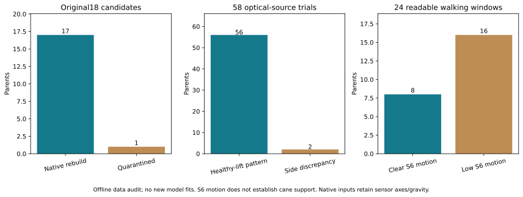

# 原始采集依据补全：固定六IMU安装、抬健侧腿标记与17条native候选

**10/22输入、监督表示与虚拟对照更新：** [192新增神经拟合、简单线性参考及独立验收](SII2027_NATIVE_ABLATIONS_20261022_ZH.md)完成。固定53真实数据/6患者TEST；3输入mask＋RotMSE/RotGeo，虚拟31TRAIN/124假设视图与同支持同21000步控制，失败context尝试也保留。所有种子及患者级配对结果见表；论文有标定方法但本地逐人安装值仍未知。当前为I_full，原E2的G/A外层患者排除尚未完成；不称临床JCS或真实安装等价。

更新：2026-10-21（Asia/Tokyo）。用户指出最原始数据在`Yan_Stroke Experiment Data/P1–P17`采集CSV，并确认固定安装、患侧原表与标记动作。本轮完成原始源/时钟审计、标记动作与S6旁证，以及从原始双小腿重新取样。

**旧18条加工配对候选中，17条已直接重建原始坐标SI输入（11 TRAIN、3 VALID、3 TEST，5患者），另1条因原始时钟回退拒绝；原69条仍有52条未形成此native版本。没有新增模型拟合。上轮2.205°属于先前GravityFilter加工输入，不能转记为本native版本成绩。**

配套：[源码函数/行号/SHA索引](SII2027_RAW_SOURCE_CODE_INDEX_20261021.json)、[聚合证据CSV](SII2027_RAW_SOURCE_AGGREGATES_20261021.csv)。A指本地`Project2_submission/experiments/raw_source_rebuild_20261021`；完整逐trial表、原患侧表、原始数据、连续波形和候选NPZ仅在本地。本页不公开参与者患侧明细或原始时间序列。

## 1. 新的采集事实及其边界

| IMU | 全部患者固定身体位置 |
|---|---|
| S1 / S2 | 左 / 右小腿 |
| S3 | 腰 |
| S4 / S5 | 左 / 右足 |
| S6 | 拐杖 |

安装左右由采集者明确确认，**不再属于缺来源/按相关猜测**。这补上语义对应，但固定安装旋转、yaw、实验室轴和临床JCS仍需单独依据，不能直接把传感器XYZ当解剖三平面。

每次走前反复抬健侧腿是有意标记动作；用户利用光学marker手选步态时间段。患侧按原`Hemiparesis Side.xlsx`逐格追踪，工作表S1–S17是受试者编号，不是IMU编号。原表与当前D主8全部一致；旧submission CSV另有2患者患侧冲突，保留逐例本地记录，不按信号自行改患侧。

用户确认未用拐时拐杖可能静止，也可能被携带/移动。因此S6有运动只能作辅助运动/节律证据，不能直接等同用拐、接地或承重。

## 2. R09：原始文件、时间与单位复核

`raw_loader.py:read_native/parse_local_timestamp/gravity_clock/source_links`建立216份CSV、19采集目录（17患者，1患者三次分开会话）清单。16目录具备全部六IMU模态，18具备双小腿12D。缺足模态不自动否定双小腿任务；一目录只有右小腿gyro和拐杖gyro，不能冒充完整12D。原始文件不覆盖。

原生各文件elapsed=0并不同时；数字epoc有13文件与高精度timestamp差>2ms，10文件出现时钟回退。统一采用带(+0900)的毫秒timestamp→UTC，明确g×9.80665、deg/s×π/180，拒绝逆序、缺口/外推和非有限值，不按第0行拼接。新输入保留原传感器轴、重力和偏置。

16份旧GravityFilter源均由时钟定位唯一原始会话。首次要求整记录被四条小腿流完整包含，仅2份通过；14份旧加工尾端超出至少一原始通道约0.074–1s，不能将旧端部填值沿用为新原始样本。

据此在native导出/模型前明确补记：来源身份要求唯一同患者会话与加工时长≥95%重叠；**实际输出窗仍逐点拒绝原生外推与>25.1ms缺口**。只对照记录UTC与(+0900)墙钟误写UTC的−9h两种解释，不用信号拟合lag。有2份源需−9h，其余0；这两份不在上轮18候选中。初次严格清单独立保留，全部metadata候选与最终选择存manifest。

这说明当前notebook与实际各文件执行谱系不能简单等同。会话身份与具体片段覆盖、重力标定、硬件同步是不同验收层。

## 3. R10：抬健侧腿标记的独立观察

`marker_pose_audit.py`先冻结检测规则：69原parent、固定行走起点与旧offset，不按网络成绩选例。原世界坐标光学120Hz/mm，前行走踝中点与heel/toe中点各自检测高度峰；固定6Hz、30mm prominence、0.6s间隔，踝足0.2s内配对，健侧≥2事件且总prominence≥患侧1.5倍并满足Z几何检查，才记支持。自动峰是候选事件，仍需人工锚点确认。

| 固定范围 | 可观察 | 支持反复健侧抬腿 |
|---|---:|---:|
| 全69原parent | 58有原光学 | 56 |
| 有旧前置校时边界 | 54 | 53在旧块内支持 |
| 旧18配对候选 | 18 | 17 |

全部408高度峰及58条轨迹保留，11条缺对应原光学trial。旧最长完整可见块并非天然的标记pose，53/54的观察则增加了此前“前置动作校时”的采集依据。

两条原记录的抬腿侧与原患侧表/健侧预期相反，恰涉及旧CSV患侧冲突的两患者：不能由此判断表格、动作执行或marker侧别哪一项错，也不擅自修改患侧/交换传感器。两例均未进入此前2患者模型诊断。后续事件锚点须将这两例隔离复核。

原GravityFilter健侧gyro只作旧冻结offset旁证，在报告中明确标为旧预处理，未冒充原始重建或独立硬件同步。

## 4. R11：S6原始信号支持哪些条件判断

`cane_evidence.py`保留69条。旧数值门槛通过25条中，24条能读原始S6步行窗，1条因原生时钟回退unknown；其余44条不把未通过lag当可靠步行窗。PDF上下文另保留，含标记动作时不能称纯步态。

| 原文档条件 | 可读步行窗 | S6运动描述 | gyro范数p95中位deg/s | acc范数去中位RMS中位g |
|---|---:|---|---:|---:|
| 有拐 | 8 | 8条明显运动 | 101.43 | .24275 |
| 无拐 | 16 | 16条低运动 | .908 | .001323 |

旧18候选中12无拐为低运动、5有拐为明显运动、1有拐unknown；17条与新文档候选条件相容。对历史冲突的S6旁证也支持新配对方向，不能反向认证所有现场标签正确。运动阈值预先固定，未按分组/神经误差调阈值。

**自动新增临床用拐标签0个**。移动拐杖和使用拐杖支撑不是等价观测；没有接触/承重真值，此处不是用拐分类准确率。

## 5. R12：直接原始坐标重建17条候选

`export_native_candidates.py`读取旧18候选的固定输出标签、光学时刻与冻结离线offset，按原始高精度绝对时间查询四条S1/S2 acc/gyro。17条导出，11TRAIN/3VALID/3TEST、5患者；1条因S1原生timestamp回退拒绝，也有标记侧别疑点。

此处采用保守全文件单调约束，回退可能在目标窗之外；不证明整试次全部样本损坏。若后续按单调块挽救，应新建有审计的版本，不静默排序或填空。

输入为native sensor frame的12D SI，含重力、未去偏置、未滤波、没有复用旧gravity旋转。标签/时间/原parent/角色/候选条件完全相同，旧pelvis-YZ投影标签仍不是临床JCS。**这不是与旧gravity-aligned filtered坐标相同的替换；必须明确新预处理后才能重训，不能沿用旧权重/2.205°成绩。**

`audit_native_candidates.py`以独立ISO+时区解析和双邻原生样本插值重建17份NPZ，输入最大差0；旧GT/时间/身份完全相同，实际插值支持行之间无跨parent重叠。新x没有整记录滤波/重力拟合支持，但继续继承旧mocap离线时钟/QC选择，不能称未看TEST或无mocap部署。正式释放仍false。

## 6. 代码、验收和后续决定

| 脚本/函数 | 已完成职责 |
|---|---|
| `raw_loader.py:read_native/parse_local_timestamp` | 高精度UTC、明确SI、原生时钟与缺口清单 |
| `raw_loader.py:source_links/interpolate_native` | 元数据会话身份与实际窗覆盖分别检验，拒绝外推/长缺口 |
| `side_metadata_audit.py` | 原xlsx单元格/SHA、17人患/健侧、旧字段冲突、采集者安装确认 |
| `marker_pose_audit.py` | 全69离线重复抬腿事件与固定旧校时块核查，408事件保留 |
| `marker_pose_check.py` | 合成事件时钟、一对一踝足配对、58/54准确分母及异常 |
| `cane_evidence.py` | 原S6运动与双小腿同期证据，全部unknown与失败保留 |
| `cane_evidence_crosscheck.py` | 独立原始reader、36源/32时钟/9桥接及16会话映射交叉核验 |
| `export_native_candidates.py` | 原始S1/S2直接重建17条，原标签/角色/时间不变 |
| `audit_native_candidates.py` | 独立时区/SI/插值及实际样本支持复算 |
| `archive_raw_source.py` | 原始SHA、旧R285项完整性、新源码/报告/候选归档 |

6项raw loader与4项S6测试通过；原生17份输入独立重建误差0；旧R260 artifact+25快照源共285项不变。新归档72 artifact、18项源/文档，快照`source_snapshots/46534ecd9fc8a64e`，manifest SHA256：`1eb9f03c167ac426c4a56092621b4b6db138fff3918ff289e8d08d7de82dc82d`。此阶段新模型拟合0次，不用上轮性能冒充raw重训结果。

下一步以采集者确认的健侧重复抬腿建立明确事件锚点，结合S6/足/小腿同期证据复核剩余记录；异常侧别、缺光学、源窗歧义和时钟分块单独处理。对native候选先定义仅用可获得校准段的滤波/重力/功能轴协议及成本，再冻结正式物理split并开展G/I/A、逐帧/整窗和虚拟数据消融。双小腿真实IMU→下肢运动学主线不变，更换核心方法、输出或主队列前先与用户沟通。

## 10/21新增：mocap少于IMU时的顺序/跳段配对（R13–R16）

[完整方法、尝试和结果](SII2027_ORDERED_MATCHING_20261021_ZH.md)、[源码函数/行号/SHA](SII2027_ORDERED_CODE_INDEX_20261021.json)、[聚合数据](SII2027_ORDERED_AGGREGATES_20261021.csv)。156原始光学中只有58属于当前有固定监督步态边界的69目标；另98未自动入组。164是IMU单侧重复动作候选，不是真实行走计数。未匹配IMU可能属于未选光学，不能等同漏采。

旧PDF同尾号绑定已降为历史假设，组内有序、组间另核来自用户确认。前置块决定候选与全局路径，步行仅后验验收且失败不重选。49原始候选仍依赖有限detector候选集和离线光学校时，正式释放false；下一步补候选召回与S6/预处理验收，再冻结新版本重训。旧数据和模型保留，未追逐原文不保真数值。

## 10/21新增：标记漏检的统一修复与回归（R17–R18）

[完整尝试、目的、代码职责和结论](SII2027_MARKER_RECALL_20261021_ZH.md)、[函数/行号/SHA](SII2027_RECALL_CODE_INDEX_20261021.json)、[聚合数据](SII2027_RECALL_AGGREGATES_20261021.csv)。

两条漏检源自标记后的活动并入峰组，导致整组对侧RMS超限。保留0.35rad/s及比值3等原门槛，全部18session统一枚举极大有效子窗；没有按旧时钟补单例。新增14动作提案，最终多4条验收；旧49同步时钟完全不变。真实同号绑定仍被弃用，两个条件各自保序、共享源且允许跳段。

物理身份反事实排除整类别名，10ms实际源区间隔与原始行非复用仍有效；当前311有效边无实际别名重复，因此结果改善来自新子窗。路径先冻结、步行后验收，失败不重选。剩余16/69未验收继续保留原因（11无模板、2侧别/模式、1无路径、2验收失败）。

本轮数据召回工作完成，正式训练就绪仍为false。下一步补53条S6证据及预处理/坐标合同，再冻结并重训；测试mocap用于离线修复，不称完全未接触测试集，不继承原2.205°模型分数。历史49版结果保留供对照。

## 10/21新增：原生53条工程训练版本与固定基线（R19–R22）

[完整目的、尝试、结论与决策树](SII2027_NATIVE_BASELINE_20261021_ZH.md)、[源码函数/行号/SHA](SII2027_NATIVE_CODE_INDEX_20261021.json)、[全部聚合指标](SII2027_NATIVE_AGGREGATES_20261021.csv)。

本轮完成此前计划的S6、输入和坐标合同：26目录有拐/27目录无拐的S6运动模式相容，未改条件或删人；53条原生SI和几何通过，三平面索引没有混淆，原生sensor XYZ与骨盆解剖轴严格区分。训练只用各患者TRAIN唯一帧拟合统计量，不再默认旧gravity加工输入或移植旧模型成绩。

固定24fits（8患者×3seed）全部200epoch，每10epoch在各人VALID择checkpoint，全部验签后统一TEST。原角色31/12/10、TEST6人；两人只有TRAIN/VALID；有一位患者VALID/TEST条件不同。连续源CSV跨角色共享但原生采样支持无重用，不能称文件级独立。

患者内真实IMU基线及TRAIN均值结果见表；旧2.205°是不同输入和分母的历史探索，不作直接增益比较。全部种子和10条TEST保留，212预测/1272角度指标完整审计。数据工程训练就绪不等于临床最终认证；下一步围绕冻结版本补输入/表示/虚拟数据消融，跨患者需另立协议，改临床输出或主队列须先讨论。

## 10/22新增：I_full信息、监督表示与假设虚拟对照（R23–R31）

[实验目的、每次尝试及结论](SII2027_NATIVE_ABLATIONS_20261022_ZH.md)、[函数/行号/SHA](SII2027_ABLATION_CODE_INDEX_20261022.json)、[聚合结果](SII2027_ABLATION_AGGREGATES_20261022.csv)、[患者配对差](SII2027_ABLATION_PAIRED_20261022.csv)。

本批实际是3输入信息组、2个Rot6D监督/损失组，共120新fits；另3个同共同crop/同4视图/同21000步的真实重复与假设虚拟组，共72新fits。简单当前帧Ridge参考8模型/48VALID候选另列，不能称完整Guo框架复现。旧raw12参考24fits只读复用。全数据角色和测试段不变，1537预测记录/9222角度指标与额外1908SO3指标可追溯，N仍为6测试患者。

虚拟完整context首次0/31失败；共同裁剪后31TRAIN/124视图，12665训练目标帧及18865参考context成本分别记账。原论文有sensor-to-segment标定方法，当前没有逐人实际安装数值，不把假设模拟提升为已标定真实IMU。输入轴与原六投影角含义保持不变。

每患者统计先汇总trial/seed再等患者，64种符号翻转与Holm保持原定义；不能为显著性把窗口/种子当患者或更换检验。本轮未完成原E2的外层患者G/A2×2：下一批需source彻底排除目标、两A共用同target真实适配并记VALID参考成本。草案已在本地形成，不冒充已运行结果。
