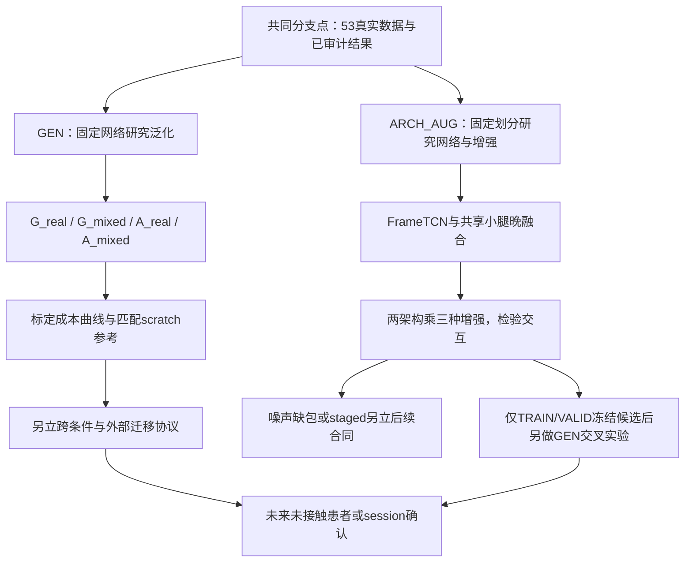

# 从当前结果分为泛化与网络架构／数据增强两条研究线

按用户决定，以[2026-10-22已验收结果](SII2027_NATIVE_ABLATIONS_20261022_ZH.md)为共同分支点。当前原始输入、配对、角色和结果冻结，两个研究方向分别建立实验目录与计划。此页记录研究分工、已完成的规划核验和拟执行预算，**两个分支的新训练均为0**；没有新增泛化或架构优越性结论。

共同起点是提交`dfeceb69d8a954a0aaddf4ded29a6db69ea71d3b`、原生53条实测数据（31TRAIN/12VALID/10TEST）、8患者建模／6患者TEST。输入为S1/S2实测acc+gyro共12D；mocap作历史离线配对、监督和评分，虚拟输入只来自允许的TRAIN父记录。输出保持原六个工程投影角，不改成clinical JCS。

| 已有参考 | 双膝RMSE(°) | 可用于什么比较 |
|---|---:|---|
| 完整TRAIN原生FrameTCN角度网络 | 2.5036 | 当前完整数据工程参考 |
| 共同crop/四槽真实重复控制 | 2.7476 | 相同支持、更新量的架构与增强对照 |
| nominal假设虚拟混合 | 3.0023 | 已完成的负结果，完整保留 |
| random假设虚拟混合 | 3.2075 | GEN及ARCH_AUG预定假设虚拟策略参考 |

前两行的TRAIN支持和优化量不同，不能互换。norm4患侧膝均值下降但只有1位患者改善、5位变差；Rot6D/geo也没有显示六角收益。后续不以“必须提升”为门槛，不删除负结果。

## GEN

核心问题：**在排除目标患者后，固定模型能否泛化；加入个体标定后，收益与成本如何变化？** 首批保持FrameTCN直接六角和真实12D，避免同时改变网络、患者协议及生成器。

| 阶段 | 尝试与目的 | 角色与控制 | 状态／拟新增预算 |
|---|---|---|---|
| GEN1 | 原E2的源训练域×目标适配四格 | G_real/G_mixed/A_real/A_mixed | 角色与预算已预检；拟72fits |
| GEN2 | 嵌套标定成本及纯预训练参照 | k=1/half/full；另以同source scaler从零训练I | 后续合同；full scratch参考拟18fits |
| GEN3 | 跨条件、跨session／外部迁移 | 独立定义留出条件、输入与标签统一 | 后续协议；不沿用GEN1名称宣称已完成 |

GEN1以有TEST的6患者逐一为目标，其余7人为source。G梯度、scaler及source VALID选择都排除整个目标患者，source TEST亦禁用；只载入该fold允许source TRAIN的真实／虚拟后代。source VALID按等患者双膝RMSE择点，不能使用目标VALID决定G。

两源域为real_replay4和既有mixed_random3，同crop、四槽、步数和source真实唯一TRAIN帧scaler。两种A均从对应G初始化、冻结G scaler，只用相同target真实TRAIN real_replay4适配、target VALID择点，不把target增强与source生成因素捆绑。VALID/TEST保留原完整段；36G＋36A＝72次200epoch拟合，计划195600＋32400＝228000更新，完成全部拟合及验签后统一真实TEST。

患侧膝为主端点，附双膝／六角、bias、ROM、SD和PCC。域效应`.5*((G_mix-G_real)+(A_mix-A_real))`、适配效应`.5*((A_real-G_real)+(A_mix-G_mix))`、交互`(A_mix-G_mix)-(A_real-G_real)`，负RMSE差有利。先患者内等trial/seed，再6患者配对；64种精确符号翻转、三项Holm最小0.09375，重点报告效应量和区间。

source TRAIN、world context、source VALID、target TRAIN及target VALID监督成本分列，A披露G+A计算。旧I与A的scaler政策不同，只作描述参照；G−A不是纯预训练收益。GEN2若比较I与A，应使用同一source scaler、同目标支持与更新量；只有1条TRAIN者合并相同预算，不虚增标定条件。

“同患者跨试次”“排除目标患者的G”“有目标监督的A”“跨条件”“跨数据集”分别报告。目录有／无拐只是候选条件，不能以S6运动代替承重真值。外部重训只支持外部可行性；冻结Stroke模型直接迁移还需统一单位、坐标和标签定义。BLISS已参与开发，不称全新确认集；如需改变主队列，先与用户沟通。

## ARCH_AUG

核心问题：**在相同数据角色下，网络组织方式和训练增强各自是否有效，二者是否存在交互？** 首轮固定12D、直接六角及当前患者内划分，不引入额外旋转／位置监督。

两种架构为既有FrameTCN与共享小腿编码、晚融合组合：同一6D时域encoder分别处理左右小腿，按左／右顺序拼接后逐帧输出六角。保持相同时间支持，参数目标在151110±5%；参数接近不代表MAC相同，必须报告实测参数、MAC/window、延迟与训练更新量。架构差异包含共享编码和融合方式，不单独归因为权重共享。

| 已实现模块的合成预检 | 参数数 | 单120帧窗卷积MAC |
|---|---:|---:|
| original_FrameTCN | 151,110 | 17,986,560 |
| shared_shank | 148,422 | 35,235,840 |

共享模型参数变化-1.78%，卷积MAC为原版1.959倍；17项合成检查通过。这里的MAC只计Conv1d，合成CPU探针耗时不作为部署延迟结论。

| 架构／增强 | real_replay4 | 真实静态SO3微扰 | mixed_random3假设虚拟 |
|---|---|---|---|
| FrameTCN | 既有24fits待逐项验收后复用 | 拟新增24 | 既有24fits待逐项验收后复用 |
| 共享小腿晚融合 | 阶段1拟新增24 | 阶段2拟新增24 | 阶段2拟新增24 |

共144个逻辑fits，已有48复用、拟新增96（阶段1的24＋阶段2的72），计划新增84000更新。完整矩阵预先固定，阶段1只看TRAIN/VALID；全部预定新增fits完成后统一新TEST评估，不能依据第一阶段TEST改后续臂。

六格统一31TRAIN共同`[100:-100]`、12665真实唯一帧、四槽、真实唯一帧scaler、200epoch、每格跨24fits共21000更新，VALID每10epoch以原完整真实段双膝RMSE择点。全部六格都在原完整真实TEST评分。world参考18865帧成本单列。复用旧48fits前必须核对源SHA、支持、窗口、初始化、scaler、生成器及VALID规则，不能仅因方法同名转记成绩。

静态旋转为1原始＋3微扰视图：随机单位轴、轴角`[-10°,10°]`；每parent/view/sensor的Q在整个片段及所有窗口固定，acc与gyro同Q，左右Q可不同。列向量为`Q.T@x`，行向量为`x@Q`；GT、时钟与测量位置不改、不另做重力移除。这是坐标轴增强，不是实测重戴或传感器位移验证。小角度真实微扰与原全SO3假设虚拟同时改变来源／生成机制和扰动范围，二者只能比较策略组合，不能归为纯数据来源效应。

主对比为replay下共享架构−FrameTCN的患侧膝差；附两种增强在两架构上的平均效应和两个架构交互，共五个患者级对比。仍先汇总seed再按6患者配对，64种符号翻转／五项Holm最低0.15625。所有患者、seed和不佳结果保留。噪声／偏置／缺包及staged/direct另立后续合同；若引入36D旋转监督或中间位置标签，明确额外监督成本，测试各阶段只能接收前级预测。

## 当前落实与两线衔接

| 决策 | 已完成内容 | 代码／计划 | 结果边界 |
|---|---|---|---|
| R32 | 共同成果冻结、两线注册 | research_fork_20261022/build_research_fork.py、fork_registry.json | 旧成果2848个哈希验签，实际新训练0 |
| R33 | GEN六fold角色、预算和成本清单 | native_generalization_20261022/branch_plan.json；audit_research_fork.py | 仅元数据隔离预检，72是拟合预算 |
| R34 | ARCH_AUG六格与复用／新增账本 | native_architecture_augmentation_20261022/branch_plan.json | 144逻辑fits不等于144新增，正式runner尚待验收 |
| R35 | 共享模型与静态旋转模块、合成预检 | shared_shank_model.py、real_axis_augmentation.py、architecture_augmentation_preflight.py | 不打开真实动态数据、不训练；不构成模型有效性结论 |

两线各自冻结研究问题、配置、搜索预算和主对比。ARCH_AUG的选择只用TRAIN/VALID，不能使用GEN测试结果选网络、Q或患者；GEN先使用共同基线网络，不混入架构探索。以后将TRAIN/VALID冻结候选迁入GEN，应另立交叉合同并报告全部差异。当前TEST已经反复用于研究，两线结果继续标为探索性，不能当成两个独立确认集；确认性结论留给未来未接触患者／session或兼容的独立数据。主队列、输入传感器数或核心输出如需改变，先与用户沟通。

共同源码快照`source_snapshots/c0bfadaf0e14450e`；manifest SHA256 `0d735c1e0ca960632f0db92196503636f30f17081bb4fd19bac6f952cd41e9d2`。函数／行号／SHA、计划和预检摘要见[分支代码索引](SII2027_RESEARCH_FORK_INDEX_20261022.json)。原始数据、逐患者角色表及模型权重保留本地。
