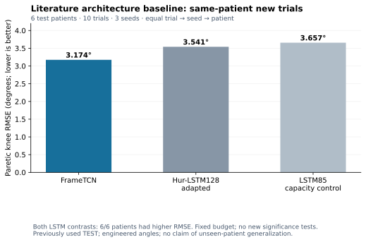
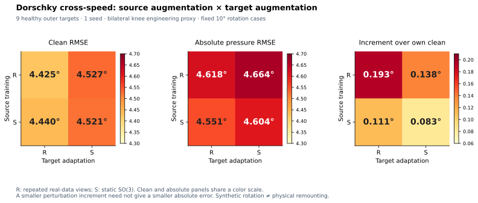
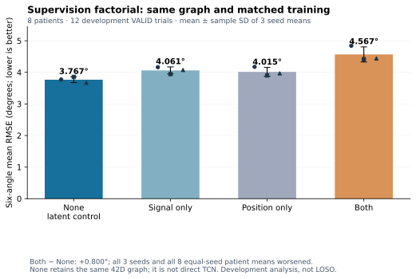
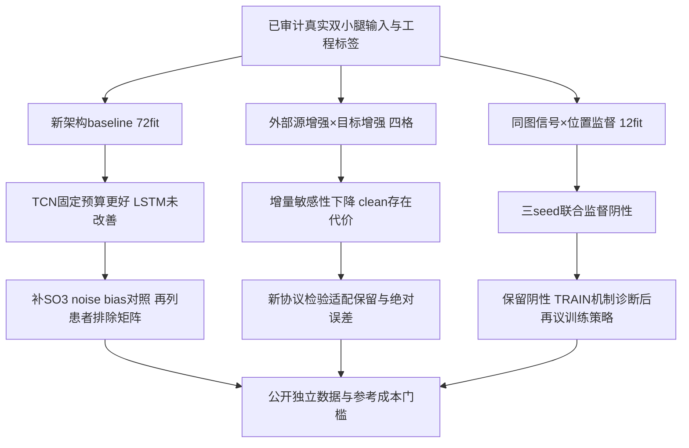

# 泛化与个体化运动重建：10月26日研究进展与决策

**2026-10-26追加验收（本条优先）：** 原六格baseline余下SO3/noise/gyro-bias的72新fit/63000更新及3360压力预测已独立复算通过，六格累计144个独立fit/126000更新。SO3患膝clean为3.273°（replay 3.174°），±10°旋转绝对误差3.388°（replay 3.711°；6/6改善），存在clean/压力权衡。固定noise/bias压力过弱，不能判增强家族无效。另完成0新fit、0VALID/TEST的TRAIN梯度几何诊断。见[增强全结果](SII2027_MEASUREMENT_BASELINES_20261026_ZH.md)、[梯度诊断及限制](SII2027_TRAIN_GRADIENT_DIAGNOSIS_20261026_ZH.md)、[本轮代码函数/SHA索引](SII2027_MEASUREMENT_GRADIENT_CODE_INDEX_20261026.json)。此前三批加本批共174 accepted fit/134400更新；含Dorschky失败版实际192次尝试/138000更新，仅指这四批，非全项目总成本。下面各日期旧状态保留历史含义；旧ARCH79及答辩文件保持。

## 追加实验、目的与决策

| 尝试 | 目的 | 实际验收 | 决策 |
|---|---|---|---|
| Frame SO3、测量noise、gyro常偏各24fit | 补齐同骨干、同预算的测量增强baseline，比较压力绝对误差及clean代价 | 新72fit/63000更新；训练/VALID独审和3360档/20160逐角结果独立重算，网络差0 | SO3旋转误差−0.323163°，clean +0.099324°；不以增量单独选优。noise/bias本次压力弱，不推断家族无效 |
| Both三seed初态/epoch50的TRAIN梯度诊断 | 查固定0.25中间监督的量级与局部方向，避免盲目增加复杂度 | 6快照×4encoder域、31TRAIN/492窗；0fit/0优化/0VALID或TEST；全局归约和静态结果独审 | 具体统计见梯度报告；仅诊断raw Euclidean梯度，不能作为AdamW更新或VALID失败的因果解释 |

独立训练审计首轮在来源说明字段上失败；数值、scaler、窗口与lineage哈希一致。保留失败证据，只修独立审计的元数据重建，再通过全量审计；未修改生产器、训练或评价结果。静态梯度审查并非重放完整真实梯度或训练轨迹。

## 更新后的下一步

1. 泛化主线优先检验个体适配时的能力保留：先冻结source增强＋真实目标适配与一个源权重约束候选，保持原G/I/A与相同标签、更新预算，分别报告clean、绝对扰动误差和负迁移；当前未启动这批新训练。
2. 噪声/偏置后续只按TRAIN统计或独立设备测量另定强度协议，不依据本批已知TEST调到有效；同患者增强结果不替代患者排除和真实重戴验证。
3. BSN启发支线保留固定联合监督阴性结果及TRAIN诊断；顺序预训练、冻结/微调或动态权重是新策略，需配平总更新并先沟通研究思路，不在已知VALID反复试到正结果。
4. 公开独立卒中数据仍须满足真实双小腿、同步/坐标可核验和独立参考门槛。本批没有增加外部卒中队列、临床三平面JCS或在线延迟证据。

## 前批研究报告（归档，以下状态截至本次追加前）

研究主题：**Generalizable and Personalized Motion Reconstruction in Stroke Patients Using Sparse IMUs**。本轮按已授权计划，完成文献架构baseline、Dorschky源×目标增强四格，以及BSN启发中间监督拆分。**三批训练与全结果独立复算均通过；当前支持保留简单TCN与有限监督个体适配，尚不支持增加中间监督或目标方向增强就能全面提高准确度。**

本页是最新研究状态。10月25日及更早记录中的“0 fit”“拟议”“架构冻结”保留其历史含义：旧ARCH79项仍冻结，后续获授权实验另立合同。已有答辩SVG和本地PPTX/PDF未在本次修改。

## 1. 本轮完成了什么

| 尝试 | 目的 | 完成与验收 | 结论 |
|---|---|---|---|
| 新FrameTCN＋Hur-LSTM128-adapted＋LSTM85容量控制 | 用已发表的循环骨干补足内部架构对照；排除仅因参数量不同 | 72新fit、63000更新；477预测/2862逐角指标独立重算 | 同患者跨试次患膝RMSE为3.174/3.541/3.657°；两种LSTM相对TCN均6/6患者更差 |
| Dorschky source R/S × target R/S | 分清方向增强在源训练和个体适配阶段各自的作用 | 新增两个交叉格18fit/3600更新；四格928档/17632case/35264逐角指标独立重算 | 两阶段都降低旋转压力增量；目标增强增加跨速度clean误差，联合增强未得到最低绝对误差 |
| 同42D图：None/Signal/Position/Both，3seed | 仅改变中间监督，分离信号与位置的影响 | 12新fit/4800更新；144完整VALID序列独立重算 | 六角3.767/4.061/4.015/4.567°；Both−None +0.800°，3seed及等seed后8/8患者均变差 |
| 公开卒中数据补查 | 寻找独立实测双小腿＋光学参考 | 只核论文/官方记录，0新数据release、0新队列训练 | REHAB、Dryad TEPI、Twente尚不能满足当前输入/独立标签条件；不将候选写成已接入 |

三批分别使用不同角色、模型训练方式或标签，**不能将这些RMSE拼成跨研究排名，也不能把6名测试患者、8名开发患者和9名健康目标相加为卒中样本量。** 新增accepted训练共102fit/71400更新；Dorschky失败版另消耗18次/3600更新，实际总成本120次尝试/75000更新。旧source预训练与对角模型只读复用，旧ARCH79项逐SHA不变。

## 2. 架构baseline：明确了什么，尚缺什么

本批8患者分别建模，31TRAIN/12VALID/10TEST，TEST涉及6人。共同真实S1/S2双小腿12D、六工程角、TRAIN唯一帧scaler、4replay、200epoch/VALID-best、120/20窗和Hann离线融合；各架构同患者/seed下实际batch顺序一致。三格全为新训练，无旧权重复用。

LSTM128是文献骨干的任务改编，LSTM85是本项目容量控制，不能称完整原论文复现。固定训练预算也不等于相同调参预算或各模型家族最优。历史TEST已有使用，本批不是新盲测；尚未回答未见患者的LSTM相对性能。原六格计划只完成前三格，SO3/noise/bias余下72fit未执行。

详见[结果和训练成本](SII2027_BASELINE_RESULTS_20261026_ZH.md)、[完整人群聚合](SII2027_BASELINE_AGGREGATES_20261026.json)及[文献与作者代码核查](SII2027_LITERATURE_BASELINES_20261025_ZH.md)。

## 3. 泛化＋方向增强：收益与代价分开

R为重复真实数据，S为静态SO(3)。在9名健康外层目标、单seed、跨速度双膝代理任务中：

| source→target | clean RMSE | 10°压力绝对RMSE | 压力相对自身clean增量 |
|---|---:|---:|---:|
| R→R | 4.425045° | 4.618499° | 0.193454° |
| R→S | 4.526822° | 4.664342° | 0.137521° |
| S→R | 4.440054° | 4.551236° | 0.111182° |
| S→S | 4.520874° | 4.603661° | 0.082787° |

预定因子描述差：source增强对clean为+0.004531°，对压力绝对误差为−0.063972°；target增强对clean为+0.091299°（9/9正差），对压力绝对误差为+0.049134°。两者对压力增量主效应分别−0.068503/−0.042164°，但增量的正交互+0.027538°不能写成额外协同。

这解释了为何“压力增量下降”不能直接写成“总重建误差下降”。当前应优先检验如何在个体适配时保留clean能力，而不是默认联合增强全面更好。未新增p值或bootstrap，没有据EVAL选择幅度、窗口或epoch。每目标2秒梯度监督以外，还需要2.4秒光学上下文、完整trial/QC及作者功能标定；名义时钟、作者经验20ms对齐与同人连续源文件限制仍存在。

详见[四格报告与失败成本](SII2027_DORSCHKY_FACTORIAL_20261026_ZH.md)和[全部人群结果](SII2027_DORSCHKY_FACTORIAL_AGGREGATES_20261026.json)。健康工程代理与合成旋转不证明卒中临床泛化或真实重新佩戴鲁棒性。

## 4. BSN启发支线：中间量可学，不保证运动更准

本轮保持同一156592参数图、初态、顺序、50epoch/400更新和三seed，只控制信号/位置loss是否开启，权重固定各0.25。None保留42D瓶颈，是同图latent控制，**不是direct TCN**。信号来自真实S3/S4/S5；位置是光学关节/足点相对双髋中点的工程代理，并非真实IMU硬件中心。

Both−None六角+0.800120°，去每trial前84帧仍+0.939454°；Signal−None与Position−None也在三个seed均为正。位置仅监督时MPJPE46.040mm，联合时56.073mm；联合监督并未改善各信号组重建。不能因此断言标签错、BSN原方法无效或梯度冲突已被测得；当前只否定这组固定权重、联合训练的配置收益。

这是pooled8人TRAIN到同8人12VALID新trial的开发诊断，0新TEST动态读取，无患者排除或独立临床验证。不得把它与旧单seed direct结果或baseline TEST拼成新排名。详见[完整机制报告](SII2027_SUPERVISION_FACTORIAL_20261026_ZH.md)和[人群/seed/对比聚合](SII2027_SUPERVISION_FACTORIAL_AGGREGATES_20261026.json)。

## 5. 下一步优先级

1. **补齐已规划的增强baseline。** 固定FrameTCN，比较SO3、测量噪声、常量gyro偏置，补余下72fit；先冻结同支持、扰动类型/强度、clean与绝对压力评价，不依据既知TEST调参。它补足增强对照，仍不替代患者排除验证。
2. **泛化主线检验“适配保留”。** 在新协议中比较固定source增强＋真实目标适配，与一个预先固定的源权重约束候选；保留原G/I/A、相同标签与更新预算，报告clean、绝对扰动误差和每人负迁移。将文献改编架构纳入跨患者协议需另列source训练、标定成本及预定矩阵，尚未开始。
3. **监督支线保留阴性结果，先查TRAIN机制。** 可先做无新fit的loss/梯度量级诊断；顺序预训练、冻结/微调或自适应权重属于新的方法变化，需另立总更新配平协议并与用户沟通，不在已知VALID上反复试到正结果。
4. **独立公开卒中证据继续设门槛。** 新候选必须具备真实双侧小腿、可核验同步/坐标及独立参考，不以IMU自派生角替代光学GT，也不将健康样本补为卒中样本。[本次有界补查](SII2027_PUBLIC_DATASET_FOLLOWUP_20261026_ZH.md)未增加合格队列。

上述是下一批建议，尚未冻结新实验或启动训练。现阶段可组织论文的核心仍是可追溯的真实稀疏输入、患者级个体适配及跨条件的收益/失败边界；新结果补强了方法比较和机制解释，尚未补齐期刊所需独立卒中验证。

新增实现的模块、函数行号与SHA见[索引](SII2027_FOLLOWUP_CODE_INDEX_20261026.json)；完整源码保留本地。独立审计包括literal网络前向和独立聚合；不声称重放完整优化轨迹。公开材料仅为研究说明、群体/seed聚合、科学图及函数/SHA索引；完整源码、raw/权重/逐帧预测、个体试次表及完整演示文稿留本地。
