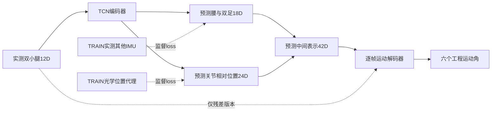

# BSN启发的分阶段稀疏IMU重建：五组开发对照

**2026-10-26最新研究状态：** [三批后续实验与决策](SII2027_RESEARCH_PROGRESS_20261026_ZH.md)已通过独立训练和全结果复算：文献架构72fit、Dorschky四格新增18fit、监督机制12fit。TCN同人TEST患膝3.174°，两种LSTM未改善；方向增强存在clean/压力权衡；固定中间联合监督三seed阴性。accepted共102fit/71400更新，含失败的实际成本120次/75000更新。旧ARCH79继续冻结；余下增强baseline72fit尚未执行。以下早期“未训练/0fit”等文字按原记录日期保留，当前状态以本条及新报告为准。

日期：2026-10-25。**5次新训练、2000次更新及一次固定VALID开发诊断均已完成，四项独立数据/训练/结果审计通过。中间重建优于常量，但未改善本轮运动预测。**

入口：[完整聚合](SII2027_STAGED_AGGREGATES_20261025.json) · [成本/验收摘要](SII2027_STAGED_READINESS_20261025.json) · [函数与SHA索引](SII2027_STAGED_CODE_INDEX_20261025.json) · [可审阅代码](sii2027_staged_20261025/README.md)。

## 目的与研究边界

根据用户对BSN思想的确认，检验“先重建其他传感器信号和相对位置，再预测运动”是否优于同类直接预测。位置采用用户明确同意的关节相对位置工程代理。原ARCH79项已逐文件SHA核验保持；新工作另建目录与合同，没有覆盖旧架构实验或答辩成绩。

该支线输入为真实S1左小腿和S2右小腿ACC/GYRO12D；新增监督为真实S3腰、S4左足、S5右足18D信号，以及8个光学关节/足部点相对双髋中点的24D位置。位置不是传感器硬件中心；S6拐杖不纳入身体重建目标。部署时只有双小腿输入，真实中间量仅进入训练loss或评价。

上图仅示意strict/residual两种staged路径；direct与aux的运动路径不经过这些预测头。旧ARCH冻结保留的[79项SHA核验凭证](sii2027_staged_20261025/old_ARCH79_recheck.json)另列。

BSN原思路为足部到小腿信号重建，本实验仍用现有双小腿输入，因此属于启发式新方法，不称BSN完整复现。相对位置中间表示参考[TransPose的官方介绍](https://xinyu-yi.github.io/TransPose/)与[作者代码](https://github.com/Xinyu-Yi/TransPose)，其6IMU、姿态输入与全身任务不同。本项目另有[文献baseline计划](SII2027_LITERATURE_BASELINES_20261025_ZH.md)，该正式大比较尚未被这五次pilot替代。

## 数据来源、坐标与成本

S1/S2与新增S3/S4/S5均为实测原生IMU轴：ACC按g×9.80665转为m/s²，GYRO按deg/s×π/180转为rad/s；保留重力，不把mocap导数当作实测IMU。不同传感器轴不被宣称统一到光学轴。S5部分文件缺模态，逐模态mask仅屏蔽原始inventory的缺失，存在但异常的源不能改成缺失。

位置先在既有光学工程骨盆框架插值，再减双髋中点并mm→m。当前方向约定X右、Y前、Z上，矢状面YZ、冠状面XZ、水平面XY；保留既有六角工程标签，不升级为临床JCS。时钟继承固定匹配与query，不重新搜索lag、轴或符号；这不是独立硬件同步验证。

TRAIN为8人31试次，固定共同crop后12665唯一100Hz帧、126.65秒；源完整TRAIN上下文188.65秒另记。S3/S4各模态监督126.65秒；S5 ACC122.37秒、GYRO114.60秒。光学位置监督同126.65秒，新增参考成本高于只用运动角的直接模型。mask统计、归一化都只用允许TRAIN，不按重叠窗口重复拟合统计量。

VALID是相同8人的12个不同试次、完整7238帧。当前只是同人跨试次开发诊断，单seed，不是LOSO、独立TEST、跨患者验证或临床结论。既有离线配对和旧研究已经看过这些开发资料，不能称新盲测。本支线无新增TEST动态数组/预测；共享raw CSV做整文件SHA会机械读取其他角色的源字节，时间扫描也遍历全clock，故不宣称TEST源字节零接触。新增动态值只解码批准角色的插值括号行。

## 五个模型与固定训练

所有模型使用TCN64、3残差块、每块两层kernel7卷积、dilation1/2/4、因果RF85；运动头为逐帧MLP。50epoch final固定，492个120帧窗、stride20加尾窗，每fit400次更新，共5fit/2000更新。初始化、训练dropout和数据洗牌RNG分别约束；每轮五臂批次顺序相同。无增强、无源预训练、无VALID选点。

| 模式 | 目的 | 训练/推理路径 | 参数量 |
|---|---|---|---:|
| direct | 直接预测参考 | encoder→MLP→运动角 | 155270 |
| auxiliary_only | 额外监督本身的作用 | 同direct运动路径，另加受监督18/24D头 | 158000 |
| latent_bottleneck | 无语义42D瓶颈控制 | encoder→latent42→MLP→运动角 | 156592 |
| strict_staged | 语义中间监督与严格瓶颈 | encoder→预测18＋24→MLP→运动角 | 156592 |
| residual_staged | 观测残差是否补回瓶颈丢失信息 | x12＋预测42→MLP→运动角 | 157360 |

latent与strict整网结构和初始化相同；direct与aux公共运动路径初始化相同。其他跨臂不强称同参数。角度/信号/位置损失权重固定1/.25/.25，信号按sensor×ACC/GYRO六组有效元素等组平均；direct/latent没有语义辅助loss。这是本实验工程先验，不是BSN或TransPose公布的训练参数。

## 固定分析口径

每trial每角计算RMSE，再在患者内等trial、患者间等8人汇总；六角均值、双膝均值与患侧膝分别报告。辅助信号按每传感器每模态在有效xyz上算RMSE，ACC与GYRO保留各自单位；位置为8点MPJPE，单位mm。额外提供冻结TRAIN通道均值常量参考和去掉初84帧的预定次要诊断。

中间量置零与整体时间移位只作依赖诊断。语义量标准化零对应TRAIN均值，latent零只是其坐标原点。循环移位是故意的离线非因果内部扰动，不能当成部署方法、真实重戴或物理干预证明。未向运动头输入真实中间量，不报告oracle作为可部署成绩。

## 固定VALID结果

以下均为**同患者新试次开发结果**，单位°；单seed20261025、固定final50。与旧个体模型、旧TEST、WMCG/Dorschky任务或不同划分不能直接拼表。去掉初84帧是冻结的次要诊断，主结论仍用完整试次。

| 模式 | 六角平均RMSE | 双膝平均RMSE | 患膝RMSE | 去初84帧六角 | 六角相对direct差 | 改善人数/8 |
|---|---:|---:|---:|---:|---:|---:|
| 直接预测 | 3.742166 | 3.934241 | 4.383157 | 3.515482 | +0.000000 | — |
| 仅辅助监督 | 3.893943 | 4.237817 | 4.741254 | 3.727914 | +0.151777 | 3 |
| 无语义瓶颈 | 3.781839 | 4.004052 | 4.633806 | 3.542916 | +0.039673 | 2 |
| 严格分阶段 | 4.332027 | 4.480378 | 4.980409 | 4.229640 | +0.589861 | 1 |
| 观测残差分阶段 | 4.613215 | 4.709579 | 5.017581 | 4.512986 | +0.871049 | 0 |

冻结TRAIN均值常量参考：六角13.689883°。strict相对同结构、同初始化latent的六角差为 **+0.550188°**，仅2/8人改善；因此本轮不支持语义中间监督优于同维度无语义瓶颈。residual相对direct为0/8人改善，观测skip也未自动解决问题。上述人数及差值仅描述，不作显著性检验。

## 中间重建质量与依赖诊断

| 目标 | 单位/可评价患者 | TRAIN均值参考 | 仅辅助监督 | 严格分阶段 | 观测残差分阶段 |
|---|---|---:|---:|---:|---:|
| S3_ACC RMSE | m/s² / 8人 | 2.182085 | 1.666010 | 1.775730 | 1.684830 |
| S3_GYRO RMSE | rad/s / 8人 | 0.469838 | 0.367383 | 0.386560 | 0.374461 |
| S4_ACC RMSE | m/s² / 8人 | 4.555816 | 4.089743 | 4.134841 | 4.072670 |
| S4_GYRO RMSE | rad/s / 8人 | 1.719942 | 1.247178 | 1.245249 | 1.280398 |
| S5_ACC RMSE | m/s² / 7人 | 3.346384 | 2.885752 | 3.037046 | 3.013135 |
| S5_GYRO RMSE | rad/s / 7人 | 1.489024 | 0.976835 | 1.139604 | 1.053296 |
| 相对位置MPJPE | mm / 8人 | 127.281491 | 43.849928 | 58.202653 | 55.891930 |

三种语义模型在全部六个信号组与位置的**汇总均值**均优于冻结TRAIN均值，说明网络学到了可预测的中间信息；这不意味着每位患者、每个通道都改善，也不等于传感器安装轴或临床关节坐标被精确恢复。脚部ACC的改善较小，且缺失模态的可评价患者不同，不能把六组跨单位平均成一个“传感器误差”。

| 模式 | 原六角RMSE | 置零中间表示 | 循环移位中间表示 |
|---|---:|---:|---:|
| 直接预测 | 3.742166 | 3.742166 | 3.742166 |
| 仅辅助监督 | 3.893943 | 3.893943 | 3.893943 |
| 无语义瓶颈 | 3.781839 | 13.687177 | 13.419955 |
| 严格分阶段 | 4.332027 | 13.686839 | 13.611188 |
| 观测残差分阶段 | 4.613215 | 12.759922 | 12.398819 |

直接/aux的中间头不在运动路径上，干预按设计不改变输出；latent/strict/residual的预测明显受内部表示影响。latent也同样依赖中间量，故“用了中间量”不能证明语义约束更优或解释正确。该干预是分布改变诊断，不证明导致运动误差的物理因果关系。

## 尝试、结论与下一步决策

| 尝试 | 目的 | 当前结论 |
|---|---|---|
| 仅辅助监督 | 将额外标签的作用与严格瓶颈分开 | 中间量可学，但运动汇总未改善direct；不能把所有差异归为瓶颈 |
| latent与strict成对 | 相同结构/初始化下检验语义监督 | strict汇总更差；保留阴性结果，不宣称BSN思想已被证实 |
| 观测残差 | 让运动头同时看到原输入，补充重建误差 | 本轮没有收益，8人六角均未优于direct |
| 常量与置零/移位 | 排除只输出平均姿态、检查表示依赖 | 中间重建优于常量，运动确实依赖预测表示；仍未转化为角度收益 |

本次是**联合端到端训练的分阶段前向结构**，没有先预训练并冻结中间网络。当前结果不能判断分阶段预训练、信号/位置监督分离、损失梯度冲突或更长训练中的哪种因素起主要作用；本实验没有测量梯度冲突，也不能把它写成确定原因。

建议先冻结本批结果，保留直接预测参考与全部五臂，随后新建小规模机制协议：在允许TRAIN上检验signal-only/position-only监督及先重建预训练、再训练motion的两阶段策略，明确额外监督成本；先完成文献LSTM等对照，再进入患者整人排除＋少量适配协议。后续开发已经知道本VALID结果，应如实记为探索性，不称新盲验证。不要基于这12VALID挑epoch/权重/seed，再把它们包装成独立确认。

现有single seed、50epoch、pooled TRAIN窗口权重、工程六角与位置代理均限制外推；无真实重戴、未新增独立卒中cohort、未检验三平面临床角度。若改为分阶段预训练或换中间监督策略，将作为新实验设计与用户沟通，不覆盖本次阴性结果。

## 验收与读取账目

独立TRAIN目标复算、TRAIN模型/归一化/顺序审计、VALID目标复算和VALID全预测/指标复算均通过。31TRAIN与12VALID新增信号和位置重建差为0；独立literal TCN重新计算60完整序列预测包（含置零/移位）与生产输出差为0，全部聚合差小于2e-14。训练审计核实250个epoch顺序、10份初末权重与400步optimizer记录，不声称重放完整优化轨迹。

端点政策在任何新VALID数值/性能访问前由任意10ms调整为与既有source最大插值间隔一致的25.1ms，依据已知11ms时间戳jitter；旧合成回执均保留。12VALID全部保留、不裁剪、不改lag，所有邻接支撑在原episode/run内且不进入其他角色步态段。全source SHA/clock文本扫描与只解码获准插值行分别记账，0新TEST动态数组/预测不等于0TEST源字节。

TRAIN新增信号另做描述性物理筛查，未见任何轴达到15.9g或1990deg/s参考水平；这两个阈值未被核定为设备量程，不能据此认证无饱和、无同步误差或正确安装。筛查未用于删试次、改数据或重训。全部脚本、合成回执、成本与SHA见索引；公开材料不含raw/NPZ、权重、逐帧预测或论文PDF。旧ARCH79项与已发表答辩数值保持。

## 2026-10-26 执行状态更新

**2026-10-26最新研究状态：** [三批后续实验与决策](SII2027_RESEARCH_PROGRESS_20261026_ZH.md)已通过独立训练和全结果复算：文献架构72fit、Dorschky四格新增18fit、监督机制12fit。TCN同人TEST患膝3.174°，两种LSTM未改善；方向增强存在clean/压力权衡；固定中间联合监督三seed阴性。accepted共102fit/71400更新，含失败的实际成本120次/75000更新。旧ARCH79继续冻结；余下增强baseline72fit尚未执行。以下早期“未训练/0fit”等文字按原记录日期保留，当前状态以本条及新报告为准。

详细目的、全部负结果、成本、下一门槛与三张科学图见[本轮研究报告](SII2027_RESEARCH_PROGRESS_20261026_ZH.md)。这次新增研究没有修改旧冻结合同或既有答辩页。
