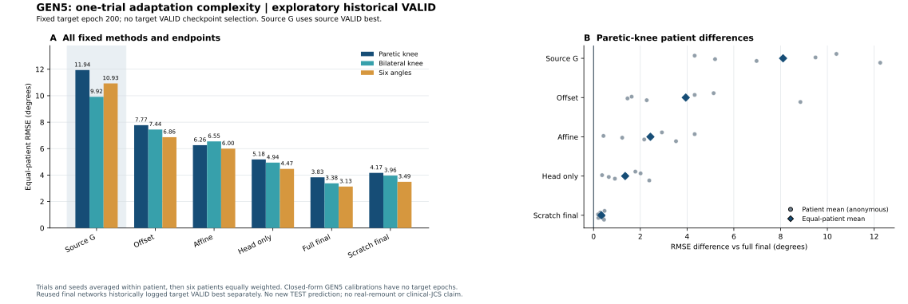
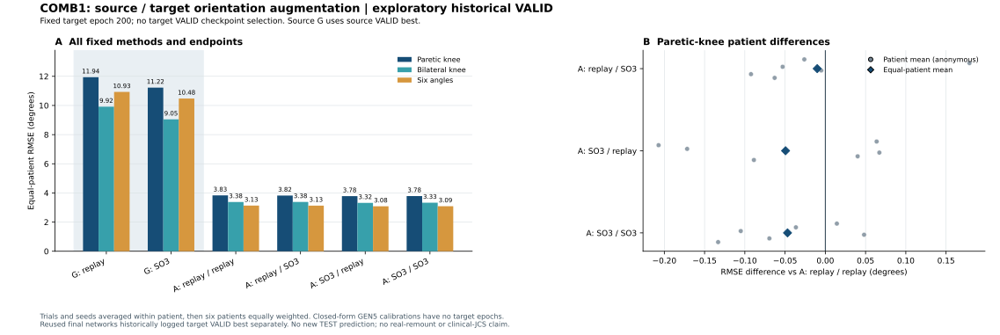

# 三线研究决策与已验收结果（2026-10-23）

用户已明确决定：**冻结架构方向，继续泛化线，另开“少量适配＋方向增强”第三线。** 这是研究范围和执行安排的更新；各实验是否完成见下表，不把协议、启动或训练完成称为独立结果验收。

|研究线|当前阶段|新增fit完成/计划|独立验收状态|
|---|---|---:|---|
|架构与增强旧支线|冻结，全部原结果保留|120/120；48旧fit只读引用另计|原六格、ARCH2、ARCH3独立审计均通过|
|泛化线GEN5|固定训练与一次clean目标VALID诊断完成|18/18|训练/角色门控及目标VALID预测、指标独立数值复核通过|
|第三线：少量适配＋方向增强|固定训练与一次clean目标VALID诊断完成|72/72|训练/角色门控及目标VALID预测、指标独立数值复核通过|

执行状态核验日期：2026-10-23 Asia/Tokyo。新增实验结果：GEN5与COMB1的固定clean目标VALID诊断均已完成并通过独立数值审计；本批没有新TEST或方向压力预测。结果属于历史开发VALID，不能作为新增独立泛化证据。

两条推进线的已验收新增库存合计90个神经fit、118600次优化更新，另有36个闭式校准。GEN5引用54个旧网络，第三线引用的36个属于其中相同源/完整适配参考，合并只计54个唯一旧网络；不将两条线的引用数简单相加。实际完成数和验收以表中阶段及独立审计为准。

## 1. 架构冻结范围与证据边界

冻结点是已发布提交[`e0108f5`](https://github.com/InchengWang/NMS-GAP/commit/e0108f5a18b6b1864cbd5a1e1e3ffe2aa88d43b4)。[原支线完整结果](SII2027_ARCH_AUG_RESULTS_20261022_ZH.md)、全部seed、阴性结果、统计家族与计算成本保留；本轮不再比较新网络或根据已使用TEST挑选架构。旧支线共120个新fit、105000次优化更新；48个旧参考fit另计。原六格、ARCH2 VALID方向压力、ARCH3非线性融合均已独立验收。

新冻结清单包含79项源码、协议、合同、审计及结果元数据和图文件SHA。清单SHA为`d22350d16347d2942ea3cc81011cfb51f45fa01f6c5e412b5c34efb38b8fe675`，见[冻结清单](SII2027_ARCHITECTURE_FREEZE_20261023.json)。原始患者数据、输入/预测NPZ、模型权重和run目录没有被本次冻结操作打开或重新hash；这些对象的历史身份由原审计和合同绑定。实时运行日志另行追加，旧历史pipeline状态不触发重训。

第三线复用冻结的FrameTCN和固定静态SO3操作。复用既有操作不等于重新开放架构搜索，也不把旧患者内方向诊断当作跨患者增强收益证据。

## 2. 泛化线GEN5：适配复杂度与实际标定成本

问题是：在同样少量目标参考数据下，输出的简单校准或仅训练输出头，能保留多少完整微调收益？此前常数偏置校准已有改善但明显不及完整适配，故本轮推进尺度和偏置、输出头与完整网络的固定比较。

固定六方法：源模型G（零目标监督）、常数偏置C_offset（6参数）、逐角尺度＋偏置C_affine（12参数）、仅输出头A_head（390参数）、完整微调A_full_final、同预算从零训练I_final。后五种都使用既有one预算选定的同一真实TRAIN parent，同样数据支持；不依据预测误差另选“最好的一段”。预训练来源继续整人排除目标患者；只使用真实源IMU的固定FrameTCN，源模型可按源患者VALID选择，目标患者的VALID不进入本轮梯度训练、选点或参数调节。

**目标网络训练固定200 epoch，使用final状态；offset与affine在融合后唯一真实帧上拟合固定闭式解。** 仿射采用预先固定的lambda=0.01，将逐角scale向1收缩，不用VALID选lambda；不把它和神经网络优化成本说成相等。200沿用既有协议以隔离目标早停依赖，本轮不宣称它已通过源患者嵌套流程证明最优。

18个源G、18个完整适配final、18个从零训练final均只读复用，共54个旧网络；仅一条TRAIN段者的one=full按合同指向原全预算模型，其余指向固定one模型。旧目标fit历史曾每10epoch读取目标VALID另存best，但没有early stop、scheduler或VALID梯度，本轮只用预先固定epoch200末态；如实保留历史读取，不能称整个旧流程从未接触VALID。不能把final与旧target-VALID-best混成严格公平主对照。

本批仅新增18个head神经fit、5200更新；18个offset和18个affine闭式拟合另计。head冻结blocks参数但保持原全model.train/dropout和四槽shuffle。全部新增head完训后，才对六方法执行一次完整目标VALID诊断；该诊断为历史开发材料，不用来选方法、选点或追加优化。输入scaler和输出scaler均冻结为源真实TRAIN统计，不用目标段更新。源VALID与目标诊断参考数据成本分开如实报告；“目标VALID不用于适配选点”不等于实验从未看目标VALID。

主指标保留患侧膝RMSE；双膝、六角及患者差异为辅助指标。报告one段全部目标监督秒数、独立帧数和优化步数，不用重复窗口、四个增强视图或200次重复暴露增加监督量。

本批范围与当前状态：native_generalization_20261023/GEN5_one_v1；已完成18个head神经fit/5200更新、36次闭式校准，54个旧网络只读引用；source G与目标one预算冻结，当前实现只允许完训后目标VALID诊断。

## 3. 第三线：少量适配与方向增强能否结合

问题是：方向增强放在源预训练或目标适配的哪一阶段，能改善跨患者少量标定后的预测及方向压力稳定性？它与架构旧支线的同患者跨试次问题不同。

固定2×2策略：源预训练不增强/方向增强 × 目标one段不增强/方向增强。四格使用同一FrameTCN、同一目标段和固定200 epoch final适配；source与target的四槽训练支持、标准化规则、seed及更新预算按新合同对齐。未增强格采用真实replay保持视图和更新数量一致，不能将额外训练量误认为增强作用。

源replay的18个G best只读复用GEN1；源replay＋目标replay的18个A final只读复用旧one模型，仅一条TRAIN段者one=full单独绑定。新训练18个源SO3与54个A，共72fit、113400更新（97800源＋15600目标），另有36旧fit只读引用。两种source共36逻辑G，四格共72逻辑A，不把引用模型或增强视图计为新增独立患者。它与GEN5共用旧源起点及旧完整适配参考，新head与联合线新A不相互复用。

SO3仅在原始SI输入标准化前进行：S1与S2各自静态旋转；同一传感器acc与gyro用同一旋转；时钟、标签和测量点保持。扰动是传感器native坐标变化，XYZ不是解剖矢状、冠状或水平轴；没有安装记录支持将合成扰动称为真实重戴。输入仍为S1左小腿、S2右小腿的12D实测信号，患侧和拐杖候选条件不作为模型输入。

本批只在全部72新fit和36引用fit验签后执行一次只读目标VALID诊断，检查G与A的clean误差；不按诊断选择checkpoint或修改增强幅度。主要描述对照为两阶段均增强相对两阶段均不增强；源增强、目标增强和交互用于机制描述。方向压力方案和未来TEST推理不在本批实现内，需另立合同后执行。历史TEST已经使用多次，本批没有TEST代码不改变全历史探索性边界。

本批范围与当前状态：native_adaptation_orientation_20261023/COMB1_v1；已完成18个新源SO3与54个目标one适配/113400更新，36个旧fit只读引用；当前只实现完训后的目标VALID clean诊断，方向压力与TEST另立合同。

## 4. 共用数据、成本和结论边界

继续沿用已修复的53个parent、31TRAIN/12VALID/10TEST划分、8名建模患者和6名有TEST患者。跨患者source训练完整排除目标患者，而目标one段与测试段属于同一目标患者的不同trial；不能将它描述为目标患者完全未见。连续原始CSV可以包含不同角色的不重叠段，也不能声称文件独立。

输出仍为六个legacy骨盆YZ工程投影角，尚不是经过临床关节坐标系校准的三维关节角。S6运动和目录是候选用拐信息，不能单独证明拐杖接触或承重。结论限制、同步修复、配对与数据排除记录继续继承历史报告。

代码、预检、训练、评估、数值审计分开记账；只有真实审计通过的结果才进入正式结果表。新的代码索引列相对实验路径、类/函数行号及源码SHA，见[函数级索引](SII2027_THREE_LINES_CODE_INDEX_20261023.json)；不公开患者数据、逐trial身份表、原始数组或模型权重。

## 5. 本批验收流程与后续门槛

1. 已冻结新协议和源码，检查目标患者完整排除、target VALID/TEST访问门控、one段支持、真实帧scaler及旋转物理约束。
2. 已完成固定训练库存，并核验final状态和源VALID-best选择，不增加目标参考监督。
3. 已在本批训练验签后执行固定目标VALID诊断，并以另写实现复核预测、指标和患者配对差。本批无TEST推理代码；未来clean TEST或方向压力需另立合同。
4. 如实报告全部格和seed、运行成本与负结果；后续独立验证只使用开源数据，不安排重新采集。历史及未来合成方向压力不能替代真实安装记录。

## 6. 后续独立数据约束：仅使用开源数据

用户补充明确：后续不会安排重新采集，独立验证只使用开源数据。优先筛选包含**双侧小腿真实原始IMU加速度/角速度与光学运动捕捉参考**的数据，核验采样率、单位、传感器部位/坐标、同步及患者/session/trial标识，确认不是mocap生成的虚拟IMU。若参考标签与当前工程投影角不同，需先明确可复现的marker推导或坐标映射，不能直接把不同角定义误差当作泛化失败。

BLISS已参与既往开发，可作为既有对照和复核材料，不能称全新的盲测外部集。优先选择此前未参与本项目模型/参数选择的公开参与者或数据源；在读取结局前固定纳入、适配预算、预处理与评价规则。若只有健康受试者，结论限定为技术迁移和坐标鲁棒性，不能代替卒中患者泛化证据。没有公开安装/重戴记录时，保留“合成坐标扰动”表述，不声称真实重戴有效。公开数据筛选及未来外部实验另立协议，本批结果仍仅是历史开发VALID。

已完成官方来源与有界文件前缀的可行性核验，**以下均为候选，尚未进入训练或性能评估**：

|候选及优先级|独立工程验证条件|当前接入门槛|
|---|---|---|
|WMCG／首选|10名健康人、8枚真实Delsys IMU，包含双小腿六轴与独立Vicon/OpenSim参考；官方v2为CC BY4.0，发布于2026-04-06。[官方数据](https://doi.org/10.25452/figshare.plus.29328746.v2)、[原论文](https://www.nature.com/articles/s41597-026-07657-7)|已实际抽样IMU、光学角与TRC字段；单位、精确时钟/同步、跨参与者左右映射及标签物理定义仍未全部验收，ready=false。|
|Dorschky／备选|10名健康人、含双tibia的7枚真实IMU及独立OMC；官方README明确SI单位和触发关系，IMU已功能标定到segment坐标。[官方记录与README](https://zenodo.org/records/11522050)|尚未实际验收连续Parquet动态schema；光学连续角需由marker重建，不能将均值周期表直接与连续IMU逐帧配对；segment轴不是未经标定的native轴。|
|BLISS／既有开发对照|本项目已经处理、训练和复核过的外部pilot。[官方记录](https://researchdata.bath.ac.uk/1425/)|可复现协议或研究增强，不能重新作为新盲测外部集；不按误差或ROM猜患侧。|

WMCG本次仅严格HTTP206有界取样约350KB原始包前缀，没有完整下载大型视频集、训练、预测或指标；已暴露于schema开发的参与者需预先标为开发用途。后续先补单位、时钟和坐标来源，再分别立项“按数据集原生光学角外部重训”与“现有Stroke checkpoint跨数据集迁移”：后者必须构造物理定义一致的标签，否则误差混入标签域差。两项候选都为健康人，不能替代新卒中患者证据；尚无通过验收的真实重戴记录。

## 7. 本批已独立验收的固定clean目标VALID诊断

**以下全部为历史开发VALID，均不是TEST，也不是新增独立患者验证。** 新head/联合线A采用固定epoch200 final；引用的旧final曾另行记录VALID-best，历史读取如实保留。不能与此前使用更多目标段、target VALID择best的2.949°等结果拼成同预算直接比较。

### 7.1 GEN5六方法

|方法|患侧膝RMSE°|双膝RMSE°|六角RMSE°|
|---|---:|---:|---:|
|源G：无目标监督|11.936504|9.917655|10.927373|
|6参数偏置|7.774237|7.442332|6.863748|
|12参数尺度＋偏置|6.262902|6.547833|5.998138|
|390参数输出头|5.183036|4.941580|4.467758|
|全网络final|3.830770|3.379875|3.132511|
|从零训练final|4.166245|3.962290|3.492798|

|患膝描述对照|患者配对均值差°|负差患者|正差患者|
|---|---:|---:|---:|
|390参数输出头−全网络final|+1.352266|0/6|6/6|
|12参数尺度＋偏置−全网络final|+2.432131|0/6|6/6|
|6参数偏置−全网络final|+3.943466|0/6|6/6|
|源G：无目标监督−全网络final|+8.105733|0/6|6/6|
|从零训练final−全网络final|+0.335474|0/6|6/6|

负差表示该方法相对固定完整微调final误差较低。每名患者先等trial、等seed，再六名患者等权；窗口和重复视图不增加样本量。闭式校准和神经训练的计算成本不相同。本批无新增p值或置信区间，不根据该VALID表选择“部署赢家”。

|参考成本（秒）|目标/seed设置平均|设置范围|
|---|---:|---:|
|目标one段：裁剪后实际监督|3.779|1.230–6.860|
|目标one段：完整参考采集支持|5.779|3.230–8.860|
|目标VALID：完训后诊断参考|9.805|3.070–16.500|
|源TRAIN：完整参考支持|162.982|142.060–184.480|
|源VALID：源模型选点参考|62.575|55.880–69.310|

秒数是冻结预算中帧数换算的支持量；18个目标/seed设置只对应6名患者。裁剪后监督、完整目标段和完训诊断分别报告：本批适配无目标VALID择点，但查看诊断仍需要该光学参考，不能把它省略后宣称总目标标定只需one段的裁剪秒数。

### 7.2 COMB1两个源模型及四个适配格

|方法|患侧膝RMSE°|双膝RMSE°|六角RMSE°|
|---|---:|---:|---:|
|源G：replay|11.936504|9.917655|10.927373|
|源G：SO3|11.222277|9.046524|10.475368|
|A：源replay／目标replay|3.830770|3.379875|3.132511|
|A：源replay／目标SO3|3.820698|3.383770|3.129873|
|A：源SO3／目标replay|3.781368|3.316475|3.083477|
|A：源SO3／目标SO3|3.783814|3.331919|3.088561|

|患膝描述对照|患者配对均值差°|负差患者|正差患者|
|---|---:|---:|---:|
|两阶段SO3−两阶段replay|-0.046957|4/6|2/6|
|目标SO3下的源SO3|-0.036885|3/6|3/6|
|目标replay下的源SO3|-0.049403|3/6|3/6|
|源SO3对源G|-0.714226|5/6|1/6|
|源×目标交互|+0.012518|4/6|2/6|
|源SO3下的目标SO3|+0.002446|4/6|2/6|
|源replay下的目标SO3|-0.010072|5/6|1/6|

交互是两个目标增强变化之差，负值不代表所有增强格或每名患者均获益。source G用源VALID-best，所有A用目标epoch200 final；两种角色不能视为完全相同的选点过程。

两线全部辅助人口级指标及患者改善/恶化计数见[无身份汇总JSON](SII2027_GEN5_COMB1_VALID_AGGREGATES_20261023.json)。原始逐trial/逐患者表、输入、预测数组和权重不上传。

### 7.3 解释与后续边界

在本次固定one预算和final协议下，偏置、仿射与只训练head依次缩小了源模型误差，但都不能替代完整网络适配：患膝head比完整final高1.352266°，六名患者均较差；同预算scratch final也比完整适配高0.335474°、六名均较差。这支持在当前开发数据上继续保留完整微调对照，不证明200 epoch或完整网络是所有公开数据的最优配置。源SO3令零目标监督G的患膝均值降低0.714226°，5/6患者改善；两阶段SO3相对两阶段replay仅降低0.046957°、4/6患者改善，源增强后再加目标SO3均值反而增加0.002446°。因此当前联合线没有清晰的适配后clean收益，后续优先在固定开源独立数据上核验，并另立方向压力问题，不据这些微小VALID差异扩展网络或反复调角度。

本批新增90神经fit、118600次更新、36闭式校准均按各自合同登记；共54唯一旧网络只读引用。新TEST预测和新方向压力预测均为0。后续独立验证仅筛选公开数据，不安排重新采集；当前VALID不能升级为外部证据。

### 7.4 独立数值审计与可追溯性

GEN5 TRAIN审计独立重建18个head初态、冻结blocks/390参数更新范围、全部训练支持/scaler及36个校准解，5200更新核对；训练阶段仅31个TRAIN原始档，VALID/TEST为0。VALID审计对四种神经状态独立functional前向，共120个网络model-trial、180份方法预测、1080逐角指标及各级表；预测逐元素差0，指标/表最大差7.11×10⁻¹⁵。

COMB训练/source VALID审计覆盖72新fit、36引用fit、113400更新及216保存状态；558个source VALID前向最大差4.44×10⁻¹⁶。目标VALID独立functional复核180份预测、window variance、1080逐角指标、六张表及126个预定患者描述差；预测及window variance差0，表最大差4.66×10⁻¹⁴。PCC按Fisher-z逐层聚合；源×目标交互与全部格保留。

GEN5初版审计的VALID分支曾以float32 GT计算ROM，而原指标使用float64，导致约10⁻⁶量级的审计精度不符；旧TRAIN审计源码及通过收据不改，另写正式VALID审计按同一float64定义复核通过，实验、训练、预测和CSV均未改。COMB最初VALID分析v1仅做零动态读预检，正式诊断前另立v2明确Fisher-z与交互，旧预检归档不覆写；它没有读取目标VALID/TEST数组。上述修正均不构成新数据或对TEST调参。

|支线|独立审计收据|SHA256|
|---|---|---|
|GEN5|training_independent_audit.json|`dfb5a0fa8673fba2c001d05521366563869805dfcbcc7e2ec5ba2afe8a659db9`|
|GEN5|validation_independent_audit.json|`e356064322f41637ee4fd8887bf5b91200a3a389a49fa9530c821ed8a4ec5624`|
|COMB1|independent_training_VALID_audit.json|`0170bfc58fc3a30de1ec974fa90ebcb8c953a026be071471e22b738ee75f6ca4`|
|COMB1|independent_target_VALID_results_audit.json|`14cc4cf282594a2eed6ce68bd513f90d20b8c685cc900c8e8fa9fcf527c88a90`|

图入口重新核验独立审计状态、完成收据与CSV双重SHA绑定，并核对六患者均值；源码/合同的函数级SHA和行号列于[代码索引](SII2027_THREE_LINES_CODE_INDEX_20261023.json)。表和图仅公开总体值及匿名患者点/方向计数，不公开患者标识；本次冻结/报告/图流程不打开原始数组、预测NPZ或权重。

---

### 2026-10-23 外部输入质量纠错与25fit已验收增量

ARCH保持79项冻结。WMCG完整公开源接入后，物理QC发现P05/P06/P07/P10右小腿ACCY5长期近−16g，源CSV有限前缀确认其已存在于发布值。旧45fit批次停止：12源fit启动、0完成、0target/外层预测、≥7200更新，日志与partial全保留且不复用；旧形式通过回执不能覆盖物理失败。

新训练前固定输入质量规则，保留6名健康人，P01仅开发/源角色，另外5人整人排除外层目标。字节不变release_v4独审通过后，全新完成25fit/26000更新：每人normal6秒适配，在其slow/fast/vfast不同完整parents评价。完整clean双膝RMSE：G_R 8.394743°、G_S 7.967532°、A_R 8.050971°、A_S 8.021340°、I_R 10.365379°；独立20秒10°坐标压力增量A_R 0.322786°、A_S 0.158372°。75完整＋1425压力case、9000逐角及11表/3统计已独立复算。五目标最小双侧exact p=.0625，不作统计优越性、真实重戴或卒中临床泛化结论。

详见[目的—尝试—结论与代码入口](SII2027_OPEN_EXTERNAL_VALIDATION_20261023_ZH.md)、[验收/历史失败机器摘要](SII2027_OPEN_EXTERNAL_READINESS_20261023.json)、[函数行号与SHA](SII2027_OPEN_EXTERNAL_CODE_INDEX_20261023.json)及[完整聚合](SII2027_OPEN_EXTERNAL_AGGREGATES_20261023.json)。本条取代此前外部数据仍仅候选的状态，保留旧历史原文。

---

### 2026-10-25 Dorschky独立双膝任务：数据、代码与结果验收增量（实验ID20261024）

旧ARCH79项继续冻结，WMCG与Stroke旧数值不变。新公开Dorschky实测双tibia12D（SI、作者功能标定segment轴）＋独立光学heading双膝proxy，任务头6→2，不能与旧六角或其他数据源合并RMSE/N。297walking候选经固定QC保留271、26因共同XYZ支持不足2.4秒拒收，10健康男性/P02仅开发、9名外层人全部保留。20ms采用作者经验相关校正，非硬件精确同步；每人trial共用连续原IMU文件、上下文不重叠，不是真实重戴/独立session。

45新fit/34200更新及独立训练/结果验收完成。每目标2秒梯度/2.4秒marker预处理，完整trial/公开QC/作者功能标定另计。cross-speed双膝RMSE G_R 5.384334°、G_S 5.031603°、A_R 4.425045°、A_S 4.520874°、I_R 6.897207°；相同2秒固定10°压力差A_R +0.193454°、A_S +0.082787°。same-speed另报，预定三项统计只用cross-speed；1160模型-parent包/22040case（clean计一次）/44080角行、12表及三统计已独立复算。保留适配未必优于无适配G_S等负结果，不据外层成绩调参数。

目的—尝试—结论与函数入口见[新实验报告](SII2027_DORSCHKY_EXTERNAL_20261024_ZH.md)、[来源/成本/验收摘要](SII2027_DORSCHKY_READINESS_20261024.json)、[函数行号/SHA](SII2027_DORSCHKY_CODE_INDEX_20261024.json)与[完整聚合](SII2027_DORSCHKY_AGGREGATES_20261024.json)；新增Kiel/Grouvel/GAITEX/Twente候选核验见[简报](SII2027_PUBLIC_DATASET_CANDIDATES_20261024_ZH.md)。Kiel公开21健康、不是公开卒中，许可来源差异和标定配对待核；未将任何候选包装为已完成训练或真实重戴证据。
